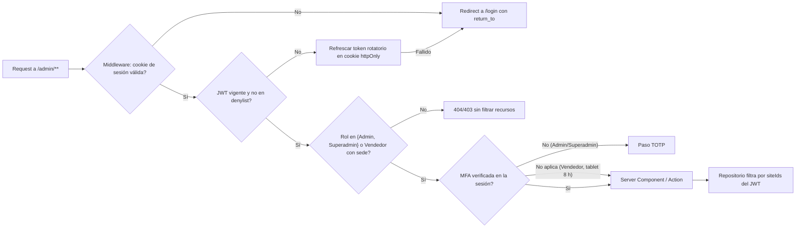

# ADR-005 — Autenticación y sesiones: JWT en cookie httpOnly, refresh rotatorio y RBAC con ámbito de sede

| Campo | Valor |
|---|---|
| **Estado** | Enmendado por `C-04` y `C-05` — pendiente de aprobación del Comandante y de `forge-sentinel` |
| **Fecha** | 23 de noviembre de 2026 |
| **Decisores** | `forge-architect`, `apex-forge`, `forge-sentinel` |
| **Relacionados** | [decisiones-comandante.md](../decisiones-comandante.md) (C-04, C-05), [ADR-004](./ADR-004-estrategia-datos-prisma.md), [design-doc.md §4.5](../design-doc.md), RF-062, RF-066, RNF-015, RNF-016 |

## Contexto

El sistema atiende a cuatro tipos de usuario con privilegios muy distintos: **Cliente** (sus propios datos), **Vendedor tienda** (una sede), **Admin** (todas las sedes) y **Superadmin** (seguridad y configuración). El panel admin maneja precios, inventario, pedidos, reembolsos y datos personales; un error de autorización podría exponer pedidos de otra sede o permitir un descuento no autorizado.

Además necesitamos: login social (Google), recuperación de contraseña, bloqueo por intentos fallidos, revocación inmediata de sesiones, cumplimiento de OWASP ASVS 2 y protección frente a XSS/CSRF sin degradar la experiencia móvil. El Comandante resolvió en `C-04` y `C-05` las contradicciones de transporte de token, `SameSite`, alcance de MFA y umbrales de rate limiting.

## Decisión

> **Decisión (C-04):** **JWT de acceso de 15 minutos + refresh token rotatorio de 7 días**, ambos en **cookies `httpOnly + Secure + SameSite=Strict`**. En storefront y panel admin el access token viaja **solo en cookie**: no se expone a JavaScript ni en `localStorage` ni como `Bearer`. **`Authorization: Bearer` queda exclusivamente para integraciones servidor a servidor** (webhooks, worker, DIAN) y se documenta así en el contrato. **Excepción documentada:** la cookie de sesión de checkout usa `SameSite=Lax` **únicamente** para el retorno desde Wompi. RBAC con ámbito de sede; **MFA TOTP obligatoria en MVP para Admin y Superadmin**; los **Vendedores usan sesión de tablet de 8 h sin MFA** (MFA para vendedores diferida a Fase 2, `DD-Q12` cerrada por C-04).

| Aspecto | Regla |
|---|---|
| Access token | JWT HS256/RS256, 15 min, claims: `sub`, `role`, `siteIds`, `jti`, `iat`, `exp` |
| Refresh token | Opaco, 7 días, **rotatorio** (se invalida al usarse), guardado en `auth.refresh_tokens` con hash; detección de reutilización → revoca familia completa |
| Almacenamiento | Cookies `httpOnly`, `Secure`, **`SameSite=Strict`**; excepción `SameSite=Lax` solo en la cookie de sesión de checkout para el retorno de Wompi; `Path=/api` para refresh; CSRF por `SameSite` + token en mutaciones sensibles |
| Bearer | **Solo server-to-server**: worker, webhooks salientes e integración DIAN. Nunca en el storefront ni en el panel admin |
| Revocación | Denylist de `jti` en Redis con TTL igual al del token; logout y cambio de rol revocan de inmediato |
| Roles | Cliente, Vendedor tienda, Admin, Superadmin (jerarquía estricta, sin herencia accidental) |
| Ámbito de sede | `siteIds` del JWT **contrastados en la capa de datos**: cada query de pedidos/inventario añade filtro por `site_id`; la UI nunca es la barrera |
| MFA | **Admin y Superadmin: obligatoria en MVP** (TOTP + códigos de recuperación de un solo uso). **Vendedor: sesión de tablet de 8 h sin MFA**; MFA para vendedores en Fase 2 |
| Cuenta break-glass | Una cuenta Superadmin de emergencia en gestor de secretos; su uso dispara una alerta inmediata y auditoría dedicada |
| Login social | Google OAuth vía proveedor; tokens del proveedor nunca se exponen al navegador; el perfil se vincula a `auth.users` |
| Password reset | Token de un solo uso, 30 min, hash en DB; fuerza de contraseña validada |
| Rate limiting (C-05) | **Login: 5 intentos / 15 min por IP + cuenta**, con **backoff exponencial** y **CAPTCHA tras el quinto intento**. **Checkout: 20 peticiones / min por sesión** con `Idempotency-Key` obligatoria. Endpoints admin con límite adicional por usuario y por IP |
| Auditoría | Todo cambio de rol, login administrativo y acceso break-glass escribe `audit_logs` irreversible |

**Protección del panel `/admin/**`:**

**Regla de oro:** cada Server Action y Route Handler **revalida permiso en servidor**. Ocultar un botón en la UI es comodidad, nunca seguridad. Un Vendedor que conozca el número de pedido de otra sede recibe 404 para no revelar existencia.

## Consecuencias

**Positivas**
- Access token corto limita la ventana de exposición; refresh rotatorio detecta robo de sesión.
- Cookies `httpOnly` + `SameSite=Strict` reducen el impacto de XSS y CSRF; la excepción `Lax` está acotada al retorno de Wompi.
- `Bearer` queda confinado a integraciones servidor a servidor: no hay un segundo mecanismo de autenticación contradictorio en el storefront.
- El ámbito de sede se aplica en la capa de datos: un bug en una pantalla no filtra información de otra sede.
- MFA y break-glass auditado cumplen las exigencias de `forge-sentinel` para un panel con reembolsos y PII.
- Umbrales únicos de rate limit (5/15 min, 20 req/min) hacen verificable el requisito y el test.

**Negativas / costos**
- Refresco rotatorio y denylist añaden complejidad y dependencia de Redis en cada request administrativo.
- La sesión de tablet de 8 h para Vendedores amplía la ventana de uso indebido frente a MFA: se mitiga con dispositivo recordado, revocación inmediata y auditoría; MFA se incorpora en Fase 2.
- CAPTCHA añade fricción tras el quinto intento de login; es el coste aceptado frente al bloqueo por fuerza bruta.
- Necesitamos gestión segura de claves de firma JWT con rotación y sin commits de secretos.
- Login social depende de un proveedor externo; se mantiene email+contraseña como vía principal.

**Neutras**
- Los clientes invitados no tienen cuenta: su carrito se asocia a cookie firmada y se fusiona al autenticarse.

## Alternativas

| Alternativa | Por qué se descartó |
|---|---|
| **Sesiones opacas en servidor** (solo cookie + fila en DB) | Más simples de revocar, pero añaden una lectura a PostgreSQL por request; el refresh JWT en cookie da la misma protección XSS con mejor escalado. |
| **JWT en `localStorage`** | Expuesto a XSS; contradice OWASP ASVS 2 y el requisito de protección de PII. |
| **`Authorization: Bearer` en el storefront** | Legible por JavaScript y contradictorio con la justificación XSS de la cookie `httpOnly`; se reserva a integraciones S2S (C-04). |
| **JWT de larga duración sin refresh** | Imposibilita revocación rápida y amplía la ventana de robo. |
| **Auth0 / Clerk / Firebase Auth** | Fuera del stack Digitaldevs, costo mensual y dependencia externa para un sistema de 4 roles; se reevaluaría solo si aparece SSO corporativo. |
| **Basic auth para el admin** | Sin MFA, sin rotación y sin revocación; inaceptable para un panel con reembolsos. |

## Estado

**Enmendado por `C-04` y `C-05`**. Requiere revisión y aprobación explícita de `forge-sentinel` antes de implementar cualquier endpoint administrativo. La decisión de MFA quedó cerrada: Admin/Superadmin en MVP, Vendedores con tablet de 8 h sin MFA; no reaparecerá como pregunta abierta.
