# ADR-006 — Estrategia de despliegue: Vercel para web, contenedor para worker, GitHub Actions y canary

| Campo | Valor |
|---|---|
| **Estado** | Enmendado por `C-09` — pendiente de aprobación del Comandante y de `forge-infra` |
| **Fecha** | 23 de noviembre de 2026 |
| **Decisores** | `forge-architect`, `apex-forge`, `forge-infra` |
| **Relacionados** | [decisiones-comandante.md](../decisiones-comandante.md) (C-09), [ADR-001](./ADR-001-stack-frontend.md), [ADR-002](./ADR-002-estrategia-pagos.md), [ADR-004](./ADR-004-estrategia-datos-prisma.md), [design-doc.md §8](../design-doc.md) |

## Contexto

Tenemos dos procesos desplegables (`apps/web` y `apps/worker`), PostgreSQL con PITR, Redis, Meilisearch y una decena de integraciones externas. El negocio opera dos sedes físicas: si el panel cae, el vendedor necesita un camino de contingencia y la operación debe poder revertir un despliegue en minutos.

Los requisitos no funcionales exigen 99,9% de disponibilidad, RPO ≤ 5 min / RTO ≤ 1 h, rollback rápido, CI en verde y trazabilidad de cada release. El stack Digitaldevs prescribe Git + GitHub, GitHub Actions, Docker, Vercel.

## Decisión

> **Decisión:** desplegar **`apps/web` en Vercel** (con Cloudflare delante) y **`apps/worker` como contenedor Docker en Fly.io/Railway** con IP fija. El pipeline de **GitHub Actions** es la única puerta de entrada a producción; el rollout es **canary por banderas de funcionalidad** con rollback instantáneo de código y PITR para datos.

| Elemento | Elección | Justificación |
|---|---|---|
| Web | Vercel | ISR/PPR gestionada, preview deploys por PR, rollback < 2 min, integración con Next.js 15 |
| Worker | Docker en Fly.io/Railway, IP fija | Jobs BullMQ persistentes; IP fija para whititelist de DIAN/transportadoras; escalado independiente |
| Base de datos | Neon PostgreSQL 16 | **PITR de 7 días** (RPO ≤ 5 min) + **dump frío diario con retención de 30 días** (C-09), pooler, multi-schema, réplica para reportes |
| Caché/colas | Redis gestionado (Upstash o el proveedor del worker) | Latencia sub-ms para idempotencia, denylist JWT y colas |
| Búsqueda | Meilisearch desplegado aparte, reconstruible desde PostgreSQL | Índice derivado: si cae, hay fallback a `pg_trgm` |
| Media | Cloudflare R2 + Image Resizing | Egress sin costo, AVIF/WebP, WAF y CDN en el mismo borde |
| CI/CD | GitHub Actions + Docker | Estándar Digitaldevs; un solo pipeline con gates |
| Observabilidad | Sentry + Vercel Analytics + logs pino + GA4 con Consent Mode | Errores, trazas, Core Web Vitals y negocio en un mismo `requestId` |

**Pipeline (obligatorio, sin excepciones):**

```mermaid
flowchart LR
    PR["PR a trunk"] --> G1["lint + typecheck + Prettier"]
    G1 --> G2["Vitest cobertura ≥70% / core ≥80%"]
    G2 --> G3["Testcontainers: stock, webhooks, IVA"]
    G3 --> G4["Playwright + axe + Lighthouse CI"]
    G4 --> G5["Semgrep + gitleaks + npm audit"]
    G5 --> G6["Docker build del worker"]
    G6 --> REV["LGTM forge-reviewer + forge-sentinel si aplica"]
    REV --> PREVIEW["Preview deploy en Vercel"]
    PREVIEW --> MERGE["Merge a trunk"]
    MERGE --> STAGING["Deploy automático a staging"]
    STAGING --> CANARY["Canary 5% → 25% → 100% con banderas"]
```

**Rollout y banderas:**

| Bandera | Función | Apagado ante incidente |
|---|---|---|
| `checkout_enabled` | Habilita el checkout completo | Vuelve a catálogo solo, sin perder carrito |
| `wompi_enabled` / `epayco_enabled` | Activa pasarela primaria / plan B | Conmuta al otro adaptador sin redeploy |
| `pickup_enabled` | Retiro en tienda | Desactiva esa modalidad, sigue envío a domicilio |
| `pos_enabled` | Registro de venta presencial | Vuelve a proceso manual con conciliación posterior |

**Rollback:**

| Capa | Mecanismo | Objetivo |
|---|---|---|
| Código web | Rollback de deployment en Vercel | < 2 min |
| Worker | Re-despliegue de imagen Docker anterior | < 5 min |
| Funcionalidad | Apagar banderas | Inmediato |
| Base de datos | Migraciones *expand → contract*; nunca destructivas en el mismo release | Código anterior sigue funcionando |
| Datos | PITR de Neon (7 días) + dump frío (30 días) | RPO ≤ 5 min, RTO ≤ 1 h; la ampliación a PITR de 30 días (USD 50–100/mes) es mejora aprobable por el cliente, no bloqueante (C-09) |
| Inventario | Reconciliación desde `inventory_movements` + último conteo físico validado | Corrige desajustes sin borrar auditoría |

**Post-lanzamiento:** monitoreo reforzado 72 h; SLOs de disponibilidad 99,9%, API p95 < 400 ms, checkout success > 97% (excluyendo rechazos del banco), webhook p95 < 60 s, factura p95 < 15 min. Postmortem sin culpables en ≤ 72 h para Sev-1/Sev-2.

## Consecuencias

**Positivas**
- Rollback de código en minutos y apagado de funcionalidad sin redeploy: decisión reversible.
- IP fija del worker resuelve la pregunta abierta sobre proveedores que exigen whititelist, sin mover el monolito.
- Preview deploys permiten validar cada historia con el cliente en el Sprint Review.
- Un solo pipeline con gates automáticos evita "funciona en mi máquina".

**Negativas / costos**
- Dos plataformas de despliegue (Vercel + Fly/Railway) = dos superficies de configuración y dos conjuntos de secretos.
- Los secretos deben sincronizarse de forma segura entre entornos; se usa el gestor de secretos de cada plataforma con rotación.
- Canary con pagos reales requiere coordinación con Wompi y con el negocio para montos de prueba.
- Costo mensual estimado USD 250–470 en régimen inicial (≈ COP 1,0–1,8 M con **TRM de planeación única: COP 4.000/USD**), más variables por transacción. **La TRM es una estimación de diseño y se actualizará con la TRM vigente el día de firma del contrato** (C-09); no coexisten dos cifras sin esta nota.

**Neutras**
- Cloudflare no reemplaza a Vercel: complementa con WAF, bot management y caché de media.

## Alternativas

| Alternativa | Por qué se descartó |
|---|---|
| Todo en Vercel (incluido worker) | Límites de duración de funciones; los jobs de facturación y conciliación necesitan proceso persistente. |
| Todo en AWS/ECS propios | Mayor carga de DevOps para un equipo pequeño; sin preview deploys ni rollback tan rápido. |
| Todo en Docker Compose en un VPS único | No cumple 99,9%, sin PITR gestionado ni rollback instantáneo; punto único de fallo para las dos sedes. |
| Sin canary (deploy directo 100%) | Un bug de stock o de pago afectaría a los dos canales y a las dos sedes simultáneamente. |
| Kubernetes | Complejidad operativa desproporcionada para dos procesos. |

## Estado

**Proposed**. Requiere aprobación de `apex-forge` y validación de costos por `forge-infra` antes de contratar servicios.

> **Pregunta abierta (`DD-Q8` en el Design Doc):** ¿existe restricción contractual de despliegue (AWS obligatorio, región específica, IP fija) que invalide Vercel/Neon? Responde: Cliente + `forge-infra` (S0).
