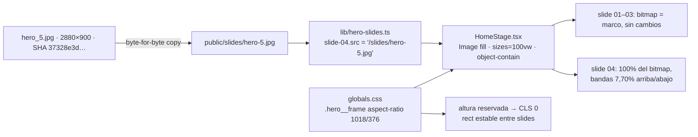

# ADR-HOME-28-01 — Sustituir el slide 04 por `hero_5.jpg` manteniendo la geometría v0.4 (bandas laterales aceptadas solo en ese slide)

| Campo | Valor |
|---|---|
| **Estado** | Aprobado en diseño por `apex-forge` (Comandante) el 27-nov-2026. Autoriza implementación y verificación; **no autoriza commit, push ni deploy**. La enmienda v0.6 del cliente (§12) fue **aprobada por el cliente**; no modifica este estado. |
| **Fecha** | 27 de noviembre de 2026 |
| **Autor / Decisor** | `forge-architect` (diseño) / `apex-forge` (Comandante) |
| **Relacionados** | [DD-HOME-27](../design-doc-slide-full-bleed.md) §13/§14, [ADR-HOME-27-01](./ADR-HOME-27-01.md), [decisiones-comandante.md](../decisiones-comandante.md) C-HOME-27 / QA-EXC-27-01 |
| **Tipo** | Enmienda **aditiva**: no reescribe los docs anteriores; solo añade este ADR, una §15 al DD, una §4j al log y notas de alcance |

**Resumen ejecutivo.** El cliente pidió «cambies la imagen hero_4 por hero_5» y confirmó tres cosas: `hero_5.jpg` se usa tal cual (JPEG, 2880×900, 412712 bytes) copiado byte-for-byte a `public/slides/hero-5.jpg`; se reemplaza el slide 04 manteniendo **4 slides** con id `slide-04`; y el texto/marca incrustado está aprobado para publicación, lo que levanta el veto de `forge-sentinel` **solo para ese slide**. El problema técnico es que el asset nuevo es 3,2:1 y el marco aprobado en v0.4 es 1018/376 ≈ 2,707:1. Se elige **mantener el marco y `object-contain` sin cambios**: el slide 04 deja ~15,4 % de la altura del marco en bandas blancas (≈41 px arriba y abajo a 1440), pero no se recorta ni un píxel del contenido aprobado, los otros tres slides quedan idénticos y el CLS sigue siendo 0. El OCR del JPEG muestra texto que empieza en `x=0` («SOLO POR HOY») y llega hasta `x≈2505`, así que cualquier `object-cover` recortaría texto aprobado. Esa es la razón decisiva: **correctitud del contenido aprobada > ausencia de bandas**.

## 1. Contexto y problema

El estado vigente es DD-HOME-27 v0.4: `.hero__frame { width:100%; aspect-ratio:1018 / 376; height:auto; overflow:hidden; }` (`app/globals.css:104-110`) con `<Image … fill sizes="100vw" className="object-contain">` (`components/HomeStage.tsx:133-142`). Esa proporción era la de los cuatro PNG del cliente y garantizaba simultaneously ancho completo, 100 % del bitmap visible, sin bandas ni recorte y altura reservada antes de cargar (CLS 0).

`hero_5.jpg` rompe esa premisa para **una** de las cuatro entradas:

| Asset | Proporción | Dimensión | Destino |
|---|---:|---|---|
| `hero_1.png` … `hero_3.png` | 2,707:1 | 1018×376 | sin cambios |
| `hero_4.png` (saliente) | 2,707:1 | 1018×376 | se conserva para rollback |
| `hero_5.jpg` (entrante) | **3,2:1** | **2880×900** | `public/slides/hero-5.jpg`, byte-for-byte |

- SHA-256 verificado en disco: `37328e3d6df4fa7edf1e1d42efa5b339b01088d1802a57982adc8e1ea2e73eff` (412712 bytes). `public/slides/hero-5.jpg` **no existe todavía**: hay que copiarlo y reverificar el hash.
- OCR del JPEG (`tesseract`): «SOLO POR HOY» con caja en `x=0…1998`, «BIO-PASTA PREPARADORA» en `x≈2238…2508`, «PASTA ACIDA BIOACTIVA»/`«xfoliacion Inteligente»`/`«Reparación de Barrera»` en `x≈2240…2505`. Hay contenido textual aprobado **en ambos bordes**; el margen derecho libre es de ~362 px (12,6 %), insuficiente para un recorte del 15,4 % (≈222 px por lado).

Con el marco actual, `object-contain` escala `hero_5.jpg` a `W × 0,3125W` dentro de un marco de `W × 0,36935W`: sobran `0,05685W` de altura, es decir **7,70 % arriba y 7,70 % abajo** del marco. Con `object-cover`, en cambio, se dibuja `1,1819W` de ancho y se recorta **15,39 % del bitmap (≈222 px por lado)**. No existe una opción que simultáneamente llene el marco, no recorte y no toque la geometría de los otros tres slides.

## 2. No-objetivos

- No recodificar, convertir a PNG, redimensionar ni re-encodear `hero_5.jpg`; no generar derivados.
- No cambiar el número de slides (4) ni el id (`slide-04`), ni el orden, ni el autoplay de 5 s, ni las pausas, ni `prefers-reduced-motion`, ni el skip link, ni el único Client Component.
- No cambiar la proporción global de `.hero__frame`, ni `object-fit`, ni `sizes`, ni `alt=""`, ni introducir `object-position` por slide.
- No añadir campos al manifiesto (`fit`, `ratio`, `source`, etc.): el contrato `{id, src, alt}` y su allowlist de tests se conservan.
- No borrar `hero_4.png` de la raíz ni de `public/slides/`: es el rollback.
- No eliminar ni reescribir C-HOME-27, `QA-EXC-27-01`, §13 ni §14 del DD: esta enmienda es aditiva.
- No levantar el veto de `forge-sentinel` para los slides 01–03. El cliente solo aprobó el contenido de `hero_5`; `hero_3` sigue con claims marcados como bloqueantes en `decisiones-comandante.md:158`.
- No commitear, pushear ni desplegar. Hay trabajo previo sin commitear en `git status`; no se debe arrastrar.

## 3. Requerimientos

**Funcionales**
- F-28-01: el manifiesto expone exactamente **cinco slides** desde la enmienda v0.9 (`C-HOME-28i`): `slide-01`…`slide-03` sin cambios, `slide-04` → `/slides/hero-5.jpg` y el nuevo `slide-05` → `/slides/hero-6.jpg`.
- F-28-05 (v0.9): `hero-6.jpg` (3000×1100, SHA `651966ea…`) se copia byte-for-byte a `public/slides/hero-6.jpg`, sin sustituir al slide 04 ni alterar marco, `object-contain`, centrado ni autoplay.
- F-28-02: `hero_5.jpg` se copia byte-for-byte a `public/slides/hero-5.jpg`; SHA-256 idéntico en origen y destino.
- F-28-03: `hero_4.png` permanece en ambos sitios con su hash histórico (`283bf014…`), sin referencia en el manifiesto.
- F-28-04: el 100 % del bitmap de `hero_5.jpg` sigue visible (sin recorte de texto/marca aprobados).

**No funcionales**
- NF-28-01: CLS < 0,1 y Δ de rect del marco ≤ 1 px al cambiar de slide; la altura se sigue reservando en CSS antes de cargar.
- NF-28-02: sin overflow horizontal; ancho de la banda = `clientWidth`; sin `width:100vw`.
- NF-28-03: `alt=""` se mantiene: el texto incrustado está aprobado para publicación pero no existe copia textual alternativa autorizada para duplicar en el DOM; el H1 y el CTA aprobados permanecen.
- NF-28-04: densidad del nuevo asset = 2,00 px de fuente por px CSS a 1440 (mejora frente a 0,71 de los PNG). `next/image` no hace upsampling: el `w=3840` devuelve como máximo 2880 px para este JPEG.
- NF-28-05: comments y código en inglés; prosa del ADR en español para consistencia con los docs existentes y lectura del cliente.

## 4. Solución propuesta

**Decisión.** No tocar la geometría ni el `object-fit`. El desajuste de proporción se absorbe como **letterbox vertical en el slide 04**, sobre el fondo blanco de `section.hero`. Es el único resultado que conserva a la vez (1) la integridad del contenido que el cliente acaba de aprobar, (2) los otros tres slides píxel a píxel y (3) el contrato de CLS 0 y las 11 geometrías ya verificadas en `BAND_CASES`.

**Por qué gana.** El orden de prioridad de APEX FORGE pone la correctitud por delante de la estética y de la velocidad: recortar `hero_5.jpg` destruiría texto aprobado (evidencia OCR en §1) y cambiaría lo que `forge-sentinel` ha aceptado; cambiar el marco global penalizaría a 3 de cada 4 slides y reescribiría toda la tabla de geometría; un ajuste por slide añade una excepción permanente y contradice Q-27-D (`object-position:center`, sin configuración por slide). La banda blanca es un defecto visual **localizado, medible y reversible**, no una pérdida de contenido ni un riesgo legal. Además la reversión es de dos líneas del manifiesto más dos fixtures, sin tocar CSS ni JSX.

### 4.1 Mapa exacto de cambios (a ejecutar solo tras aprobación; este ADR no los aplica)

| Archivo : líneas | Cambio |
|---|---|
| Raíz `hero_5.jpg` → `public/slides/hero-5.jpg` | Copia byte-for-byte; verificar `sha256sum` en ambos. No borrar `hero_4.png`. |
| `lib/hero-slides.ts:1-5` | Añadir una línea de comentario citando `ADR-HOME-28-01` (motivo del `.jpg` y de las bandas). |
| `lib/hero-slides.ts:13` | En el union de `src`: `'/slides/hero-4.png'` → `'/slides/hero-5.jpg'`. |
| `lib/hero-slides.ts:21` | Manifest: `{ id: 'slide-04', src: '/slides/hero-5.jpg', alt: '' }`. El id y `alt` no cambian. |
| `lib/hero-slides.ts:29-31` | **Sin cambios**: `isLocalSlidePath` ya acepta rutas `.jpg` locales (`/slides/…` sin `://` ni `/Imagenes/`). |
| `components/HomeStage.tsx:122-124` | Solo actualizar el comentario: el ratio del marco es el de los PNG 01–03; el slide 04 (3,2:1) hace letterbox por diseño, sin recorte, CLS 0. **Sin cambio de JSX ni de props** (`src`, `fill`, `sizes`, `priority`, `loading`, `decoding`, `object-contain` intactos). |
| `app/globals.css:102-103` | Solo actualizar el comentario: «ratio matches the PNG bitmaps; `hero-5.jpg` is wider and letterboxes by design (ADR-HOME-28-01)». **Sin cambio de valores** en `:104-110`. No añadir `background-color` ni `object-position`. |
| `tests/unit/hero-slides.test.ts:10` | Comentario: añadir referencia a `ADR-HOME-28-01`. |
| `tests/unit/hero-slides.test.ts:30-35` | Entrada `slide-04`: `source:'hero_5.jpg'`, `destination:'public/slides/hero-5.jpg'`, `sha256:'37328e3d6df4fa7edf1e1d42efa5b339b01088d1802a57982adc8e1ea2e73eff'`. Las otras tres entradas quedan intactas. |
| `tests/unit/hero-slides.test.ts:61` | Array esperado, 4º elemento → `'/slides/hero-5.jpg'` (`:50` sigue exigiendo longitud 4 y `:51-56` los mismos ids). |
| `tests/unit/hero-slides.test.ts:83` | Añadir `expect(isLocalSlidePath('/slides/hero-5.jpg')).toBe(true)` al caso positivo; el allowlist de campos de `:65-80` **no se toca**. |
| `tests/e2e/home-slide.spec.ts:12-26` | `BAND_CASES` **intacto** (la banda no cambia de altura). |
| `tests/e2e/home-slide.spec.ts:56,73-77` | Comentario + entrada `slide-04` del fixture con el nuevo SHA y rutas. |
| `tests/e2e/home-slide.spec.ts:272-275` | Comentario de source-cap: indicar que el límite es 1018 para los PNG y 2880 para el JPEG, con densidades 0,71 y 2,00 a 1440. |
| `tests/e2e/home-slide.spec.ts:318` | Solo el comentario «frame ratio matches the bitmap» → «matches bitmaps 01–03; slide 04 letterboxes by design». El bucle `:312-323` sigue exigiendo `objectFit === 'contain'` en **los cuatro** slides y el ratio 1018/376: esos aserts son precisamente la decisión adoptada. |
| `tests/e2e/home-slide.spec.ts:783` | Regex → `/^\/slides\/(hero-[1-3]\.png|hero-5\.jpg)$/`. |
| `tests/e2e/home-slide.spec.ts:802` | Exclusión de preload: `'hero-4.png'` → `'hero-5.jpg'`; `:799-801` y `:803-813` intactos (el preload sigue siendo solo hero-1). |
| `tests/e2e/home-slide.spec.ts:1105-1139` | HOME-E2E-54: ramificar el bucle `:1121-1138` por extensión — URL `hero-4.jpg` para `slide===4`, cap `≤2880` y densidad `≈2,00`; `≤1018` y `≈0,71` para 1–3. Actualizar el comentario `:1106-1109`. |
| **Nuevo** HOME-E2E-56 (propuesto; implementación en Fase 3, validada por `forge-qualis`) | Tras `:1139`: a 375/768/1440, navegar a slide 04 y verificar `objectFit==='contain'`, `naturalWidth/naturalHeight≈3,2`, hueco superior e inferior = `(frameH − frameW·900/2880)/2` ±1 px (≈11/22/41 px), 100 % del bitmap visible, rect del marco estable entre 04→01 y CLS <0,1. |
| `docs/02-arquitectura/design-doc-slide-full-bleed.md` (añadir **§15** tras `:559`) | Inventario aditivo de `hero_5.jpg`, tabla de bandas/densidad, y nota de que §13/§14 se conservan como registro con una sola excepción de asset. **No editar** `:26`, `:421`, `:13.4` ni `:14.4`. |
| `docs/02-arquitectura/adr/ADR-HOME-27-01.md` (añadir tras `:8` y al final) | Nota «Enmienda v0.5»: slide 04 pasa a `hero_5.jpg`; geometría v0.4 intacta; veto levantado solo para slide 04. Sin borrar líneas existentes. |
| `docs/02-arquitectura/decisiones-comandante.md` (añadir **§4j** antes de `---` en `:167`, y una fila nueva en `:169-178`) | Registrar C-HOME-28a…d (texto propuesto en §10) y el alcance del levantamiento del veto. No modificar la fila C-HOME-27 ni `QA-EXC-27-01`; añadir una nota de alcance junto a `:159`. |

## 5. Alternativas evaluadas

| # | Alternativa | Pros | Contras | Veredicto |
|---|---|---|---|---|
| A | **Mantener marco 1018/376 + `object-contain` (elegida)** | Cero cambio de geometría, CLS 0, 100 % del contenido aprobado, otros 3 slides idénticos, reversión en 2 líneas | Bandas blancas de ~7,7 % de la altura del marco arriba/abajo **solo en slide 04** (≈41 px a 1440) sobre un bitmap de bordes oscuros | ✅ **Elegida**: el peaje es visual y localizado; cualquier alternativa pierde contenido aprobado o penaliza a los otros slides |
| B | Cambiar globalmente a `object-cover` | La banda se llena; los PNG 01–03 son píxel-idénticos porque su ratio coincide con el marco; un solo `className` | Recorta **15,39 % del bitmap** (≈222 px por lado); OCR muestra «SOLO POR HOY» empezando en `x=0` y texto hasta `x≈2505` → se cortaría texto aprobado; invierte el «sin recorte» de v0.4 y altera lo aprobado por Sentinel | ❌ Rechazada: pérdida de contenido aprobado; corrobora el riesgo R-27-02 que el cliente ya rechazó |
| C | Pasar el marco global a 3,2:1 (`aspect-ratio:16/5`) | Slide 04 exacto, CLS 0 (la altura sigue reservada) | Los slides 01–03 quedan con bandas laterales de ~7,7 % del ancho cada una; reescribe las 11 alturas de `BAND_CASES`, HOME-E2E-34/-42/-43/-54 y la tabla §14.4; penaliza a 3 de 4 slides | ❌ Rechazada: empeora a la mayoría y rompe la estabilidad de tests por un solo asset |
| D | Excepción por slide (`data-slide-id` + CSS `object-fit:cover` solo en 04, o `object-position:left`) | Aísla el cambio al slide nuevo; `object-position:left` evita el texto de la izquierda | Sigue recortando ~222 px; el margen derecho libre es solo ~362 px y puede contener producto/marca no detectado por OCR; añade una excepción permanente y contradice Q-27-D («centro, sin configuración por slide»); exige una nueva aprobación visual del cliente | ❌ Rechazada: mismo problema de contenido (B) más complejidad; se puede reabrir solo con nueva decisión del cliente |
| E | `object-fit:fill` en slide 04 (estirar verticalmente 15 %) | Sin bandas ni recorte; un `className` | Deforma foto y texto aprobados; degrada la nitidez percibida y cambia el aspecto de lo aprobado | ❌ Rechazada: distorsión inaceptable de contenido aprobado |
| F | Cambiar `aspect-ratio` del marco al cambiar de slide (altura natural por asset) | Cada bitmap llena su marco | La altura del marco cambia en cada transición → salto de layout y riesgo de CLS; rompe NF-27-02/28-01 y HOME-E2E-44 | ❌ Rechazada: viola el contrato de CLS 0 que v0.4 garantiza por construcción |

## 6. Riesgos y mitigaciones

| ID | Riesgo | Mitigación |
|---|---|---|
| R-28-01 | Las bandas blancas son visibles sobre un JPEG de bordes oscuros (esquinas medidas `srgb(32,32,32)` … `srgb(174,120,134)`) y el cliente puede percibirlo como un «marco» que prohibió en DD-HOME-24 | Revisión visual obligatoria en preview a 375/768/1440 **antes** de promocionar; métrica HOME-E2E-56. Si el cliente lo rechaza, se abre una decisión nueva: aportar un derivado 1018×376 de `hero_5.jpg` o autorizar recorte/posición por slide. No se decide aquí. |
| R-28-02 | Un futuro `object-cover` accidental recorte el texto aprobado | HOME-E2E-56 verifica `objectFit==='contain'` en los cinco slides y el 100 % del bitmap; `assertSharpBand` ya lo exige. No añadir overrides de `object-position`. |
| R-28-03 | Malinterpretar el levantamiento del veto como autorización global de publicación | Registrar por escrito que el visto bueno cubre **solo** el contenido de `hero-5.jpg` / slide 04. `forge-sentinel` emitió constancia **separada y exclusiva** para el slide 05 (`hero-6.jpg`): mismo copy de producto, sin marca de tercero ni PII. Los slides 01–03 siguen con BLOQUEAR PUBLICACIÓN (`hero_3` claims en `decisiones-comandante.md:158`, marca BellSk en 01/02). Sin release sin ese cierre. |
| R-28-04 | HOME-E2E-54 falla porque asume los cuatro assets ≤1018 px y densidad 0,71 | Ramificar el test por extensión con cap 2880 y densidad 2,00 para slide 04 (§4.1). `forge-qualis` valida. |
| R-28-05 | El checklist histórico de `QA-EXC-27-01:159` sigue marcando `hero_4.png` como bloqueante y confunde el acta de release | Añadir una nota de alcance junto a esa línea; no borrarla. El acta debe citar este ADR. |
| R-28-06 | Se arrastran cambios ajenos del `git status` sin commitear (header, lupa, etc.) | No stagear ni commitear; el implementador toca solo los archivos del mapa §4.1. `forge-reviewer` verifica el diff. |
| R-28-07 | Copia no byte-for-byte o hash desactualizado | `cp` directo + `sha256sum` en origen y destino; fixtures unitarios y E2E con el mismo valor. |

## 7. Estrategia de testing

Owner de la estrategia: `forge-qualis`. Implementación: el ingeniero que construya el cambio, **después** de aprobado este ADR.

- **Unitarias** (`npm run test`): `tests/unit/hero-slides.test.ts` — 4 slides, ids inalterados, `src` con `hero-5.jpg`, `{id,src,alt}` sin campos nuevos, SHA-256 del JPEG en raíz y en `public/slides/`, `/slides/hero-5.jpg` aceptado por `isLocalSlidePath`. Sin caída de coverage.
- **Integración** (`npm run test:integration`): sin cambios funcionales en datos; solo se exige que siga en verde.
- **E2E** (`npm run test:e2e:smoke`, `npm run test:e2e`, `npm run test:e2e:dynamic`, con `retries: 0`): fixture/provenance HOME-E2E-38, regex y preload en `:783-813`, HOME-E2E-54 ramificado y el nuevo HOME-E2E-56 de letterbox/estabilidad. HOME-E2E-34/-42/-43/-44/-55 **no cambian** porque la banda no cambia.
- **A11y** (`npm run test:a11y`): axe 2.2 AA sin critical/serious; `alt=""` y H1/CTA intactos. El texto incrustado sigue fuera del árbol accesible: no se declara conformidad WCAG 1.1.1/1.4.5 para él.
- **Calidad** (`npm run lint`, `npm run typecheck`, `npm run build`, `npm run check:bundle`): 0 errores; Home ≤150.000 B gzip y total ≤300.000 B (el cambio no añade JS ni dependencias).
- **Gates de personas**: `forge-reviewer` LGTM nuevo (el LGTM v0.4 no cubre este asset); `forge-sentinel` debe dejar constancia escrita de que su OK es **solo slide 04**; `forge-qualis` + `forge-infra` GO técnico; `apex-forge` decide sobre commit/deploy. `forge-qualis` añade la comprobación manual a 1440 con barra de scroll clásica.

## 8. Rollout y rollback

**Rollout.** Igual que DD-HOME-27 §8: preview estático → revisión visual del cliente (foco: las bandas del slide 04) → canary si la plataforma lo permite → promoción. Monitorear CLS p75, LCP p75, overflow horizontal y tickets de «foto con franjas». Sin feature flag: es un swap de asset.

**Rollback (trivial, <30 min).** No hay cambios de CSS ni de JSX que revertir: basta volver a `'/slides/hero-4.png'` en `lib/hero-slides.ts:13` y `:21`, restaurar los dos fixtures (SHA y array de rutas) en `tests/unit/hero-slides.test.ts` y `tests/e2e/home-slide.spec.ts`, y reeditar el comentario de `app/globals.css:102-103`. `hero_4.png` sigue en raíz y en `public/slides/` con su hash `283bf014…`; `hero-5.jpg` puede permanecer en `public/slides/` sin efecto mientras no esté en el manifiesto. Sin BD, migraciones ni secretos. **No se ha autorizado commit, push ni deploy para este cambio.**

## 9. Métricas de éxito

| Métrica | Objetivo | Fuente |
|---|---|---|
| Manifiesto | 4 slides, id `slide-04`, `src='/slides/hero-5.jpg'`, campo `alt` vacío | unit + HOME-E2E-38 |
| Proveniencia | SHA-256 `37328e3d…` idéntico en `hero_5.jpg` y `public/slides/hero-5.jpg`; `hero_4.png` conservado | unit + E2E |
| Contenido | 100 % del bitmap visible en slide 04; ningún recorte de texto aprobado | HOME-E2E-56 (OCR de referencia en §1) |
| Banda (slide 04) | Hueco arriba/abajo ≈9/11/17/22/23/26/29/29/41 px a 320/375/600/767/768/820/900/1023/1024/1440 (±1 px) | HOME-E2E-56 |
| Geometría | Banda = `clientWidth`, sin `width:100vw`, sin overflow, rect estable entre slides | HOME-E2E-34/-44/-55 |
| CLS | < 0,1 y Δ rect ≤ 1 px | HOME-E2E-36/-44/-56 |
| Densidad | 2,00 px fuente/px CSS a 1440 para hero-5; 0,71 para los PNG (sin upsampling) | HOME-E2E-54 |
| Gobernanza | LGTM nuevo; constancia del alcance del OK de Sentinel; slides 01–03 siguen bloqueados | `decisiones-comandante.md` §4j y §5 |

## 10. Decisiones nuevas a registrar en `decisiones-comandante.md`

Añadir una sección **«4j. Enmienda del slide 04 — DD-HOME-28 (27-nov-2026)»** antes del `---` de la línea 167, con estas filas (texto listo para pegar; `apex-forge` decide si las agrupa):

| ID | Decisión propuesta |
|---|---|
| **C-HOME-28** | **DD-HOME-28 / `ADR-HOME-28-01` APROBADO EN DISEÑO (pendiente de GO del Comandante).** El cliente pidió «cambies la imagen hero_4 por hero_5» y cerró tres decisiones: (1) `hero_5.jpg` tal cual (JPEG, 2880×900, 412712 bytes, SHA-256 `37328e3d…`), copiado byte-for-byte a `public/slides/hero-5.jpg`, sin recodificar ni convertir; (2) se **reemplaza** el slide 04 y el carrusel sigue con **4 slides** e id `slide-04`; (3) el texto/marca incrustado está **aprobado para publicación**, con lo que se levanta el veto de `forge-sentinel` **únicamente sobre el slide 04**. Se conserva `hero_4.png` en raíz y en `public/slides/` para rollback. **Sin autorización para commitear, pushear ni desplegar.** |
| **C-HOME-28a** | **Geometría: no se toca.** Se mantiene `.hero__frame { aspect-ratio:1018/376; height:auto }` y `object-contain` global. El asset nuevo es 3,2:1, por lo que el slide 04 deja ~15,39 % de la altura del marco en bandas (7,70 % arriba y 7,70 % abajo; ≈41 px a 1440, ≈11 px a 375). Se **aceptan esas bandas** como peaje localizado. Se rechazan `object-cover` global (recortaría 15,39 % del bitmap y, según OCR, el texto «SOLO POR HOY» que empieza en `x=0`), el cambio de ratio global (pillarbox en los otros tres slides y reescritura de 11 geometrías) y las excepciones por slide (Q-27-D). Sin recorte, sin `object-position` por slide, CLS 0. |
| **C-HOME-28b** | **Alcance legal: solo slide 04.** El OK del cliente cubre el contenido de `hero_5.jpg`; no modifica `QA-EXC-27-01` para 01–03 ni retira los claims bloqueantes de `hero_3` (`decisiones-comandante.md:158`). La publicación sigue condicionada a que `forge-sentinel` + contenido/legal cierren los slides 01–03. Se añade una nota de alcance junto al checklist histórico de `hero_4.png:159` sin borrarlo. |
| **C-HOME-28c** | **Tests.** Actualizar SHA-256 y rutas en `tests/unit/hero-slides.test.ts:30-35,61,83` y `tests/e2e/home-slide.spec.ts:56,73-77,783,802`; ramificar HOME-E2E-54 para cap 2880 / densidad 2,00 en slide 04; añadir HOME-E2E-56 de letterbox y estabilidad del rect. `BAND_CASES`, `assertSharpBand`, HOME-E2E-34/-42/-43/-44/-55 quedan intactos. Revisión visual obligatoria en preview a 375/768/1440. |
| **C-HOME-28d** | **Rollback y gobernanza.** Revertir es cambiar dos líneas del manifiesto y sus fixtures; los PNG/JPG aditivos pueden permanecer. `ADR-HOME-28-01`, la nueva §15 del DD-HOME-27 y esta sección son adiciones: no se reescriben C-HOME-27, §13, §14 ni `ADR-HOME-27-01`. Requiere LGTM nuevo de `forge-reviewer`; el LGTM v0.4 no cubre este asset. |

Además, añadir una fila nueva en la tabla «5. Estado de firmas» (sin editar la fila DD-HOME-27 existente):

> | **DD-HOME-28 — pendiente** | ⏸ Diseño propuesto por `forge-architect`; ⏸ LGTM de `forge-reviewer`; ⏸ OK de `forge-sentinel` **solo slide 04** (01–03 siguen bloqueados); ⏸ GO de `forge-qualis`/`forge-infra` y autorización de `apex-forge` | Sin commit, push ni deploy. Si el cliente rechaza las bandas, se abre una decisión nueva (derivado 1018×376 o recorte autorizado). |

## 11. Preguntas abiertas

| ID | Pregunta | Quién responde | Bloquea |
|---|---|---|---|
| Q-28-01 | ¿Acepta el cliente las bandas blancas del slide 04 (≈41 px arriba/abajo a 1440) tal como se verán en el preview? | Cliente, tras revisión visual | Rollout, no implementación |
| Q-28-02 | ¿Se levantan también los claims de los slides 01–03, o se mantiene el veto global hasta su propia aprobación? (Este ADR asume lo segundo.) | Cliente + `forge-sentinel` | Publicación |
| Q-28-03 | Si las bandas se rechazan, ¿aporta el cliente un `hero_5` en 1018×376 o autoriza explícitamente un recorte/posición por slide? | Cliente | Diseño de una nueva enmienda |

## 12. Enmienda v0.6 del cliente — asset definitivo

> **Adición, no reescritura.** Durante la implementación el cliente cambió de opinión sobre el archivo del slide 04. Las secciones §1–§11 se conservan como registro cronológico de la decisión original; esta sección las supera donde lo indica expresamente. No se han reencodificado imágenes ni se ha tocado la geometría.

El cliente sustituyó el asset aprobado originalmente por un JPEG nuevo, con guion, y confirmó su uso como **asset definitivo del slide 04**:

| Concepto | Registro original (§1–§11) | Asset definitivo (v0.6) |
|---|---|---|
| Archivo de origen | `hero_5.jpg` | **`hero-5.jpg`** |
| SHA-256 | `37328e3d…` | **`6898831f89303a0cdfc9d96057374cf5d420c62c142384e9b2d615773f660b97`** |
| Dimensión y peso | 2880×900, 412712 bytes | **2880×1000, 2.449.445 bytes** |
| Proporción del bitmap | 3,2:1 | **2,88:1** |
| Fórmula del hueco | `(frameH − frameW · 900/2880)/2` | **`(frameH − frameW · 1000/2880)/2`** |
| Bandas del slide 04 | 15,39 % del bitmap / 7,70 % de la altura por lado | **~3 % de la altura del marco por lado** |
| Hueco arriba/abajo a 1440 | ≈41 px | **≈16 px** |

En v0.6 la copia en `public/slides/hero-5.jpg` era byte-for-byte y el SHA-256 verificado en el origen `hero-5.jpg` y en el destino coincidía con el valor de la tabla. **Registro histórico**: ese archivo ya no está en disco (v0.7 lo sustituye), por lo que el hash `6898831f…` no es verificable hoy.

**Se mantiene la decisión A** de §5: el marco sigue siendo `.hero__frame { aspect-ratio:1018/376; height:auto }` con `object-contain` global, sin `object-position` por slide, sin recorte y con la altura reservada antes de cargar (CLS 0). Solo cambia el bitmap servido en el cuarto elemento del manifiesto, que ahora es 2,88:1 y deja un hueco menor. En consecuencia, los valores históricos **3,2:1, `900/2880`, 15,39 %, 7,70 % y ≈41 px quedan supersedidos** por 2,88:1, `1000/2880`, ~3 % por lado y ≈16 px a 1440. HOME-E2E-54 conserva el cap de 2880 px y la densidad 2,00 a 1440; HOME-E2E-56 mide la nueva proporción y los huecos esperados (~4,4 px a 375, ~8,7 px a 768 y ~16 px a 1440).

**Rollback (estado real verificado el 27-nov-2026):** `hero_4.png` sí está en raíz y en `public/slides/` (SHA `283bf014…`). El `hero_5.jpg` original de 2880×900 **ya no está en disco**; el `hero-5.jpg` actual en raíz es 2880×1100, 2.776.232 bytes, SHA `efbfd27f8c9dee42dab666fdd1148de3932e47a62c67f3e9efe22d1322fcb0ee`, distinto del `hero-5.jpg` de v0.6. Por tanto el rollback a v0.5/v0.6 requiere que el cliente reaporte esos archivos; no se reencodifica nada. No hay autorización para commit, push ni deploy; la enmienda v0.6 fue aprobada por el cliente y sigue pendiente el LGTM de `forge-reviewer` y la constancia de alcance de `forge-sentinel`.

## 13. Enmienda v0.7 del cliente — `SOLO POR HOY` (histórica; v0.8 vigente)

> **Adición, no reescritura.** El cliente volvió a cambiar el asset durante la implementación. Esta sección **supersede la §12** en todo lo que contradiga; §1–§11 y §12 se conservan como registro cronológico. No se han reencodificado imágenes ni se ha tocado la geometría.
>
> **Enmienda v0.8 (27-nov-2026) — asset final vigente.** El cliente pidió expresamente usar el **`hero-5.jpg` que aportó en la raíz**: 2880×1100 (≈2.618:1), 2.776.232 bytes, SHA-256 `efbfd27f8c9dee42dab666fdd1148de3932e47a62c67f3e9efe22d1322fcb0ee`, copiado byte-for-byte a `public/slides/hero-5.jpg`. Supersede el `SOLO POR HOY (2880 x 1200 px).jpg` de esta §13 en todo lo que contradiga (tabla, SHA, ratio y huecos); aquel queda como registro histórico. Con marco 1018/376 y `object-contain` intactos el pillarbox horizontal se reduce a `(frameW − frameH · 2880/1100)/2` ≈ **6 / 12 / 24 px** a 375 / 768 / 1440, sin recorte. HOME-E2E-54/56 y las fixtures unitaria/E2E usan el SHA y el ratio nuevos. Rollback: `hero_4.png` en raíz y `public/slides/` (SHA `283bf014…`). Sin autorización para commit, push ni deploy.

En v0.7 el cliente confirmó como **asset definitivo del slide 04** el archivo `SOLO POR HOY (2880 x 1200 px).jpg`, ahora **supersedido** por la enmienda v0.8 al inicio de esta sección:

| Concepto | v0.6 (§12) | Asset final (v0.7) |
|---|---|---|
| Archivo de origen | `hero-5.jpg` | **`SOLO POR HOY (2880 x 1200 px).jpg`** |
| SHA-256 | `6898831f…` | **`d36949f11cd9a6e4f499edaf1d8f25e6fe705af82eeec9b981ea703541539b07`** |
| Dimensión y peso | 2880×1000, 2.449.445 bytes | **2880×1200, 2.981.703 bytes** |
| Proporción del bitmap | 2,88:1 | **2,4:1** |
| Fórmula del hueco | `(frameH − frameW · 1000/2880)/2` | **`(frameW − frameH · 2880/1200)/2`** |
| Bandas del slide 04 | ~3 % de la altura por lado | **~11 % del ancho del marco por lado** |
| Hueco izquierda/derecha a 1440 | ≈16 px arriba/abajo | **≈82 px izquierda/derecha** |

La copia en `public/slides/hero-5.jpg` es byte-for-byte y el SHA-256 verificado en el origen y en el destino coincide con el valor de la tabla. Las fixtures unitaria y E2E apuntan al nuevo archivo fuente y al hash final.

**Se mantiene la decisión A** de §5: marco `1018/376`, `object-contain` global, sin `object-position` por slide, sin recorte y con altura reservada (CLS 0). Como el bitmap final es *más alto* que el marco, el letterbox pasa a ser **pillarbox horizontal**: el bitmap se escala a la altura del marco y dejan huecos laterales de ≈21 / 43 / 82 px a 375 / 768 / 1440. El 100 % del bitmap sigue visible. HOME-E2E-54 conserva el cap de 2880 px y la densidad 2,00 px por px de banda a 1440; HOME-E2E-56 medía la proporción 2,4:1 y los huecos laterales de v0.7; en v0.8 mide 2880/1100, huecos ≈6/12/24 px a 375/768/1440, `object-position: 50% 50%`, la estabilidad del rect y el CLS.

**Rollback (estado real verificado el 27-nov-2026):** `hero_4.png` está en raíz y en `public/slides/` (SHA `283bf014…`) y permite volver al slide 04 original con dos líneas del manifiesto. En raíz hay además un `hero-5.jpg` de 2880×1100, SHA `efbfd27f…`, que **no** corresponde a los estados v0.5 (2880×900, `37328e3d…`) ni v0.6 (2880×1000, `6898831f…`); esos hashes quedan como registro histórico no verificable hoy. El rollback a v0.7 se hace restaurando el archivo fuente confirmado por el cliente; no se reencodifica nada. No hay autorización para commit, push ni deploy; la enmienda v0.7 fue aprobada por el cliente y siguen pendientes el LGTM de `forge-reviewer` y la constancia de alcance de `forge-sentinel` (solo slide 04; 01–03 siguen bloqueados).

### QA-EXC-28-01 — fiabilidad del smoke con el asset de 3 MB

Con el bitmap de la enmienda v0.7 (2.981.703 bytes), el smoke con 4 workers y caché fría colgaba en `page.goto` y en `image.decode()`: las variantes frías de `next/image` se encolaban y retrasaban el evento `load` más allá de 60 s; aislado el mismo test pasaba en 1,6 s. `forge-qualis` dictaminó dos cambios de infraestructura de test, sin tocar la app ni el asset: (1) `waitForImagesLoaded` en `tests/e2e/home-slide.spec.ts` pone el plazo de 30 s en Node (no en el reloj de la página, que algunos tests pausan); (2) `globalSetup` en `tests/global-setup.ts` calienta una vez las 32 combinaciones de 4 assets × 8 anchos antes de arrancar los workers. Verificado: `npm run test:e2e:smoke` → **92/92** con `retries: 0` tanto en `next dev` como sobre `next build && next start`.
