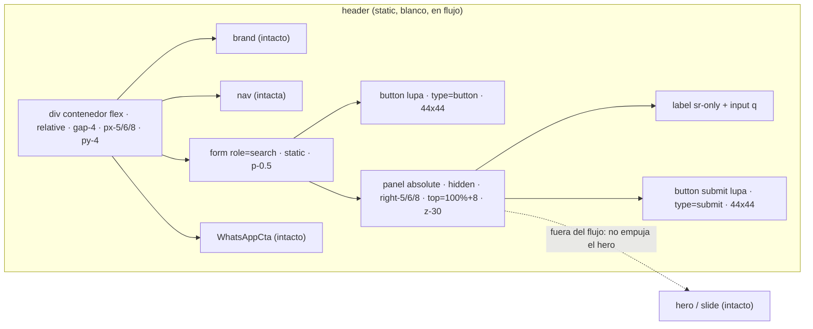
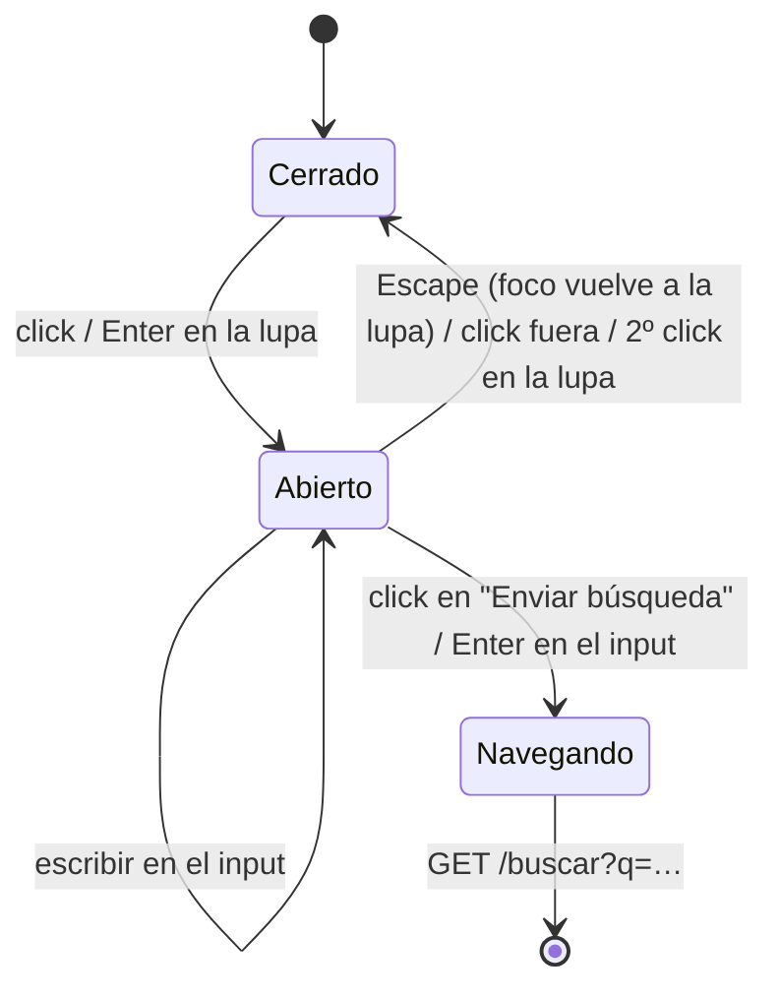

# Design Doc: DD-HOME-25 — Lupa de búsqueda en el header con campo revelable

| Campo | Valor |
|---|---|
| **ID** | **DD-HOME-25**. ID nuevo: `DD-HOME-20`, `-21`, `-22`, `-22.5`, `-23` y `-24` quedan como historia |
| **Autor** | `forge-architect` (Staff Engineer, APEX FORGE) |
| **Estado** | **Approved — C-HOME-09 (27-nov-2026)**. Autoriza código y gates locales. **No** autoriza commit, push ni deploy |
| **Fecha** | 27 de noviembre de 2026 |
| **Decisor final** | `apex-forge` (Comandante). El cliente cerró el «qué» en Fase 0; aquí se decide el «cómo» |
| **Idioma** | Español porque lo lee el cliente (misma excepción justificada de DD-HOME-23/24). Identificadores, tokens, clases y tests en inglés (`AGENTS.md`) |
| **Tipo** | Archivo **nuevo**. No reescribe DD anteriores; la supersesión parcial se registra en §11.1 |
| **Alcance** | `components/SiteHeader.tsx`, nuevo `components/HeaderSearch.tsx`, `app/globals.css` (una sola regla opcional, ver §4.6), `tests/e2e/home.spec.ts` y un guard unitario nuevo. **Sin** nav, logo, WhatsApp, hero, footer, datos, endpoints, env vars, CSP ni CI nuevos |
| **Predecesor** | DD-HOME-21 (chrome blanco y foco `ink`) y DD-HOME-24 (slide claro, header normal en flujo) siguen vigentes salvo lo aquí derogado |

> **Regla de oro:** el diseño se aprueba antes del código. Los fragmentos de TSX/CSS de este documento son **contratos de diseño**, no implementación. Quien construye escribe los tests; `forge-reviewer` da el LGTM; `forge-qualis` da el GO; `apex-forge` autoriza Fase 2 y cualquier publicación. El arquitecto no versiona, no ejecuta tests ni build y no despliega.

---

## 0. Resumen ejecutivo (cliente)

El cliente pidió cambiar el botón verde «Buscar» del header por una **lupa** y que, al seleccionarla, aparezca el texto **«¿Qué estás buscando?»**. La Fase 0 cerró tres decisiones: el formulario **sigue enviando `GET /buscar` sin XHR**, la URL de Nihlo es **solo referencia visual** (no se enlaza ni se cargan recursos de ese dominio) y la lupa es **verde tinta** (`--color-ink`, `#123F33`), no el azul del ejemplo.

La decisión técnica es:

1. **La lupa es un disclosure, no un enlace.** Botón `type="button"` con nombre accesible estable «Buscar», `aria-expanded` y `aria-controls`. Al activarlo se revela un panel flotante con el `<input name="q">`, etiqueta accesible y placeholder exactos «¿Qué estás buscando?».
2. **Panel overlay, no expansión inline.** El panel es `position:absolute`, anclado al contenedor del header, fuera del flujo. El header no cambia de altura al abrir ni al cerrar: **CLS = 0 px** y **overflow horizontal = 0** en los 9 anchos del matrix (375…1440). El `<header>` sigue blanco, opaco y en flujo (DD-HOME-23/24).
3. **El formulario no se toca semánticamente.** Sigue siendo `<form role="search" method="get" action="/buscar">`; dentro del panel hay un segundo control `type="submit"` con nombre accesible **distinto** («Enviar búsqueda») para evitar dos controles con el mismo nombre y no depender de la sumisión implícita.
4. **SVG local, sin dependencias.** Se dibuja un glifo propio con `viewBox="0 0 49.36 45.44"`, `stroke="currentColor"`, 4 unidades de trazo (≈1,95 normalizadas a 24, dentro de la familia documentada), 28 px en desktop y 22 px en móvil, con un área táctil de **44×44 px**. Sin IDs `uuid`, sin `<style>` inyectado, sin `title` duplicado y sin importar `lucide-react`.
5. **Cero superficie nueva.** Sin datos, auth, secretos, analítica ni cambios de CSP. El OK previo de `forge-sentinel` queda reutilizado; su veto sigue vigente si aparece cualquier recurso externo o cambio de `next.config.ts`.

Este documento **no** autoriza commit, push ni despliegue.

---

## 1. Contexto y problema

### 1.1 Pedido del cliente (Fase 0 cerrada)

> «Cambiar el botón verde «Buscar» del header por una lupa, y que al seleccionarla aparezca «¿Qué estás buscando?».»

Referencia visual enviada por el cliente (explícitamente **no destino**):

```html
<a href="#" class="hdicon search-icn" title="Buscar">
  <svg id="uuid-search-icon" viewBox="0 0 49.36 45.44">…</svg>
</a>
```

La referencia aporta tres pistas visuales ——color `#132c45`, 28 px desktop / 22 px móvil y la URL `https://www.nihlo.com.co/collections/ofertas-de-temporada?filter.v.availability=1`— pero las decisiones del cliente las sustituyen: color `ink` de marca, mismo tamaño, y **cero enlaces o recursos a Nihlo**.

### 1.2 Estado verificado en el repositorio (no asumido)

| Hecho | Evidencia (líneas verificadas el 27-nov-2026) |
|---|---|
| El control actual es un `<form role="search" action="/buscar" method="get">` con `order-2 ml-auto … p-1.5 md:order-none md:ml-0`, label `sr-only` «Buscar en la tienda», `<input id="site-search" name="q" type="search" placeholder="Buscar" … md:w-40>` y `<button type="submit" class="rounded-pill bg-primary …">Buscar</button>` | `components/SiteHeader.tsx:70-95` |
| El header es blanco/opaco y sigue en flujo; el contenedor es `flex flex-wrap items-center gap-4 px-5 py-4 md:px-6 lg:px-8`; la nav móvil `order-3 w-full md:order-none md:w-auto` se va a segunda línea por debajo de 768 px | `components/SiteHeader.tsx:25-26,34-68` |
| `WhatsAppCta` `header` va después del form; el render sin BD no lo emite | `components/SiteHeader.tsx:97`; `components/WhatsAppCta.tsx:12-18` |
| Tokens `@theme` y foco global: `--color-ink:#123F33`, `--color-primary:#1B5D4A`, `--color-surface:#F7F5EE`; `:focus-visible { outline:2px solid var(--color-ink); outline-offset:2px }`; `prefers-reduced-motion` neutraliza animaciones | `app/globals.css:14-29,60-63,111-118` |
| CSP es **report-only**, sin `report-uri`, con `form-action 'self'` y sin recursos externos | `next.config.ts:3-22,37` |
| `retries: 0` es política explícita: un test flaky se quarantina, nunca se reintenta hasta verde | `playwright.config.ts:15-20` |
| Home ya prohibe `nihlo.com.co`, `cdn.shopify.com`, `fonts.googleapis.com`, scripts/links externos y hints de preconnect | `tests/e2e/home.spec.ts:117-141,770-788,882` |
| Existen 4 muestreos de foco ligados al control actual y el contrato de búsqueda | `tests/e2e/home.spec.ts:296-306,336-337,514-527,562-590` |
| HOME-E2E-27 muestreó un `button[type="submit"]` verde y espera fondo primary/blanco | `tests/e2e/home.spec.ts:683-684,738-741` |
| HOME-E2E-34 cubre 9 anchos y exige que el hero empiece justo tras el header sin solape ni overflow | `tests/e2e/home-slide.spec.ts:539-632` |
| HOME-E2E-40 exige que **el header no pause el autoplay**; el slide se pausa en hover/foco de controles del slide | `tests/e2e/home-slide.spec.ts:334-360` |
| `lucide-react@1.81.0` está en `node_modules` como **extraneous**: no está en `package.json` ni en `package-lock.json` (`npm ls`/`npm explain` verificados). Importarlo rompería una instalación limpia | `package.json:22-44`; `package-lock.json` (sin entrada `node_modules/lucide-react`) |
| El sistema de diseño describe la familia de iconos como lucide con `stroke-width:1.75–2`, pero esos mismos trazos se reproducen como **SVG inline**, con `aria-hidden` y `aria-label` en el botón | `docs/03-disenos/sistema-diseno.md:212-223` |
| DD-HOME-24 declaró `SiteHeader.tsx` fuera de alcance (N-24-05) | `docs/02-arquitectura/design-doc-home-slide-claro.md:85` |

### 1.3 Problema que se resuelve

El control de búsqueda hoy ocupa demasiado espacio visual en un header blanco compacto: un campo crema ancho más un botón verde con texto «Buscar». El cliente quiere un único gesto visual (lupa) que revele el campo solo cuando se necesite. El reto técnico no es el icono, sino **revelar el campo sin desplazar el hero, sin provocar overflow en 375 px y sin romper el contrato de búsqueda GET ni la accesibilidad**. Una expansión inline ingenua cambiaría la altura del header y el punto de inicio del slide (HOME-E2E-34), por lo que se descarta en §5.

### 1.4 Objetivos medibles

| # | Objetivo | Verificación |
|---|---|---|
| O1 | Lupa de 28/22 px con trazo `ink` y área táctil ≥44×44 | HOME-E2E-45 (§7.3) |
| O2 | Al activarla aparece «¿Qué estás buscando?» como placeholder **y** nombre accesible, con foco automático | HOME-E2E-46 |
| O3 | Cierre con Escape (foco de vuelta a la lupa) y con click fuera; sin trampa de foco | HOME-E2E-47 |
| O4 | CLS 0 y overflow 0 en 9 anchos, con/sin panel abierto | HOME-E2E-48 + HOME-E2E-34 |
| O5 | `GET /buscar?q=shampoo` sin XHR/fetch; sin segundo dominio | HOME-E2E-05 (amend) + HOME-E2E-49 |
| O6 | axe 2.2 AA: 0 críticas/serias abierto y cerrado; anillo de foco ≥3:1 | axe existente + HOME-E2E-50 |
| O7 | Cero recursos externos/Nihlo/IDs uuid/`<style>` en el SVG; CSP intacta | HOME-E2E-49 + guard unitario |
| O8 | Sin dependencias nuevas; presupuesto de bundle intacto | `npm run check:bundle` + `package.json` sin cambios |
| O9 | Reversión completa en <2 min sin BD, env, assets ni CSP | §8.2 |

---

## 2. No-objetivos

| ID | Explícitamente fuera de alcance | Motivo |
|---|---|---|
| N-25-01 | Enlazar a `nihlo.com.co`, copiar su SVG, su CSS, sus IDs `uuid-*` o cualquier recurso remoto | El cliente dijo que es solo referencia visual; HOME-E2E-37/externos lo prohíben |
| N-25-02 | Usar el color `#132c45` del ejemplo o cualquier HEX nuevo en componentes | DD-HOME-08: solo tokens `@theme`; el cliente fijó `--color-ink` |
| N-25-03 | Cambiar logo, wordmark, nav desktop, `<details>` del menú móvil, su orden ni su comportamiento | «No tocar navegación, logo, WhatsApp ni el hero» |
| N-25-04 | Cambiar `WhatsAppCta`, su `href`, `target`, `rel` ni su variante | Fuera del pedido; HOME-E2E-09/10 y HOME-E2E-28 siguen vigentes |
| N-25-05 | Tocar el hero, `.home-stage__viewport`, `.hero__frame`, autoplay, slides ni `HeroCopy` | DD-HOME-24 está aprobado; el header debe seguir sin pausar el slide (D-23-06) |
| N-25-06 | Modificar el `<header>`: fondo blanco, borde `primary` inferior, `data-surface="light"` ni `position`/`z-index` en el propio header | DD-HOME-21/23/24; el overlay se ancla al **contenedor interno**, no al header |
| N-25-07 | Cambiar `role="search"`, `method="get"`, `action="/buscar"`, `name="q"` ni introducir XHR/`fetch`/router push | El cliente cerró el contrato; HOME-E2E-05 lo verifica |
| N-25-08 | Añadir autocompletado, sugerencias, filtros, `aria-live`, búsqueda semántica, analítica o logging del término | RF-MVP-017 literal; sin superficie de datos nueva |
| N-25-09 | Instalar/importar `lucide-react` o cualquier dependencia nueva | Es extraneous; regla de stack y cero dependencias nuevas |
| N-25-10 | Animaciones JS, `IntersectionObserver`, `requestAnimationFrame` ni transiciones nuevas | Cero movimiento; `prefers-reduced-motion` ya global |
| N-25-11 | Cambiar CSP a `enforce`, añadir `report-uri`, endpoints, Prisma, env vars, secretos ni A2/F5 | C-HOME-01 y cerco de Sentinel intactos |
| N-25-12 | Reescribir DD-HOME-20…24 ni borrar decisiones vigentes | Los DD aprobados se conservan como historia (§11.1) |
| N-25-13 | Commits, push, build, ejecución de tests ni despliegue por parte del arquitecto | Requiere autorización expresa de Fase 2 |

---

## 3. Requerimientos y restricciones

### 3.1 Funcionales

| ID | Requisito |
|---|---|
| F-25-01 | El botón verde con texto «Buscar» desaparece del header; lo sustituye un único botón lupa con **nombre accesible estable «Buscar»** |
| F-25-02 | El botón lupa es `type="button"` dentro del `<form role="search">`; lleva `aria-expanded` (`false`/`true`) y `aria-controls="site-search-panel"` |
| F-25-03 | El panel `id="site-search-panel"` existe siempre en el DOM y se oculta con el atributo `hidden` cuando está cerrado (evita referencia colgante en `aria-controls`) |
| F-25-04 | El panel contiene `<label for="site-search" class="sr-only">¿Qué estás buscando?</label>` y `<input id="site-search" name="q" type="search" placeholder="¿Qué estás buscando?">` |
| F-25-05 | El panel contiene un **segundo** control `type="submit"` con icono lupa y nombre accesible **«Enviar búsqueda»**, distinto del de la lupa disparadora |
| F-25-06 | El formulario conserva `action="/buscar"`, `method="get"`, `role="search"`, `name="q"`; no hay `onSubmit` con `preventDefault`, XHR ni `fetch` |
| F-25-07 | Activar la lupa (click o Enter) revela el panel y mueve el foco al input en la misma interacción |
| F-25-08 | Escape cierra el panel y devuelve el foco a la lupa; click/pointerdown fuera del `<form>` cierra sin capturar el evento ni bloquear la navegación destino |
| F-25-09 | Un segundo click en la lupa mientras está abierta **cierra** (coherente con `aria-expanded`); el envío lo hace el submit del panel o Enter en el input |
| F-25-10 | El texto ya escrito se conserva al cerrar/reabrir; no se limpia ni se persiste fuera del DOM |
| F-25-11 | El header, la nav, el logo, WhatsApp y el hero conservan su output actual; solo cambia el subárbol del form y se añade `relative` al contenedor interno del header |

### 3.2 No funcionales

| Ámbito | Contrato |
|---|---|
| **Accesibilidad** | WCAG 2.2 AA. Anillo global `2px solid var(--color-ink)` / offset 2 px; ≥3:1 contra el color adyacente real. `ink` sobre blanco = **11,77:1**; sobre crema `#F7F5EE` = **10,79:1**. `aria-hidden="true"` y `focusable="false"` en ambos SVG; `aria-label` en los botones; axe `button-name`, `aria-allowed-attr` y `aria-hidden-focus` en 0 |
| **Geometría / CLS** | Objetivo **0 px** de delta de altura del header, posición del hero y `scrollWidth` al abrir/cerrar; gate `<0,1` de CLS. Panel `w-[min(280px,calc(100vw-40px))]`; margen ≥20/24/32 px según breakpoint |
| **Tamaños** | Área táctil ≥44×44 CSS px en todos los anchos; glifo 22 px bajo 768 px y 28 px desde 768 px; trazo 4 unidades en `viewBox 49.36×45.44` (≈1,78 px móvil / ≈2,27 px desktop), equivalente a ≈1,95 en un viewBox de 24 |
| **Movimiento** | Sin transición ni animación en v1. Cualquier micro-interacción futura debe ser CSS-only y quedar neutralizada por `app/globals.css:111-118` |
| **Rendimiento** | Isla cliente pequeña (~1–2 KB gzip objetivo); `SiteHeader` sigue siendo Server Component y solo el nuevo `HeaderSearch` lleva `'use client'`. Gates existentes: Home ≤150 KB gzip, total ≤300 KB gzip (`npm run check:bundle`) |
| **Privacidad / seguridad** | El término viaja en la URL GET al mismo origen, igual que hoy. Sin PII nueva, auth, secretos, logging ni analítica. CSP `report-only` sin `report-uri`; `form-action 'self'` satisfecho |
| **Stack** | Next.js 15 App Router / React 19 / TS strict / Tailwind v4 / Playwright + Vitest, ya fijados. **No se evalúa versión mayor**: no se añade ni actualiza tecnología. La desviación de tamaño frente a `sistema-diseno.md:216` (24 px) está impuesta por el cliente y se documenta en §4.4 |
| **Determinismo** | `retries: 0`: los nuevos E2E esperan `data-search-ready="true"` y usan `getByRole`, nunca sleeps |

---

## 4. Solución propuesta

### 4.1 Decisión DD-HOME-25.1 — overlay anclado al contenedor del header, no expansión inline



- El panel es hijo del `<form>` en el DOM (para que el submit siga siendo nativo), pero su bloque contenedor es el **div contenedor del header** porque se le añade una sola clase `relative` en `components/SiteHeader.tsx:26` y el form permanece `static`. El `<header>` mismo **no** recibe `position` ni `z-index`.
- `top-[calc(100%+8px)]`: el borde inferior del contenedor coincide con el borde inferior del header menos 2 px, así que el panel queda **6 px por debajo del header** en los 9 anchos, incluidos los móviles donde la nav ocupa una segunda línea. Anclar al form habría hecho el panel caer **sobre el botón «Menú»** en móvil; por eso se ancla al contenedor.
- `right-5 md:right-6 lg:right-8`: coincide con el padding del contenedor, de modo que el panel nunca cruza el borde del viewport. En móvil, donde el form lleva `ml-auto`, el panel queda alineado con la lupa; en desktop queda alineado con el borde derecho del contenedor (bajo WhatsApp cuando hay número configurado), decisión deliberada para no depender del ancho del CTA.
- `z-30` sobre un panel posicionado; `.home-stage__chrome` y `.home-stage__viewport` siguen sin `overflow:hidden` ni `position` (`app/globals.css:81-93`). La imagen del hero no se reencuadra: la geometría de DD-HOME-24 queda byte-for-byte.
- El puntero sobre el panel pertenece al subárbol del header, no al `<section>` del hero: HOME-E2E-40 (header no pausa el autoplay) sigue siendo válido.

**Por qué gana:** es la única opción que, con un solo estado React, garantiza a la vez CLS 0, overflow 0, foco predecible y contrato GET intacto. Ver §5 para las alternativas rechazadas.

### 4.2 Decisión DD-HOME-25.2 — estado y foco



- `HeaderSearch` es el **único** Client Component nuevo (`'use client'`), con `expanded: boolean`, `useRef<HTMLButtonElement>` para la lupa y `useRef<HTMLInputElement>` para el input. Un `useEffect` enfoca el input cuando `expanded` pasa a `true`; otro registra `keydown` (Escape) y `pointerdown` (fuera) solo mientras está abierto, con cleanup.
- `aria-expanded` y `aria-controls` viven en la lupa; el panel con `hidden={!expanded}` existe siempre para que `aria-controls` nunca apunte a un ID inexistente. **No** se usan `aria-hidden` en el panel ni `display:none` desde una clase que pueda ganar al atributo `hidden`.
- El botón lupa mantiene **un solo nombre accesible** durante todo el ciclo: «Buscar». El submit del panel se llama «Enviar búsqueda». No hay dos controles con el mismo nombre y no se cambia el nombre según el estado (evita el anti-patrón «Abrir»→«Cerrar» que rompería los selectores de los tests).
- Entrar con Tab desde la nav móvil lleva primero a la lupa (el input está `hidden`). Tras abrir, el foco está en el input; Tab siguiente → submit del panel; Tab siguiente → WhatsApp (o fin del header). Sin trampa de foco: el panel no es `role="dialog"`.
- Se añade `data-search-ready="false"` en el HTML servido y se cambia a `"true"` en el primer efecto tras hidratación. Es el único punto de sincronía que necesitan los E2E con `retries: 0` (no `waitForTimeout`).
- Sin JS el panel permanece `hidden`: limitación aceptada y trazada en §6 (R-25-09); el formulario y su `action` siguen presentes en el HTML, pero el gesto de apertura requiere hidratación, igual que el resto de la experiencia del Home.

**Contrato de marcado (diseño, no implementación):**

```tsx
// components/HeaderSearch.tsx — 'use client'
<form data-surface="light" action="/buscar" method="get" role="search"
      data-search-ready={ready}
      className="flex min-w-0 items-center rounded-card border border-primary bg-surface p-0.5">
  <button type="button" aria-label="Buscar"
          aria-expanded={expanded} aria-controls="site-search-panel"
          className="flex h-11 w-11 shrink-0 items-center justify-center rounded-pill text-ink">
    <SearchGlyph className="h-[22px] w-[22px] md:h-7 md:w-7" />
  </button>

  <div id="site-search-panel" hidden={!expanded}
       className="absolute right-5 top-[calc(100%+8px)] z-30 w-[min(280px,calc(100vw-40px))]
                  rounded-card border border-primary bg-surface p-2 shadow-soft md:right-6 lg:right-8">
    <div className="flex items-center gap-2">
      <label htmlFor="site-search" className="sr-only">¿Qué estás buscando?</label>
      <input id="site-search" name="q" type="search"
             placeholder="¿Qué estás buscando?"
             className="w-full min-w-0 rounded-small bg-surface px-3 py-2 text-ink placeholder:text-ink" />
      <button type="submit" aria-label="Enviar búsqueda"
              className="flex h-11 w-11 shrink-0 items-center justify-center rounded-pill text-ink">
        <SearchGlyph className="h-5 w-5" />
      </button>
    </div>
  </div>
</form>
```

Notas de implementación derivadas del contrato:

- El `<label>` va **dentro** del panel, pegado al input; el `placeholder` no sustituye a la etiqueta (SC 3.3.2).
- El `hidden` se pone en el `<div id="site-search-panel">`, nunca en el `div.flex` interno: una clase `flex` en el mismo nodo ganaría al `display:none` del agente de usuario.
- `SiteHeader.tsx` conserva su firma y sus props; importa `HeaderSearch` en el lugar de las líneas 70-95. El resto del archivo (`:1-69`, `:97-100`) no cambia salvo la clase `relative` del contenedor en `:26`.

### 4.3 Decisión DD-HOME-25.3 — accesibilidad

| Elemento | Contrato | Verificación |
|---|---|---|
| Lupa disparadora | `aria-label="Buscar"`, `type="button"`, `aria-expanded`, `aria-controls`, `aria-hidden` **en el SVG**, no `title` (evita tooltip/nombre duplicado del ejemplo) | axe `button-name`; `getByRole('button',{name:'Buscar'})` |
| Submit del panel | `aria-label="Enviar búsqueda"`, `type="submit"`; mismo glifo a 20 px; nombre distinto del disparador | axe `button-name`; consulta por nombre exacto |
| Input | `type="search"`, `name="q"`, `id="site-search"`, label `sr-only` y placeholder «¿Qué estás buscando?» | `getByRole('searchbox',{name:'¿Qué estás buscando?'})` |
| Orden de foco | nav → lupa → (al abrir) input → submit → WhatsApp; Escape devuelve el foco a la lupa | asserts de `toBeFocused()` |
| Anillo de foco | 2 px `ink`, offset 2 px, heredado del global; **sin** override por control | HOME-E2E-19 y HOME-E2E-13 |
| Contraste | `ink` vs blanco 11,77:1; vs crema 10,79:1; anillo ≥3:1 en los tres anchos | cálculo de §3.2 + `sampleFocusRing` |
| axe | 0 critical/serious, abierto y cerrado, a 375/768/1440; reglas dirigidas `button-name`, `aria-allowed-attr`, `aria-hidden-focus` en 0 | `tests/e2e/home.spec.ts:143-198` |

### 4.4 Decisión DD-HOME-25.4 — glifo local, 28/22 px, `currentColor`

**SVG propio (≈15 líneas) gana sobre `lucide-react`:** el paquete aparece como `extraneous` (`npm ls lucide-react` → `lucide-react@1.81.0 extraneous`) y no está en `package-lock.json`; importarlo añadiría una dependencia no declarada que desaparece en `npm ci`. Además, el `Search` de lucide usa `viewBox 0 0 24 24` y no replica la proporción del círculo+mango de la referencia.

```tsx
function SearchGlyph({ className }: { className?: string }) {
  return (
    <svg viewBox="0 0 49.36 45.44" className={className}
         aria-hidden="true" focusable="false" fill="none"
         stroke="currentColor" strokeWidth={4}
         strokeLinecap="round" strokeLinejoin="round">
      <circle cx="19" cy="19" r="15" />
      <path d="M30 30 L46 42" />
    </svg>
  );
}
```

- `viewBox` exacto de la referencia; círculo de radio 15 centrado en (19,19) y mango de (30,30) a (46,42), `linecap="round"`. La trayectoria definitiva se afina contra la captura del cliente **sin salir de esas cotas**; el contrato fija el viewBox, el trazo y el color, no los decimales del path.
- `stroke="currentColor"` y `text-ink` en el botón → `rgb(18, 63, 51)`; `fill="none"` es modo de forma, **no** un color hardcodeado. Cero HEX en el componente.
- Sin `id` (ni `uuid-search-icon`), sin `<style>`, sin `href` externo en `<use>`, sin `title`. `aria-hidden` en el SVG evita que el lector de pantalla anuncie «graphics» además del `aria-label` del botón.
- Tamaños: `h-[22px] w-[22px] md:h-7 md:w-7` en la lupa disparadora; 20 px en el submit del panel. El área clicable es `h-11 w-11` (44 px) aunque el dibujo sea de 22 px.
- **Desviación documentada:** `sistema-diseno.md:216-217` fija 24 px para acciones de cabecera; el cliente fijó 28/22. Se cumple el cliente. El trazo de 4/49,36 normalizado a 24 da ≈1,95, dentro de la familia `1.75–2` de `sistema-diseno.md:214-215`, así que la familia de iconos se conserva aunque la librería no se importe.

### 4.5 Decisión DD-HOME-25.5 — geometría y tabla de anchos

Constantes de layout (CSS actual, verificadas):

- Contenedor: `max-width:1200px`, centrado; padding horizontal 20 px (<768), 24 px (768–1023), 32 px (≥1024); padding vertical 16 px; `gap:16px`; borde inferior del header 2 px.
- Form colapsado: `border 1px×2 + p-0.5 (2px×2) + botón 44px` = **50 px** de alto (no mayor que el form actual, ~54 px). No cambia la altura del header: **≈138 px** en móvil (fila de 50 + gap 16 + `summary` 38 + padding 32 + borde 2) y **≈84 px** en desktop (50 + 32 + 2).
- Panel: alto ≈62 px (`44 + p-2×2 + borde 2`); ancho `min(280, 100vw−40)`; `top = headerBottom + 6 px`; `bottom = headerBottom + 68 px`.
- Contenido del panel a 375 px: `280 − 2 borde − 16 padding − 8 gap − 44 submit` = **210 px** para el input; el placeholder «¿Qué estás buscando?» cabe sin recortarse.

| Ancho | Padding | Borde derecho del contenedor (x) | Ancho del panel | Panel izquierdo (x) | Panel derecho (x) | Margen al borde del viewport | Alto header (aprox.) | Δ alto / Δ hero al abrir | Overflow |
|---:|---:|---:|---:|---:|---:|---:|---:|---:|---:|
| 375 | 20 | 355 | 280 | 75 | 355 | 20 | 138 | 0 px | ≤0 |
| 600 | 20 | 580 | 280 | 300 | 580 | 20 | 138 | 0 px | ≤0 |
| 767 | 20 | 747 | 280 | 467 | 747 | 20 | 138 | 0 px | ≤0 |
| 768 | 24 | 744 | 280 | 464 | 744 | 24 | 84 | 0 px | ≤0 |
| 820 | 24 | 796 | 280 | 516 | 796 | 24 | 84 | 0 px | ≤0 |
| 900 | 24 | 876 | 280 | 596 | 876 | 24 | 84 | 0 px | ≤0 |
| 1023 | 24 | 999 | 280 | 719 | 999 | 24 | 84 | 0 px | ≤0 |
| 1024 | 32 | 992 | 280 | 712 | 992 | 32 | 84 | 0 px | ≤0 |
| 1440 | 32 | 1288 (1200 centrado) | 280 | 1008 | 1288 | 32 | 84 | 0 px | ≤0 |

Notas de la tabla:

- En 1024 px el content box **disminuye** frente a 1023 px (960 vs 975) por el salto de `px-6` a `px-8`; el panel sigue 64 px dentro del viewport, sin overflow.
- El panel se mide con `getBoundingClientRect()` en HOME-E2E-48; se exige `left ≥ 0` y `right ≤ innerWidth`, además de `scrollWidth − innerWidth ≤ 0`.
- El header sigue siendo blanco y opaco; no aparece `backdrop-filter`, `position:fixed`, ni regla `:hover`/`:focus-within` sobre `.home-stage__chrome` (C-HOME-05).

### 4.6 Criterios de aceptación numéricos

| ID | Criterio | Umbral |
|---|---|---|
| AC-01 | Área clicable de la lupa en móvil | `width ≥ 44` y `height ≥ 44` CSS px |
| AC-02 | Glifo renderizado | `22×22` px bajo 768; `28×28` px desde 768 (±0,5) |
| AC-03 | Grosor de trazo renderizado | ≈1,78 px móvil / ≈2,27 px desktop (±0,5); `stroke===currentColor`, `fill==='none'` |
| AC-04 | Color de ambos trazos | `rgb(18, 63, 51)` calculado |
| AC-05 | Panel | `width ≤ 280` y `width ≤ innerWidth−40`; margen derecho ≥20/24/32 |
| AC-06 | CLS de la interacción | `Δ headerHeight = 0`, `Δ heroTop = 0`, `Δ scrollWidth = 0` antes/después de abrir y cerrar |
| AC-07 | Estado ARIA | `aria-expanded` «false»→«true»→«false»; `aria-controls` resuelve a un nodo existente siempre |
| AC-08 | Nombres accesibles | lupa «Buscar», submit «Enviar búsqueda», searchbox «¿Qué estás buscando?»; 0 duplicados |
| AC-09 | Foco | input enfocado tras abrir; Escape devuelve el foco a la lupa; 0 trampas |
| AC-10 | Búsqueda | `method=get`, `action=/buscar`, `name=q`, URL final `/buscar?q=shampoo`, 0 XHR/fetch |
| AC-11 | axe | 0 violaciones critical/serious abierto y cerrado a 375/768/1440; anillo ≥3:1 |
| AC-12 | Recursos | 0 `href`/`src` a dominio externo en el header; 0 apariciones de `nihlo.com.co`, `uuid-`, `<style` dentro del SVG; CSP sin cambios |
| AC-13 | Bundle | Δ JS objetivo ≤2 KB gzip; Home ≤150 KB y total ≤300 KB gzip |
| AC-14 | Dependencias | 0 entradas nuevas en `package.json` / lockfile; `lucide-react` sigue sin importarse |
| AC-15 | Regresión | Suite existente en verde con `retries: 0`; solo los tests listados en §7.2 se amendan |

### 4.7 Seguridad y privacidad

- No hay datos, auth, privilegios ni secretos nuevos. El término de búsqueda viaja en la query string al mismo origen, **exactamente igual que hoy**; no se almacena en `localStorage`, no se envía a analítica y no se registra.
- `form-action 'self'` de `next.config.ts:19` sigue cumpliéndose; no se relaja CSP, no se añade `report-uri`, no se pasa a `enforce` (C-HOME-01).
- El SVG es inline y local: no dispara `img-src`, `connect-src` ni `style-src` adicionales. Aunque CSP es report-only, el diseño sería válido si mañana se enforceara, salvo la excepción documentada `style-src 'unsafe-inline'` que este DD no toca.
- OK previo de `forge-sentinel` para DD-HOME-24 se reutiliza por ausencia de superficie nueva. Su veto se reactiva automáticamente si aparece un recurso externo, un cambio de CSP o cualquier flujo con PII (R-25-08).

### 4.8 Por qué gana esta solución

| Criterio (prioridad APEX) | Solución elegida | Mejor alternativa descartada |
|---|---|---|
| 1. Corrección | Cero CLS y cero overflow medibles en 9 anchos; GET nativo intacto; disclosure con ARIA honesto | Expansión inline: cambia la altura del header y empuja el hero en 375–767 |
| 2. Mantenibilidad | Un estado, un Client Component pequeño, tokens y clases existentes; selector de test estable | Submit único con `preventDefault` condicional: comportamiento «clever» y `aria-expanded` engañoso |
| 3. Rendimiento | Sin dependencias; SVG ~15 líneas; Δ JS ~1–2 KB; hero y header siguen siendo RSC | `lucide-react`: paquete extraneous + nueva dependencia no declarada |
| 4. Velocidad de entrega | Un archivo nuevo + un import + retoques de tests; rollback <2 min | Rehacer el header con `<details>`/JS dual-state: más superficie de axe y más churn de tests |

---

## 5. Alternativas evaluadas

### Alternativa A — Lupa disclosure + panel overlay + submit propio (**GANADORA**)

- **Pros:** CLS 0 por construcción; overflow 0 en los 9 anchos; nombres accesibles distintos; GET nativo; SVG local reversible; formulario semántico intacto.
- **Contras:** un Client Component nuevo (Δ JS pequeño); sin hidratación el panel no se abre; dos lupas visibles mientras el panel está abierto (disparador + submit, con tamaños 22/28 y 20 px para diferenciarlas).
- **Motivo de elección:** cumple O1–O9 con el menor radio de explosión y sin tocar el hero ni la navegación.

### Alternativa B — Expansión inline del input dentro del form (RECHAZADA)

- **Pros:** un solo control visible; no necesita posicionamiento absoluto ni `z-index`; el panel nunca tapa nada.
- **Contras:** en 375 px el form pasa de ~50 px a ~50+210 px; con WhatsApp configurado la primera fila no cabe y el `flex-wrap` añade una línea: el header crece y el hero baja (rompe HOME-E2E-34 y genera CLS real al abrir). Con `ml-auto` y `order-2`, el texto del botón «Menú» también se desplaza. Reservar el ancho siempre para evitar el CLS deja un campo invisible ocupando 210 px en móvil y reintroduce el overflow que el cliente quiere quitar.
- **Motivo de rechazo:** viola O4; es exactamente el riesgo que la Fase 0 pidió evitar.

### Alternativa C — Un único botón lupa `type="submit"` que abre y luego envía con `preventDefault` condicional (RECHAZADA)

- **Pros:** un solo control y un solo nombre accesible; menos nodos; el HOME-E2E-05 apenas cambia.
- **Contras:** `aria-expanded="true"` invita a pulsar de nuevo para cerrar, pero el segundo clic enviaría la búsqueda; comportamiento dependiente de estado sin hidratar; una dirección de interacción difícil de explicar a lector de pantalla y a QA.
- **Motivo de rechazo:** prioridad 1 del equipo es corrección; un disclosure cuyo activador cambia de acción es un anti-patrón.

### Alternativa D — Importar `Search` de `lucide-react` (RECHAZADA)

- **Pros:** coincide con `sistema-diseno.md:214` y evita mantener un path propio.
- **Contras:** `lucide-react@1.81.0` está **extraneous**: no está declarado en `package.json` ni bloqueado en `package-lock.json`; `npm ci` en limpio lo eliminaría y el build fallaría. Añadirlo como dependencia contradice N-25-09 y su `viewBox 24` no replica el trazo de la referencia (28/22 px pedidos).
- **Motivo de rechazo:** dependencia no declarada + deriva visual; el SVG inline está expresamente permitido por el propio sistema de diseño.

### Alternativa E — Copiar el `<a href="https://www.nihlo.com.co/…">` y su SVG con IDs `uuid-*` (RECHAZADA)

- **Pros:** réplica pixel-perfect inmediata del screenshot.
- **Contras:** enlace a otro dominio, posibles peticiones externas, IDs globales colisionables, `<style>` inyectado y color `#132c45` fuera de tokens. Rompe HOME-E2E-37, `form-action`/CSP y la decisión explícita del cliente.
- **Motivo de rechazo:** la referencia fue entregada como inspiración visual, no como destino; es un bloqueante de Sentinel.

### Alternativa F — Revelar el input con CSS `:hover`/`:focus-within` sobre `.home-stage__chrome` (RECHAZADA)

- **Pros:** cero JS y cero estado React.
- **Contras:** C-HOME-05 retiró precisamente esas reglas porque generaban revelados fantasma y acoplaban el chrome al hero; `:hover` es inalcanzable en teclado/táctil, `:focus-within` abre al tabular sin intención y no ofrece cierre con Escape; no permite `aria-expanded` fiable.
- **Motivo de rechazo:** regresión directa de DD-HOME-23/24 y de la accesibilidad.

---

## 6. Riesgos y mitigaciones

| ID | Riesgo | Mitigación | Owner |
|---|---|---|---|
| R-25-01 | El panel cae sobre el botón «Menú» en 375–767 px | Anclar a `top-[calc(100%+8px)]` del **contenedor**, no del form; HOME-E2E-48 verifica `panelTop ≥ headerBottom` y no solape con `nav details summary` | `forge-frontend` + `forge-qualis` |
| R-25-02 | Overflow horizontal al abrir en 375 px | `w-[min(280px,calc(100vw-40px))]` + `right-5/6/8`; tabla §4.5 y asserts de `left/right/scrollWidth` en 9 anchos | `forge-frontend` |
| R-25-03 | Clase `flex` sobre el nodo con `hidden` anula el ocultamiento | `hidden` va en el `<div id="site-search-panel">`; el `flex` va en un hijo; HOME-E2E-46 comprueba `toBeHidden()` inicial | `forge-reviewer` |
| R-25-04 | Dos controles con el mismo nombre accesible | Nombres fijos «Buscar» / «Enviar búsqueda»; assert de `getByRole(...).toHaveCount(1)` por nombre exacto | `forge-frontend` + `forge-qualis` |
| R-25-05 | Foco perdido al abrir o al cerrar con Escape | `useEffect` de foco + `keydown` con `focus()` a la lupa; `toBeFocused()` en HOME-E2E-46/47 | `forge-frontend` |
| R-25-06 | El listener de click fuera captura el submit o la navegación del CTA | Usar `pointerdown`, comprobar `formRef.current.contains(target)` y **no** llamar `preventDefault` | `forge-frontend` |
| R-25-07 | El panel tapa el hero y el hover del slide pausa el autoplay | Panel dentro del subtree del header con `z-30`; HOME-E2E-40 queda en verde y HOME-E2E-48 no mide el slide como hover objetivo | `forge-qualis` |
| R-25-08 | Deriva a recursos externos o a CSP enforce | Guard unitario de source + HOME-E2E-49 (HTML, requests y headers); `next.config.ts` queda sin diff; Sentinel conserva veto | `forge-sentinel` + `forge-infra` |
| R-25-09 | Sin hidratación no se puede abrir el campo | Limitación aceptada: el form y su action siguen en HTML; se documenta en UAT. Si el Comandante la rechaza, se evaluará `@media (scripting:none)` en un DD nuevo, nunca un `<script>` inline | `apex-forge` (decisión de producto) |
| R-25-10 | Contraste del anillo sobre el panel crema | `data-surface="light"` en form y panel; anillo `ink` heredado; `sampleFocusRing` ampliado al submit | `forge-qualis` |
| R-25-11 | El trazo final no coincide con la captura del cliente | Cotas rígidas (viewBox, centro, radio, mango, stroke, currentColor); ajustar solo el `path` en Fase 3 y validar con screenshots de UAT | `forge-frontend` + cliente |
| R-25-12 | Flakiness con `retries: 0` | Esperar `data-search-ready="true"`, usar `getByRole`, sin `waitForTimeout`; cualquier flaky se quarantina con owner y fecha, nunca se reintenta | `forge-qualis` |
| R-25-13 | Bundle sobre presupuesto por la isla cliente | Un solo Client Component; `npm run check:bundle` como gate; si Δ >2 KB gzip se revisa antes de merge | `forge-infra` |
| R-25-14 | Confusión por dos lupas visibles al abrir | Diferenciar tamaño (22/28 vs 20) y nombre accesible; capturas de UAT abierto/cerrado; si el cliente lo rechaza, alternativa C se reevalúa con DD nuevo | `apex-forge` + cliente |

---

## 7. Estrategia de testing

### 7.1 Unit / integración

- **Guard unitario nuevo (requerido):** `tests/unit/header-search-guard.test.ts`, estilo `brand-logo.test.ts:1-14` (lectura de fuente con `node:fs`). Lee `components/HeaderSearch.tsx` y `components/SiteHeader.tsx` y falla si aparece `lucide-react`, `nihlo`, `uuid-`, `https://`, `dangerouslySetInnerHTML` o `<style`; verifica además los literales `action="/buscar"`, `method="get"`, `role="search"`, `name="q"`, `aria-label="Buscar"` y `aria-label="Enviar búsqueda"`. Es complemento del E2E, no sustituto.
- **Sin cambios en integration:** `tests/integration/home-content.integration.test.ts` no toca el header; no hay endpoint ni dato nuevo. El stub `/buscar` ya existe y devuelve 200 (`tests/e2e/home.spec.ts:31`).
- Cobertura Vitest (`vitest.config.ts:10-31`) sigue midiendo solo `lib/**`: este DD no añade lógica allí, así que los umbrales 70/90/85 no se tocan.

### 7.2 E2E existentes a modificar (enmendar, nunca borrar ID ni tag)

| Test | Ubicación | Cambio exacto |
|---|---|---|
| Focus smoke (sin ID propio) | `tests/e2e/home.spec.ts:296-306` | `getByRole('searchbox',{name:'Buscar en la tienda'})` → `getByRole('button',{name:'Buscar'})` para el Tab desde `summary`; luego abrir y comprobar el searchbox con el nuevo nombre. Conservar los asserts de `outline-color rgb(18,63,51)` y `outline-width 2px` |
| HOME-E2E-13 | `tests/e2e/home.spec.ts:321-422` (searchbox en `:336`, `chromeControls` en `:391`) | Actualizar el nombre del searchbox a «¿Qué estás buscando?»; el barrido de `header a/summary/input/button` ahora incluye el submit «Enviar búsqueda» cuando el panel está abierto. Mantener `goldOnLight`, el check champagne→ink y el ID |
| HOME-E2E-19 | `tests/e2e/home.spec.ts:505-544` (searchbox `:514`, `searchButton` `:515`, samples `:526-527`) | Mantener las muestras de summary/nav link y de la lupa; sustituir la muestra del input ahora oculto por la del input **abierto**; ampliar con el submit del panel abierto. Seguir exigiendo `outlineWidth ≥2` y `contrastRatio ≥3` a 375/768/1440 |
| HOME-E2E-05 | `tests/e2e/home.spec.ts:562-590` | Abrir la lupa antes de `fill`; searchbox por nombre «¿Qué estás buscando?»; `form.getByRole('button',{name:'Enviar búsqueda'}).click()` (o `searchbox.press('Enter')` en un segundo caso). Mantener `method=get`, `action=/buscar`, `waitForURL(/\/buscar\?q=shampoo$/)`, `q=shampoo` y `xhr=[]` **sin cambios**. El tracker de XHR/fetch de `:564-575` queda intacto |
| HOME-E2E-27 | `tests/e2e/home.spec.ts:628-768` (submit en `:683-684` y `:738-741`) | **Debe actualizarse:** `header.querySelector('button[type="submit"]')` ya no existe en el header cerrado. Muestrear el nuevo control `header button[aria-label="Buscar"]` y assert `backgroundColor === 'rgba(0, 0, 0, 0)'`, `color === 'rgb(18, 63, 51)'`, `width/height === 44px`; con el panel abierto, assert lo mismo para `button[aria-label="Enviar búsqueda"]`. Mantener blanco, borde primary 2 px, textos ink, sin dorado como texto y overflow 375 ≤0 |
| axe 2.2 AA | `tests/e2e/home.spec.ts:143-198` | Sin cambio de expects; ejecutar la misma suite **dos veces por ancho**: cerrado y con `data-search-ready="true"` + lupa abierta. 0 critical/serious y 0 en `button-name`/`aria-allowed-attr`/`aria-hidden-focus` |
| HOME-E2E-34 | `tests/e2e/home-slide.spec.ts:539-632` | Sin cambios de expects: 9 anchos, `heroTop ≈ headerBottom`, `frameSide`, overflow 0. Es la guarda independiente de que el overlay no desplaza el slide |
| HOME-E2E-40 | `tests/e2e/home-slide.spec.ts:334-360` | Sin cambios: el header (abierto o cerrado) no pausa el autoplay |
| HOME-E2E-37 / externos | `tests/e2e/home.spec.ts:117-141,770-788,882` | Sin cambios: ningún `nihlo.com.co`, ningún script/link externo, Poppins self-hosted |
| HOME-E2E-26 / -24 / -01 / -02 | `home-brand.spec.ts`, `home-highlights.spec.ts`, `home.spec.ts` | Sin cambios: logo, H1, landmarks y axe general |

### 7.3 E2E nuevos (ID libre: -45 en adelante)

Todos en `tests/e2e/home.spec.ts`, con `@smoke` salvo el de axe (`@a11y`), esperando `data-search-ready="true"`.

| ID | Nombre / tag | Asserts principales |
|---|---|---|
| **HOME-E2E-45** | «lupa replaces the green Buscar button and keeps a 44px target» `@smoke` | `getByRole('button',{name:'Buscar'}).toHaveCount(1)`; 0 botones con texto «Buscar»; `boundingBox.width/height ≥44` a 375/768/1440; SVG `viewBox="0 0 49.36 45.44"`, `stroke=currentColor`, `fill=none`, sin `id`, sin `<style>`, sin `title`; `getComputedStyle(svg).stroke === 'rgb(18, 63, 51)'`; `width` 22/28 según ancho; `aria-expanded="false"` inicial; panel `toBeHidden()` |
| **HOME-E2E-46** | «selecting the magnifier reveals the accessible search field and moves focus» `@smoke` | Click lupa → `aria-expanded="true"`, panel `toBeVisible()`, `getByRole('searchbox',{name:'¿Qué estás buscando?'}).toHaveAttribute('placeholder','¿Qué estás buscando?')`, `toBeFocused()`, label `sr-only` con el mismo texto, `aria-controls` resuelve al panel; submit «Enviar búsqueda» existe una sola vez; 2º click en la lupa cierra y `aria-expanded="false"` |
| **HOME-E2E-47** | «Escape and outside click close the panel without a focus trap» `@smoke` | Abrir → `Escape` → panel hidden y lupa `toBeFocused()`; abrir → `click` en `h1` → panel hidden sin navegar; Tab desde el submit sale del form hacia el CTA de WhatsApp cuando existe, sin volver al input |
| **HOME-E2E-48** | «reveal causes no CLS, no overlap and no overflow at 9 widths» `@smoke` | Para `[375,600,767,768,820,900,1023,1024,1440]`: medir `headerHeight`, `heroTop`, `document.scrollWidth`, rect del panel, rect de `nav details summary`; abrir y repetir; exigir Δ=0 en header/hero/scrollWidth, `panelTop ≥ headerBottom`, sin intersección con `summary`, `panel.left ≥0`, `panel.right ≤ innerWidth`, `panel.width ≤280` y `panel.width ≤ innerWidth−40` |
| **HOME-E2E-49** | «GET search stays same-origin: no XHR, no Nihlo, no external resources» `@smoke` | Abrir, rellenar `shampoo`, click en «Enviar búsqueda»; `waitForURL(/\/buscar\?q=shampoo$/)`; capturar todos los `request` y `response`: hosts externos prohibidos (`nihlo.com.co`, `cdn.shopify.com`, `fonts.googleapis.com`, `fonts.gstatic.com`), 0 xhr/fetch no-`/_next`; HTML sin `nihlo.com.co` ni `uuid-`; `Content-Security-Policy-Report-Only` presente con `form-action 'self'`, sin `Content-Security-Policy` enforce. NOTA: HOME-E2E-05 sigue siendo la guarda canónica del GET; -49 cubre solo la superficie nueva |
| **HOME-E2E-50** | «axe 2.2 AA with the search panel open» `@a11y` | Misma inyección de `axeSource` que `home.spec.ts:19,147-195`, a 375/768/1440 con el panel abierto: 0 critical/serious y 0 en las tres reglas dirigidas |

### 7.4 Gates de cierre

`npm run typecheck`, `npm run lint`, `npm run test` (incluye el guard unitario), `npm run test:e2e` (`@smoke` + `@a11y`), `npm run test:e2e:dynamic` (WhatsApp con config sembrada), `npm run check:bundle`. Todo en verde con `retries: 0`.

**Ownership:** `forge-frontend` construye y prueba; `forge-qualis` valida cobertura, axe, matriz de 9 anchos y GO; `forge-reviewer` da el LGTM obligatorio; `forge-sentinel` reutiliza OK y conserva veto por CSP/recursos; `forge-infra` verifica CI y bundle; `apex-forge` autoriza Fase 2 y la promoción. **El arquitecto no ejecuta tests ni build en esta fase.**

---

## 8. Rollout y rollback

### 8.1 Rollout

- Fase 2 solo tras acknowledging explícito del Comandante. Commits pequeños sobre `main`: (1) guard unitario + `HeaderSearch` nuevo, (2) sustitución en `SiteHeader` + `relative` del contenedor, (3) amend de tests existentes, (4) nuevos HOME-E2E-45…50. CI en verde en cada paso; sin ramas largas.
- Sin canary propio: el cambio viaja con la siguiente promoción ya aprobada, con Deployment Protection y `noindex` vigentes (A2). F5 no se modifica.
- `forge-infra` registra el ID del deployment anterior en el acta antes del Go/No-Go (el último ID documentado en el repo es `CLqk5ZKNjuDNVGdMyp9FqTjH6QuW`, estado previo a C-HOME-08; infra debe capturar el ID **vigente**).
- **Este DD no autoriza commit, push, build, ejecución de tests ni deploy.**

### 8.2 Rollback (<2 min, decidido)

| Trigger | Acción |
|---|---|
| Regresión visual en UAT, solape con el menú móvil, overflow o CLS >0 | Revertir los commits del DD; el header vuelve al form green «Buscar» de `SiteHeader.tsx:70-95` |
| axe critical/serious, foco <3:1 o nombre accesible duplicado | `git revert` de los 4 commits + CI verde + promoción del ID anterior |
| Cualquier petición externa, cambio de CSP o PII nueva | Revert inmediato y aviso a `forge-sentinel`; no se intenta hotfix en producción |

No hay BD, migración, env var, asset, hash de logo, `next.config.ts` ni `globals.css` que revertir salvo, en su caso, la regla opcional de §4.6. HOME-E2E-05/27/34 y el axe vuelven a su estado aprobado. A2, F5 y C-HOME-01 nunca se reabren por el rollback.

### 8.3 Monitoreo

CI con los gates de §7.4; screenshots UAT abierto/cerrado a 375/768/1440; axe en 6 estados (3 anchos × abierto/cerrado); tabla de geometría §4.5. En producción, tras A2, solo el monitoreo PII-free existente: **no se añade analítica ni logging del término buscado**.

---

## 9. Métricas de éxito

| Métrica | Target |
|---|---|
| Presencia visual | 1 lupa `ink` en el header; 0 botones verdes con texto «Buscar»; 44×44 de target; 22/28 px de glifo |
| Revelación | Placeholder y nombre accesible exactos «¿Qué estás buscando?»; foco en el input en el mismo evento; `aria-expanded` consistente |
| Geometría | Δ header/hero/scrollWidth = 0 px al abrir en 9 anchos; overflow ≤0; panel dentro del viewport |
| Búsqueda | 100% de los envíos son `GET /buscar?q=…` a mismo origen; 0 XHR/fetch; HOME-E2E-05 en verde |
| A11y | 0 axe critical/serious abierto y cerrado; 0 nombres duplicados; anillo ≥3:1 |
| Seguridad | 0 recursos externos/Nihlo; CSP report-only sin cambios; OK de Sentinel reutilizado |
| Presupuesto | Δ JS ≤2 KB gzip objetivo; Home ≤150 KB, total ≤300 KB gzip |
| Regresión | HOME-E2E-01/-02/-05/-13/-19/-26/-27/-34/-37/-40 y axe en verde con `retries: 0` |
| Reversibilidad | Rollback drill <2 min sin tocar BD/env/assets/CSP |

---

## 10. Checklist de mano a Fase 2

- [ ] `apex-forge` aprueba el design gate y autoriza Fase 2 (este DD no lo hace).
- [ ] `forge-reviewer` confirma que el diff toca solo `SiteHeader.tsx`, `HeaderSearch.tsx`, tests y, como máximo, la regla opcional de §4.6.
- [ ] `forge-sentinel` confirma 0 diff en `next.config.ts`, 0 recursos externos y reutilización del OK previo.
- [ ] `forge-frontend` fija el `path` del SVG contra la captura sin salir de las cotas de §4.4.
- [ ] `data-search-ready` presente para los E2E; sin `waitForTimeout`.
- [ ] HOME-E2E-05, -13, -19, -27 y axe amendados **sin perder ID ni tag**.
- [ ] HOME-E2E-45…50 añadidos con la matriz completa de 9 anchos.
- [ ] Guard unitario de source en verde; `lucide-react` sigue sin importarse.
- [ ] `npm run typecheck`, `lint`, `test`, `test:e2e`, `test:e2e:dynamic`, `check:bundle` en verde con `retries: 0`.
- [ ] `forge-qualis` emite GO y `forge-infra` registra el ID previo al deploy; Comandante autoriza la promoción.

---

## 11. Trazabilidad, precedencia y preguntas abiertas

### 11.1 Precedencia con DD anteriores

| DD | Estado según DD-HOME-25 |
|---|---|
| DD-HOME-21 | **Vigente**: header blanco, `data-surface="light"`, textos `ink`, anillo `ink`. Este DD no cambia tokens ni superficies |
| DD-HOME-23 | **Vigente**: header normal en flujo; se conserva logo, nav y skip link |
| DD-HOME-24 | **Vigente salvo una excepción**: se deroga **N-24-05** (`docs/02-arquitectura/design-doc-home-slide-claro.md:85`) únicamente para el subárbol del formulario de búsqueda. Hero, slide, autoplay, assets y geometría quedan intactos; HOME-E2E-34/-40 siguen siendo gate |
| C-HOME-01/07/08 | **Vigentes**: CSP report-only sin `report-uri`, borde primary, slide claro y alias publicado; ninguno se reabre |

### 11.2 Decisiones DD-HOME-25.x

| ID | Decisión | Justificación | Sección |
|---|---|---|---|
| DD-HOME-25.1 | Panel `absolute` anclado al contenedor del header; `<header>` sin `position` | CLS 0 y overflow 0 en 9 anchos; evita tapar el «Menú» móvil | §4.1 |
| DD-HOME-25.2 | Lupa `type="button"` + submit **`type="submit"`** con nombre «Enviar búsqueda» | Disclosure honesto, sin `preventDefault` condicional y sin nombres duplicados | §4.2 |
| DD-HOME-25.3 | Label sr-only + placeholder idénticos; Escape y click fuera; `data-search-ready` | WCAG 2.2 AA y determinismo con `retries: 0` | §4.2/§4.3 |
| DD-HOME-25.4 | SVG local con `currentColor`, stroke 4/49,36, 28/22 px, 44×44 target | Cero dependencias (lucide es extraneous), COLOR ink y familia de trazos documentada | §4.4 |
| DD-HOME-25.5 | Ancho `min(280px,100vw−40px)` y `right-5/6/8`; matriz de 9 anchos | Reversibilidad y límites numéricos verificables | §4.5 |
| DD-HOME-25.6 | Cero recursos externos/Nihlo; CSP y OK de Sentinel intactos | Decisión del cliente y C-HOME-01 | §4.7 |
| DD-HOME-25.7 | Amend de -05/-13/-19/-27; nuevos -45…50; guard unitario | Continuidad de guards + cobertura de la superficie nueva | §7 |
| DD-HOME-25.8 | Sin commit/push/build/tests/deploy por el arquitecto; rollback <2 min | Regla de proceso APEX FORGE | §8 |

### 11.3 Preguntas abiertas

**Ninguna bloqueante para Fase 2.** Tres notas no bloqueantes para el Comandante:

1. **Sin JS:** el panel no se abre sin hidratación (R-25-09). Se acepta por CLS 0; si se exige fallback, va en DD nuevo con `@media (scripting:none)`, nunca con `<script>` inline.
2. **Dos lupas al abrir:** disparador 22/28 px + submit 20 px. Si UAT lo rechaza, se reevalúa la alternativa C con DD nuevo; no se cambia en construcción.
3. **Trayectoria exacta del path:** la referencia no incluía los datos del `<path>`. El diseño fija viewBox, centro, radio, mango, trazo y color; el ajuste fino de decimales es responsabilidad de Fase 3 con captura de comparación.

---

**Veredicto del arquitecto: APROBADO EN EL GATE DE DISEÑO (Draft → In Review), listo para aprobación del Comandante.** El diseño cumple la petición cerrada del cliente sin tocar el hero, la navegación, el logo ni WhatsApp, sin dependencias nuevas y con criterios numéricos auditables. `forge-reviewer` conserva el LGTM obligatorio del código resultante; `forge-sentinel` mantiene su veto sobre CSP/recursos; `forge-qualis` e `forge-infra` firman el cierre; `apex-forge` debe autorizar expresamente Fase 2, commit, push y despliegue. El arquitecto no ha ejecutado tests ni build y no ha versionado nada.
