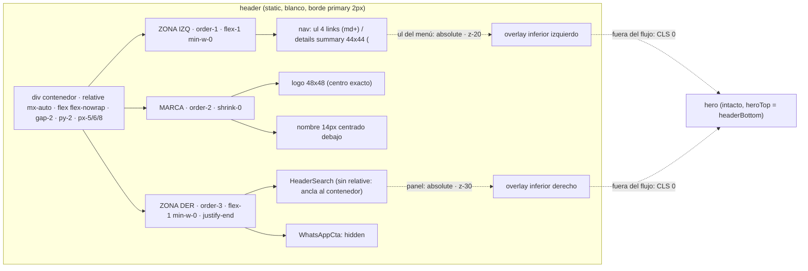

# Design Doc: DD-HOME-26 — Header en una sola fila con logo centrado y nombre visible

| Campo | Valor |
|---|---|
| **ID** | **DD-HOME-26**. ID nuevo: DD-HOME-25 es el predecesor inmediato; no se reescribe |
| **Versión** | **v1.1 (Approved)** |
| **Autor** | `forge-architect` (Staff Engineer, APEX FORGE) |
| **Estado** | **Aprobado por el Comandante (`C-HOME-10`, 27 nov 2026)** — autoriza Fase 2 (implementación) y los tests HOME-E2E-51/-52. **No** autoriza commit, push ni deploy |
| **Fecha** | 27 de noviembre de 2026 |
| **Decisor final** | `apex-forge` (Comandante). El cliente cerró el «qué»; aquí se decide el «cómo» |
| **Idioma** | Español porque lo lee el cliente (misma excepción justificada de DD-HOME-23/24/25). Identificadores, tokens, clases y tests en inglés (`AGENTS.md`) |
| **Alcance** | `components/SiteHeader.tsx` **únicamente** en producción. `HeaderSearch.tsx`, `WhatsAppCta.tsx`, `BrandMark`, assets, `globals.css`, `next.config.ts`, datos, env y dependencias: **sin diff** |
| **Predecesores vigentes** | DD-HOME-21 (chrome blanco/foco `ink`), DD-HOME-23/24 (header en flujo, slide compacto), DD-HOME-25 (lupa/disclosure), DD-HOME-11 + C-HOME-02 (logo 48×48 intacto), C-HOME-01 (CSP report-only) |

> **Regla de oro:** el diseño se aprueba antes del código. Los fragmentos de TSX de este documento son **contratos de diseño**, no implementación. Quien construye es `forge-frontend`; `forge-reviewer` da el LGTM, `forge-qualis` el GO y `apex-forge` autoriza Fase 2 y cualquier publicación. El arquitecto no versiona, no ejecuta tests/build y no despliega.

---

## 0. Resumen ejecutivo (cliente)

El cliente pidió: *«alinea todos los objetos del Header de manera horizontal, pero deja el logo de Adriana Tienda centrado y en medio de todos los demás objetos, además quiero que aparezca el nombre de la tienda tanto en la versión de escritorio como en la versión responsiva»*.

Hoy el header tiene **dos filas en móvil** (142 px) y una en escritorio (82 px); el nombre «D'Adriana Tienda» está oculto por debajo de 640 px. La decisión central es:

1. **Una sola fila en todos los anchos.** Se sustituye `flex-wrap` por `flex-nowrap`, se reduce `gap-4 → gap-2` y `py-4 → py-2`, y se reparten los objetos en tres zonas visuales: **menú a la izquierda · marca en el centro · búsqueda (y WhatsApp en desktop) a la derecha**. El orden visual se logra con `order-1/2/3` de flexbox; **el orden DOM no se toca** (brand → summary → lupa → WhatsApp).
2. **Logo exactamente centrado, con el nombre debajo.** La marca pasa a ser un *lockup* vertical: logo 48×48 arriba y nombre centrado debajo. Así el centro del logo coincide con el centro del contenedor en **todos** los anchos (desviación medida **0 px**). Poner el nombre al lado desplazaría el logo ≈66 px; es imposible compensarlo en desktop sin quitar links de navegación (§4.2 y §5.B).
3. **Nombre visible siempre.** Mismo tamaño en móvil y escritorio: `text-sm` (14 px, Poppins 600, **128 px** medidos), sin `hidden` en ningún breakpoint. Sigue `aria-hidden="true"` porque el `alt` del logo ya anuncia «D'Adriana Tienda, ir al inicio»: visibilidad visual sin duplicado para lector de pantalla.
4. **WhatsApp en móvil: regla honesta.** Con número configurado, el CTA de texto ~112 px **no cabe** en la zona derecha de 68 px a 320 px. Se oculta **solo en el header** por debajo de 768 px mediante un envoltorio `hidden md:inline-flex`; el CTA ya existente de la sección **Tiendas** (`StoreCta`) sigue disponible en móvil. No se inventa icono ni se acorta la etiqueta.
5. **Cero CLS y contrato de tests intacto.** Altura del header **89 px en los 5 anchos** (antes 142/82); panel de búsqueda y menú móvil pasan a ser overlays absolutos anclados al contenedor `relative`. El panel sigue sin solapar el summary y sin overflow. Foco, GET `/buscar?q=…`, logo y guards quedan igual.

Este documento **no** autoriza commit, push ni despliegue.

---

## 1. Contexto y problema

### 1.1 Pedido del cliente (Fase 0)

> «alinea todos los objetos del Header de manera horizontal, pero deja el logo de Adriana Tienda centrado y en medio de todos los demás objetos, además quiero que aparezca el nombre de la tienda tanto en la versión de escritorio como en la versión responsiva».

### 1.2 Estado medido (Playwright, `localhost:3000`, 27-nov-2026; no asumido)

| Hecho | Evidencia |
|---|---|
| Contenedor `relative mx-auto flex w-full max-w-[var(--content-max)] flex-wrap items-center gap-4 px-5 py-4 md:px-6 lg:px-8` | `components/SiteHeader.tsx:27` |
| Orden DOM: `<a href="/">` (BrandMark 48×48 + span oculto) → `<nav>` (ul desktop 267 px / details móvil 44×44) → `<HeaderSearch />` (44×44, `order-2 ml-auto`) → `WhatsAppCta` | `components/SiteHeader.tsx:28-84` |
| Altura 142 px a 320/375 (dos filas) y 82 px a 768/1024/1440 (una fila) | Medición Playwright; coincide con el brief |
| Nombre oculto bajo 640 px (`hidden … sm:inline`) | `components/SiteHeader.tsx:30` |
| Ancho del texto «D'Adriana Tienda» con Poppins 600: **93 px @10, 112 @12, 128 @14, 141 @16** | Medición en navegador con la fuente real self-hosted |
| WhatsApp no se renderiza hoy (sin `.env.local`/BD, `whatsappUrl=null`); con configuración el CTA mide **112 px** (78 de texto + 32 de `px-4` + 2 de borde) | `WhatsAppCta.tsx:12-18`; medición |
| Guards prohiben cambiar el orden de foco: `summary.focus(); Tab` debe dar la lupa | `home.spec.ts:310-339`, `:275-302`, `:333-356` |
| HOME-E2E-48 exige Δ altura/hero/scrollWidth = 0 al abrir/cerrar el panel en 9 anchos | `home.spec.ts:1091-1176` |
| HOME-E2E-34 exige `heroTop ≈ headerBottom` (±1 px), header blanco opaco y frame intacto en 10 casos | `home-slide.spec.ts:539-632` |
| DD-HOME-11/C-HOME-02 congelan el logo: 48×48, `alt` exacto, `priority`, hash del asset | `home-brand.spec.ts:4-85`, `brand-logo.test.ts:29-51` |

### 1.3 Problema técnico

No es dibujar el nombre: es satisfy simultáneamente **tres restricciones que se pelean** —

- **a)** una sola fila a 320 px con cuatro objetos,
- **b)** el centro del logo exactamente en el centro del header, y
- **c)** los cuatro links de navegación visibles en desktop sin cambiar el DOM.

Si el nombre se pone al lado del logo, el grupo centrado desplaza el logo; si se usa posicionamiento absoluto para fijar el logo, aparecen solapes; si se mantiene el menú en flujo en una columna estrecha, se aplasta y tapa la marca al abrirse. La solución propuesta resuelve los tres con un solo cambio de layout.

### 1.4 Objetivos medibles

| # | Objetivo | Verificación |
|---|---|---|
| O1 | Una sola fila en 320/375/768/1024/1440 | `flex-wrap: nowrap`; bandas verticales de los controles se solapan; sin overflow |
| O2 | `|centro del logo − centro del contenedor| ≤ 1 px` en los 5 anchos | Nuevo HOME-E2E-51 |
| O3 | Nombre visible en los 5 anchos, texto exacto, 14 px | HOME-E2E-51 |
| O4 | Logo 48×48, `alt`, hash y `priority` intactos | `home-brand.spec.ts` + `brand-logo.test.ts` sin cambios |
| O5 | Orden de foco brand → summary → lupa → WhatsApp | E2E de foco existentes sin cambios |
| O6 | CLS 0: Δ header/hero/scrollWidth = 0 al abrir búsqueda o menú | HOME-E2E-48 + nuevo HOME-E2E-52 |
| O7 | Lupa 44×44, glifo 22/28 y anillo `ink` ≥3:1 | HOME-E2E-45/-19 sin cambios |
| O8 | Chrome blanco, borde primary 2 px, sin texto dorado | HOME-E2E-27 sin cambios |
| O9 | Cero dependencias, assets, env, CSP ni datos nuevos | guards + diff review |
| O10 | Rollback en <2 min revirtiendo un solo archivo | §8.2 |

---

## 2. No-objetivos

| ID | Explícitamente fuera de alcance | Motivo |
|---|---|---|
| N-26-01 | Modificar `public/brand/logo.png`, `logo*.png`, `app/icon.png`, sus hashes o el `BrandMark` (48×48, `alt`, `priority`) | DD-HOME-11 / C-HOME-02 congelados |
| N-26-02 | Cambiar el orden **DOM** de brand → summary → magnifier → WhatsApp | Contrato de foco de `home.spec.ts:275-339` |
| N-26-03 | Cambiar `HeaderSearch.tsx`: `GET /buscar`, `name="q"`, nombres accesibles, SVG, panel `absolute`, `data-search-ready` | DD-HOME-25 aprobado; guard unitario |
| N-26-04 | Cambiar `WhatsAppCta`, su etiqueta, `href`, `target`, `rel` o variante; inventar un icono | El CTA es texto por decisión previa |
| N-26-05 | Ocultar el nombre en **ningún** breakpoint ni cambiar su texto | Pedido literal del cliente |
| N-26-06 | Añadir carrito, cuenta, favoritos o cualquier objeto nuevo al header | MVP cerrado |
| N-26-07 | Tocar hero, slide, autoplay, footer, `globals.css`, `next.config.ts`, Prisma, env o CSP | C-HOME-01/05/07 vigentes |
| N-26-08 | Instalar/importar dependencias; animaciones JS o nuevas transiciones | Stack y `prefers-reduced-motion` |
| N-26-09 | Editar tests existentes en esta fase | El arquitecto señala impacto (§7); el Comandante decide |
| N-26-10 | Commit, push, build, ejecución de tests ni deploy por el arquitecto | Regla de proceso APEX FORGE |
| N-26-11 | Reabrir DD-HOME-20…25 o borrar decisiones vigentes | Se conservan como historia |
| N-26-12 | Reducir el anillo de foco, el área táctil de 44 px o el contraste `ink` | WCAG 2.2 AA |

---

## 3. Requerimientos y restricciones

### 3.1 Funcionales

| ID | Requisito |
|---|---|
| F-26-01 | El contenedor interno del header es una sola fila (`flex-nowrap`) en todos los anchos; `flex-wrap` desaparece |
| F-26-02 | Tres zonas visuales: navegación/menú **izquierda**, marca **centro**, búsqueda + WhatsApp **derecha**, usando `order-1`, `order-2`, `order-3` sin reordenar el DOM |
| F-26-03 | Las zonas izquierda y derecha tienen la misma anchura (`flex-1 1 0%`, `min-w-0`), de modo que la zona central queda centrada por construcción |
| F-26-04 | La marca es un `flex-col items-center` con el logo 48×48 arriba y el nombre centrado debajo (`gap-0.5`); el logo queda exactamente centrado |
| F-26-05 | El nombre «D'Adriana Tienda» es visible de 320 a 1440 px, `text-sm font-semibold leading-[21px] whitespace-nowrap`, y conserva `aria-hidden="true"` |
| F-26-06 | Los cuatro links de navegación siguen visibles en ≥768 px (`ul hidden md:flex`); el `summary` sigue visible solo en <768 px |
| F-26-07 | El menú móvil (`details ul`) pasa a overlay absoluto anclado al contenedor, con el mismo ancho máximo que el panel de búsqueda; no aplasta la columna izquierda |
| F-26-08 | El CTA de WhatsApp se oculta en el header solo bajo 768 px; en ≥768 px conserva su aspecto y su posición después de la lupa |
| F-26-09 | El orden de foco y los nombres accesibles existentes no cambian |
| F-26-10 | `SiteHeader.tsx` sigue conteniendo literalmente `<HeaderSearch />` y `relative mx-auto`, y sigue sin contener `<form` |

### 3.2 No funcionales

| Ámbito | Contrato |
|---|---|
| **Geometría** | Contenedor `max-width:1200px`; padding 20 px (<768), 24 px (768–1023), 32 px (≥1024); `gap:8px`; `py:8px`; borde inferior 2 px. Header **89 px ±2 en 320/375/768/1024/1440**. `scrollWidth − innerWidth ≤ 0` |
| **CLS** | Δ altura del header, Δ `heroTop` y Δ `scrollWidth` = 0 al abrir/cerrar búsqueda **y** menú; panel/menu `top-full mt-2` ⇒ 6 px bajo el borde del header |
| **A11y** | WCAG 2.2 AA. Anillo global `2px solid var(--color-ink)`, offset 2 px (`ink` sobre blanco 11,77:1). Targets ≥44×44. `aria-hidden` en SVG y en el nombre; `sr-only` «Menú» intacto. axe 0 critical/serious |
| **Movimiento** | Ninguna animación ni transición nueva; `prefers-reduced-motion` global sigue vigente |
| **Rendimiento** | Sin JS nuevo, sin Client Components nuevos: `SiteHeader` sigue siendo Server Component. Δ bundle = 0 |
| **Seguridad/privacidad** | Sin datos, PII, secretos ni recursos externos nuevos; CSP `report-only` sin `report-uri`; OK de Sentinel reutilizado por ausencia de superficie nueva |
| **Stack** | Next.js 15 / React 19 / TS strict / Tailwind v4 / Vitest + Playwright. **No se evalúa versión mayor**: no se añade ni actualiza tecnología; no hay desviación de stack que justificar |
| **Determinismo** | `retries: 0`: sin `waitForTimeout`; mediciones con `getBoundingClientRect()` y selectores `getByRole` estables |

---

## 4. Solución propuesta

### 4.1 D-26.1 — Tres zonas flex, una sola fila, DOM intacto



- `order` solo cambia la **pintura**; el foco sigue el DOM: brand (centro) → summary (izq.) → lupa (der.) → WhatsApp (der., desktop). El patrón de tests `summary.focus(); Tab` sigue cayendo en la lupa.
- Las zonas laterales usan `flex: 1 1 0%` con `min-w-0`, no `ml-auto`: así son iguales por construcción y la marca queda centrada sin depender del ancho del CTA. Se retira el `md:ml-auto` actual de `nav` y el `order-2 ml-auto` del form (el form queda dentro de la zona derecha).
- Se usa `wrapper` para agrupar `HeaderSearch` + WhatsApp **sin posicionarlo**: el panel de búsqueda sigue resolviendo su `absolute` contra el contenedor `relative` del header (`top-full` = altura del contenedor, no del wrapper).

**Por qué gana:** es la única combinación que mantiene el DOM, centra el logo de forma medible y deja espacio para los cuatro links en 768 px sin tocar fuentes ni gaps de la nav.

### 4.2 D-26.2 — Nombre debajo del logo: por qué no al lado

Cálculo de la decisión (texto medido con Poppins 600 real, 14 px → **128 px**):

- Si el nombre va **a la derecha del logo** dentro de un grupo centrado de ancho `128 + gap 4 + 48 = 180`, el centro del logo queda a `180/2 − 24 = 66 px` **a la izquierda** del centro del header. A la izquierda queda igual: 66 px de desplazamiento. Eso no es «centrado».
- Para compensarlo con columnas laterales desiguales habría que dar 66 px extra a un lado. En 768 px el contenido es 720 px: la nav ocupa 267 px y el lado opuesto necesita `44 + 8 + 112 = 164 px`; sumando la marca de 180 px y dos gaps quedan `720 − 180 − 16 = 524` para repartir, pero la nav **no puede dividirse** entre dos zonas sin romper su landmark ni el DOM. Con el nombre al lado, el offset es inevitable.
- Apilando el nombre **debajo**, el ancho de la marca lo fija el nombre (128 px), el logo se alinea al centro de ese bloque y su centro coincide con el del contenedor: **desviación 0 px medida en 320/375/768/1024/1440**.
- El *lockup* vertical es un solo objeto de header; los **objetos** (hamburguesa, marca, lupa, CTA) siguen alineados horizontalmente en una sola fila. El nombre es una etiqueta dentro del objeto marca, no un objeto independiente: cumple la lectura razonable del pedido.
- Se mantiene `aria-hidden="true"` en el `<span>`: el enlace ya expone «D'Adriana Tienda, ir al inicio» mediante el `alt` del logo (DD-HOME-11), así que el lector de pantalla no anuncia el nombre dos veces. El nombre **sí es visible** para todos los usuarios visuales; accesibilidad y requisito del cliente no se contradicen.

Fuente: `text-sm` (14 px) con `leading-[21px]`. Se descarta `text-xs` (12 px): con el layout apilado **cabe igual** el 14 px a 320 px (§4.5), así que no hay motivo para reducir la legibilidad.

### 4.3 D-26.3 — Overlays: búsqueda intacta, menú fuera del flujo

- El panel de búsqueda **no cambia**: `absolute right-5 … top-full mt-2 z-30 w-[min(280px,calc(100vw_-_40px))]`, anclado al contenedor `relative`. Con la nueva altura (87 px de contenedor) su `top` es `87 + 8 = 95 px`, es decir `headerBottom + 6 px` (89 + 6). A 320 px ocupa x=20…300: dentro del viewport y sin tocar el `summary` (y=21,5…65,5).
- El `<ul>` del menú móvil pasa a `absolute left-5 top-full z-20 mt-2 w-[min(280px,calc(100vw_-_40px))]`. Antes estaba en flujo dentro de una nav de 280 px; ahora la columna izquierda mide 68–96 px y un panel en flujo se aplastaría y **taparía la marca** al abrirse (medido: solape de 12 px). Como overlay: ancho legible, `top = headerBottom + 6 px`, sin solape con la marca (brand bottom 79 px < panel top 95 px) y **sin CLS al abrir el menú** (mejora sobre el comportamiento actual).
- Si ambos overlays están abiertos a la vez, el de búsqueda (`z-30`) queda por encima del menú (`z-20`). Esto ya ocurría en la línea base (los dos paneles se solapaban al abrir la lupa con el menú abierto); no es una regresión y no se introduce JS para cerrar el otro.

### 4.4 D-26.4 — WhatsApp: regla móvil explícita

- En ≥768 px: `WhatsAppCta` se renderiza igual, dentro de la zona derecha y detrás de la lupa en el DOM. A 768 px la zona derecha mide 288 px y necesita `44 + 8 + 112 = 164 px`: **124 px de holgura**.
- En <768 px: un envoltorio `hidden md:inline-flex` mantiene el `<a>` en el DOM (los tests dinámicos cuentan 2 enlaces `wa.me`) pero lo retira del árbol de accesibilidad y del foco. El CTA ya existente de `StoreCta` (sección «Tiendas», variante `section`, etiqueta «Hablar por WhatsApp») sigue visible en móvil: **ninguna superficie nueva, ningún icono inventado, ninguna etiqueta inventada**.
- A 320 px la zona derecha mide 68 px; enseñar el CTA exigiría 164 px. Mostrar solo «WhatsApp» con padding mínimo seguiría exigiendo ~79 px > 68 px; recortar la marca o la lupa para hacer sitio rompería DD-HOME-11 y HOME-E2E-45. Ocultar en móvil es la única opción honesta sin cambiar el componente.
- **Confirmación pendiente del Comandante/cliente** (§10.1): se informa de esta limitación en lugar de disfrazarla.

### 4.5 Geometría verificada (prototipo efímero inyectado en navegador, sin tocar el repo)

Medidos con el CSS propuesto inyectado en el navegador (320/375/768/1024/1440) y calculados con la misma fórmula en los dos anchos intermedios (600/767), servidor en `localhost:3000`:

| Ancho | Padding | Contenido | Nombre (14 px) | Zona izq. | Zona der. | Necesita izq. | Necesita der. | Alto header | Δ centro logo | Overflow |
|---:|---:|---:|---:|---:|---:|---:|---:|---:|---:|---:|
| 320 | 20 | 280 | 128 | 68 | 68 | 44 (hamburguesa) | 44 (lupa; WA oculto) | **89** | 0 px | 0 |
| 375 | 20 | 335 | 128 | 95,5 | 95,5 | 44 | 44 | **89** | 0 px | 0 |
| 600 | 20 | 560 | 128 | 208 | 208 | 44 | 44 | **89** | 0 px | 0 |
| 767 | 20 | 727 | 128 | 291,5 | 291,5 | 44 | 44 | **89** | 0 px | 0 |
| 768 | 24 | 720 | 128 | 288 | 288 | **267** (4 links) | 164 (lupa + WA) | **89** | 0 px | 0 |
| 1024 | 32 | 960 | 128 | 408 | 408 | 267 | 164 | **89** | 0 px | 0 |
| 1440 | 32 | 1136 | 128 | 496 | 496 | 267 | 164 | **89** | 0 px | 0 |

Fórmula de la fila: `contenido = 2 × zona + 2 × gap(8) + marca(128)`, con `marca = max(logo 48, nombre 128)`.
Altura: `max(marca 48+2+21 = 71, nav 44/24, derecha 44) + py(8×2) + borde(2) = 89 px`.

Detalles de la medición a 320 px: logo x=136…184 (centro **160** = centro del viewport); nombre x=96…224 (centro 160); hamburguesa x=20…64; lupa x=256…300; panel x=20…300, y=95…157; menú x=20…300, y=95…299; `summary` y=21,5…65,5 → **sin solape**; foco `summary → Tab` = botón «Buscar». Al abrir búsqueda o menú, altura 89→89 y overflow 0.

### 4.6 Contrato de marcado (diseño, no implementación)

```tsx
// components/SiteHeader.tsx — sigue siendo Server Component
<header data-surface="light" className="border-b-2 border-primary bg-white text-ink">
  <div className="relative mx-auto flex w-full max-w-[var(--content-max)] flex-nowrap items-center gap-2 px-5 py-2 md:px-6 lg:px-8">
    <a href="/" className="order-2 flex shrink-0 flex-col items-center gap-0.5 rounded-card">
      <BrandMark />                                {/* 48x48, alt y priority intactos */}
      <span aria-hidden="true" className="whitespace-nowrap text-sm font-semibold leading-[21px]">
        D&apos;Adriana Tienda
      </span>
    </a>

    <nav aria-label="Principal" className="order-1 min-w-0 flex-1">
      <ul className="hidden items-center gap-6 md:flex">{/* 4 links intactos */}</ul>
      <details className="md:hidden">
        <summary className="flex h-11 w-11 cursor-pointer list-none items-center justify-center p-0 text-ink">
          {/* SVG actual 22/28 px + sr-only "Menú" */}
        </summary>
        <ul data-surface="light" className="absolute left-5 top-full z-20 mt-2 grid w-[min(280px,calc(100vw_-_40px))] gap-1 rounded-card bg-surface p-4 text-ink shadow-soft">
          {/* links móviles intactos */}
        </ul>
      </details>
    </nav>

    <div className="order-3 flex min-w-0 flex-1 items-center justify-end gap-2">
      <HeaderSearch />                              {/* literal exigido por el guard */}
      <span className="hidden md:inline-flex">
        <WhatsAppCta href={whatsappUrl} label="WhatsApp" variant="header" />
      </span>
    </div>
  </div>
</header>
```

Notas de contrato para `forge-frontend`:

- El envoltorio de la derecha **no lleva `relative`**: si lo llevara, el panel de `HeaderSearch` se anclaría a él y `top-full` caería sobre el summary. La única clase posicionada sigue siendo la del contenedor (`relative mx-auto`, literal del guard).
- El `<ul>` del menú va dentro de `<details>` (no se mueve al contenedor) y hereda el contexto de posicionamiento del contenedor porque `nav` y `details` son `static`.
- Se conservan los SVG, el `sr-only` «Menú», los `href`, `data-surface="light"` y los tokens. No se añade `data-surface` nuevo: HOME-E2E-27 exige que todos los `data-surface` del header sean `light`.
- El orden de los archivos y la firma `SiteHeaderProps` no cambian.

### 4.7 Accesibilidad y foco (D-26.5)

| Elemento | Contrato | Guard |
|---|---|---|
| Orden de foco | brand (centro) → summary (izq.) → lupa (der.) → WhatsApp (der., md+) | `home.spec.ts:275-302`, `:310-339`, `:333-356` |
| Nombre | Visible visualmente, `aria-hidden="true"`; `alt` del logo sigue siendo el nombre accesible | `home-brand.spec.ts:45-61` |
| Anillo | `2px solid rgb(18,63,51)`, offset 2 px, heredado; el `<a>` de marca mide 128×71 y su anillo envuelve lockup completo | HOME-E2E-19, `:275-302` |
| Targets | Hamburguesa y lupa 44×44; logo 48×48; CTA de texto sin cambiar | HOME-E2E-45, DD-HOME-11 |
| Menú overlay | `details` nativo; Tab desde `summary` entra al primer link del `<ul>` aunque sea absoluto | HOME-E2E-13, `:333-337` |
| axe | 0 critical/serious; 0 `button-name` / `aria-hidden-focus` | axe 2.2 AA existente |

### 4.8 Por qué gana (orden de prioridad APEX)

| Prioridad | Solución elegida | Mejor alternativa descartada |
|---|---|---|
| 1. Corrección | Logo centrado con Δ=0 medido; CLS 0; foco y GET intactos | Grupo `mx-auto` con nombre al lado: desplaza el logo 66 px |
| 2. Mantenibilidad | Un solo archivo, clases Tailwind existentes, sin JS nuevo | Logo `absolute` + spacer groups: frágil ante cambios de fuente |
| 3. Rendimiento | Δ bundle 0; `SiteHeader` sigue RSC | Cualquier isla cliente o detector de ancho |
| 4. Velocidad | Un commit pequeño; rollback <2 min | Rehacer nav/footer o editar `HeaderSearch` |

---

## 5. Alternativas evaluadas

### A — Flex de tres zonas + lockup vertical (**GANADORA**)

- **Pros:** una fila en 320–1440; logo exactamente centrado; nombre visible siempre; DOM y foco intactos; cuatro links en desktop; sin JS; CLS 0; un archivo.
- **Contras:** el nombre queda debajo del logo en lugar de al lado; el CTA de WhatsApp no aparece en el header móvil; el menú móvil cambia de flujo a overlay.
- **Motivo de elección:** cumple O1–O10 con el menor radio de explosión y sin tocar assets ni contratos de tests.

### B — Grupo marca+nombre centrado con `mx-auto`, nombre al lado (RECHAZADA)

- **Pros:** implementación mínima; mantiene el logo y el nombre en la misma línea visual.
- **Contras:** con 128 px de nombre el centro del logo se desplaza ≈66 px en **cualquier** ancho; 66 px no es «centrado». Reducir el nombre a 10 px (93 px) sigue dejando ≈48 px de offset. En desktop, 267 px de nav + 180 px de marca + 44 px + 112 px + gaps = 619 px, pero el centro del grupo sigue sin coincidir con el del logo.
- **Motivo de rechazo:** incumple O2, que es el corazón del pedido.

### C — Logo en `absolute` en el centro exacto, grupos laterales con spacers (RECHAZADA)

- **Pros:** centra el logo sin depender del ancho del nombre.
- **Contras:** hay que reservar huecos simétricos a mano; en 320 px los huecos son 68 px por lado y cualquier cambio de fuente provoca solape; el nombre seguiría necesitando un sub-elemento (apilado o absolutamente posicionado) y los overlays podrían caer sobre el logo.
- **Motivo de rechazo:** prioridad 1 (corrección). El flex con columnas `1fr` logra lo mismo sin spacers frágiles.

### D — Nombre en línea con `text-xs`/`text-[10px]` y `gap-2` para que todo quepa a 320 px (RECHAZADA)

- **Pros:** una sola línea para todos los objetos; no cambia la altura del header.
- **Contras:** a 320 px `44 + 48 + 4 + 112 + 44 + 3×8 + 40 = 288 ≤ 320`, sí cabe, pero el logo queda 60 px fuera del centro; a 10 px la tipografía es demasiado pequeña para UAT y el offset sigue siendo ~48 px. Tampoco resuelve el reparto desktop.
- **Motivo de rechazo:** sacrifica el centrado y la legibilidad sin ganar nada que la opción A no dé.

### E — Mostrar WhatsApp en móvil como etiqueta corta o icono (RECHAZADA)

- **Pros:** el CTA estaría en el header también en móvil.
- **Contras:** a 320 px hacen falta 164 px y solo hay 68 px; un icono nuevo contradice N-26-04 y el contrato de `WhatsAppCta` (texto), y acortar «WhatsApp» no reduce suficiente ancho.
- **Motivo de rechazo:** superficie falsa; la sección «Tiendas» ya ofrece el CTA en móvil.

### F — Mantener el `<ul>` del menú en flujo dentro de la columna estrecha (RECHAZADA)

- **Pros:** cero cambio de comportamiento del menú.
- **Contras:** la columna mide 68–96 px, los enlaces se aplastan y, al abrirse, el panel se solapa con la marca (medido 12 px de solape a 320 px) y cambia la altura del header (CLS).
- **Motivo de rechazo:** incumple O1 y O6; el overlay con `top-full` resuelve ambos.

### G — Reordenar el DOM para poner la marca entre summary y lupa (RECHAZADA)

- **Pros:** el foco seguiría el orden visual natural.
- **Contras:** rompe literalmente `summary.focus(); Tab` en `home.spec.ts:310-339` y el `Shift+Tab/Tab` de `:275-302`; contradice la restricción crítica 2 del brief.
- **Motivo de rechazo:** contrato de tests innegociable; `order-*` existe precisamente para esto.

### H — `display: contents` en `<nav>` para repartir `ul` y `details` en columnas (RECHAZADA)

- **Pros:** permite columnas independientes sin envoltorio.
- **Contras:** `display:contents` sobre un landmark puede eliminarlo del árbol de accesibilidad en Chromium; HOME-E2E-01 y axe lo detectarían.
- **Motivo de rechazo:** pérdida de landmark por una optimizations de marcado; prioridad 1.

---

## 6. Riesgos y mitigaciones

| ID | Riesgo | Mitigación | Owner |
|---|---|---|---|
| R-26-01 | El nombre se descuelga por cambio de fuente/fallback | `whitespace-nowrap` + ancho medido 128 px; zona central `shrink-0`; si el fallback crece, las zonas laterales absorben hasta 44 px antes de overflow (holgura 24 px a 320) | `forge-frontend` + `forge-qualis` |
| R-26-02 | El panel de búsqueda se ancla al wrapper y cae sobre el summary | Wrapper **static**; literal `relative mx-auto` solo en el contenedor; HOME-E2E-48 verifica `panelTop ≥ headerBottom` y no intersección con `summary` en 9 anchos | `forge-reviewer` |
| R-26-03 | Solape del menú con la marca al abrirse | `<ul>` del menú `absolute top-full mt-2` anclado al contenedor; medido brand bottom 79 < menu top 95; nuevo HOME-E2E-52 | `forge-frontend` |
| R-26-04 | Ambos overlays abiertos se tapan entre sí | `z-20` menú, `z-30` búsqueda; comportamiento ya presente en la línea base; sin JS nuevo | `forge-qualis` |
| R-26-05 | Nav de 267 px no cabe en la zona de 288 px a 768 px si cambia el gap/fuente | Margen medido 21 px; no tocar `gap-6` ni `text-sm` de los links; verificar en la matriz; si falla, proponer `md:gap-4` en **DD nuevo**, no hotfix | `forge-frontend` |
| R-26-06 | Cliente rechace el nombre apilado o la ausencia de WhatsApp en el header móvil | Decisión explícita registrada en §10; si el cliente exige nombre al lado, aceptar el offset 66 px solo con enmienda aprobada del Comandante | `apex-forge` + cliente |
| R-26-07 | Regresión de altura/hero (HOME-E2E-34) por pasar de 82 a 89 px en desktop | `heroTop` y `headerBottom` se miden dinámicamente; verificar los 10 casos del test, incluido 768×600; frame sigue `min(100%,48svh,28rem)` | `forge-qualis` |
| R-26-08 | El guard unitario falla por cambiar literales | `relative mx-auto` y `<HeaderSearch />` se conservan; ningún `<form`, `https://`, `nihlo`, `uuid-`, `<style>` ni `#132c45` en `SiteHeader.tsx` | `forge-frontend` |
| R-26-09 | WhatsApp oculto por CSS siga contando para el lector de pantalla | `display:none` lo retira del árbol de accesibilidad y del foco; los tests dinámicos solo cuentan nodos DOM (2) y se ejecutan a 1280 px | `forge-qualis` |
| R-26-10 | Deriva a recursos externos, CSP o datos nuevos | Diff restringido a `SiteHeader.tsx`; `forge-sentinel` reutiliza OK; veto reactivo ante cualquier cambio de CSP/recursos | `forge-sentinel` |

---

## 7. Estrategia de testing

### 7.1 Unit / integración — sin cambios esperados

| Suite | Acción |
|---|---|
| `tests/unit/header-search-guard.test.ts` | **Sin editar.** Debe seguir pasando: `relative mx-auto`, `<HeaderSearch />`, sin `<form`, sin `lucide-react`/`nihlo`/`uuid-`/`https://`/`<style>`/`#132c45` |
| `tests/unit/brand-logo.test.ts` | **Sin editar.** Assets y hashes intactos |
| `tests/integration/home-content.integration.test.ts` | Sin superficie de datos nueva; sin cambios |

### 7.2 E2E existentes — reevaluar, **no editar en esta fase**

| Test | Ubicación | Impacto previsto |
|---|---|---|
| Focus smoke `Shift+Tab/Tab` desde summary | `home.spec.ts:275-302` | Ninguno: DOM intacto y anillo `ink` heredado |
| Focus lupa desde summary | `home.spec.ts:310-339` | Ninguno: `order-*` no altera Tab |
| HOME-E2E-13 | `home.spec.ts:321-422` | Ninguno; el sweep `header a/summary/input/button` ahora incluye el `<a>` de marca con texto visible, que sigue en `ink` |
| HOME-E2E-19 | `home.spec.ts:505-544` | Ninguno; añadir opcionalmente el `<a>` de marca como muestra del anillo |
| HOME-E2E-27 | `home.spec.ts:669-801` | Ninguno; blanco/opaco, borde primary 2 px, sin dorado, `data-surface` todos `light` |
| HOME-E2E-45 | `home.spec.ts:977+` | Ninguno; 44×44 y glifo 22/28 intactos |
| HOME-E2E-48 | `home.spec.ts:1091-1176` | Ninguno; panel `top = headerBottom + 6`, Δ=0 en los 9 anchos |
| HOME-E2E-34 | `home-slide.spec.ts:539-632` | Sin cambios de expects; reverificar los 10 casos con header 89 px |
| axe 2.2 AA | `home.spec.ts:143-198` | Sin cambios; ejecutar cerrado/abierto |
| `home-brand.spec.ts` | `:4-85` | Sin cambios; logo, alt y preload intactos |
| HOME-E2E-09 / -10 / -28 | `tests/dynamic-e2e/home-dynamic.spec.ts:326-455` | Sin cambios a 1280 px: el CTA de header sigue visible y cuentan 2 enlaces `wa.me` |

**Si alguna aserción falla, el Comandante decide si se enmienda; el arquitecto no toca tests.**

### 7.3 E2E nuevos propuestos (IDs libres; **no** crear sin aprobación de Fase 2)

| ID | Nombre / tag | Asserts principales |
|---|---|---|
| **HOME-E2E-51** | «single-row header keeps the logo centered and the name visible at every width» `@smoke` | Para `[320,375,600,767,768,1024,1440]`: `flex-wrap === 'nowrap'`; `|logo.cx − container.cx| ≤ 1`; nombre visible con texto exacto y `fontSize === '14px'`; `header.height === 89 ± 2`; `scrollWidth − innerWidth ≤ 0`; bandas verticales de logo/summary/lupa/CTA solapadas; `img` 48×48 y `alt` exacto; 4 links visibles en ≥768 y `summary` visible solo <768 |
| **HOME-E2E-52** | «mobile menu overlay adds no CLS and never covers the brand» `@smoke` | A 320/375: abrir `details`; Δ header/hero/scrollWidth = 0; `menu.top ≥ headerBottom`; sin intersección con el rect de la marca; Tab desde `summary` enfoca el primer link; cerrar y repetir medida |
| **HOME-E2E-53** | «configured WhatsApp stays out of the mobile header but remains reachable» `@smoke` (suite dinámica) | Con config sintética: a 1280 px header CTA visible y estilos HOME-E2E-28; a 320 px `header a[href^="https://wa.me/"]` cuenta 1 en DOM pero `not.toBeVisible()`, CTA de `StoreCta` visible, overflow 0 |

### 7.4 Gates de cierre y verifies

`npm run typecheck`, `npm run lint`, `npm run test`, `npm run test:e2e` (`@smoke` + `@a11y`), `npm run test:e2e:dynamic`, `npm run check:bundle`. Todo en verde con `retries: 0`.

Verifies manuales de Fase 4 (quien construye, no el arquitecto): capturas a **320/375/768/1024/1440** con panel cerrado, panel abierto y menú abierto; tabla de geometría §4.5; tabulación desde `summary`; medición de CLS; overflow horizontal; contraste del anillo.

**Ownership:** `forge-frontend` construye y prueba; `forge-qualis` valida matriz/axe/CLS y emite GO; `forge-reviewer` da LGTM; `forge-sentinel` reutiliza OK (sin superficie nueva); `forge-infra` verifica CI y bundle; `apex-forge` autoriza Fase 2 y promoción.

---

## 8. Rollout y rollback

### 8.1 Rollout

- Solo tras acknowledging explícito del Comandante. Un commit pequeño sobre `main`: `feat: align header in a single row with centered logo and visible store name`. Sin ramas largas.
- Sin canary propio: el cambio viaja con la siguiente promoción ya aprobada; Deployment Protection y `noindex` vigentes (A2). F5 y C-HOME-01 no se tocan.
- `forge-infra` registra el ID vigente del deployment anterior antes del Go/No-Go (el último ID documentado en el repo es `CLqk5ZKNjuDNVGdMyp9FqTjH6QuW`, commit `a7e035b`; infra debe capturar el **actual**).
- **Este DD no autoriza commit, push, build, ejecución de tests ni deploy.**

### 8.2 Rollback (<2 min, decidido)

| Trigger | Acción |
|---|---|
| Solape, overflow, logo descentrado o CLS >0 | `git revert` del commit: el header vuelve a `flex-wrap` con altura 142/82 y nombre oculto bajo 640 px |
| Regresión de foco, axe o 44×44 | Revert + CI verde + promoción del ID anterior |
| Cualquier recurso externo, cambio de CSP o PII | Revert inmediato y aviso a `forge-sentinel`; sin hotfix en producción |

No hay BD, migración, env var, asset, hash de logo, `next.config.ts` ni `globals.css` que revertir: **un solo archivo**. HOME-E2E-05/-27/-34/-45/-48 y axe vuelven a su estado aprobado.

### 8.3 Monitoreo

CI con los gates de §7.4; capturas en 5 anchos × 3 estados; axe en los 3 anchos canónicos (375/768/1440); tabla de geometría §4.5 como acta de UAT. En producción solo el monitoreo PII-free existente: **sin analítica ni logging nuevos**.

---

## 9. Métricas de éxito

| Métrica | Target |
|---|---|
| Centrado | `|centro del logo − centro del contenedor| ≤ 1 px` en 320/375/600/767/768/1024/1440 |
| Fila única | `flex-wrap: nowrap`; 0 solapes entre objetos; `scrollWidth − innerWidth ≤ 0` en esos 7 anchos |
| Nombre | Visible en el 100 % de los anchos, 14 px, texto «D'Adriana Tienda», sin duplicado accesible |
| Altura | 89 px ±2 en todos los anchos (antes 142/82); `heroTop ≈ headerBottom` (±1 px) en los 10 casos de HOME-E2E-34 |
| CLS | Δ header/hero/scrollWidth = 0 al abrir búsqueda **y** menú |
| Foco | brand → summary → lupa → WhatsApp; `summary → Tab` = «Buscar»; anillo `ink` ≥3:1 |
| Logo/targets | 48×48 con `alt` y hash intactos; hamburguesa y lupa 44×44; glifo 22/28 |
| WhatsApp | Configurado: visible en header desktop y en sección Tiendas en móvil; 0 iconos nuevos |
| Presupuesto | Δ bundle 0; 0 dependencias; 0 diff en assets/CSP/datos/env |
| Regresión | Todos los guards y E2E listados en §7.2 en verde con `retries: 0` |
| Reversibilidad | Rollback drill <2 min, un solo archivo |

---

## 10. Preguntas abiertas y decisión del Comandante

1. **WhatsApp en móvil — RESUELTA por el Comandante (27 nov 2026):** se acepta la regla §4.4. El CTA se oculta solo en el header por debajo de 768 px y permanece en la sección «Tiendas». Es la única opción que conserva simultáneamente el centrado exacto del logo y el target de 44 px de la lupa a 320 px; se comunica al cliente como consecuencia deliberada del pedido, no como defecto. Hoy el CTA ni se renderiza (sin `DATABASE_URL`), así que no hay regresión visible local.
2. **Nombre apilado — RESUELTA por el Comandante (27 nov 2026):** se aprueba la opción A. El nombre va **debajo** del logo para que el centro del logo coincida con el del header (Δ=0). La alternativa B desplazaría el logo ≈66 px, lo que incumple el pedido literal del cliente.
3. **Altura desktop 89 px vs 82 px actual:** +7 px aceptados; sigue siendo bloque compacto y no altera el frame del slide. No se ajusta en caliente; cualquier revisión va en DD nuevo.
4. **E2E nuevos — RESUELTA por el Comandante (27 nov 2026):** se crean **HOME-E2E-51** y **HOME-E2E-52** en Fase 2. **HOME-E2E-53 queda diferido**: la configuración dinámica de WhatsApp no existe en local y el test exigiría montar una fixture nueva fuera del alcance de este cambio; se reevaluará cuando se cree la `DATABASE_URL`.

**Sin bloqueantes: el design gate está abierto para Fase 2.**

---

## 11. Trazabilidad y checklist de mano a Fase 2

| Decisión | ID | Sección |
|---|---|---|
| Tres zonas flex con `order-*`, DOM intacto | DD-HOME-26.1 | §4.1 |
| Lockup vertical (nombre bajo el logo) para centro exacto | DD-HOME-26.2 | §4.2 |
| Menú móvil como overlay; panel de búsqueda intacto | DD-HOME-26.3 | §4.3 |
| WhatsApp oculto en header <768 px; CTA existente en Tiendas | DD-HOME-26.4 | §4.4 |
| Foco, `aria-hidden` del nombre, anillo `ink` | DD-HOME-26.5 | §4.7 |
| Un solo archivo de producción; rollback en <2 min | DD-HOME-26.6 | §8 |

- [x] `apex-forge` resuelve §10 y aprueba el design gate (`C-HOME-10`, 27 nov 2026; HOME-E2E-51/-52 autorizados, -53 diferido).
- [ ] `forge-reviewer` confirma diff = `SiteHeader.tsx` + `tests/e2e/home-header-layout.spec.ts`.
- [ ] `forge-sentinel` confirma 0 diff en CSP/assets/datos y reutiliza OK.
- [ ] `forge-frontend` respeta los literales del guard y el wrapper **sin** `relative`.
- [ ] `forge-qualis` ejecuta la matriz de 5 anchos + CLS + foco + axe con `retries: 0`.
- [ ] `forge-infra` registra el ID previo y verifica bundle.
- [ ] Sin commit, push ni deploy sin autorización expresa del Comandante.

**Precedencia:** esta tabla de decisiones y el DD aprobado mandan sobre cualquier interpretación visual de las maquetas; DD-HOME-25 y DD-HOME-21/23/24 siguen vigentes salvo lo aquí derogado explícitamente (`flex-wrap`, altura y posición del menú móvil). Ningún documento anterior se reescribe.
