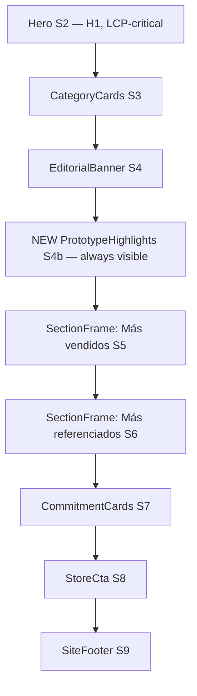
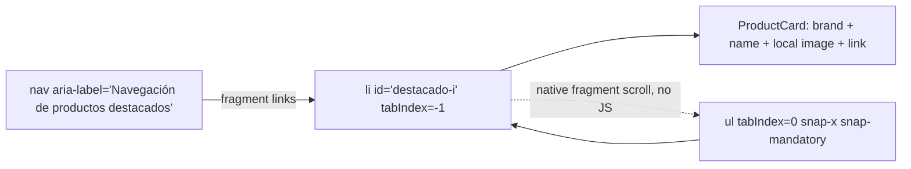

# Design Doc: DD-HOME-20 — Static product highlights row (prototype-derived)

- **ID:** DD-HOME-20
- **Autor:** `forge-architect` (APEX FORGE)
- **Estado:** **Approved by `forge-architect` (design gate)**, 26-nov-2026 — acknowledged by `apex-forge`, constructed and LGTM by `forge-reviewer` the same day. This document is frozen at approval; changes require a new DD or an explicit amendment (`DD-HOME-20.8`).
- **Fecha:** 26-nov-2026
- **Decisor final:** `apex-forge` (Comandante)
- **Relación:** extends `design-doc-home.md` (DD-HOME-01…19) without derogating A2, `noindex`, C-HOME-01, the JS budget or F5. It narrows DD-HOME-12 §7 only for this new section: arrows remain anchors, never JS state.

## 0. Resumen ejecutivo (cliente)

Se añade una fila horizontal de **6 tarjetas de producto** tomadas del prototipo, con **nombre y marca exactos** de `prototipo/app.js` y sus fotos reales. No es un slider de portada: es una fila deslizable con flechas/navegación visible, sin autoplay y sin librerías nuevas. La fila **siempre se ve**, porque no depende de la base de datos: los datos son una constante estática y tipada derivada del catálogo ya aprobado. No hay precios, porcentajes, diagnósticos ni promesas; cada tarjeta enlaza a la ruta de producto que ya existe. El impacto en JavaScript es cero y el rollback es inmediato. **Este documento aprueba el diseño, no autoriza commit, push ni despliegue.**

## 1. Contexto y problema

### 1.1 Pedido del cliente (26-nov-2026)

> «Agrega un carrusel como el de https://www.laroche-posay.co/ usando algunas imágenes del prototipo.»

Clarifications already closed with the client before this DD:

| Clarification | Closed decision |
|---|---|
| Pattern | Horizontal **row of product cards**, like the reference's "Life-changers" section. **Not** a hero slider. |
| Content | **Only product name and brand**, verbatim from `prototipo/app.js`. No prices, percentages, diagnostics, claims, ratings or badges. Link to the existing `/productos/[slug]` route. |
| Inspiration | Interaction only: a swipeable row with visible arrow-like navigation. **No** external images, JS, libraries or markup are copied. |

### 1.2 Current state (verified in the repo, not assumed)

- `app/page.tsx` is `dynamic = 'force-dynamic'` and `revalidate = 0` (DD-HOME-19). Order: `SiteHeader → Hero → CategoryCards → EditorialBanner → SectionFrame(masVendidos) → SectionFrame(masReferenciados) → CommitmentCards → StoreCta → SiteFooter`.
- `CuratedCarousel` renders `role="region"`, an H2, a focusable `<ul tabIndex={0} class="snap-x snap-mandatory …">`, `li.snap-start`, and no JS/autoplay. Both curated sections disappear when `app_config.selections` is empty (`SectionFrame`).
- `ProductCard` uses `next/image` only for local paths starting with `/`, shows brand, name, optional `priceLabel`, optional "Agotado" state, and a link labelled `Ver producto`.
- `lib/home-content.ts` owns `ProductCardData` and `parseImage` (local-path allowlist: no `..`, `%`, `?`, `#`, `//`, backslash or HTTPS).
- `prototipo/app.js` contains 18 real product photos mapped through `IMG.*`; `prototipo/assets/` holds 19 square 1080×1080 JPEGs plus `portada.jpg`.
- `app/productos/[slug]/page.tsx` is the approved honest stub (`Producto` / `Ficha de producto pendiente de publicar.`). The new links land there; this DD does **not** implement the PDP.
- Budget gate (`scripts/check-bundle.mjs`): Home First Load JS ≤ 150,000 B gzip; total chunks ≤ 300,000 B gzip. Last measured: Home 108,466 B; total 256,654 B.
- Hard constraints in force: `X-Robots-Tag: noindex, nofollow`, CSP **report-only** only (C-HOME-01), no secrets, no invented data or PII, no commit/push/deploy without explicit instruction.

### 1.3 Problem being solved

The client wants product imagery visible on the Home **today**, but the curated sections are DB-dependent and correctly hidden when `app_config` is empty (DD-HOME-04, HOME-E2E-07). A taller placeholder, a new DB key, or a JS carousel would respectively invent data, reintroduce DB coupling, or break DD-HOME-12. We need an always-visible, factually sourced, accessible row that adds zero JS.

### 1.4 Goals (measurable)

| ID | Goal | Verification |
|---|---|---|
| G1 | 6 factual cards visible with empty `app_config`; 0 invented prices/claims/stock | HOME-E2E-20, unit provenance test |
| G2 | Row-level keyboard/scroll-snap interaction plus visible anchors; no JS state, no autoplay | HOME-E2E-21, -22, -23 |
| G3 | axe 2.2 AA: 0 critical/serious at 375/768/1440; H1→H2→H3 with no jumps; approved focus tokens | HOME-E2E-24, existing HOME-E2E-01/02/13/19 |
| G4 | Local optimized images, reserved square box, CLS target 0 | HOME-E2E-25 |
| G5 | JS budget unchanged: Home ≤ 150 KB, total ≤ 300 KB gzip | `npm run check:bundle` |
| G6 | Reversible in < 2 min; no A2/F5/`vercel.json` changes | Rollback drill, §8 |

## 2. No-objetivos

| ID | Explicitly out of scope | Reason |
|---|---|---|
| N-20-01 | Hero slider / multi-slide hero with or without autoplay | Client clarified; N-HOME-01, RNF-MVP-008 |
| N-20-02 | Prices, old prices, percentages, ratings, review counts, badges, stock, INVIMA, descriptions, "how to use" | Client chose name + brand only; prototype values are demo data, not approved commercial data |
| N-20-03 | New `app_config` key, DB seed, migration, API endpoint or client fetch | Client wants the row independent of the DB; DD-HOME-19 keeps rendering dynamic for the rest of the Home |
| N-20-04 | `useState`, `onClick`, `scrollIntoView`, smooth scrolling, autoplay, interval, carousel/animation library (Swiper, Slick, AOS, lucide-react) | DD-HOME-12 §7, RNF-MVP-005/008, JS budget |
| N-20-05 | Copying the external site's images, JS, CSS, SVG icons, tracking or legal/consent layer | Inspiration of interaction only; SEC-MVP-026, C-HOME-01 |
| N-20-06 | Implementing or changing `/productos/[slug]` | Existing honest stub is already covered by HOME-E2E-11; no invented PDP data |
| N-20-07 | Reordering any existing section, changing tokens, header/footer, A2 protection or F5 gate | Reversibility and minimal blast radius |
| N-20-08 | True "next relative to current scroll position" arrow | Requires runtime state; see §4.4 for the state-free substitute |

## 3. Requerimientos y restricciones

### 3.1 Functional

- F-1: One always-visible `section role="region"` named by an H2, with 6 product cards in a fixed order.
- F-2: Each card shows **only** brand, name, factual photo, and one link to `/productos/<prototype-id>`.
- F-3: The row keeps native horizontal scrolling with `snap-x snap-mandatory`; the `<ul>` stays `tabIndex={0}` so arrow keys scroll it (HOME-E2E-06 pattern).
- F-4: Visible arrow-like anchors plus numbered anchors jump to specific cards; labels state the exact destination.
- F-5: Works with an empty DB and with populated `app_config`; no visual or DOM difference in this section.

### 3.2 Non-functional

- **A11y:** WCAG 2.2 AA. One H1 (unchanged); new H2 then H3s; `aria-labelledby` on region; unique `nav` label; visible 2 px focus ring (ink `#123F33` on light surfaces, offset 2 px); no champagne on light; `alt` equal to the factual product name; no focus trap; axe 0 critical/serious.
- **Reduced motion:** no animation/transition, `scroll-behavior: auto` in all cases; fragment jumps are instant.
- **Performance:** zero new JS chunks; HTML delta target ≤ 4 KB gzip; images lazy by default; no `priority`/`fetchPriority=high`; square aspect ratio reserved before load; Home and total budgets unchanged.
- **Security/privacy:** local image paths only (must satisfy the existing `parseImage` allowlist); no external URL, no PII, no analytics, no new env var; CSP remains report-only; `noindex` remains.
- **Compatibility:** Next.js 15 App Router / React 19 RSC, TypeScript strict, Tailwind v4 tokens only, existing Playwright/Vitest stack. No version change to evaluate: `next` is pinned `>=15.5.29 <16` and is the current approved major.

## 4. Solución propuesta

### 4.1 Placement (decided)

Insert the new section **after `EditorialBanner` and before the two `SectionFrame`-wrapped curated carousels**.



Why this position wins:

1. It preserves the approved editorial rhythm of DD-HOME-06: brand story (S2/S3/S4) → product discovery (S4b/S5/S6) → trust (S7) → store CTA (S8).
2. It does not move LCP-critical content (hero/categories) and does not push the store CTA below the new row.
3. It gives the user a product row immediately after the brand banner, exactly where the reference places its product strip, while remaining above ranking-based sections that may be hidden.
4. It is a single insertion point: no change to `SectionFrame`, no change to `loadHomeContent`, no conditional rendering.

Rejected positions: before `CategoryCards` (competes with category navigation and delays it on mobile), after curated carousels (visible only after two possibly hidden sections, so ordering shifts with data), after `CommitmentCards` (too close to the store CTA, weak discovery).

### 4.2 Data source (decided)

New static module `lib/prototype-highlights.ts`. It is a hand-transcribed, `as const satisfies` constant derived from `prototipo/app.js`; the prototype is **not imported at build or runtime** (it is untyped vanilla JS and must not become a build dependency).

```ts
export type PrototypeHighlight = {
  slug: string;                    // equals the prototype product id
  name: string;                    // verbatim from prototipo/app.js
  brand: string;                   // verbatim from prototipo/app.js
  image: `/products/${string}`;    // local path, passes parseImage allowlist
};
```

Why this wins over reusing `app_config.selections`:

- The row is visible with an empty database; no seed, migration or config contract is needed (client requirement, F-5).
- Fields absent from the client-approved content (`price`, `oldPrice`, `rating`, `reviews`, `stock`, `badge`, descriptions, INVIMA) are **not transcribed at all**, so invented copy cannot leak into the UI.
- The provenance is auditable in one file and enforceable by a unit test that checks every literal against `prototipo/app.js`.

Duplicate-copy guard: the implementation must not restate marketing copy. The only new visible strings are the section title `Productos destacados` (editorial label, not a ranking or efficacy claim), the navigation labels defined in §4.4, and the card link label defined in §4.5. All product names/brands come from the constant. No string from the external reference site is reused.

### 4.3 Selected products and assets (decided)

Six items, chosen for factual names, brand variety, category balance (4 hair / 2 face) and distinct square photos. All names/brands are byte-for-byte from `prototipo/app.js`; the `id` becomes the existing route slug.

| # | Prototype `id` / `IMG` key | Name (verbatim) | Brand (verbatim) | Source file in `prototipo/assets/` | Target in `public/` | Route |
|---|---|---|---|---|---|---|
| 1 | `shampoo-purificante` / `neutral13` | Shampoo Purificante Anticaspa | L'Oréal Paris | `476383572_942330954741052_878526072427543475_n.jpg` | `/products/shampoo-purificante-anticaspa.jpg` | `/productos/shampoo-purificante` |
| 2 | `shampoo-morado` / `purple16` | Shampoo Morado Anti-amarillo | Garnier | `476452255_942330974741050_5802109887038169884_n.jpg` | `/products/shampoo-morado-anti-amarillo.jpg` | `/productos/shampoo-morado` |
| 3 | `mascarilla-reparadora` / `terra7` | Mascarilla Reparadora 400 ml | L'Oréal Paris | `476162518_942328904741257_7430935235354454783_n.jpg` | `/products/mascarilla-reparadora-400-ml.jpg` | `/productos/mascarilla-reparadora` |
| 4 | `aceite-argan` / `gold6` | Aceite Capilar de Argán | Garnier | `476134411_941094224864725_2822899998559028354_n.jpg` | `/products/aceite-capilar-argan.jpg` | `/productos/aceite-argan` |
| 5 | `serum-vitamina-c` / `orange14` | Sérum Vitamina C 30 ml | La Roche-Posay | `476402716_942330921407722_7554504591105678866_n.jpg` | `/products/serum-vitamina-c-30-ml.jpg` | `/productos/serum-vitamina-c` |
| 6 | `crema-hidratante` / `neutral0` | Crema Hidratante Piel Sensible | CeraVe | `187485109_101843935456429_4899052523150508942_n.jpg` | `/products/crema-hidratante-piel-sensible.jpg` | `/productos/crema-hidratante` |

Asset rules:

- Byte-for-byte copy from `prototipo/assets/` to `public/products/`; **no re-encode**, no crop, no filter, no new external asset. The prototype folder stays untouched.
- All six sources are 1080×1080 JPEG (verified); 631,431 raw bytes total. These bytes are not part of the JS budget.
- `next/image` via existing `ProductCard`: `fill` inside the existing `aspect-square` wrapper, `sizes="(min-width: 768px) 288px, 80vw"` (inherited), AVIF/WebP generated by the optimizer, local-src allowlist, `alt={name}`, default lazy loading. No `priority`, so the hero remains the LCP candidate. Reserved box gives CLS 0.
- No `portada.jpg`, no `logo.jpg`, no image from the external site.

### 4.4 Navigation without JS state (decided)

DD-HOME-12 §7 requires arrows as anchors, not state handlers. A literal "prev/next from the current scroll position" cannot be honest without knowing that position. Therefore the control strip exposes **exact destinations**; it is arrow-shaped like the reference but state-free:

| Control | `href` | Accessible name (`aria-label`) | Visible glyph |
|---|---|---|---|
| Left arrow | `#destacado-1` | `Ir al primer producto destacado: Shampoo Purificante Anticaspa` | inline SVG chevron, `aria-hidden="true"` |
| Numbered anchors 1…6 | `#destacado-i` | `Ir al producto i de 6: <name>` | `1` … `6` |
| Right arrow | `#destacado-6` | `Ir al último producto destacado: Crema Hidratante Piel Sensible` | inline SVG chevron, `aria-hidden="true"` |

Implementation contract (interface, not implementation):



- `<nav>` sits above the `<ul>`, not inside a card; it has a unique accessible name so `getByRole('navigation', { name: 'Principal' })` stays unique.
- Icons are inline `<svg aria-hidden="true">` using `currentColor` (ink/primary token). No lucide-react, no icon package, no external SVG request.
- Each target `<li>` has `id="destacado-i"`, `tabIndex={-1}` (programmatically focusable, **not** an extra Tab stop), `scroll-mt-28` (header clearance on vertical fragment scroll), `rounded-card`, and the approved `:focus-visible` ink ring. The `<ul>` carries `px-1` so a 2 px ring with 2 px offset is not clipped by `overflow-x-auto`.
- No `onClick`, no `useState`, no `scrollIntoView`, no `scroll-behavior: smooth`, no `aria-roledescription="carousel"`, no live region, no autoplay. `globals.css` already sets `html { scroll-behavior: auto }` and forces `auto` under `prefers-reduced-motion: reduce`; no new CSS animation/transition is added.
- Snap behaviour is untouched: same `snap-x snap-mandatory` on the `<ul>`, same `snap-start` on each `<li>`. Fragment navigation is performed by the browser, not by scripted scroll assignment.

**Mobile behaviour (375 px, explicitly decided):**

1. The strip is static above the row (not sticky, not overlaid on photos). Arrows are 44×44 px; numbers are 32×32 px; with 4 px gaps the strip is ≈312 px wide and fits the 335 px content area (`px-5`), so the page never scrolls horizontally.
2. The row remains a native horizontally scrollable `ul`; users can swipe or use keyboard arrows exactly as in `CuratedCarousel`. The strip does not intercept touch gestures.
3. Activating an anchor scrolls the `ul` so the target `li` lands at its snap-start position and moves focus to the `li` (`tabIndex=-1`); from there Tab reaches that card's product link. A vertical page adjustment is bounded by `scroll-mt-28`.
4. With reduced motion the jump is instant; nothing fades, slides or auto-advances. On desktop (768/1440) the strip occupies one line above the first visible cards and additional cards remain reachable by swipe/keyboard/number anchors.
5. No hover-only affordance: the controls are visible and operable with touch and keyboard at all widths.

### 4.5 Component boundary and the existing smoke test (decided)

`components/PrototypeHighlights.tsx` is a **server component** with no props (or an `items` prop fed from the constant); it owns the section, nav anchors and `<ul>`, and reuses `ProductCard` for each card.

Two small, type-level changes to `ProductCard` are required:

```ts
export type ProductCardDisplay = Pick<ProductCardData, 'slug' | 'name'> &
  Partial<Pick<ProductCardData, 'brand' | 'image' | 'priceLabel' | 'availability'>> & {
    linkLabel?: string; // defaults to 'Ver producto'
  };
```

- `CuratedCarousel` keeps passing full `ProductCardData` and is visually unchanged.
- Highlights pass only `slug`, `name`, `brand`, `image` and `linkLabel` set to `Ver ficha de <name>`. No `priceLabel`, no `availability`: no fake stock state is invented, and the `Agotado` branch never triggers.
- **Critical compatibility decision:** the existing DB-free smoke test asserts `getByRole('link', { name: 'Ver producto' })` has count 0. Playwright's string name matching is substring-based by default, so reusing the literal `Ver producto` would break HOME-E2E-07. The new row therefore uses `Ver ficha de …`, which is factual, contains no banned copy, and does not contain that substring. No existing test needs modification.

### 4.6 Why this solution wins

| Criterion | This design | Alternative with DB config / JS carousel |
|---|---|---|
| Correctness | Facts transcribed once, provenance-tested; always visible | Seed may be absent; stateful arrows can lie after a manual swipe |
| Maintainability | One static module + one server component; no new config contract | New `app_config` key plus sync between prototype and DB |
| Performance | Zero new JS chunks, lazy images, reserved box | Client component and/or library adds JS and INP risk |
| Delivery speed | Small, isolated, reversible change | Migration/seed + client testing increases surface |
| A11y | Native anchors + existing focusable scroll-snap pattern | Custom roles/state usually need extra ARIA work |

## 5. Alternativas evaluadas

### Alternativa A — Static typed constant + server component + anchor strip (**GANADORA**)

- **Pros:** always visible; no DB; no JS; reuses `ProductCard`, tokens and scroll-snap; exact-copy guard possible; < 2 min revert.
- **Contras:** arrows jump to fixed destinations rather than to "the next item after my current swipe" (explicitly accepted, §4.4); six source photos add ~617 KB of static files to the repo (not to the JS budget).
- **Motivo de elección:** cumple simultáneamente G1–G6 y DD-HOME-12 sin tocar A2, F5 ni la PDP.

### Alternativa B — New `app_config.selections.destacados` fed from the prototype (RECHAZADA)

- **Pros:** reuses `CuratedCarousel` almost unchanged; editable without deploy once seeded.
- **Contras:** reintroduces DB dependency exactly where the client asked for "always visible"; DD-HOME-19 forces dynamic rendering and the section would need `SectionFrame` (invisible with empty config); requires a seed/migration and a new parser contract; mixes demo-derived facts with runtime configuration; HOME-E2E-07 would need rewriting.
- **Motivo de rechazo:** violates F-5 and increases rollback complexity; reversibility is worse than a static constant.

### Alternativa C — Client carousel with `useState` prev/next handlers (RECHAZADA)

- **Pros:** literal next/previous behaviour feels closest to the reference.
- **Contras:** adds a client component and JS to a Home that is currently RSC-only; risks the 150 KB / 300 KB gates; needs ARIA state, focus management and reduced-motion handling; contradict DD-HOME-12 §7 and the zero-animation-library rule.
- **Motivo de rechazo:** correctitud y mantenibilidad por encima de una interacción incremental; can be revisited with a new DD if the client requires true index tracking.

### Alternativa D — Hero slider copied from the reference (RECHAZADA)

- **Pros:** visually closest to the source page.
- **Contras:** client explicitly ruled it out; N-HOME-01; autoplay/LCP/CTA conflicts; would require external assets and JS.
- **Motivo de rechazo:** fuera de alcance por decisión del cliente y del DD aprobado.

## 6. Riesgos y mitigaciones

| ID | Riesgo | Mitigación | Owner |
|---|---|---|---|
| R-20-01 | Fragment anchor scrolls the whole page under the sticky header or leaves the target off-screen | `scroll-mt-28` on `li`; E2E measures target visibility at 375/768/1440 | `forge-frontend` + `forge-qualis` |
| R-20-02 | Existing HOME-E2E-07 breaks because of a second "Ver producto" link | New `linkLabel="Ver ficha de …"` avoids the substring; run the full smoke suite before review | `forge-frontend` |
| R-20-03 | Focus ring clipped by `overflow-x-auto` | `px-1` on the `<ul>` + `rounded-card` on `li`; computed-style and geometry assertions in HOME-E2E-21 | `forge-frontend` + `forge-qualis` |
| R-20-04 | Product names read as claims/ranking | Names/brands verbatim from prototype; no `Más vendidos`/`Recomendados`; `Productos destacados` is an editorial label; HOME-E2E-17 + copy review | `forge-architect` + Comandante |
| R-20-05 | Image becomes LCP or causes CLS | `loading=lazy` default, no `priority`, square box reserved by `aspect-square`, `sizes` unchanged; HOME-E2E-25 | `forge-frontend` + `forge-qualis` |
| R-20-06 | Accidental contamination with external-site assets/JS | Only inspiration; no `http` URLs; existing E2E already forbids external `script`/`link`; reviewer diff check | `forge-reviewer` |
| R-20-07 | User expects a real PDP behind the link | Links land on the approved honest stub; HOME-E2E-11 unchanged; no PDP work in this DD | Comandante |
| R-20-08 | Duplicate `nav` landmark confuses axe or smoke selectors | Unique `aria-label="Navegación de productos destacados"`; `Principal` remains unique | `forge-frontend` |
| R-20-09 | JS budget regression from an accidental client component | Keep all new modules server-only; `npm run check:bundle` is a required PR gate; Δ target ≈ 0 | `forge-infra` + `forge-qualis` |
| R-20-10 | Demo prototype stock/price data leaks via copy-paste | Type allows only 4 fields; unit test forbids price/rating/stock/badge keys and checks literals against `app.js` | `forge-frontend` + `forge-reviewer` |

## 7. Estrategia de testing

### 7.1 Unit / integration (additive)

| Test | Assertion |
|---|---|
| `tests/unit/prototype-highlights.test.ts` (new) | Exactly 6 items; slug matches `^[A-Za-z0-9_-]{1,200}$`; every `image` starts `/products/` and passes the local-path allowlist; every `name`/`brand` literal appears verbatim in `prototipo/app.js`; no `price`, `oldPrice`, `rating`, `stock`, `badge`, `description` or `availability` field. |
| `tests/integration/home-content.integration.test.ts` (extend, no behavioural change) | With empty and populated `app_config`, `loadHomeContent()` output is unchanged; the new row is not fed from it. Optional RSC render assertion: `PrototypeHighlights` present with empty config and both curated sections absent. |

### 7.2 Additive E2E (`tests/e2e/home.spec.ts` and/or a new spec file)

| ID | New test |
|---|---|
| HOME-E2E-20 | Always visible with empty `app_config`; region `Productos destacados` has exactly 6 `h3` names in the §4.3 order; 6 links to the exact `/productos/<slug>` paths; 0 price strings, 0 `%`, 0 `Agotado`, 0 rating/badge text; DOM order `EditorialBanner < new region < Más vendidos`. |
| HOME-E2E-21 | At 375/768/1440: left/number/right anchors move focus to `li#destacado-i` and change the row's `scrollLeft` as expected; target is inside the visible row area; document has no horizontal overflow; focused `li` has 2 px ink outline with 2 px offset. |
| HOME-E2E-22 | `<ul tabIndex=0>` focusable; repeated `ArrowRight` scrolls it without scripted `scrollLeft`; no autoplay/`aria-roledescription="carousel"`/interval; no new client-side state marker. |
| HOME-E2E-23 | `reducedMotion: 'reduce'`: `scroll-behavior: auto`, `transitionDuration: 0s`, `animationName: none` on nav controls and cards; anchor jump remains instant and functional. |
| HOME-E2E-24 | axe 2.2 AA at 375/768/1440 with the new row visible: 0 critical/serious; one H1; H2→H3 order unbroken; unique nav names; each `img` alt equals its product name. |
| HOME-E2E-25 | Image contract: 6 local `/products/…` sources; reserved 1:1 box before load; AVIF/WebP `srcset` under an `Accept` header; no `fetchpriority="high"`; `npm run check:bundle` still passes (CI job, not in-browser). |

### 7.3 Impact on existing tests (all must stay green **unchanged**)

| Existing ID | Expected impact |
|---|---|
| HOME-E2E-01 | None: skip link remains the first focusable element; new controls appear later in `<main>`. |
| HOME-E2E-02 | Still one H1/header/nav Principal/main/footer; new H2 followed by H3s, no level jump. |
| HOME-E2E-04 | None: mobile `<details>` in the header is before the new section and unmodified. |
| HOME-E2E-06 | Still green: the dynamic test scopes `ul[tabindex="0"]` inside `region[name="Más vendidos…"]`; the new row has a different region name and its own `ul`. |
| HOME-E2E-07 | **Protected by §4.5:** new links use `Ver ficha de …`, so the `Ver producto` count remains 0 with empty config. |
| HOME-E2E-13 | None: ink/primary tokens only; divider has no text; no gold text on light surfaces. |
| HOME-E2E-17 | Scoped to exclude inline `style` attributes (false positive from `100%` in `next/image fill`); the percentage ban on copy is unchanged. |
| HOME-E2E-19 | None: header samples unchanged; new controls use `focus.light` (ink) on a light surface, covered by HOME-E2E-21. |
| HOME-E2E-11 | None: product links resolve to the existing stub with its honest empty state. |

Validation ownership: `forge-frontend` writes tests with the change; `forge-qualis` validates coverage and the axe/gate runs; `forge-reviewer` gives LGTM; `forge-sentinel` is **not** required for a new blocker because no data flow, auth, privilege or secret is introduced (local static assets only), but it retains veto on any C-HOME-01 drift.

## 8. Rollout y rollback

### 8.1 Rollout

- Construction happens as small commits on trunk only after the Comandante acknowledges this DD. CI must be green at every step; no long-lived branch.
- No canary and no independent Home release (DD-MVP-15 / DD-HOME-12 §12.1). The section ships with the next approved app promotion, still behind Deployment Protection and `noindex` until A2 is closed by the Comandante.
- **No commit, push or deploy is authorised by this document.** A2, F5, `vercel.json`, C-HOME-01 and the CSP mode are untouched.

### 8.2 Rollback (< 2 min, decided)

Revert the isolated change set: `app/page.tsx` insertion, `lib/prototype-highlights.ts`, `components/PrototypeHighlights.tsx`, the type-only `ProductCard` change, and `public/products/*.jpg`; then redeploy the previous Vercel build (instant rollback). Assets are additive and could be left as dead files in an emergency, but the clean revert removes them.

- No DB row, migration, env var, config key or cache invalidation is involved.
- No change to A2 (`noindex`/Deployment Protection) or to the F5 release gate; rollback never reopens those decisions.
- Trigger criteria: any axe critical/serious regression, focus-token drift, broken anchors, CLS ≥ 0.1, bundle gate failure, or a discovered claim/invented datum.

### 8.3 Monitoring

CI: `typecheck`, `lint`, `test`, `test:e2e`, `test:e2e:dynamic`, `check:bundle`. Preview: axe at 375/768/1440, lab CWV (LCP/CLS/TBT) and image-format check. Production after A2: existing PII-free Vercel monitoring only. No new analytics or logging.

## 9. Métricas de éxito

| Metric | Target |
|---|---|
| Cards visible with empty DB | 6/6, in the decided order |
| Copy provenance | 100 % of names/brands byte-for-byte in `prototipo/app.js`; 0 price/percentage/diagnostic/claim strings |
| Accessibility | 0 axe critical/serious at 375/768/1440; anchors operable by keyboard; focus ring 2 px ink / offset 2 px |
| Motion | 0 autoplay, 0 smooth scroll, 0 animation library |
| Images | 6 local optimized images, CLS < 0.1 (target 0) |
| Bundle | Home ≤ 150,000 B gzip; total ≤ 300,000 B gzip; Δ JS ≈ 0 vs 108,466 / 256,654 B baseline |
| Regression | Existing E2E suite green with no modification to HOME-E2E-01/02/04/06/07/11/13/17/19 |
| Reversibility | Rollback drill completed in < 2 min, with A2 and F5 unchanged |

## 10. Decisiones `DD-HOME-20.x` (trazables)

| ID | Decisión | Justificación | Sección |
|---|---|---|---|
| DD-HOME-20.1 | Insert after `EditorialBanner`, before curated carousels; no `SectionFrame` | Editorial rhythm + always-visible requirement | §4.1 |
| DD-HOME-20.2 | `lib/prototype-highlights.ts` typed constant; no prototype import, no new `app_config` key | DB independence, provenance, reversibility | §4.2 |
| DD-HOME-20.3 | Six fixed products/assets listed in §4.3; byte-for-byte copies | Factual content, local optimized images | §4.3 |
| DD-HOME-20.4 | Anchor strip: arrows to first/last + numbered anchors; no JS state | DD-HOME-12 §7; honest labels | §4.4 |
| DD-HOME-20.5 | Reuse `ProductCard` via widened display type; new link label `Ver ficha de …` | Zero JS, protects HOME-E2E-07 | §4.5 |
| DD-HOME-20.6 | Additive tests HOME-E2E-20…25; existing suite unchanged | Quality gate without rewriting approved coverage | §7 |
| DD-HOME-20.7 | No commit/push/deploy; rollback < 2 min; A2 and F5 untouched | Hard client/process constraint | §8 |
| DD-HOME-20.8 | Commander-authorized amendment (26-nov-2026): HOME-E2E-17 excludes inline `style` attributes; copy percentage ban stays in force | `next/image fill` emits `width:100%` CSS, not user-facing copy | §7.3 |
| DD-HOME-20.9 | Commander-authorized amendment (26-nov-2026): tag HOME-E2E-20/-25 as `@smoke` and -24 as `@a11y`; tighten the first-card return assertion against the measured last position | PR smoke/a11y gates must exercise the new row; QA finding, no UI change | §7.2 |

## 11. Preguntas abiertas

**Ninguna bloqueante.** Two non-blocking notes for the Comandante:

1. If the client later demands a literal "next from current item" arrow, that needs a new DD with a client component and a fresh budget check; the current anchors remain a valid fallback.
2. The `/productos/<slug>` destinations currently render the approved honest stub; implementing the PDP is a separate change and is explicitly out of scope here.

---

**Veredicto del arquitecto: APROBADO (design gate).** Design frozen for construction. `forge-reviewer` still owns the mandatory LGTM on the resulting code, and `apex-forge` must explicitly authorise commit, push and deploy.
