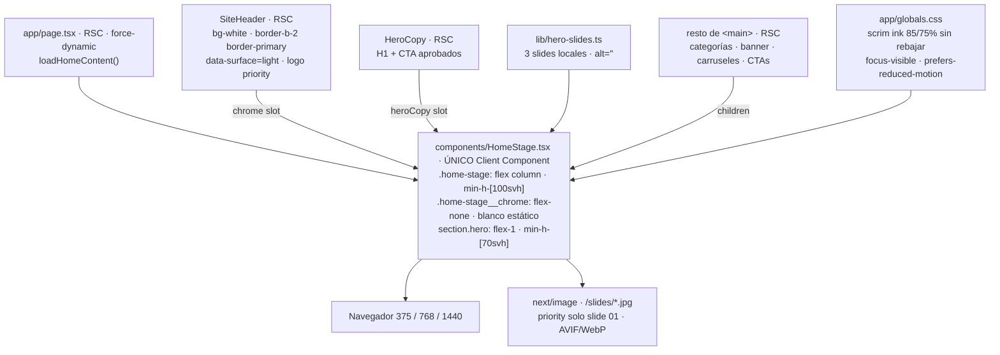

# Design Doc: DD-HOME-23 — Slide del Home después de un header normal (reversión del overlay)

| Campo | Valor |
|---|---|
| **ID** | **DD-HOME-23**. No se reutiliza ningún ID anterior; `DD-HOME-20`, `-21` y `-22` ya existen (`design-doc-home-20.md`, `design-doc-home-21.md`, `design-doc-home-slide.md`) |
| **Autor** | `forge-architect` (Staff Engineer, APEX FORGE) |
| **Estado** | **Approved — listo para construcción**, 27-nov-2026. Diseño congelado. **No autoriza `commit`, `push` ni despliegue**: `apex-forge` debe autorizar expresamente Fase 2 |
| **Fecha** | 27 de noviembre de 2026 |
| **Decisor final** | `apex-forge` (Comandante), con la corrección verbal del cliente registrada en §1.1 |
| **Idioma** | Español (lo lee el cliente). Identificadores de código, tokens y nombres de tests en inglés (AGENTS.md) |
| **Tipo** | Archivo **nuevo**. No edita ningún DD anterior; la supersesión parcial se registra en §11 |
| **Precedencia** | Siguen vigentes `mvp-requisitos.md`, `design-doc-mvp.md`, los arbitrajes A1…A8/C-HOME-01/C-HOME-02, DD-HOME-19 y **todo DD-HOME-22 salvo lo explícitamente revocado en §11** |
| **Alcance** | `components/SiteHeader.tsx`, `components/HomeStage.tsx`, `app/page.tsx`, `app/globals.css` y los tests de Home listados en §7.2. Sin `app/layout.tsx`, sin `lib/**`, sin assets nuevos, sin datos, endpoints, env vars, CSP ni CI nuevos |

> **Regla de oro:** el diseño se aprueba antes del código. Los fragmentos de interfaces y reglas CSS de este documento son **artefactos de diseño**, no implementación. Quien construye escribe los tests; `forge-reviewer` da el LGTM obligatorio; `forge-qualis` valida la estrategia. **Este documento no versiona ni despliega nada.**

---

## 0. Resumen ejecutivo (cliente)

El cliente corrigió la interpretación de DD-HOME-22: **no quiere el header fusionado con la foto**. Textualmente: «no me entendiste la idea de fusionar el slide, dejalo normal, la imagen del slide, que se vea despues del header, y que se autoreproduzca». Tras la aclaración de Fase 0, la decisión es:

1. El header vuelve a ser **normal**: blanco, opaco, en flujo documental, con su borde verde de 2 px, sin transparencia y sin aparecer u ocultarse con hover, foco o tacto.
2. La foto del slide se ve **después del header** y ocupa **casi todo el viewport restante**: el conjunto header + hero llena la pantalla (`100svh`) sin solape y sin espacio compensatorio.
3. El slide **sigue autoreproduciéndose** igual: 5 s por foto, pausa al pasar el puntero por el slide, al enfocar los controles, con botón explícito, con `prefers-reduced-motion: reduce` y con las tres fotos aprobadas. El H1, el CTA y **Poppins en todo el sitio** no cambian.

En corto: se mantiene el propósito original del cliente («casi a pantalla completa») y su autoplay; solo se corrige **dónde está el header**: fuera de la foto, no encima. La reversión es pequeña, reversible y no añade riesgo de datos ni de licencias.

---

## 1. Contexto y problema

### 1.1 Pedido corregido (Fase 0 cerrada)

DD-HOME-22 interpretó «slide casi a pantalla completa» como un header superpuesto y transparente que se revelaba bajo el puntero, el foco o de forma permanente en táctil. El cliente lo ha desmentido: quiere el header normal y la imagen debajo. No hay nueva ambigüedad sobre el resultado visual:

- Header: blanco/opaco siempre; mismo estado que antes de DD-HOME-22 (`bg-white`, `border-b-2 border-primary`, `data-surface="light"`, logo con `priority`).
- Slide: inmediatamente después del header; casi todo el viewport restante. Sin velo superior sobre la foto.
- Autoplay: sin cambios de producto (5 s, pausa, reduce, controles). El único ajuste de alcance es que el área de pausa por puntero pasa a ser **el slide**, porque el header ya no está sobre la foto; ver D-23-06 en §10.

### 1.2 Estado verificado en el repositorio (no asumido)

| Hecho | Evidencia |
|---|---|
| `SiteHeader` tiene prop `overlay`, fondo condicional y logo sin `priority` bajo overlay | `components/SiteHeader.tsx:5-36` (`overlay?: boolean` en `:8`, `priority={!overlay}` en `:18`, `backgroundClass` en `:27`) |
| `app/page.tsx` pasa `overlay` al header dentro del slot `chrome` | `app/page.tsx:27-33` |
| El wrapper del header es absoluto, transparente y revela blanco con `:hover`, `:focus-within` y `@media (hover:none)` | `components/HomeStage.tsx:109-117` (handlers) y `app/globals.css:87-101,136-151` |
| El hero compensa la altura del header con `--stage-chrome-h` y lleva un velo superior | `app/globals.css:84,97-114`; `components/HomeStage.tsx:149-158` (`hero__top-veil` en `:151`, `pt-[calc(...)]` en `:158`) |
| El scrim del copy usa `ink` 85 % (y 85 %→75 % en desktop) y no se ha rebajado | `app/globals.css:116-134` |
| Hay un único Client Component con `data-hydrated` para el reloj determinista | `components/HomeStage.tsx:1,23,35-37`; `tests/e2e/home-slide.spec.ts:77-81` |
| Poppins y el resto de secciones son independientes del header | `app/layout.tsx` (sin cambios en este DD); `app/page.tsx:36-60` |
| El OK de `forge-sentinel` de DD-HOME-22 cubre tipografía y chrome, sin nuevos flujos de datos | `docs/02-arquitectura/design-doc-home-slide.md:138,452,612` |

### 1.3 Lo que NO se revisa de DD-HOME-22

Se conservan literalmente: las tres fotos y sus hashes (`lib/hero-slides.ts`, `public/slides/*.jpg`), `alt=""`, el H1 «Belleza para tu piel y tu cabello», el CTA «Explorar piel» → `/piel`, la máquina `shouldAutoplay`/`nextIndex` (`lib/hero-playback.ts`), la excepción del toggle (DD-HOME-22.5), los controles accesibles, `prefers-reduced-motion`, `visibilityState`, la limpieza del intervalo, Poppins 400/500/600/700, el presupuesto de 150 KB, A2/`noindex`, CSP `report-only` y `data-hydrated`.

### 1.4 Objetivos medibles

| # | Objetivo | Verificación | Test |
|---|---|---|---|
| O1 | Header blanco y opaco a 375/768/1440 y en touch; sin revelado por hover/foco | Colores computados del `<header>` y del wrapper | HOME-E2E-27, -34 |
| O2 | Hero después del header, sin solape y con ~100svh de conjunto | Geometría de cajas + `min-height` del stage | HOME-E2E-34, -36 |
| O3 | Autoplay de 5 s y pausa en slide/controles/botón/`reduce` sin cambios funcionales | Reloj determinista | HOME-E2E-30…32 |
| O4 | AA del copy y del anillo de foco sobre foto en 3 anchos × 3 slides | Muestreo de píxel compuesto | HOME-E2E-35 |
| O5 | Cero CLS y LCP candidato = slide 01 o H1 | `PerformanceObserver`, sin reloj falso | HOME-E2E-36, -39 |
| O6 | Poppins cargada en todas las rutas; sin peticiones externas | `document.fonts.check` + CSS emitido | HOME-E2E-37 |

---

## 2. No-objetivos

| ID | Explícitamente fuera de alcance | Motivo |
|---|---|---|
| N-23-01 | Header fusionado, transparente, con `:hover`/`:focus-within`/`hover:none` que revelen fondo | El cliente lo ha rechazado literalmente |
| N-23-02 | `--stage-chrome-h`, `padding-top` compensatorio, velo superior sobre la foto ni segundo borde en el wrapper | El header ya no se superpone: no hay nada que compensar |
| N-23-03 | Header `sticky`, `IntersectionObserver`, scroll listeners ni transición de fondo | N-22-09 sigue vigente; cambiaría navegación y añadiría JS/INP |
| N-23-04 | Cuarto slide, vídeo, copy nuevo, claims, precios ni `aria-live` | N-22-01/-02/-08 siguen vigentes |
| N-23-05 | Cambiar H1, CTA, fotos, hashes, `alt`, nombres de slides ni Poppins | DD-HOME-22 sigue vigente en esos puntos |
| N-23-06 | Cambiar la máquina de estados, los 5 s, la excepción del toggle ni `data-hydrated` | El autoplay «se mantiene igual»; ver D-23-06 para el alcance del hover |
| N-23-07 | Nuevos datos, Prisma, endpoints, env vars, secretos, CSP `enforce`, A2/F5 ni analítica | Sin superficie de seguridad nueva; el OK de Sentinel previo sigue vigente |
| N-23-08 | Nuevas dependencias o evaluación de versión mayor | Stack fijado (Next 15 / React 19 / Tailwind v4); A7/A11 ya documentan las evaluaciones |
| N-23-09 | Reescribir DD-HOME-20/-21/-22 ni borrar sus decisiones vigentes | D6 de DD-HOME-22: los DD aprobados se conservan como historia |
| N-23-10 | Tocar carruseles, secciones ocultas, footer, `app/layout.tsx`, `lib/**` ni assets | Reversión quirúrgica del chrome |
| N-23-11 | `commit`, `push`, despliegue ni publicación | Requiere autorización explícita del Comandante |

---

## 3. Requerimientos y restricciones

### 3.1 Funcionales

| ID | Requisito |
|---|---|
| F-23-01 | `<header>` con `data-surface="light"`, fondo `rgb(255,255,255)`, borde inferior 2 px `rgb(27,93,74)` y texto `ink`, en los tres anchos y en touch; sin pseudo-clases que cambien el fondo |
| F-23-02 | El logo del header se renderiza con `priority` (vuelve a su estado previo a DD-HOME-22); el slide 01 mantiene su `priority` propio |
| F-23-03 | Contenedor del stage en flujo documental: `min-height: 100svh`, `display: flex`, `flex-direction: column`; header `flex: none` con altura natural; hero `flex: 1` con `min-height: 70svh` |
| F-23-04 | El hero empieza justo después del header: sin solape de cajas y sin velo superior; el copy conserva un padding ordinario (`pt` estándar, sin `var(--stage-chrome-h)`) |
| F-23-05 | Autoplay de 5000 ms por slide; pausa por puntero **en el slide**, por foco en controles, por botón explícito, por `visibilityState !== 'visible'` y por `reduce`; limpieza al desmontar |
| F-23-06 | Tres slides, un H1, un CTA, flechas, puntos con `aria-current`, toggle con `aria-pressed`; sin `aria-live` |
| F-23-07 | `data-hydrated="true"` se sigue escribiendo en `.home-stage` tras la hidratación para los tests de reloj determinista |
| F-23-08 | Poppins 400/500/600/700 en todas las rutas; sin recursos tipográficos externos |

### 3.2 No funcionales

| Situación | Autoplay | Header | Mecanismo |
|---|---|---|---|
| Ratón fuera del slide | Sí (5 s) | Blanco | Estado inicial, sin CSS condicional |
| Ratón sobre el slide | Pausado | Blanco | `pointerenter`/`pointerleave` en `section.hero` (sin cambios) |
| Ratón sobre el header | No pausa (D-23-06) | Blanco | El header sale del área de pausa; sin handlers en el wrapper |
| Foco en flechas/puntos | Pausado | Blanco | `focusin`/`focusout` en el slide (sin cambios) |
| Foco en toggle Pausar/Reanudar | Exento de `focusPaused` (DD-HOME-22.5) | Blanco | `[data-playback-toggle]` (sin cambios) |
| Botón activado / pestaña oculta / `reduce` | Pausado, 0 intervalos con `reduce` | Blanco | Lógica pura y `useEffect` existentes |
| Touch (`hover:none` / `pointer:coarse`) | Sí (5 s), pausa con el botón | Blanco | Ya no depende de `matchMedia` para el color; la rama táctil del test sigue comprobando el estado |

- **Accesibilidad:** WCAG 2.2 AA; un H1; landmarks únicos; anillo `ink` de 2 px con offset 2 px; SC 2.2.2 con botón explícito; `alt=""`; slides inactivos `aria-hidden`; axe 0 críticas/serias en 375/768/1440 y en los 3 slides.
- **Contraste:** se conservan los tokens del scrim de DD-HOME-22 sin rebajarlos: `ink` al 85 % en móvil y 85 %→75 % en desktop. Los valores medidos en DD-HOME-22 fueron **7,5–7,75:1** para el copy y el CTA (el cálculo pesimista del DD anterior era 5,55:1; ambos superan 4,5:1). El anillo sobre la placa `surface` y sobre el header blanco mantiene **11,77:1** (≥3:1). Al desaparecer el velo superior ya no hay texto del header compuesto sobre foto: ese muestreo se retira del test (§7.2).
- **Rendimiento:** Home ≤ 150.000 B gzip, total ≤ 300.000 B; LCP p75 < 2,5 s, CLS p75 < 0,1 (objetivo 0), INP p75 < 200 ms, TTFB p75 < 800 ms. `100svh` + flex evita medición en runtime y therefore CLS. El presupuesto lo mide **solo** el job `bundle budget` de CI con artefactos de build; nunca Playwright.
- **Seguridad:** sin datos, auth, secretos ni PII nuevos. El OK de `forge-sentinel` de DD-HOME-22 (tipografía y chrome) **sigue vigente** porque este cambio es estrictamente una reversión visual sin nuevas superficies; se registra en el acta de release. `forge-reviewer` da el LGTM obligatorio al código.
- **Compatibilidad:** Next 15 (`>=15.5.29 <16`), React 19, TS strict, Tailwind v4, Vitest + Playwright. Sin cambio de versión mayor que evaluar.

---

## 4. Solución propuesta

### 4.1 Arquitectura



Árbol resultante (landmarks intactos):

```
<div class="home-stage">              ← flex column, min-h 100svh, en flujo
  <div class="home-stage__chrome">    ← flex-none, blanco estático, sin handlers
    <SiteHeader />                    ← <header data-surface="light"> bg-white
  </div>
  <main id="main" tabIndex={-1}>
    <section class="hero" ...>        ← flex-1, min-h 70svh, después del header
      <div class="hero__media">3 imágenes absolutas</div>
      <div class="hero__scrim" />     ← sin hero__top-veil
      <div class="hero__copy">{heroCopy}</div>
      <div class="hero__controls">◀ · 1 · 2 · 3 · ▶ · Pausar</div>
    </section>
    {children}                        ← servidor, sin cambios
  </main>
</div>
<SiteFooter ... />
```

**Por qué este límite cliente/servidor:** no cambia. El único estado del navegador sigue siendo el índice del slide y las banderas de pausa; el header, el H1, el CTA y el resto de secciones llegan como slots RSC. No hay `fetch` de cliente, no hay contexto compartido y no se hidrata contenido ajeno al hero.

### 4.2 Contratos de componentes (diseño, no implementación)

```ts
// Design-only interface. No production code in this document.
type HomeStageProps = {
  chrome: React.ReactNode;   // <SiteHeader /> — server-rendered, unchanged slot
  heroCopy: React.ReactNode; // <HeroCopy> with the single h1 and CTA
  slides: readonly HeroSlide[];
  children: React.ReactNode; // rest of <main>
};

type SiteHeaderProps = {
  navigation: HomeContent['navigation'];
  whatsappUrl: string | null;
  // No `overlay` prop: the header has one visual state everywhere.
};
```

- `components/SiteHeader.tsx`: eliminar `overlay?: boolean`, el parámetro `overlay` de `BrandMark`, `priority={!overlay}` → `priority`, `backgroundClass` y el condicional de clases. La raíz queda `border-b-2 border-primary bg-white text-ink` con `data-surface="light"`. Búsqueda `GET`, `<details>` nativo y WhatsApp CTA intactos.
- `components/SiteHeader.tsx:25-27`: se retira el comentario que explica el overlay; no se sustituye por otro estado.
- `app/page.tsx:27-33`: se quita solo la prop `overlay` del `<SiteHeader>`. El slot `chrome` y el orden de secciones no cambian.
- `components/HomeStage.tsx`: se conserva `chrome` como slot RSC y el wrapper `.home-stage__chrome` (decisión D-23-02). Se eliminan **solo** los cuatro handlers de `:111-114`; los handlers de `section.hero` (`:123-126`) siguen intactos. Sin estado nuevo, sin `fetch` y sin `matchMedia` adicional.

### 4.3 Contrato de layout CSS (decisión D-23-03)

| Regla | Contrato de diseño | Por qué |
|---|---|---|
| `.home-stage` | `position: static` (en flujo), `display: flex`, `flex-direction: column`, `min-height: 100svh` | Header + hero llenan el viewport sin solape; `svh` evita el salto de la barra de URL móvil |
| `.home-stage__chrome` | `flex: none`, `background-color: var(--color-white)`, sin `position`, sin `z-index`, sin `border`, sin `transition`, sin `:hover`/`:focus-within`/`@media` | Simple contenedor blanco estático: mantiene el selector de los tests y un solo Client Component |
| `section.hero` | `flex: 1 1 auto`, `min-height: 70svh`, `position: relative`, `overflow: hidden`, `bg-ink` | Crece hasta ocupar todo el viewport restante; el suelo de 70svh evita colapso con headers altos |
| `.hero__copy` | padding superior ordinario (por ejemplo `pt-16 md:pt-24`), sin `calc(var(--stage-chrome-h) + 2rem)` | No hay chrome superpuesto que compensar |
| `.hero__scrim` | **Sin cambios**: `ink` 85 % en móvil; 85 %→75 %→transparente desde 1024 px | No se rebaja el contraste medido en DD-HOME-22 |
| Eliminar | `--stage-chrome-h` (`:84`, `:97-101`), `.hero__top-veil` (`:103-114`) y su nodo en `HomeStage.tsx:149-152`, reglas de revelado (`:136-151`) | Desaparece el motivo de todas ellas |
| Conservar byte-for-byte | `@layer base`, tokens `@theme`, `[data-surface='dark']` y `@media (prefers-reduced-motion: reduce)` (`:153-165`) | DD-HOME-21 y RNF-MVP-008 siguen vigentes |

**Por qué gana:** es la reversión más pequeña que satisface la corrección del cliente. El wrapper se mantiene como ancla estable para los tests y el slot RSC, pero deja de tener comportamiento. Todo el cambio es CSS estático + borrado de props/handlers: reversible con un `git revert` y sin superficie nueva de hidratación.

### 4.4 Autoplay (sin cambios de estado)

`activeIndex ∈ {0,1,2}`; banderas `explicitPaused`, `hoverPaused`, `focusPaused`, `reduce` y su función pura `shouldAutoplay` se conservan. El intervalo sigue dependiendo de `[canAutoplay, activeIndex, slides.length]`, comprueba `document.visibilityState` y se limpia al desmontar. DD-HOME-22.5 (toggle exento de `focusPaused`), `aria-current`, las flechas/puntos y `data-hydrated` siguen iguales. La única diferencia de alcance es que los handlers de puntero/foco viven **solo** en `section.hero`; el wrapper del header ya no participa (D-23-06).

### 4.5 Contraste y velos

No se crea un velo nuevo: el `hero__scrim` existente es suficiente y no se modifica. Al ir el header en flujo blanco, desaparece el caso «texto `ink` sobre foto» que exigía muestreo del nav, del menú, del enlace de marca y de la placa del logo. El copy blanco y el anillo `ink` sobre la placa `surface/95` se miden igual que en DD-HOME-22: **3 anchos × 3 slides**, umbrales **4,5:1** y **3:1**, respectivamente. Los valores medidos (7,5–7,75:1) se conservan; no se rebajan los tokens al 85 %/75 %.

### 4.6 Por qué gana

| Criterio (prioridad APEX FORGE) | Esta solución | Alternativa |
|---|---|---|
| **Correctitud** | Cumple literalmente la corrección del cliente: foto debajo de un header normal; sin solape, sin CLS | Mantener el overlay contradice el pedido y obliga a seguir midiendo contraste del header sobre foto |
| **Mantenibilidad** | Una prop menos, cuatro handlers menos y CSS estático; el wrapper sigue siendo un ancla de test | Quitar el wrapper obliga a reescribir selectores en cuatro tests y a rediseñar el slot |
| **Rendimiento** | Sin JS nuevo, sin observadores; `priority` del logo vuelve a su estado original | Header sticky con scroll listeners añade INP y superficie de regresión |
| **Velocidad de entrega** | Reversión de un archivo de DD y ajustes de tests; `git revert` limpio | Una nueva solución de fusión requeriría reabrir DD-HOME-22 y QA |

---

## 5. Alternativas evaluadas

### A — Header en flujo + stage flex con hero `flex-1` (**GANADORA**)

- **Pros:** cumple O1…O6; reversión mínima; un solo Client Component; conserva slots RSC, scrim, autoplay y Poppins; selector `.home-stage__chrome` estable para tests.
- **Contras:** el logo vuelve a competir con el LCP del slide (se acepta: es el estado previo aprobado y el slide sigue siendo el candidato grande) y hay que ajustar el conteo de preloads en HOME-E2E-36 (§7.2).
- **Motivo:** es la única opción que respeta la corrección del cliente sin reabrir el autoplay ni los assets.

### B — Mantener el overlay de DD-HOME-22 (RECHAZADA)

- **Pros:** cero cambios; tests actuales en verde.
- **Contras:** ignora la corrección explícita «dejalo normal… que se vea después del header»; mantiene pseudo-clases, velo superior y muestreo de contraste del header innecesarios.
- **Motivo de rechazo:** el cliente decide el «qué»; el equipo decide el «cómo». Aquí el «qué» ha cambiado.

### C — Header `sticky` que recupera el fondo al salir del hero (RECHAZADA)

- **Pros:** patrón editorial habitual.
- **Contras:** cambia la navegación actual, añade JS de scroll, transición de fondo y nuevos tests; contradice N-22-09.
- **Motivo de rechazo:** no pedido, no reversible en un cambio de clases y peor para presupuesto/foco.

### D — Eliminar `.home-stage__chrome` y pasar el header fuera de `HomeStage` (RECHAZADA)

- **Pros:** árbol DOM más corto.
- **Contras:** rompe el slot `chrome` y los selectores de `home.spec.ts`, `home-slide.spec.ts` y el caso de hover del header; obliga a mover handlers o a reescribir más tests sin beneficio funcional.
- **Motivo de rechazo:** más cambios para el mismo resultado; se prefiere el wrapper estático (D-23-02).

### E — Hero absoluto con `padding-top` compensatorio (RECHAZADA)

- **Pros:** conserva la altura previa del hero sin flex.
- **Contras:** reintroduce `--stage-chrome-h`, depende de la altura real del header a 375 px (menú + búsqueda) y puede generar solape o CLS.
- **Motivo de rechazo:** es exactamente el patrón que el cliente ha pedido retirar.

---

## 6. Riesgos y mitigaciones

| ID | Riesgo | Mitigación | Dueño |
|---|---|---|---|
| R-23-01 | Header alto a 375 px (menú + buscador) coma espacio al hero | `min-h-[70svh]` + `flex-1`; HOME-E2E-34 verifica 0 solape y 0 overflow en los 3 slides | `forge-frontend` |
| R-23-02 | CLS por cambio de altura del stage | Sin medición en runtime; `svh` y flex puros; HOME-E2E-36 con `PerformanceObserver` sin reloj falso | `forge-frontend` + `forge-qualis` |
| R-23-03 | Regresión de contraste al retirar el velo superior | Scrim `ink` 85/75 % intacto; HOME-E2E-35 mide copy y foco en 3 anchos × 3 slides | `forge-qualis` |
| R-23-04 | Selectores `.home-stage__chrome` queden obsoletos | Se conserva el wrapper (D-23-02); solo cambian las expectativas de color en §7.2 | `forge-frontend` |
| R-23-05 | `priority` del logo añada un segundo preload y rompa HOME-E2E-36 | El ámbito es el conteo de preloads: exigir **uno de slide** y permitir el del logo; ver §7.2 y D-23-05 | `forge-qualis` |
| R-23-06 | Caso «hover del header pausa» de HOME-E2E-31 quede sin cumplir al quitar handlers | Retirar ese caso y conservar el de hover del slide; HOME-E2E-40 reservado si QA quiere explicitar la no-pausa; confirmar D-23-06 | `apex-forge` + `forge-qualis` |
| R-23-07 | Tests antiguos sigan esperando `overlay`/transparencia | Tabla §7.2 con path:línea; barrido de `overlay` en código y tests antes del review | `forge-reviewer` |
| R-23-08 | Reinterpretar que el autoplay cambia por completo | La máquina de estados y DD-HOME-22.5 quedan byte-for-byte; solo cambia el área de pausa por puntero | `forge-architect` |
| R-23-09 | Doble firma de seguridad innecesaria o perdida | OK de `forge-sentinel` de DD-HOME-22 vigente; se anota su reuso, sin nuevos flujos de datos | `forge-sentinel` |
| R-23-10 | Deploy sin autorización | Sin commit/push/deploy en este DD; rollback al ID anterior solo con Go de `apex-forge` | `apex-forge` + `forge-infra` |

---

## 7. Estrategia de testing

Responsable: `forge-qualis`. Quien construye, prueba. `@smoke` en cada PR; suite completa y axe en release; `retries: 0`. La política de reloj de DD-HOME-22 no cambia: `page.clock` solo en HOME-E2E-30/-31/-32; **nunca** en -36/-39; sin `fastForward`; `runFor(0)` y `aria-current` tras cada paso.

### 7.1 Unitarias / integración (sin cambios)

| Prueba | Estado |
|---|---|
| `tests/unit/hero-playback.test.ts` | Sin cambios: la tabla de verdad de `shouldAutoplay` no se toca |
| `tests/unit/hero-slides.test.ts` | Sin cambios: mismos 3 slides y hashes |
| `tests/integration/home-content.integration.test.ts` | Sin cambios: el hero no lee `app_config` |
| `vitest.config.ts` (umbral per-file 90/85/90 de `lib/hero-playback.ts`) | Sin cambios |

### 7.2 Impacto exacto en tests existentes (cirugía, no borrado de suites)

| Archivo : línea | Test | Acción |
|---|---|---|
| `tests/e2e/home.spec.ts:630-774` | HOME-E2E-27 (chrome blanco, `:630`) | **Volver al estado previo a DD-HOME-22**: `headerBackground` → `rgb(255, 255, 255)` (`:723`); quitar la aserción de wrapper transparente (`:724`) o cambiarla a blanco; quitar el comentario de mouse sobre el header (`:635-638`, el `mouse.move` puede permanecer); quitar el bloque de revelado hover/foco del wrapper (`:748-758`). Conservar `data-surface`, borde 2 px `primary` (`:726`), footer, textos `ink`, dorado decorativo, `submit` y overflow 375 (`:771`). El wrapper static blanco mantiene válido el selector de `:643`. |
| `tests/e2e/home.spec.ts:776-910` | HOME-E2E-37 (Poppins, `:785`) | **Sin cambios**. El button probe sigue excluyendo `<nextjs-portal>` mediante el ámbito `main button, header button, footer button` (`:816`); no ampliar a `page.locator('button')`. |
| `tests/e2e/home.spec.ts:65` | HOME-E2E-29 | **Sin cambios funcionales**. Nota de precisión: este test vive en `home.spec.ts`, no en `home-slide.spec.ts`; el encargo lo agrupó con la suite de slide por error material. |
| `tests/e2e/home-slide.spec.ts:249-268` | HOME-E2E-30 | Sin cambios: reloj determinista, 4999/5000 ms y wrap 3→1. |
| `tests/e2e/home-slide.spec.ts:270-407` | HOME-E2E-31 | Conservar hover del slide (`:271-280`), foco en flecha (`:293-304`), toggle DD-HOME-22.5 (`:306-331`), `visibilityState` (`:333-365`) y limpieza (`:367-406`). **Único cambio:** retirar el caso «hovering the header wrapper freezes the deck» (`:282-291`), incompatible con quitar los handlers del wrapper (D-23-06). Si `forge-qualis` quiere explicitar el nuevo alcance, usar HOME-E2E-40 (§7.3). |
| `tests/e2e/home-slide.spec.ts:409-446` | HOME-E2E-32 | Sin cambios: 0 intervalos con `reduce`, transición `0s`, navegación manual instantánea. |
| `tests/e2e/home-slide.spec.ts:448-482` | HOME-E2E-33 | Sin cambios: nombres exactos, foco retenido, `aria-current`. |
| `tests/e2e/home-slide.spec.ts:484-567` | HOME-E2E-34 | Cambiar la expectativa del bloque desktop (`:485-550`): `<header>` **y** wrapper en `rgb(255,255,255)` (`:516-517`), sin revelado; eliminar el bloque hover/foco que esperaba blanco «revelado» (`:522-531`); conservar borde 2 px del header y 0 px del wrapper (`:518-519`), `overlap === 0` (`:520`) y el bucle de 0 overflow tras avanzar slides (`:533-548`). La rama táctil (`:552-566`) sigue aseverando `matchMedia('(hover: none), (pointer: coarse)').matches === true` antes de comprobar el blanco, ahora en `<header>` y wrapper sin hover. Renombrar el título del `describe` de «header overlay» a «static header above slide». |
| `tests/e2e/home-slide.spec.ts:569-655` | HOME-E2E-35 | **Eliminar el muestreo del chrome**: quitar de `targets` (`:604-636`) `header nav`, `header menu`, `brand link` y `logo plate`. Mantener `copy text` (`:605-611`) y `focus ring` (`:630-635`) en **3 anchos × 3 slides**, con umbrales 4,5:1 y 3:1 (`:647-650`). La comprobación de visibilidad de nav/menu (`:580-582`) puede permanecer como guarda DOM, no como píxel. Cambiar la aserción del wrapper transparente (`:599-602`) a blanco. Actualizar el comentario de `:593-594`: ya no hay velo superior. |
| `tests/e2e/home-slide.spec.ts:657-715` | HOME-E2E-36 | Sin cambios en su propósito, **pero ajustar el conteo de preloads** (`:693-701`): con el logo en `priority`, filtrar `link[rel="preload"][as="image"]` cuyo `imagesrcset` contenga `/slides/` y exigir exactamente **1** (`hero-01.jpg`); los preloads de `/brand/logo.png` quedan permitidos. Mantener CLS < 0,1, AVIF/WebP por `Accept` y `loading` lazy en 02/03. Ver D-23-05. |
| `tests/e2e/home-slide.spec.ts:717-741` | HOME-E2E-38 | Sin cambios: hashes de las tres fotos, 0 src remotos ni `/Imagenes/`. |
| `tests/e2e/home-slide.spec.ts:743-770` | HOME-E2E-39 | Sin cambios: LCP candidato = `hero-01.jpg` u `h1#hero-title`; vigilar que el preload del logo no desplace el candidato. |
| `tests/e2e/home-brand.spec.ts:32-57` | Guardas de logo (verificación adicional) | **Sin cambio previsto**: Next 15 emite preload para `priority`, no `fetchpriority="high"` en el `` (ver `home-slide.spec.ts:691-692`). Si el atributo apareciera al restaurar `priority`, actualizar la aserción de `:44`/`:54` para reflejar el estado aprobado, con LGTM de QA. No forma parte del alcance mínimo. |
| `tests/e2e/home-highlights.spec.ts:98`, `:347-394` | Orden de secciones / HOME-E2E-25 | Sin cambios: `.home-stage` se conserva y el `priority` del logo está fuera de la región de productos. |
| `tests/e2e/home.spec.ts:365-366` | Barrido «gold on light» | Sin cambios: la exclusión de `.home-stage`/`.home-stage__chrome` queda inofensiva con el wrapper blanco. |
| `tests/dynamic-e2e/home-dynamic.spec.ts:411-457` | HOME-E2E-28 | Sin cambios: WhatsApp y nav del header intactos. |
| `playwright.config.ts:27-31` | Bloque táctil | Sin cambios: el proyecto mantiene la rama táctil para HOME-E2E-34. |

### 7.3 IDs nuevos (reservados, no obligatorios)

| ID | Uso | Etiqueta |
|---|---|---|
| HOME-E2E-40 | Si `forge-qualis` quiere explicitar que el hover del **header** no pausa el autoplay (sustituyendo funcionalmente al caso retirado de `:282-291`): tras hidratar y con el reloj congelado, `header.hover()` + `runFor(6000)` ⇒ el índice avanza; el hover del slide sigue congelándolo | `@a11y` (sin `@smoke` hasta estabilizar) |

No se renombran HOME-E2E-29…39. Cualquier cambio de etiqueta requiere aprobación de `forge-qualis`.

### 7.4 Puertas (idénticas a DD-HOME-22)

| Puerta | Dónde | Fuente de verdad |
|---|---|---|
| `lint`, `typecheck`, `test` (unitarias con umbrales per-file), `test:integration` | Jobs de CI | Logs del job |
| `test:e2e:smoke`, `test:a11y`, `test:e2e` completo | Job `e2e` (Playwright + axe, `retries: 0`) | HOME-E2E-27, -29…39 y guardas ajustadas en §7.2 |
| `test:e2e:dynamic` | Suite dinámica | HOME-E2E-28 y -38 |
| `build` + **`check:bundle`** | Job `bundle budget`, con artefactos `next-build` y `.next/BUILD_ID` | Ese job, nunca Playwright |
| Revisión | `forge-reviewer` (LGTM obligatorio) | Sin aprobación propia |
| Seguridad | OK de `forge-sentinel` de DD-HOME-22 vigente | Sin datos/auth/secretos nuevos; se anota el reuso |

Un job rojo bloquea el merge; no se acepta «casi AA».

---

## 8. Rollout y rollback

### 8.1 Rollout

Sin canary (DD-MVP-15). Construcción en commits pequeños sobre `main` **solo tras autorización expresa de Fase 2**; CI en verde en cada paso, incluido `bundle budget`. El cambio viaja con la siguiente promoción ya aprobada, con Deployment Protection y `noindex` vigentes (A2). `forge-infra` registra en el acta el **ID del deployment anterior** antes del Go/No-Go; sin ese ID no hay rollback instantáneo. **Este DD no autoriza commit, push ni deploy.**

### 8.2 Rollback al estado DD-HOME-22 (< 2 min)

| Mecanismo | Cuándo | Cómo |
|---|---|---|
| ***Instant rollback*** | Incidente en producción | Redeploy del ID de deployment anterior (estado DD-HOME-22) registrado en §8.1; sin rebuild ni commits nuevos; objetivo < 2 min desde la detección |
| **`git revert` + CI** | El redeploy no basta o hay que retirar el código | Revertir los commits de DD-HOME-23, esperar CI verde (incluido `bundle budget`) y promover |

**Lista de reversión:** `components/SiteHeader.tsx` (prop `overlay`, `priority={!overlay}`, fondo condicional), `components/HomeStage.tsx` (handlers del wrapper, velo, padding compensatorio), `app/page.tsx` (`overlay`), `app/globals.css` (reglas del stage y revelado), y los tests de §7.2. No hay cambios en `app/layout.tsx`, `lib/**`, `public/**`, DB, migraciones, env vars, cache keys, A2/F5 ni CSP. La reversión es exactamente el estado previo: **commit previo / redeploy del ID anterior**.

La disciplina de DD-HOME-22 se mantiene: drill cronometrado con acta, ventana reforzada de 30 min (5xx, 4xx de `/_next/image`, uptime, Speed Insights), SLO 99,5 % / 30 días ≈ 216 min de presupuesto de error y postmortem sin culpables en ≤ 72 h para Sev-1/Sev-2.

**Disparadores:** overlap header/hero, overflow 375 px, CLS ≥ 0,1, LCP > 2,5 s, copy < 4,5:1 o foco < 3:1 en cualquier slide, axe crítico/serio, autoplay que no respete `reduce` o pierda la pausa explícita, bundle > 150 KB en `bundle budget`, y cualquier petición externa de fuente/imagen.

Tras la reversión: smoke de las 7 superficies + axe 375 + Poppins cargada en `/`, `/piel`, `/tiendas` + overflow 375 + `git diff` contra el commit previo de DD-HOME-22.

### 8.3 Monitoreo

Solo observabilidad técnica sin PII (logs con `requestId`, 5xx, 4xx de `/_next/image`, Vercel Speed Insights, uptime y lab CWV en Preview). Sin analítica de interacción con el slide. HOME-E2E-30…40 sustituyen cualquier telemetría de interacción.

---

## 9. Métricas de éxito

| Métrica | Umbral | Fuente | Ventana | Owner |
|---|---|---|---|---|
| Header normal | `rgb(255,255,255)` + borde 2 px `rgb(27,93,74)` en 375/768/1440 y touch; 0 reglas de revelado | HOME-E2E-27, -34 + revisión de CSS | Cada PR + release | `forge-frontend` |
| Layout | `overlap === 0`, stage `min-height 100svh`, hero `flex-1 min-h 70svh`, 0 overflow a 375 en los 3 slides | HOME-E2E-34, -36 | Cada PR | `forge-frontend` |
| Autoplay | 5000 ms ± un frame; pausa en slide/controles/botón/`reduce`/visibility; 0 intervalos con `reduce`; limpieza al desmontar | HOME-E2E-30…32 | Cada PR + release | `forge-qualis` |
| Contraste | Copy ≥ 4,5:1 y foco ≥ 3:1 por píxel compuesto en 3 anchos × 3 slides; axe 0 críticas/serias | HOME-E2E-35 + pasadas axe | Cada PR (`@a11y`) + release | `forge-qualis` |
| CLS / LCP | CLS < 0,1 (objetivo 0); candidato = slide 01 u H1; p75 < 2,5 s | HOME-E2E-36, -39 (lab) y Speed Insights (campo) | Lab por release; campo 7–28 días | `forge-frontend` + `forge-qualis` |
| Bundle | Home ≤ 150.000 B gzip; total ≤ 300.000 B | Job `bundle budget` con artefactos de build | Cada PR + release | `forge-infra` |
| Tipografía | Poppins 400/500/600/700, `document.fonts.check`, woff2 same-origin, 0 Inter/Playfair/Helvetica/Nihlo | HOME-E2E-37 | Cada PR en 3 rutas | `forge-frontend` + `forge-qualis` |
| Regresión | HOME-E2E-01…39 y dinámicas en verde; solo §7.2 se modifica | Suite completa + dinámica | Cada release | `forge-qualis` |
| Reversibilidad | < 2 min cronometrados en drill; redeploy al ID anterior sin rebuild | Acta + ID de deployment + panel SLO | Pre-go-live y 30 min post-deploy | `forge-qualis` + `forge-infra` |

---

## 10. Decisiones del Comandante y preguntas abiertas

| # | Decisión | Resolución | Estado |
|---|---|---|---|
| D-23-01 | ID del DD | **DD-HOME-23**, archivo nuevo; no se renombran 20/21/22 | Aceptada por el arquitecto; registrar en §11 |
| D-23-02 | Wrapper del header | **Conservar** `.home-stage__chrome` como simple contenedor blanco estático en flujo (`flex-none`), sin handlers ni pseudo-clases. Minimiza cambios de selectores y mantiene el slot RSC y un solo Client Component | Decidida por el arquitecto |
| D-23-03 | Layout | Stage `min-h-[100svh] flex flex-col`; header natural `flex-none`; hero `flex-1 min-h-[70svh]`; sin `--stage-chrome-h`, sin velo, sin padding compensatorio | Decidida por el arquitecto (patrón recomendado por el Comandante) |
| D-23-04 | Contraste | Scrim `ink` 85 %/75 % **sin rebajar**; 7,5–7,75:1 medidos en DD-HOME-22 se conservan | Decidida por el arquitecto |
| D-23-05 | Logo `priority` | Se restaura. HOME-E2E-36 debe contar **solo los preloads de slide**; el del logo es esperado y permitido | Decidida por el arquitecto; `forge-qualis` valida el ajuste |
| D-23-06 | Alcance del hover en el autoplay | El encargo pedía «sin cambios funcionales» en HOME-E2E-31, pero también quitar los handlers del wrapper. **Valor por defecto para construcción:** el header ya no pausa; se retira el caso `:282-291` y se conserva el hover del slide. HOME-E2E-40 queda reservado si QA quiere explicitar la no-pausa | **Único punto que el Comandante debe confirmar antes de Fase 2**; alternativa (mantener pausa en header) exigiría conservar handlers y contradice la decisión técnica |
| D-23-07 | Seguridad | OK de `forge-sentinel` de DD-HOME-22 vigente; LGTM de `forge-reviewer` obligatorio | Registrado |
| D-23-08 | Enmienda de layout tras re-review | Sustituye el patrón literal de D-23-03: `.home-stage__viewport` con `min-height:100svh` contiene solo chrome + hero; `<main>` queda como hermano. Ver **C-HOME-03** en `decisiones-comandante.md` | Aprobada por el Comandante; LGTM y GO sin deploy obtenidos |

No hay preguntas sobre datos, stack, licencias ni assets. La única confirmación pendiente es D-23-06; si `apex-forge` no dice lo contrario, la construcción sigue el valor por defecto aquí documentado.

---

## 11. Tabla DD/Q actualizada

| ID | Estado anterior | Estado según DD-HOME-23 | Referencia |
|---|---|---|---|
| DD-HOME-01…02, 04…08, 10…20 | Approved | Vigentes, sin cambios | — |
| **DD-HOME-03** | Reversado por DD-HOME-22 (slide con autoplay) | Sigue **reversado**: el slide y el autoplay no se tocan | §1.3 |
| **DD-HOME-09** | Reversado en tipografía por DD-HOME-22 | Sigue **reversado**: Poppins en todo el sitio | §1.3 |
| **DD-HOME-21** | Parcialmente suspendido bajo el overlay de DD-HOME-22 | **Totalmente restaurado**: header blanco, `data-surface="light"`, borde `primary`, anillo `ink` | §3.1, §4.2 |
| **DD-HOME-22** | Approved con correcciones QA; header fusionado | **PARCIALMENTE SUPERSEDIDO por DD-HOME-23**: solo §4.2, §4.3, §4.6 y los E2E de chrome (HOME-E2E-27/-34/-35, más el ajuste de -36 y el caso de -31). El resto — autoplay 5 s, DD-HOME-22.5, assets, alt/copy, Poppins, presupuesto, QA y rollback — **sigue vigente** | §1.3, §7.2, §11 |
| **DD-HOME-22.5** | Toggle exento de `focusPaused` | **Vigente sin cambios** | §4.4 |
| **DD-HOME-22.6** | `Hero.tsx` en lista de reversión | Sin cambios | §8.2 |
| **DD-HOME-22.7** | — | **Nueva, decidida 27-nov-2026 por `apex-forge`**: reversión del header fusionado (§4.2/4.3/4.6 de DD-HOME-22) a header normal; el slide pasa a estar **después** del header y el autoplay continúa igual | §0, §1.1, §4 |
| **DD-HOME-23** | — | **Nuevo, Approved — listo para construcción** (ID, wrapper estático, layout flex, scrim intacto, logo `priority`, alcance de hover) | Todo el doc |
| **Q-HOME-05** | Cerrada por DD-HOME-22: cliente autoriza 3 fotos para el hero | **CERRADA, sin cambios**: las 3 fotos y sus hashes siguen aprobados; banner y OG no se tocan | §1.3 |
| Q-HOME-03 | Abierta: HEX del logo | Sigue abierta; este DD no confirma HEX nuevos | — |
| C-HOME-01/-02 | CSP `report-only`; logo local | Sin cambios | §3.2 |

**Propósito del cliente preservado:** «casi a pantalla completa» sigue siendo el objetivo del hero; ahora se consigue con el header **fuera** de la foto, no fusionado con ella.

---

## 12. Plan de verificación y criterios de aceptación

Orden de ejecución (mismas puertas que DD-HOME-22, en este orden):

1. `npm run lint` → 0 errores.
2. `npm run typecheck` → 0 errores (props de `SiteHeader` sin `overlay`).
3. `npm run test` (unitarias, umbrales per-file intactos) → verde.
4. `npm run test:integration` → verde.
5. `npm run test:e2e:smoke` → HOME-E2E-27, -29, -30, -34, -36, -37, -38 y guardas ajustadas en verde.
6. `npm run test:a11y` → HOME-E2E-31/-32/-33/-34/-35 y pasadas axe en verde; 0 críticas/serias.
7. `npm run test:e2e` (full, `retries: 0`) → HOME-E2E-01…39 + HOME-E2E-40 si se crea.
8. `npm run test:e2e:dynamic` → HOME-E2E-28/-38 en verde.
9. `npm run build` → éxito.
10. `npm run check:bundle` **solo dentro del job `bundle budget` de CI**, con artefactos de build → ≤ 150 KB Home / ≤ 300 KB total.

Criterios medibles (checklist de Fase 2):

- [ ] `SiteHeader` no expone `overlay`; el logo lleva `priority`; el `<header>` computa blanco y borde 2 px `primary` en 375/768/1440 y touch.
- [ ] No queda ninguna regla `:hover`, `:focus-within`, `@media (hover:none)` ni `transition` sobre el fondo del chrome; no hay `hero__top-veil`, `--stage-chrome-h` ni `pt-[calc(var(--stage-chrome-h)...)]`.
- [ ] `.home-stage` es flex column con `min-h 100svh`; header `flex-none`; hero `flex-1 min-h 70svh`; `overlap === 0` y 0 overflow a 375 en los 3 slides.
- [ ] `data-hydrated="true"` presente; `runFor(4999)` sin avance, `+1 ms` con avance, `runFor(0)` y `aria-current` en cada paso; sin `fastForward`; reloj ausente en -36/-39.
- [ ] Pausa verificada en hover del slide, foco en controles, toggle (DD-HOME-22.5), `visibilityState` y `reduce`; 0 intervalos con `reduce`; limpieza al desmontar. El caso obsoleto de hover del header se retiró o se sustituyó por HOME-E2E-40.
- [ ] Muestreo real en 3 anchos × 3 slides para copy y anillo de foco: ≥ 4,5:1 y ≥ 3:1; el muestreo del header/placa del logo ya no existe.
- [ ] Scrim `ink` 85 %/75 % sin rebajar; CTA blanco sobre `primary` 7,75:1; anillo 11,77:1.
- [ ] Preloads: exactamente uno de `/slides/hero-01.jpg`; el del logo está permitido; AVIF/WebP por `Accept`; CLS < 0,1; LCP = slide 01 u H1.
- [ ] Poppins cargada de verdad en `/`, `/piel`, `/tiendas`; 0 peticiones externas; 0 Inter/Playfair/Helvetica/Nihlo.
- [ ] Carruseles, secciones ocultas, footer, A2/F5/CSP y `bundle budget` intactos; `.github/workflows/ci.yml` sin cambios por este DD.
- [ ] LGTM de `forge-reviewer`; OK de `forge-sentinel` de DD-HOME-22 registrado como vigente; firma de cierre de `forge-qualis` + `forge-infra`; tabla §11 actualizada; D-23-06 confirmado.
- [ ] Sin `commit`, `push`, deploy ni publicación por parte del arquitecto.

---

## 13. Estimación

| Trabajo | Complejidad | Estimación |
|---|---|---|
| Reversión de `SiteHeader` + `page.tsx` | S | 0,5 h |
| Reversión del wrapper y layout flex en `HomeStage` + `globals.css` | S | 1–1,5 h |
| Ajuste quirúrgico de HOME-E2E-27/-31/-34/-35/-36 y verificación del resto | M | 2–3 h |
| Review, axe, bundle, drill de rollback | M | 2 h |
| **Total** | **3 puntos (Fibonacci)** | **5,5–7 h** |

La estimación asume que D-23-06 se confirma según la recomendación y que no se reabren A2, F5, DD-HOME-20/21/22 vigente ni los carruseles.

---

**Veredicto del arquitecto: APROBADO, LISTO PARA CONSTRUCCIÓN.** El diseño respeta la corrección literal del cliente (header normal, foto después del header, autoplay igual) y es una reversión acotada de DD-HOME-22: solo §4.2/4.3/4.6 y los E2E de chrome quedan supersedidos por DD-HOME-23/22.7; el resto del slide, Poppins y Q-HOME-05 siguen vigentes. `forge-reviewer` conserva el LGTM obligatorio; el OK de `forge-sentinel` de DD-HOME-22 sigue vigente por ausencia de datos/auth/secretos nuevos; `forge-qualis` y `forge-infra` firman el cierre. `apex-forge` debe confirmar D-23-06 y autorizar expresamente Fase 2, los commit, el push y el despliegue. El arquitecto no versiona ni despliega nada.
