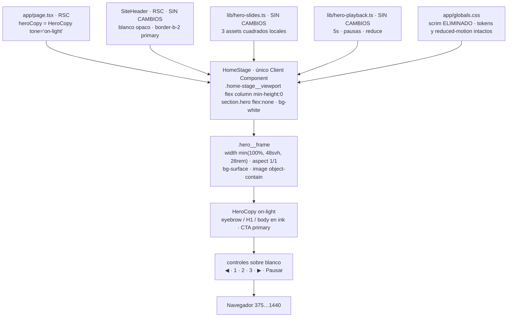

# Design Doc: DD-HOME-24 — Slide claro: foto completa, sin velo y con texto/controles debajo

| Campo | Valor |
|---|---|
| **ID** | **DD-HOME-24**. ID nuevo; `DD-HOME-20`, `-21`, `-22`, `-22.5` y `-23` quedan como historia (`design-doc-home-20.md`, `design-doc-home-21.md`, `design-doc-home-slide.md`, `design-doc-home-slide-below-header.md`) |
| **Autor** | `forge-architect` (Staff Engineer, APEX FORGE) |
| **Estado** | **Approved by `apex-forge`** (C-HOME-07, 27 nov 2026). LGTM de `forge-reviewer` y GO de `forge-qualis` recibidos. Este documento **no** autoriza `commit`, `push` ni despliegue |
| **Fecha** | 27 de noviembre de 2026 |
| **Decisor final** | `apex-forge` (Comandante). El «qué» ya fue decidido por el cliente; aquí se decide el «cómo» |
| **Idioma** | Español porque lo lee el cliente, igual que DD-HOME-23. Identificadores, tokens, clases y nombres de tests en inglés (AGENTS.md). Esta es la única desviación del default «docs en inglés» y queda justificada por audiencia |
| **Tipo** | Archivo **nuevo**. No edita DD anteriores; la supersesión parcial se registra en §11 |
| **Precedencia** | Siguen vigentes `mvp-requisitos.md`, `design-doc-mvp.md`, arbitrajes A1…A8/C-HOME-01…C-HOME-06 y **todo DD-HOME-23 salvo lo explícitamente revocado en §11** |
| **Alcance** | `components/HomeStage.tsx`, `components/Hero.tsx`, `app/page.tsx`, `app/globals.css` y los tests listados en §7.2. **Sin** `SiteHeader.tsx`, `lib/**`, `public/**`, `next.config.ts`, datos, endpoints, env vars, CSP ni CI nuevos |

> **Regla de oro:** el diseño se aprueba antes del código. Los fragmentos de CSS y de interfaces de este documento son **artefactos de diseño**, no implementación. Quien construye escribe los tests; `forge-reviewer` da el LGTM; `forge-qualis` da el GO. El arquitecto no versiona ni despliega nada.

---

## 0. Resumen ejecutivo (cliente)

El cliente pidió, literalmente: «quita la capa de la imagen, que la imagen se vea clara, no tan gigante» y, al preguntarle, confirmó: «la imagen no se ve bien, además tiene una capa de verde encima, quitalo», eligiendo además que **el texto y los controles vayan debajo de la foto**.

La decisión técnica es:

1. **Cero capas sobre la foto.** Se elimina el nodo `.hero__scrim` del DOM **y** su regla del CSS. No queda ningún gradiente verde, ningún `ink` semitransparente ni ningún otro velo encima de la imagen.
2. **La foto se ve completa y más pequeña.** Las tres imágenes son cuadradas (1080×1080, 1080×1080 y 1241×1241). Se dejan de recortar con `object-cover` y pasan a `object-contain` dentro de un marco cuadrado con altura máxima `min(48svh, 28rem)` = **≤ 448 px**. Antes el hero medía hasta ~828 px de alto; ahora la foto mide **432 px** en viewports de 900 px de alto y **335 px** a 375×812.
3. **Texto y controles debajo, sobre blanco, en tinta.** `HeroCopy` gana una variante `on-light` (tinta `#123F33` sobre blanco, 11,77:1) sin romper su forma actual. El CTA sigue siendo blanco sobre verde `primary` (7,75:1).
4. **El slide deja de llenar la pantalla.** `.home-stage__viewport` pasa a `min-height: 0` y `section.hero` a `flex: none; min-height: 0`. El bloque empieza justo debajo del header (sin solape), pero ya no fuerza `100svh`; se permite scroll vertical y se prohíbe overflow horizontal.
5. **El autoplay no se toca.** 5 s, pausa en hover del slide, foco en controles, botón explícito, `visibilityState` y `prefers-reduced-motion` siguen intactos. El **header sigue sin pausar** (D-23-06 / HOME-E2E-40).

---

## 1. Contexto y problema

### 1.1 Pedido del cliente (Fase 0 cerrada)

No hay ambigüedad pendiente sobre el resultado visual. El cliente vio la implementación de DD-HOME-23 y rechazó tres cosas a la vez:

- **El velo verde**: es `.hero__scrim`, hoy `ink` al 85 % en móvil y un gradiente 85 %→75 %→transparente desde 1024 px (`app/globals.css:100-118`). Debe desaparecer, no rebajarse.
- **El recorte / tamaño**: la foto se renderiza con `<Image fill sizes="100vw" className="object-cover">` dentro de `.hero__media absolute inset-0` (`components/HomeStage.tsx:122-141`) y el hero mide `flex:1; min-height:70svh` (`app/globals.css:95-98`). Con assets cuadrados en un marco panorámico de ~900 px, `object-cover` recorta casi la mitad de la imagen y la hace «gigante».
- **La posición del texto**: hoy `HeroCopy` blanco flota sobre la foto y los controles están en una placa `bg-surface/95` (`components/HomeStage.tsx:148-195`). El cliente quiere ambos **debajo** de la foto, sobre blanco.

### 1.2 Estado verificado en el repositorio (no asumido)

| Hecho | Evidencia |
|---|---|
| El velo verde existe en el DOM y es el único overlay sobre la foto | `components/HomeStage.tsx:143-146` (`aria-hidden`, `pointer-events-none`, `absolute inset-0 -z-10`) |
| El velo verde existe en CSS con dos reglas | `app/globals.css:100-103` (85 %) y `:105-118` (gradiente 85 %→75 % desde 1024 px) |
| La foto se recorta y ocupa todo el hero | `components/HomeStage.tsx:129-138` (`fill`, `sizes="100vw"`, `object-cover`) y `:122` (`absolute inset-0 -z-20`) |
| El hero fuerza casi todo el viewport | `app/globals.css:84-88` (`min-height:100svh`) y `:95-98` (`flex:1`, `min-height:70svh`) |
| El texto es blanco y los controles llevan placa crema | `components/Hero.tsx:14-34`; `components/HomeStage.tsx:148-152` |
| Los tres assets son cuadrados | Verificado en `public/slides/`: `hero-01.jpg` y `hero-02.jpg` 1080×1080; `hero-03-crema-hidratante.jpg` 1241×1241 |
| El autoplay y sus pausas están aislados en un solo Client Component | `components/HomeStage.tsx:16,48-105`; `lib/hero-playback.ts:12-37` |
| El header es normal, blanco y opaco | `components/SiteHeader.tsx:23-26`; **no se toca** |
| El skip link apunta a `#main`, que es el `<section>` del hero, y `<main>` es `id="contenido"` | `components/HomeStage.tsx:109-121,200-202`; `tests/e2e/home.spec.ts:46-54` |
| `retries: 0` es política explícita | `playwright.config.ts:16-20` |
| No hay superficie de datos/auth nueva | Sin cambios en rutas, Prisma ni headers; `next.config.ts:10-45` intacto |

### 1.3 Lo que NO se revisa

Se conservan literalmente: las tres fotos y sus hashes (`lib/hero-slides.ts:14-18`), `alt=""`, el H1 «Belleza para tu piel y tu cabello», el CTA «Explorar piel» → `/piel`, la máquina `shouldAutoplay`/`nextIndex` (`lib/hero-playback.ts`), la excepción del toggle DD-HOME-22.5, los nombres accesibles de los controles, `data-hydrated`, Poppins self-hosted, el presupuesto de bundle, `noindex`/CSP `report-only`, el header y el footer.

### 1.4 Objetivos medibles

| # | Objetivo | Verificación | Test |
|---|---|---|---|
| O1 | Cero velos: no existe `.hero__scrim` en DOM ni en CSS servido | Conteo 0 + grep del CSS | HOME-E2E-41 |
| O2 | Foto completa y nítida: `object-contain`, marco cuadrado, lado ≤ 448 px, sin upscaling | Geometría + `naturalWidth` vs DPR | HOME-E2E-42 |
| O3 | Texto y controles debajo de la foto, sobre blanco, en tinta ≥ 4,5:1 | Bounding boxes + colores + muestreo de píxel | HOME-E2E-35, -43 |
| O4 | Slide ya no llena `100svh`; empieza justo tras el header; 0 overflow horizontal en 9 anchos | Geometría del viewport/hero en los 3 slides | HOME-E2E-34 |
| O5 | Sin salto al cambiar de slide y sin CLS | Rectámetros idénticos + PerformanceObserver | HOME-E2E-36, -44 |
| O6 | Autoplay, pausas, `reduce`, toggle y header-no-pausa intactos | Reloj determinista | HOME-E2E-30…32, -40 |
| O7 | Skip link, H1 único, landmark y axe AA intactos | `home.spec.ts` + axe | HOME-E2E-27, -01/-02, axe |

---

## 2. No-objetivos

| ID | Explícitamente fuera de alcance | Motivo |
|---|---|---|
| N-24-01 | Bajar la opacidad del scrim, cambiar su color o sustituirlo por otro velo | El cliente dijo «quitalo»: cero capas, no «menos capa» |
| N-24-02 | Recortar, reencuadrar, regenerar o reemplazar las tres fotos | Los hashes y Q-HOME-05 siguen aprobados; el defecto es del marco, no del asset |
| N-24-03 | `object-cover` en un marco más pequeño | Sigue recortando; contradice «la imagen se vea clara»/completa |
| N-24-04 | Mantener `min-height:100svh`, `min-height:70svh` o `flex:1` en el hero | El cliente pide que no sea gigante; el slide pasa a ser contenido, no viewport |
| N-24-05 | Tocar `SiteHeader.tsx`, su borde, su logo, su búsqueda, su menú ni su comportamiento | DD-HOME-23 está aprobado y el header no es parte del pedido |
| N-24-06 | Cambiar la máquina de autoplay, los 5 s, `visibilityState`, `reduce`, DD-HOME-22.5 ni `data-hydrated` | «El autoplay sigue igual»; solo cambia la presentación |
| N-24-07 | Hacer que el header pause el autoplay | D-23-06 y HOME-E2E-40 lo prohíben; el header queda fuera del área de pausa |
| N-24-08 | Cuarto slide, vídeo, carrusel nuevo, copy nuevo, claims, precios ni `aria-live` | N-22-01/-02/-08 siguen vigentes |
| N-24-09 | Nuevos datos, Prisma, endpoints, env vars, secretos, CSP `enforce`, A2/F5 ni analítica | Sin superficie nueva; OK de Sentinel previo sigue vigente |
| N-24-10 | Nuevas dependencias o evaluación de versión mayor | Stack fijado (Next 15 / React 19 / Tailwind v4); A7/A11 ya documentan evaluaciones |
| N-24-11 | Reescribir DD-HOME-20/-21/-22/-23 ni borrar decisiones vigentes | Los DD aprobados se conservan como historia |
| N-24-12 | Animaciones, crossfade, `IntersectionObserver`, scroll listeners ni JS nuevo | Cero JS nuevo; CSS-first y `prefers-reduced-motion` intacto |
| N-24-13 | Commits, push, build, ejecución de tests ni despliegue por parte del arquitecto | Requiere autorización explícita de Fase 2 |

---

## 3. Requerimientos y restricciones

### 3.1 Funcionales

| ID | Requisito |
|---|---|
| F-24-01 | No existe ningún elemento `.hero__scrim` en el DOM ni regla `.hero__scrim` en el CSS servido; cero capas con `ink` semitransparente o gradiente sobre la foto |
| F-24-02 | Las tres imágenes se renderizan con `object-fit: contain` dentro de `.hero__frame`, cuadrado (`aspect-ratio: 1 / 1`), centrado, con fondo `var(--color-surface)` como placeholder neutro |
| F-24-03 | `.hero__frame` mide `width: min(100%, 48svh, 28rem)`; el lado es ≤ 448 px y ≤ el ancho disponible del contenedor |
| F-24-04 | `sizes` de `next/image` deja de ser `100vw` y pasa a `(min-width: 640px) 448px, calc(100vw - 40px)`; `priority` solo en slide 01, `loading="lazy"` en 02/03 |
| F-24-05 | `section.hero` tiene fondo `var(--color-white)`; el texto (`HeroCopy` en variante `on-light`) y los controles van **debajo** del marco, sin placa crema de fondo |
| F-24-06 | `HeroCopy` expone `tone?: 'on-dark' \| 'on-light'` con default `'on-dark'`; `app/page.tsx` pasa `tone="on-light"`. El default conserva el output actual para cualquier otro uso |
| F-24-07 | Autoplay de 5000 ms, pausa por hover del slide, foco en controles, toggle explícito, `visibilityState !== 'visible'` y `reduce`; limpieza del intervalo; `data-hydrated="true"` |
| F-24-08 | El slide empieza justo tras el header (`heroTop == headerBottom ± 1 px`), sin solape con el H1 y sin overflow horizontal en 375/600/767/768/820/900/1023/1024/1440 ni al cambiar de slide |
| F-24-09 | Un solo H1, un solo CTA, tres imágenes, `alt=""`, slides inactivos `aria-hidden`, nombres exactos de los seis controles y `aria-current` único |
| F-24-10 | Skip link sigue enfocando `#main` (el `<section>` del hero) y `<main id="contenido">` sigue envolver las secciones |

### 3.2 No funcionales

| Ámbito | Contrato |
|---|---|
| **Contraste AA** | `ink #123F33` sobre blanco = **11,77:1**; sobre `surface #F7F5EE` = **10,79:1**; blanco sobre `primary #1B5D4A` = **7,75:1**; anillo `ink` sobre blanco = **11,77:1** (≥ 3:1). Umbrales de test: texto ≥ 4,5:1, foco ≥ 3:1 |
| **CLS** | Objetivo 0, gate < 0,1. El marco reserva altura con `aspect-ratio` antes de la carga; `Image fill` es absoluto y no desplaza el texto |
| **Nitidez** | Lado máximo 448 CSS px; con DPR 2 el `srcset` debe entregar una fuente de al menos 864 px (w=1080 en viewports de 900 px de alto, w=750 a 375 px). Regla de test: `naturalWidth ≥ ceil(displayWidth × devicePixelRatio)` |
| **LCP** | Candidato permitido = slide 01 **u** H1 aprobado (Igual que E2E-39). Al encogerse la foto, el H1 puede pasar a ser LCP; es aceptado y no dispara cambio de test |
| **Rendimiento** | Home ≤ 150.000 B gzip, total ≤ 300.000 B; LCP p75 < 2,5 s, CLS p75 < 0,1, INP p75 < 200 ms, TTFB p75 < 800 ms. El presupuesto lo mide solo `check:bundle` en CI |
| **Accesibilidad** | WCAG 2.2 AA; axe 0 críticas/serias en 375/768/1440; anillo `ink` 2 px con offset 2 px; SC 2.2.2 con botón explícito; `prefers-reduced-motion` global intacto (`app/globals.css:120-132`) |
| **Seguridad** | Sin datos, auth, secretos ni PII nuevos. El OK de `forge-sentinel` previo sigue vigente y se anota su reuso; `forge-reviewer` da LGTM obligatorio; `forge-qualis` da GO antes de cerrar |
| **Compatibilidad** | Next 15, React 19, TS strict, Tailwind v4, Vitest + Playwright. Sin versión mayor que evaluar; `next.config.ts` byte-for-byte |

---

## 4. Solución propuesta

### 4.1 Arquitectura



Árbol resultante (landmarks intactos, `id`s intactos):

```text
<div class="home-stage">
  <div class="home-stage__viewport">     ← flex column, min-height:0
    <div class="home-stage__chrome">     ← flex:none, blanco, sin handlers
      <SiteHeader />                     ← <header> blanco opaco, SIN CAMBIOS
    </div>
    <section id="main" class="hero ..."> ← flex:none, bg-white, empieza tras el header
      <div class="hero__media">          ← 3 imágenes absolutas dentro del marco
        <div class="hero__frame">        ← cuadrado, ≤448px, bg-surface
          <Image fill object-contain sizes=... />
        </div>
        ...
      </div>
      NO EXISTE .hero__scrim             ← eliminado del DOM y del CSS
      <div class="hero__copy">           ← variante on-light, debajo del marco
      <div class="hero__controls">       ← debajo del copy, sobre blanco
    </section>
  </div>
  <main id="contenido" tabIndex={-1}>    ← hermano del viewport, SIN CAMBIOS
    {children}
  </main>
</div>
```

**Por qué este límite cliente/servidor:** no cambia. El único estado del navegador sigue siendo el índice del slide y las banderas de pausa. El marco, el texto y los controles llegan como markup del mismo Client Component, pero el contenido del copy sigue siendo un slot RSC. No hay `fetch`, ni estado nuevo, ni observadores nuevos.

### 4.2 Contrato de componentes (diseño, no implementación)

```ts
// Design-only interfaces. No production code in this document.
type HomeStageProps = {
  chrome: React.ReactNode;   // <SiteHeader /> — unchanged slot
  heroCopy: React.ReactNode; // <HeroCopy tone="on-light" hero={...} />
  slides: readonly HeroSlide[];
  children: React.ReactNode;
};

type HeroCopyProps = {
  hero: HomeContent['hero'];
  tone?: 'on-dark' | 'on-light'; // DEFAULT 'on-dark' preserves today's white copy
};
```

| `file:line` (líneas actuales) | Cambio de diseño |
|---|---|
| `components/HomeStage.tsx:122-141` | `.hero__media` deja de ser `absolute inset-0 -z-20`; pasa a bloque normal en flujo que contiene el marco. Se mantiene el `<div>` por slide, `aria-hidden` y los `opacity-100/0` para el slide activo. Sin transición nueva |
| `components/HomeStage.tsx:129-138` | `<Image>` conserva `src`, `alt`, `fill`, `priority` (slide 01) y `loading` (02/03). Cambian `sizes` → `(min-width: 640px) 448px, calc(100vw - 40px)` y `className` → `object-contain` |
| **`components/HomeStage.tsx:143-146`** | **Eliminar el nodo completo** `<div class="hero__scrim" ... />`. No sustituirlo por otro elemento |
| `components/HomeStage.tsx:116` | `section.hero`: quitar `flex flex-col justify-center overflow-hidden bg-ink relative isolate`; quedar `relative` + fondo blanco. Los handlers de `:117-120` **no se tocan** |
| `components/HomeStage.tsx:148` | Reducir el padding del contenedor: `mx-auto w-full max-w-[var(--content-max)] px-5 py-8 md:px-6 md:py-10 lg:px-8` (antes `py-16 md:py-24`). Sin compensaciones ni `calc` |
| `components/HomeStage.tsx:149` | `.hero__copy`: centrar bajo el marco, p. ej. `mx-auto mt-8 max-w-2xl text-center` (antes `max-w-3xl`). Recibe `HeroCopy` con `tone="on-light"` desde `app/page.tsx` |
| `components/HomeStage.tsx:152` | `.hero__controls`: quitar la placa `rounded-card bg-surface/95 p-2`; dejar `mx-auto mt-6 flex w-fit flex-wrap items-center justify-center gap-3` sobre blanco. Botones y nombres accesibles intactos |
| `components/Hero.tsx:3-5,12-35` | Añadir `tone?: 'on-dark' \| 'on-light'` con default `'on-dark'`. En `on-light`: root `text-ink`, eyebrow `text-ink` (sin `/90`), regla decorativa `bg-accent-dark`, H1 `text-ink`, body `text-ink`. CTA y hover `primary`/`primary-hover` sin cambios |
| **`app/page.tsx:30`** | Pasar `tone="on-light"` a `<HeroCopy>`. El slot, el orden de secciones y `force-dynamic` (`:17-18`) no cambian |
| **`app/globals.css:81-118`** | Reescribir el contrato de layout (§4.3). **Borrar por completo** `.hero__scrim` y su `@media (min-width:1024px)` |
| `app/globals.css:13-79,120-132` | Byte-for-byte: `@theme`, `@source`, `@layer base`, tokens de foco y `prefers-reduced-motion` |
| `lib/hero-slides.ts`, `lib/hero-playback.ts`, `components/SiteHeader.tsx`, `next.config.ts` | **Sin cambios** |

> Nota de estrategia visual: la regla decorativa del eyebrow pasa de `accent-soft` a `accent-dark` en la variante `on-light` porque `#E6CC87` casi no se ve sobre blanco; `#B38F44` es un token aprobado y da 3,03:1 (suficiente para un elemento decorativo, nunca para texto). No se introduce ningún color nuevo.

### 4.3 Contrato de layout CSS (decisión D-24-02)

| Regla | Contrato de diseño | Por qué |
|---|---|---|
| `.home-stage__viewport` | `display:flex; flex-direction:column; min-height:0` | Conserva el ancla de tests y el apilamiento chrome+hero, pero **retira el suelo de `100svh`**. El slide deja de estirarse; no hay medición en runtime |
| `.home-stage__chrome` | `flex:none; background-color:var(--color-white)`; sin `position`, `z-index`, `border` ni pseudo-clases | Idéntico a DD-HOME-23; el header sigue en flujo y no pausa |
| `section.hero` | `flex:none; min-height:0; position:relative; background-color:var(--color-white)` | Altura = contenido; empieza justo tras el header; ya no hay `-z-*` ni `isolate` porque no hay capas superpuestas |
| `.hero__frame` | `position:relative; width:min(100%, 48svh, 28rem); aspect-ratio:1 / 1; margin-inline:auto; background-color:var(--color-surface); overflow:hidden` | Reserva la caja antes de cargar (CLS 0), muestra la foto cuadrada completa y deja un matte neutro si en el futuro llega un asset no cuadrado |
| `.hero__frame img` | `object-fit:contain` vía clase de Tailwind; `inset:0` de `fill` | Sin recorte; la imagen se escala hacia adentro del marco |
| `.hero__copy`, `.hero__controls` | Bloques en flujo debajo del marco, `margin-top` 32 px / 24 px | Orden visual pedido por el cliente; sin posicionamiento absoluto |
| **Eliminar** | Reglas `.hero__scrim` de `app/globals.css:100-118` y su nodo en `HomeStage.tsx:143-146` | Es exactamente la «capa de verde» que el cliente quiere fuera |
| Conservar byte-for-byte | `@layer base`, `@theme`, `[data-surface='dark']`, `:focus-visible` y `@media (prefers-reduced-motion: reduce)` | DD-HOME-21 y RNF-MVP-008 siguen vigentes |

**Geometría resultante (lado del marco, ±1 px):** `min(anchoDisponible, 48svh, 448 px)`, donde `anchoDisponible = min(anchoViewport, 1200) − 2 × padding` (40 px base, 48 px desde 768, 64 px desde 1024).

| Viewport | Lado esperado |
|---|---:|
| 375×812 | **335 px** |
| 600×900, 767×900, 768×900, 820×900, 900×900, 1023×900, 1024×900, 1440×900 | **432 px** |
| 768×600 (caso extra de altura corta) | **288 px** |

Comparación con el estado anterior: el hero ocupaba `max(70svh, viewport − header)` (≥ 630 px y típicamente ~828 px a 900 px de alto); ahora el marco mide ≤ 448 px. Es una reducción de **al menos 182 px** y típicamente de ~396 px en desktop.

### 4.4 Autoplay (sin cambios)

`activeIndex ∈ {0,1,2}`; banderas `explicitPaused`, `hoverPaused`, `focusPaused`, `reduce` y la función pura `shouldAutoplay` (`lib/hero-playback.ts:12-19`) quedan byte-for-byte. El intervalo sigue dependiendo de `[canAutoplay, activeIndex, slides.length]`, comprueba `document.visibilityState` y se limpia al desmontar (`components/HomeStage.tsx:48-67`). DD-HOME-22.5 (toggle exento de `focusPaused`, `:72-94`), `goTo`/`step` (`:96-105`), `aria-current`, los nombres accesibles y `data-hydrated` (`:35-37`) siguen iguales.

Los handlers de puntero/foco siguen **solo** en `section.hero` (`:117-120`). `.home-stage__chrome` no gana handlers: el header **no pausa** (D-23-06 / HOME-E2E-40). Al encogerse el slide esto es más importante si cabe: el área de pausa es exactamente el bloque foto+texto+controles.

### 4.5 Contraste y velos

No se crea un velo nuevo ni se rebaja ninguno: **se elimina el único que existía**. Los colores compuestos pasan a ser simples y verificables:

| Elemento | Color | Fondo | Contraste | Umbral |
|---|---|---|---:|---:|
| Eyebrow, H1, body (`on-light`) | `#123F33` | `#FFFFFF` | 11,77:1 | ≥ 4,5:1 |
| Texto si el marco queda visible como placeholder | `#123F33` | `#F7F5EE` | 10,79:1 | ≥ 4,5:1 |
| CTA | `#FFFFFF` | `#1B5D4A` | 7,75:1 | ≥ 4,5:1 |
| Anillo de foco | `#123F33` | `#FFFFFF` | 11,77:1 | ≥ 3:1 |
| Regla decorativa | `#B38F44` | `#FFFFFF` | 3,03:1 | decorativa, sin requisito de texto |

HOME-E2E-35 deja de muestrear blanco sobre `ink` y pasa a muestrear **tinta sobre blanco**. El helper `sampleCompositedBackgrounds` (`tests/e2e/home-slide.spec.ts:134-247`) ya decide la dirección del muestreo con `lightForeground = foreground[0] > 200…` (`:199-200`), así que basta con cambiar `foreground` de `WHITE` a `INK` en los objetivos de texto; el del foco ya era `INK`. No se reescribe el helper.

### 4.6 Por qué gana

| Criterio (prioridad APEX FORGE) | Esta solución | Alternativa |
|---|---|---|
| **Correctitud** | Cumple los tres pedidos literales: sin capa, foto completa y más pequeña, texto/controles debajo. Cero CLS por `aspect-ratio` | `object-cover` en un marco menor sigue recortando; bajar la opacidad del scrim sigue teñiendo la foto |
| **Mantenibilidad** | Un nodo y dos reglas CSS menos; un prop opcional con default compatible; los selectores de tests se conservan | Migrar a `background-image` obligaría a rehacer preload/LCP/alt y `next/image` |
| **Rendimiento** | `sizes` ajustado al tamaño real evita sobrecarga; `priority` y AVIF/WebP intactos; sin JS nuevo | `100vw` en un marco de 432 px descarga imágenes hasta 2,5× más grandes y se ve menos nítido |
| **Velocidad de entrega** | Cambio acotado a 4 archivos de producción + cirugía de tests; reversible con `git revert` | Rediseñar el carrusel o crear assets nuevos exigiría reabrir Q-HOME-05 y QA completa |

---

## 5. Alternativas evaluadas

### A — Scrim eliminado + `object-contain` en marco cuadrado limitado (**GANADORA**)

- **Pros:** cumple O1…O7; foto completa y nítida; bloque compacto; contraste máximo; sin JS nuevo; `sizes` correcto; `git revert` limpio.
- **Contras:** el slide ya no llena el viewport (es exactamente lo pedido); a 375 px puede aparecer scroll vertical (aceptado, sin overflow horizontal); el H1 puede desplazar al slide como LCP (ya permitido por E2E-39).
- **Motivo:** es la única opción que satisface simultáneamente «sin capa», «completa y no gigante» y «texto debajo» sin tocar assets ni autoplay.

### B — Quitar solo el scrim, conservar `object-cover` y el hero de `100svh` (RECHAZADA)

- **Pros:** cambia dos líneas; arregla el color verde.
- **Contras:** mantiene el recorte severo de assets cuadrados y la altura de ~900 px; el cliente dijo explícitamente que la imagen «no se ve bien» y es «tan gigante». El texto seguiría encima de la foto.
- **Motivo de rechazo:** resuelve una de tres quejas y deja las otras dos intactas.

### C — Bajar el scrim a 30–40 % en vez de eliminarlo (RECHAZADA)

- **Pros:** conserva el contraste del texto blanco sin tocar `HeroCopy`.
- **Contras:** contradice «quitalo»; la foto sigue con tinte verde; deja gradiente en CSS servido y obliga a mantener el muestreo de píxel compuesto.
- **Motivo de rechazo:** el cliente pidió cero capas, no una capa más débil.

### D — Mantener `100svh` y mover el copy debajo de la foto dentro del hero panorámico (RECHAZADA)

- **Pros:** conserva la geometría DD-HOME-23 y sus tests casi sin cambios.
- **Contras:** con `object-cover` en ~900 px la foto sigue gigante y recortada; con `object-contain` aparecerían bandas enormes y el texto quedaría muy abajo. Fuerza scroll interno o espacio vacío.
- **Motivo de rechazo:** «no tan gigante» exige reducir la caja, no solo reordenar dentro de ella.

### E — `object-cover` dentro de un marco cuadrado pequeño (RECHAZADA)

- **Pros:** marco compacto, sin bandas, menos bytes.
- **Contras:** un asset cuadrado en un marco cuadrado con `cover` no gana nada y cualquier cambio futuro vuelve a recortar; no cumple «la imagen se vea clara» en el sentido de completa.
- **Motivo de rechazo:** `contain` es la semántica correcta para mostrar la foto entera; el coste es cero porque el marco ya es cuadrado.

### F — Sustituir `next/image` por `background-image` + `aspect-ratio` (RECHAZADA)

- **Pros:** menos markup.
- **Contras:** pierde `srcset`/AVIF/WebP, el `<link rel="preload">` de slide 01, el candidato LCP medible y el `alt` semantics; rompe HOME-E2E-36/-38/-39.
- **Motivo de rechazo:** retrocede en rendimiento y accesibilidad para el mismo resultado visual.

---

## 6. Riesgos y mitigaciones

| ID | Riesgo | Mitigación | Dueño |
|---|---|---|---|
| R-24-01 | Quede un nodo o regla `.hero__scrim` en el bundle | Borrar DOM + CSS; HOME-E2E-41 cuenta 0 nodos y busca la clase en el CSS servido | `forge-frontend` |
| R-24-02 | Aparezcan letras blancas heredadas sobre fondo blanco | Variante `on-light` con tabla de clases; HOME-E2E-43 exige colores `ink` computados y HOME-E2E-35 muestrea tinta | `forge-frontend` + `forge-qualis` |
| R-24-03 | CLS por no reservar altura antes de la carga | `aspect-ratio:1/1` + `width:min(...)`; HOME-E2E-36 (< 0,1) y HOME-E2E-44 (Δ rect ≤ 1 px) | `forge-frontend` |
| R-24-04 | `sizes="100vw"` quede y la imagen se vea blanda/sobrecargada | Cambio contractual en `:133`; HOME-E2E-36 exige el valor; HOME-E2E-42 con DPR 2 exige `naturalWidth ≥ ceil(display×dpr)` | `forge-qualis` |
| R-24-05 | El marco no sea cuadrado y aparezcan bandas | `aspect-ratio` + assets cuadrados verificados; HOME-E2E-42 exige ratio 1,00 ± 0,01 y `naturalWidth === naturalHeight` | `forge-frontend` |
| R-24-06 | HOME-E2E-34 siga esperando `min-height:100svh` y `flex-grow ≥ 1` | Tabla de reescritura en §7.2: `min-height:0`, `flex-grow:0`, lado del marco, sin aserción de hero ≥ 70svh | `forge-qualis` |
| R-24-07 | El muestreo de píxel invierta la dirección al cambiar a tinta oscura | El helper ya deriva `lightForeground` del color (`:199-200`); solo cambia `foreground: INK`. Revisión de QA en 3 anchos × 3 slides | `forge-qualis` |
| R-24-08 | Skip link o H1 se rompan al mover el bloque | `#main` sigue en `section.hero` y `<main id="contenido">` sigue en `HomeStage`; HOME-E2E-01/-02 y skip link intactos (§7.2) | `forge-frontend` |
| R-24-09 | El header pase a pausar por solapamiento del nuevo layout | Handlers siguen solo en `section.hero`; HOME-E2E-40 se ejecuta sin cambios | `forge-qualis` |
| R-24-10 | Salto visual al cambiar de slide | Sin transición nueva; marco y cajas fijos; HOME-E2E-44 compara rectámetros y `scrollHeight` entre 1→2→3→1 | `forge-qualis` |
| R-24-11 | Scroll vertical a 375 px se confunda con defecto | Diseño lo permite explícitamente; se prohíbe solo overflow **horizontal**. Comunicado en §0 y §12 | `apex-forge` |
| R-24-12 | Bundle crezca por clases nuevas | Solo utilidades de Tailwind ya existentes; `check:bundle` en CI ≤ 150 KB Home / 300 KB total | `forge-infra` |
| R-24-13 | Doble firma de seguridad innecesaria o perdida | Sin datos/auth/secretos; OK de Sentinel vigente se anota en acta; LGTM de `forge-reviewer` y GO de `forge-qualis` obligatorios | `forge-sentinel` + `forge-reviewer` + `forge-qualis` |
| R-24-14 | Deploy o commit sin autorización | Este DD no los autoriza; rollback al deployment ID anterior con Go de `apex-forge` | `apex-forge` + `forge-infra` |

---

## 7. Estrategia de testing

Responsable: `forge-qualis`. Quien construye, prueba. `@smoke` en cada PR; suite completa + axe en release; **`retries: 0`** (`playwright.config.ts:20`). La política de reloj no cambia: `page.clock` solo en HOME-E2E-30/-31/-32; **nunca** en -36/-39/-44; sin `fastForward`; `runFor(0)` y `aria-current` tras cada paso. **Este DD no ejecuta tests ni build.**

### 7.1 Unitarias / integración (sin cambios)

| Prueba | Estado |
|---|---|
| `tests/unit/hero-playback.test.ts` | Sin cambios: tabla de verdad intacta |
| `tests/unit/hero-slides.test.ts` | Sin cambios: mismos 3 slides y hashes |
| `tests/integration/home-content.integration.test.ts` | Sin cambios: el hero no lee `app_config` |
| `vitest.config.ts` (umbrales per-file 90/85/90 de `lib/hero-playback.ts`) | Sin cambios |

No se crean tests unitarios nuevos: el cambio es presentacional y el único contrato nuevo (`tone`) se verifica en E2E con colores computados.

### 7.2 Impacto exacto en tests existentes (cirugía, no borrado de suites)

| `Archivo : línea` | Test | Acción |
|---|---|---|
| `tests/e2e/home-slide.spec.ts:249-268` | HOME-E2E-30 | **Sin cambios**. 4999 ms estable, pasos de 5000 ms y wrap 3→1 |
| `tests/e2e/home-slide.spec.ts:270-449` | HOME-E2E-31/-32 | **Sin cambios**. Hover del slide, foco en flecha, toggle DD-HOME-22.5, `visibilityState`, limpieza y `reduce` con 0 intervalos |
| **`tests/e2e/home-slide.spec.ts:282-294`** | **HOME-E2E-40** | **Sin cambios funcionales; se conserva y se ejecuta también con la nueva geometría**: hover de `.home-stage__chrome` + `runFor(6000)` ⇒ índice 2. El header sigue sin pausar (D-23-06). Etiqueta `@smoke @a11y` intacta |
| `tests/e2e/home-slide.spec.ts:451-485` | HOME-E2E-33 | **Sin cambios**. Nombres exactos, foco retenido, `aria-current` |
| **`tests/e2e/home-slide.spec.ts:487-588`** | **HOME-E2E-34** | Reescribir el bloque de geometría (`:498-552`): `viewportMinHeight === 0`; `heroFlexGrow === 0`; `heroTop == headerBottom ± 1`; **eliminar** `heroHeight >= viewportHeight*0.7` y `heroTop+heroHeight == viewportHeight`. Añadir `frameSide` esperado por ancho (§4.3) y `frameAspect ≈ 1`. Conservar header/wrapper blancos, borde 2 px `primary`, borde wrapper 0, `overlap === 0`, touch en 375/767 y el bucle de 0 overflow en [2,3,1]. Renombrar el título a «light slide below a static header, compact block» |
| **`tests/e2e/home-slide.spec.ts:590-650`** | **HOME-E2E-35** | Mantener 3 anchos × 3 slides. Cambiar en `targets` (`:617-631`): `copy text` → `headline` con `selector:'#hero-title'`, `foreground: INK`, 5×3; añadir `copy paragraphs` con `selector:'.hero__copy p'`, `foreground: INK`, 3×3; `focus ring` sigue con `foreground: INK`, `outside: 6`. Umbrales 4,5 / 3 (`:642`). Añadir asserts de fondo blanco del hero y de `color` computado `rgb(18,63,51)` en H1 y párrafos. El helper de muestreo no se toca |
| **`tests/e2e/home-slide.spec.ts:652-714`** | **HOME-E2E-36** | Sin reloj falso. Añadir `expect(sizes).toBe('(min-width: 640px) 448px, calc(100vw - 40px)')` en el mapa de `:673-679`. **Conservar**: 3 `/_next/image`, `srcset`, exactamente 1 preload de slide (`hero-01.jpg`), preload del logo permitido, `loading` lazy en 02/03, AVIF/WebP por `Accept` con `w=640&q=75` (DPR 1) y CLS < 0,1 |
| `tests/e2e/home-slide.spec.ts:716-740` | HOME-E2E-38 | **Sin cambios**. Hashes y 0 fuentes remotas/`/Imagenes/` |
| `tests/e2e/home-slide.spec.ts:742-769` | HOME-E2E-39 | **Sin cambios**. Candidato LCP = `hero-01.jpg` **o** H1 aprobado; ahora es más probable el H1 y eso es válido |
| **`tests/e2e/home.spec.ts:46-54`** | Skip link | **Sin cambios funcionales**. `Tab` → `href="#main"` → `Enter` enfoca `#main`. Comentario opcional: `#main` sigue siendo `section.hero`; `<main>` sigue siendo `#contenido` |
| **`tests/e2e/home.spec.ts:56-63`** | H1 único | **Sin cambios**. Un header/main/footer y un H1; reforzar opcionalmente con `expect(hero).toContainElement(page.locator('h1'))` |
| `tests/e2e/home.spec.ts:65-93` | HOME-E2E-29 | **Sin cambios**. Un H1, un CTA, 3 imágenes locales; `sizes` cambia, el conteo no |
| `tests/e2e/home.spec.ts:321-423` | HOME-E2E-13 | **Sin cambios**. El guard «gold on light» sigue excluyendo `.home-stage`; actualizar solo el comentario de `:362-363` («hero paints a dark scrim» → «hero is a light white surface; exclusion kept for chrome-scope stability») |
| **`tests/e2e/home.spec.ts:628-768`** | **HOME-E2E-27** | **Sin cambios de expect**: header/footer/wrapper blancos, borde 2 px `primary`, textos `ink`, sin dorado como texto, `submit` primary/blanco, overflow 375 ≤ 0. Actualizar comentarios de `:717` y `:744` que hablan de revelado por hover (ya no aplica desde DD-HOME-23) |
| `tests/e2e/home-brand.spec.ts` | Guardas de logo | **Sin cambios** |
| `tests/e2e/home-highlights.spec.ts:98,347-394` | Orden de secciones | **Sin cambios**; `.home-stage` y `<main id="contenido">` se conservan |
| `tests/dynamic-e2e/home-dynamic.spec.ts:411-457` | HOME-E2E-28 | **Sin cambios** |
| `playwright.config.ts:16-44` | Profile E2E | **Sin cambios**. `retries: 0`, proyectos `chromium` y `touch` intactos |

### 7.3 IDs nuevos (HOME-E2E-41…44)

| ID | Criterio | Etiqueta |
|---|---|---|
| **HOME-E2E-41** | **Cero velos.** En 375/768/1440 y en los 3 slides: `page.locator('.hero__scrim')` cuenta 0; el CSS servido no contiene la cadena `.hero__scrim`; `getComputedStyle(section.hero).backgroundColor === 'rgb(255, 255, 255)'`; ningún descendiente de `.hero__frame` tiene `background-image` con `gradient` ni un `rgba(18, 63, 51, …)` con alpha < 1. `@smoke @a11y` |
| **HOME-E2E-42** | **Foto completa y nítida.** Para los 9 anchos de HOME-E2E-34 (más 768×600): `objectFit === 'contain'`; lado del marco = tabla §4.3 ± 1 px; `aspectRatio ≈ 1`; `naturalWidth === naturalHeight` en los 3 assets; `naturalWidth ≥ ceil(displayWidth × devicePixelRatio)` con un test adicional `test.use({ deviceScaleFactor: 2 })` en 375×812 y 1440×900. `@smoke` |
| **HOME-E2E-43** | **Texto y controles debajo, sobre blanco.** `copyRect.top ≥ frameRect.bottom` y `controlsRect.top ≥ copyRect.bottom` (±1 px), con gaps 0…96 px; colores computados de eyebrow/H1/body = `rgb(18, 63, 51)`; fondo del hero = blanco; la placa `bg-surface/95` ya no existe; nombres y `aria-current` intactos en los 3 slides. `@smoke @a11y` |
| **HOME-E2E-44** | **Sin salto al cambiar de slide.** Con `PerformanceObserver` de `layout-shift` (sin reloj falso), recorrer 1→2→3→1 y exigir: Δ rect de marco/H1/controles ≤ 1 px, Δ `document.documentElement.scrollHeight` ≤ 1 px, shift acumulado por los clics ≤ 0,02 y CLS global < 0,1. `@smoke` |

No se renombran HOME-E2E-01…40. Cualquier cambio de etiqueta requiere aprobación de `forge-qualis`.

### 7.4 Puertas

| Puerta | Dónde | Fuente de verdad |
|---|---|---|
| `lint`, `typecheck`, `test`, `test:integration` | Jobs de CI | Logs del job; `tone` opcional no rompe typecheck |
| `test:e2e:smoke`, `test:a11y`, `test:e2e` completo | Job `e2e`, `retries: 0` | HOME-E2E-27, -29…44 y guardas de §7.2 |
| `test:e2e:dynamic` | Suite dinámica | HOME-E2E-28/-38 |
| `build` + **`check:bundle`** | Job `bundle budget`, con artefactos de build | Ese job, nunca Playwright |
| Revisión | `forge-reviewer` | LGTM obligatorio; nadie aprueba su propio trabajo |
| Seguridad | OK vigente de `forge-sentinel` | Sin datos/auth/secretos nuevos; se anota el reuso en el acta |
| Cierre | `forge-qualis` + `forge-infra` | GO con evidencia real; la firma de diseño no certifica ejecución |

Un job rojo bloquea el merge; no se acepta «casi AA».

---

## 8. Rollout y rollback

### 8.1 Rollout

Sin canary (DD-MVP-15). Construcción en commits pequeños sobre `main` **solo tras autorización expresa de Fase 2 de `apex-forge`**; CI en verde en cada paso, incluido `bundle budget`. El cambio viaja con la siguiente promoción ya aprobada, con Deployment Protection y `noindex` vigentes (A2). `forge-infra` registra en el acta el **ID del deployment anterior** (estado DD-HOME-23) antes del Go/No-Go; sin ese ID no hay rollback instantáneo. **Este DD no autoriza commit, push, tests, build ni deploy.**

### 8.2 Rollback al estado DD-HOME-23 (< 2 min)

| Mecanismo | Cuándo | Cómo |
|---|---|---|
| **Instant rollback** | Incidente en producción | Redeploy del ID anterior registrado en §8.1; sin rebuild ni commits nuevos; objetivo < 2 min desde la detección |
| **`git revert` + CI** | El redeploy no basta o hay que retirar el código | Revertir los commits de DD-HOME-24, esperar CI verde (incluido `bundle budget`) y promover |

**Lista de reversión:** `components/HomeStage.tsx` (nodo `.hero__scrim`, `.hero__media`, `sizes`, `object-cover`, padding, clases del hero/copy/controles), `components/Hero.tsx` (prop `tone` y clases), `app/page.tsx` (`tone="on-light"`), `app/globals.css` (layout y `.hero__scrim`) y los tests de §7.2. **No** hay cambios en `SiteHeader.tsx`, `lib/**`, `public/**`, DB, migraciones, env vars, cache keys, A2/F5 ni CSP. La reversión es exactamente el commit previo / el deployment anterior.

**Disparadores:** cualquier píxel de velo sobre la foto, marco > 448 px o recorte detectado, texto < 4,5:1 o foco < 3:1, CLS ≥ 0,1, salto > 1 px al cambiar de slide, overflow horizontal en cualquier ancho, regresión de autoplay/`reduce`/toggle, axe crítico/serio, bundle > 150 KB o petición externa de imagen/fuente.

Tras la reversión: smoke de las 7 superficies + axe 375 + Poppins cargada en `/`, `/piel`, `/tiendas` + overflow 375 + `git diff` contra el commit previo de DD-HOME-23.

### 8.3 Monitoreo

Solo observabilidad técnica sin PII: logs con `requestId`, 5xx, 4xx de `/_next/image`, Vercel Speed Insights, uptime y lab CWV en Preview. Sin analítica de interacción con el slide: HOME-E2E-30…44 sustituyen cualquier telemetría. Ventana reforzada de 30 min, SLO 99,5 % / 30 días ≈ 216 min de presupuesto de error y postmortem sin culpables en ≤ 72 h para Sev-1/Sev-2.

---

## 9. Métricas de éxito

| Métrica | Umbral | Fuente | Ventana | Owner |
|---|---|---|---|---|
| Cero capas | 0 nodos `.hero__scrim`; 0 reglas en CSS servido; 0 gradientes/alpha sobre la foto | HOME-E2E-41 + revisión de CSS | Cada PR + release | `forge-frontend` |
| Tamaño de la foto | Lado ≤ 448 px; 335 px a 375×812, 432 px a 900 px de alto, 288 px a 600 px de alto | HOME-E2E-42 | Cada PR | `forge-frontend` |
| Nitidez / bytes | `naturalWidth ≥ ceil(display × dpr)`; `sizes` contractual; 1 solo preload de slide | HOME-E2E-36, -42 | Cada PR | `forge-qualis` |
| Orden visual | `copy.top ≥ frame.bottom`, `controls.top ≥ copy.bottom` (±1 px), fondo blanco | HOME-E2E-43 | Cada PR en 3 anchos × 3 slides | `forge-qualis` |
| Contraste | Texto ≥ 4,5:1 y foco ≥ 3:1; axe 0 críticas/serias | HOME-E2E-35 + axe | Cada PR (`@a11y`) + release | `forge-qualis` |
| Layout | `min-height:0`, `flex-grow:0`, `heroTop == headerBottom ±1`, 0 overflow horizontal en 9 anchos y 3 slides | HOME-E2E-34 | Cada PR | `forge-frontend` |
| Estabilidad | Δ rect y Δ `scrollHeight` ≤ 1 px por cambio de slide; CLS < 0,1 (objetivo 0); LCP = slide 01 u H1 | HOME-E2E-36, -44, -39 | Cada PR + campo 7–28 días | `forge-frontend` + `forge-qualis` |
| Autoplay | 5000 ms ± un frame; pausa en slide/controles/botón/`reduce`/visibility; 0 intervalos con `reduce`; **header no pausa** | HOME-E2E-30…32, -40 | Cada PR + release | `forge-qualis` |
| Bundle | Home ≤ 150.000 B gzip; total ≤ 300.000 B | `check:bundle` en CI | Cada PR + release | `forge-infra` |
| Regresión | HOME-E2E-01…44 y dinámicas en verde; solo §7.2 se modifica | Suite completa + dinámica | Cada release | `forge-qualis` |
| Reversibilidad | < 2 min cronometrados; redeploy al ID anterior sin rebuild | Acta + ID de deployment | Pre-go-live y 30 min post-deploy | `forge-qualis` + `forge-infra` |

---

## 10. Preguntas abiertas

**Ninguna que bloquee la Fase 2.** El cliente ya respondió las tres preguntas clave (quitar capa, foto clara/no gigante, texto y controles debajo) y eligió la opción de geometría. Los puntos que podrían parecer abiertos quedan decididos aquí:

| Tema aparente | Resolución | Quién la fijó |
|---|---|---|
| ¿Altura exacta del marco? | `min(48svh, 28rem)` = ≤ 448 px; tabla por viewport en §4.3 | Arquitecto, justificada en §4.6 |
| ¿Fondo del marco y del slide? | Marco `--color-surface` (#F7F5EE) como matte neutro; slide `--color-white`; nunca `bg-ink` | Arquitecto, tokens aprobados en `@theme` |
| ¿Se permite scroll vertical? | Sí; se prohíbe solo overflow horizontal. El slide ya no debe llenar `100svh` | Arquitecto, derivado del pedido «no tan gigante» |
| ¿Cambia el LCP? | Puede pasar al H1; E2E-39 ya lo acepta. Sin cambio de test | Arquitecto + `forge-qualis` en §7.2 |
| ¿Se toca el header o el autoplay? | No. SiteHeader byte-for-byte; máquina de playback byte-for-byte; header no pausa | Cliente + D-23-06 |
| ¿Hace falta nuevo visto bueno de Sentinel? | No: sin datos/auth/secretos. Se anota reuso del OK vigente; LGTM y GO siguen obligatorios | Arquitecto |

Si `apex-forge` decide otra altura máxima distinta de 448 px, el cambio es **reversible y local**: dos valores (`48svh`, `28rem`), la tabla §4.3 y HOME-E2E-42. No afecta al autoplay ni a los assets.

---

## 11. Tabla DD/Q actualizada

| ID | Estado anterior | Estado según DD-HOME-24 | Referencia |
|---|---|---|---|
| DD-HOME-01…20 | Approved | Vigentes, sin cambios | — |
| **DD-HOME-21** | Restaurada por DD-HOME-23 | **Vigente**: header blanco, `data-surface="light"`, `ink`, anillo `ink` | §2 N-24-05 |
| **DD-HOME-22 / -22.5** | Parcialmente supersedidos por DD-HOME-23 | **Siguen vigentes** en autoplay, assets, alt/copy, Poppins, presupuesto, QA y rollback; el toggle exento no se toca | §4.4 |
| **DD-HOME-23** | Approved | **PARCIALMENTE SUPERSEDIDO**: solo su §4.3 (stage `min-height:100svh`, hero `flex-1 min-h-70svh`, scrim `ink` 85/75 %) y los E2E de geometría/contraste (HOME-E2E-34/-35). El header normal (§4.2), D-23-06 y C-HOME-03…06 siguen vigentes | §1.3, §4.3, §7.2 |
| C-HOME-03 | `.home-stage__viewport` con `min-height:100svh` | **Enmendada**: el wrapper se conserva pero con `min-height:0`; deja de ser un viewport-filler | §4.3, D-24-02 |
| C-HOME-04 | Matriz de 9 anchos con hero hasta el borde del viewport | **Matriz de 9 anchos conservada**, pero se verifica lado del marco y cero overflow; se retira «hero termina en el viewport» | §4.3, §7.2 |
| C-HOME-06 | Skip link alcanza H1/CTA con hero fuera de `<main>` | **Vigente sin cambios**: `#main` sigue en el hero y `<main id="contenido">` sigue hermano | §4.1, F-24-10 |
| Q-HOME-03 | Abierta: HEX del logo | Sigue abierta; este DD no confirma HEX nuevos | — |
| C-HOME-01/-02 | CSP `report-only`; logo local | Sin cambios | §3.2 |
| **DD-HOME-24** | — | **Nuevo, Draft — listo para aprobación** | Todo el doc |

---

## 12. Criterios de aceptación (visuales y numéricos)

### 12.1 Visual (checklist de Fase 2)

- [ ] Al abrir `/`, **no se ve ningún tinte verde** sobre la foto: el fondo de la imagen es el de la foto misma.
- [ ] Se ve la **foto entera**, no un recorte; las esquinas del producto/escena están presentes en los 3 slides.
- [ ] La foto es **notablemente más pequeña** que el viewport: ocupa como máximo un cuadrado de 448 px centrado, con espacio blanco alrededor.
- [ ] El H1, el eyebrow y el cuerpo están **debajo** de la foto, en tinta oscura sobre blanco.
- [ ] Los seis controles están **debajo del texto**, sobre blanco, sin placa crema de fondo.
- [ ] El bloque empieza justo tras el borde verde del header; no hay hueco, solape ni velo superior.
- [ ] Al pasar de slide, la foto cambia **sin que el texto o los controles se muevan**.
- [ ] El header sigue blanco y opaco; al pasar el ratón por el header el autoplay **no** se pausa.

### 12.2 Numérico

| Parámetro | Valor exigido |
|---|---|
| Nodos `.hero__scrim` | **0** en DOM; **0** ocurrencias en CSS servido |
| Estilo del hero | `background-color: rgb(255, 255, 255)`; `flex-grow: 0`; `min-height: 0px` |
| Viewport del stage | `display: flex`; `flex-direction: column`; `min-height: 0px` (no `100svh`) |
| Marco | `aspect-ratio ≈ 1,00 ± 0,01`; `object-fit: contain`; lado = **335 px** @375×812, **432 px** @900 px de alto, **288 px** @768×600; siempre ≤ 448 px |
| Assets | `naturalWidth === naturalHeight` (1080/1080/1241); `naturalWidth ≥ ceil(lado × DPR)` |
| `sizes` | `(min-width: 640px) 448px, calc(100vw - 40px)` |
| Geometría | `hero.top == header.bottom ± 1 px`; `overlap(H1, header) === 0`; `copy.top ≥ frame.bottom`; `controls.top ≥ copy.bottom`; gaps 0…96 px |
| Contraste | H1/eyebrow/body ≥ **4,5:1**; foco ≥ **3:1**; valores esperados 11,77:1 / 11,77:1 |
| Colores computados | textos `rgb(18, 63, 51)`; hero `rgb(255, 255, 255)`; marco `rgb(247, 245, 238)`; CTA blanco sobre `rgb(27, 93, 74)` |
| Estabilidad | Δ rect (marco/H1/controles) ≤ **1 px** y Δ `scrollHeight` ≤ **1 px** entre slides; shift por clics ≤ **0,02**; CLS < **0,1** |
| Overflow | `document.documentElement.scrollWidth <= window.innerWidth` en los 9 anchos y en los 3 slides |
| Autoplay | 4999 ms sin avance, +1 ms con avance; pausas y `reduce` como en DD-HOME-22; hover del header **avanza** a slide 2 tras 6000 ms |
| Estructura | 1 H1, 1 CTA, 3 imágenes, 6 controles con sus nombres exactos, `aria-current` único, skip link a `#main` |
| Presupuesto | Home ≤ 150.000 B gzip; total ≤ 300.000 B (solo `check:bundle` en CI) |

### 12.3 Orden de verificación (para Fase 2, sin ejecución ahora)

1. `npm run lint` → 0 errores.
2. `npm run typecheck` → 0 errores (`tone` opcional).
3. `npm run test` y `npm run test:integration` → verdes, umbrales intactos.
4. `npm run test:e2e:smoke` → HOME-E2E-27, -29, -30, -34, -36, -37, -38, -40, -41, -42, -43, -44.
5. `npm run test:a11y` → HOME-E2E-31/-32/-33/-34/-35/-43 + axe, 0 críticas/serias.
6. `npm run test:e2e` completo y `npm run test:e2e:dynamic` (`retries: 0`).
7. `npm run build` → éxito; `npm run check:bundle` **solo** en el job `bundle budget` de CI.
8. LGTM de `forge-reviewer`, OK vigente de `forge-sentinel` anotado, GO de `forge-qualis` + `forge-infra`, y autorización de `apex-forge` para cualquier commit/push/deploy.

---

## 13. Estimación

| Trabajo | Complejidad | Estimación |
|---|---|---|
| `HomeStage.tsx` + `Hero.tsx` + `page.tsx` (scrim, marco, variante `tone`) | S | 1–1,5 h |
| `globals.css` (layout compacto, borrado de `.hero__scrim`) | S | 0,5 h |
| Reescritura HOME-E2E-34/-35/-36 y nuevos -41…44 | M | 3–4 h |
| Review, axe, bundle y drill de rollback | M | 2 h |
| **Total** | **3 puntos (Fibonacci)** | **6,5–8 h** |

La estimación asume que no se reabren Q-HOME-03, C-HOME-01/-02, los carruseles ni la máquina de autoplay.

---

**Veredicto del arquitecto: DRAFT, LISTO PARA APROBACIÓN.** El diseño cumple literalmente las tres peticiones del cliente (sin capa verde, foto completa y compacta, texto y controles debajo sobre blanco) con un cambio acotado a cuatro archivos de producción y cirugía de tests; el autoplay, el header, los assets y la seguridad quedan intactos. `forge-reviewer` conserva el LGTM obligatorio, el OK de `forge-sentinel` se reusa por ausencia de datos/auth/secretos, y `forge-qualis` + `forge-infra` firman el cierre. `apex-forge` debe aprobar este DD y autorizar expresamente Fase 2, los commits, el push y el despliegue. El arquitecto no ha ejecutado tests, no ha construido y no ha versionado nada.
