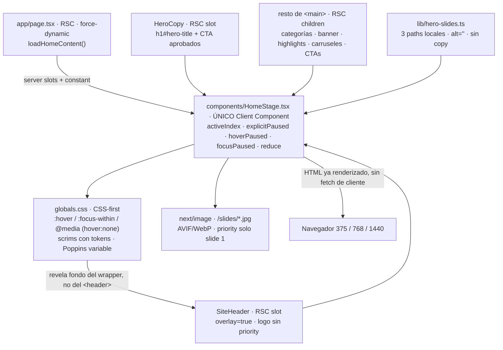

# Design Doc: DD-HOME-22 — Hero Slide con header fusionado y tipografía Poppins

| Campo | Valor |
|---|---|
| **ID** | **DD-HOME-22**. El ID sugerido en la petición (`DD-HOME-20`) ya está ocupado por `design-doc-home-20.md` (fila de productos destacados) y `DD-HOME-21` por el experimento de chrome blanco. No se reutiliza ninguno: ver §10 y §11 |
| **Autor** | `forge-architect` (Staff Engineer, APEX FORGE) |
| **Estado** | **Approved con correcciones QA — design gate**, 26-nov-2026. Diseño congelado para construcción. **No autoriza `commit`, `push` ni despliegue**; `apex-forge` debe autorizar expresamente el paso a Fase 2 |
| **Fecha** | 26 de noviembre de 2026 |
| **Revisado** | 26-nov-2026 — `forge-architect`. Enmienda QAHALL-DHOME22: estrategia de testing, métricas p75, sampling de contraste, carga real de fuentes, rollback drill y checklist. Aceptada íntegramente por `apex-forge`; ver §7, §8, §9, §13 y §4.7. **Cierre final 26-nov-2026:** DD-HOME-22.5 (toggle exento de `focusPaused`) y DD-HOME-22.6 (`Hero.tsx` en reversión), decididos por `apex-forge` |
| **Decisor final** | `apex-forge` (Comandante) |
| **Idioma** | Español (lo lee el cliente). Identificadores de código, tokens y nombres de tests en inglés (AGENTS.md) |
| **Tipo** | Archivo **nuevo**. No edita los DD anteriores; registra su reversión/supersesión en §11 |
| **Precedencia** | Siguen vigentes `mvp-requisitos.md` (Aprobado), `design-doc-mvp.md`, los arbitrajes A1…A8/C-HOME-01/C-HOME-02 y DD-HOME-19 (render dinámico). Este DD **revoca** DD-HOME-03 (hero estático), la parte tipográfica de DD-HOME-09 y la resolución original de Q-HOME-05, y **matiza** DD-HOME-21 solo durante el hero |
| **Alcance** | `app/layout.tsx`, `app/globals.css`, `app/page.tsx`, `components/SiteHeader.tsx`, nuevo `components/HomeStage.tsx`, nuevo `lib/hero-slides.ts`, `public/slides/*.jpg`, tests de Home y, **solo para la construcción**, `playwright.config.ts` (bloque táctil) y `vitest.config.ts` (umbral por archivo de `lib/hero-playback.ts`). El job `bundle budget` de `.github/workflows/ci.yml` ya existe y **no se modifica**: es la fuente de verdad del presupuesto. Sin datos, endpoints, env vars, A2/F5 ni CSP `enforce` |

> **Regla de oro:** el diseño se aprueba antes del código. Los fragmentos de tipos, clases y contratos de este documento son **artefactos de diseño**, no implementación. Quien construye escribe los tests; `forge-reviewer` da el LGTM obligatorio; `forge-sentinel` firma antes de publicar; `forge-qualis` valida la estrategia. **Este documento no versiona ni despliega nada.**

---

## 0. Resumen ejecutivo (cliente)

El Home pasa de una composición tipográfica estática a un **slide a pantalla casi completa (`100svh`) con tres fotografías reales**, autoplay de **5 segundos**, pausa al pasar el puntero, al enfocar con teclado, con un **botón explícito de pausa** (WCAG 2.2.2) y con `prefers-reduced-motion: reduce` (sin autoplay). El header se **superpone al slide y no pinta fondo mientras no se interactúa con él**: con ratón, el fondo blanco aparece solo bajo el puntero; con teclado aparece al entrar el foco; en pantallas táctiles, donde no existe hover, se mantiene **siempre visible** para no esconder la navegación. Esa es la decisión documentada para touch.

Se usan **exactamente tres fotos** de `Imagenes/` (las de mayor nitidez/resolución, elegidas por el cliente), copiadas y servidas desde `public/slides/` con nombres semánticos, `next/image`, AVIF/WebP y `priority` **solo** en la primera. No se sirve nada desde `Imagenes/`, no se hace hotlinking y no se introducen datos inventados: el H1, el CTA y el resto del copy aprobado no cambian.

Además, **Poppins sustituye a Inter y Playfair Display en todo el sitio** (`next/font/google`, pesos 400/500/600/700, `display: swap`, variable CSS). No se copian los `HelveticaNeue.woff2` ni ningún archivo del CDN de Nihlo: solo se toma la decisión tipográfica, no su licencia ni sus recursos.

Esto **reabre y revoca DD-HOME-03** y actualiza Q-HOME-05. El presupuesto se mantiene (Home ≤ 150 KB gzip), los carruseles `scroll-snap` y las secciones ocultas por falta de datos quedan intactos, y la reversión es de un solo commit. Se explicita también un cambio de ID: este DD es **DD-HOME-22**, no DD-HOME-20.

**Enmienda QA (26-nov-2026, aceptada por el Comandante):** `forge-qualis` no aprobó la estrategia de testing original. Se refuerza §7 con reloj determinista, muestreo real de píxeles en los tres slides, verificación de carga efectiva de Poppins, bloque táctil explícito y pruebas de limpieza; se traslada el control presupuestario al job `bundle budget` de CI; y se vincula el rollback < 2 min a un *drill* cronometrado y al SLO 99,5 %/216 min. **Ninguna decisión de producto cambia**: DD-HOME-22, el header fusionado, los tres slides, Poppins y D1–D6 siguen como fueron aceptados.

---

## 1. Contexto y problema

### 1.1 Pedido del cliente (Fase 0 ya aclarada)

1. Slide/hero casi a pantalla completa **fusionado con el header**: header superpuesto y transparente sobre la imagen; su fondo aparece solo bajo el puntero (hover), con solución para foco de teclado y para dispositivos sin hover.
2. Autoplay de 5 s con pausa en hover, en foco y con `prefers-reduced-motion: reduce`; flechas y puntos accesibles.
3. Tres fotos concretas de `Imagenes/`, optimizadas a `public/` con nombres semánticos:
   - `475978267_941094554864692_7081155730124177924_n.jpg` — 1080×1080, 241 KB (mayor nitidez medida).
   - `476352299_941094471531367_8294340225166205945_n.jpg` — 1080×1080, 189 KB.
   - `905462971_1477563607884448_2853981617253828113_n.jpeg` — 1241×1241, 104 KB; byte-idéntica a `public/products/crema-hidratante-piel-sensible.jpg`.
4. Tipografía del sitio `https://www.nihlo.com.co/`: el cliente verificó que usa Poppins (300–900) y archivos `HelveticaNeue.woff2` propios. Decisión: **Poppins en todo el sitio**, sin copiar los archivos con licencia de Nihlo; implementar con `next/font/google` (400/500/600/700, `display: swap`, variable CSS), reemplazando Inter y Playfair Display.

### 1.2 Estado verificado en el repositorio (no asumido)

| Hecho | Evidencia |
|---|---|
| `app/page.tsx` renderiza `<SiteHeader>` **fuera** de `<main>` y `<Hero>` dentro; orden: Hero → CategoryCards → EditorialBanner → PrototypeHighlights → dos `SectionFrame` → CommitmentCards → StoreCta | `app/page.tsx:23-60` |
| `Hero` es RSC sin imagen, con `<section aria-labelledby="hero-title">`, un único `h1#hero-title` y un CTA «Explorar piel» → `/piel` | `components/Hero.tsx:9-38` |
| `SiteHeader` es RSC con `data-surface="light"`, `bg-white`, `border-b-2 border-primary`, logo con `priority`, buscador `GET` y `<details>` nativo | `components/SiteHeader.tsx:10-100` (DD-HOME-21) |
| Fuentes actuales: `Inter` + `Playfair_Display` en `app/layout.tsx`; `body`, `h1/h2`, `h3` las consumen en `app/globals.css` | `app/layout.tsx:2-17,53`; `app/globals.css:29,35,45` |
| Los tres JPEG existen y sus dimensiones/hashes están verificados; el tercero es **byte-idéntico** al asset de producto | `file`, `sha256sum`: `dab0ad18…` compartido; `ee61df88…` y `07d8ea3b…` para los otros dos |
| Presupuesto: Home ≤ 150.000 B gzip, total ≤ 300.000 B; última medición documentada 108.466 / 256.654 B | `scripts/check-bundle.mjs:16-17`; `design-doc-home-20.md:36` |
| Matrices de tests: `home.spec.ts:65` («hero is static: one CTA, no slider, video or autoplay»), `home-highlights.spec.ts` y `home-dynamic.spec.ts` asumen el hero actual | Ver §7.2 |
| CSP sigue `report-only` sin `report-uri`; `X-Robots-Tag: noindex, nofollow` y Deployment Protection siguen vigentes (A2) | `next.config.ts`; C-HOME-01 |

### 1.3 Reversión registrada: DD-HOME-03 y RNF-MVP-008

- **DD-HOME-03** («Hero estático único con H1 y un CTA; sin slider ni autoplay», `design-doc-home.md:528`, aplicado en `N-HOME-01` y en la fila «Hero full-width con 1 CTA por slide» de `design-doc-home.md:115`) queda **REVERSADO por decisión explícita del cliente**. Se sustituye por DD-HOME-22: hero de 3 slides con autoplay controlado.
- **N-HOME-01** y `N-20-01` dejan de aplicarse **al hero**; siguen aplicándose a los carruseles de producto (DD-HOME-07/20), que no adquieren autoplay ni JS de estado.
- **RNF-MVP-008 no se modifica**: exige `prefers-reduced-motion: reduce`, animaciones CSS-first, transiciones desactivadas sin romper scroll/foco y **0 librerías de animación**. El DD anterior la interpretó como «0 autoplay»; este DD aclara que el autoplay se permite **solo** dentro de ese marco: sin librerías, sin transiciones cuando `reduce`, con pausa explícita y con intervalo JS mínimo para el temporizador. La contradictoriedad registrada en `design-doc-home.md:66,131,133-134,375` queda resuelta por esta lectura, no por una enmienda al texto normativo.
- **DD-HOME-09** (solo Playfair + Inter) queda **reversado en su totalidad** por la decisión Poppins de todo el sitio. Los ejemplos de `imagencorporativa.md` y `sistema-diseno.md` quedan como documentación histórica: no se editan en esta entrega, pero dejan de ser la fuente operativa de tipografía.
- **DD-HOME-21** (chrome blanco) se mantiene: debajo del overlay el header sigue siendo `data-surface="light"`, texto `ink`, verde solo en botones/bordes y dorado decorativo. Se suspende temporalmente su `bg-white` computado en el hero (ver §4.3); fuera del hero nada cambia. Este DD **sí** toca `globals.css` para añadir las reglas del stage y el `--font-poppins`; las reglas de foco `[data-surface='dark']` se conservan intactas.

### 1.4 Q-HOME-05: cerrada y reabierta por el cliente

La resolución del 26-nov-2026 («sin fotografía autorizada; composición tipográfica en hero, banner y OG; no usar `Imagenes/`») queda **supersedida** por la autorización actual de tres fotos. Quedan **superadas literalmente** estas líneas de `design-doc-home.md`: **87** (RF 001–004 «sin foto autorizada»), **196** (S2 «sin foto autorizada… composición tipográfica»), **198** (S4 «imagen solo cuando haya fotografía autorizada»), **310** (OG «sin fotografía autorizada»), **315** («No se seleccionan hoy fotos de `Imagenes/`…») y **557** (Q-HOME-05). **No se edita el DD viejo**; este documento es la fuente operativa nueva. El banner (S4) y el OG **no cambian**: la autorización cubre explícitamente el hero, no esos activos.

### 1.5 Objetivos medibles

| # | Objetivo | Verificación | Test |
|---|---|---|:---:|
| O1 | 3 slides locales, 1 sola H1, 1 CTA visible, 0 copy/claims nuevos | DOM + constantes tipadas + diff de copy | HOME-E2E-29, -38 |
| O2 | Autoplay 5 s con pausa en hover (slide y header)/foco/botón/`reduce` | Reloj determinista (`runFor`, `pauseAt`) + estados DOM | HOME-E2E-30…32 |
| O3 | Header transparente con regla por hover, foco y touch | Colores computados del wrapper en 375/768/1440 y bloque táctil con `matchMedia` aseverado | HOME-E2E-34 |
| O4 | AA sobre fotografía: contraste real del texto y del anillo de foco | Screenshot + rejilla de píxel compuesto en **los 3 slides**, ≥4,5:1 texto / ≥3:1 foco | HOME-E2E-35 |
| O5 | Sin CLS; LCP candidato = slide 01 o el H1; `priority` solo en slide 1 | PerformanceObserver + atributos; el presupuesto lo mide el job `bundle budget` de CI con artefactos de build, **nunca** desde Playwright | HOME-E2E-36, HOME-E2E-39 |
| O6 | Poppins 400/500/600/700 en todo el sitio; 0 peticiones externas de fuente; 0 Helvetica/Nihlo | `getComputedStyle` + `document.fonts.check` + `FontFace.status` + woff2 same-origin + CSS bundles | HOME-E2E-37 |
| O7 | Carruseles y secciones vacías intactos; reversión < 2 min | Suite existente + rollback drill | §8, §13 |

No se promete conversión: no hay instrumentación de personas (N-MVP-17/18).

---

## 2. No-objetivos

| ID | Explícitamente fuera de alcance | Motivo |
|---|---|---|
| N-22-01 | Cuarto slide, vídeo, GIF, audio ni autoplay de vídeo | Q-HOME-07 (resuelta «no en MVP»), N-HOME-02; sin transcripción |
| N-22-02 | Copy nuevo, eslogan alternativo, claims, porcentajes, diagnósticos, precios, marcas o tiendas en el slide | N-HOME-07/-12; H1 y CTA aprobados se reutilizan literalmente |
| N-22-03 | Modificar `app_config`, Prisma, seeds, endpoints, env vars ni `DATABASE_URL` | DD-HOME-19 queda intacto; el slide es estático y DB-free |
| N-22-04 | `Swiper`, `Slick`, `Embla`, `AOS`, `lucide-react` ni librería de animación | RNF-MVP-008, RNF-MVP-005, DD-HOME-12 |
| N-22-05 | Cambiar `CuratedCarousel`, `PrototypeHighlights`, `SectionFrame`, `ProductCard` ni su política de ocultación | Los carruseles `scroll-snap` y el contenido oculto por falta de datos no deben degradarse |
| N-22-06 | Servir imágenes desde `Imagenes/`, `presentacion/`, CDN externo ni hotlinking a Nihlo/Shopify | Seguridad, CSP `img-src 'self'`, legal |
| N-22-07 | Copiar `HelveticaNeue.woff2`, archivos woff2 de Nihlo ni cualquier recurso con licencia ajena | Decisión del cliente: solo la elección Poppins, no los binarios |
| N-22-08 | Bloques `aria-live`, anuncios automáticos ni movimiento de foco durante el autoplay | El contenido visible no cambia para lectores de pantalla; el anuncio sería ruido |
| N-22-09 | Header *sticky*, detección de scroll con `IntersectionObserver` ni cambio de `vercel.json` | El header actual no es sticky; añadirlo cambia navegación y aumenta JS/INP |
| N-22-10 | Cambiar tokens HEX, logo, favicon, OG, A2/`noindex`, CSP `enforce` ni F5 | C-HOME-01/-02, Q-HOME-03 sigue abierta |
| N-22-11 | Hacer `commit`, `push` o deploy | Requiere autorización explícita del Comandante |
| N-22-12 | Reescribir los DD anteriores | Se registra la reversión en §11; los archivos aprobados se conservan como historia |

---

## 3. Requerimientos y restricciones

### 3.1 Funcionales

| ID | Requisito |
|---|---|
| F-22-01 | Hero de altura `100svh` (mínimo) con tres slides en orden fijo; **un solo `h1`** y **un solo enlace CTA** accesible en el hero, en todo momento |
| F-22-02 | Autoplay de **5000 ms** por slide, reiniciado tras cada navegación manual; el timer se limpia al desmontar |
| F-22-03 | Pausa al entrar el puntero en el slide **o** en el header; se reanuda al salir si no hay foco, pausa explícita ni `reduce` |
| F-22-04 | Pausa al entrar el foco de teclado en el slide o el header (`:focus-within` + estado JS); se reanuda al salir |
| F-22-05 | **Botón explícito** `Pausar presentación` / `Reanudar presentación` (WCAG 2.2.2); su estado se expone por texto y `aria-pressed` |
| F-22-06 | `prefers-reduced-motion: reduce`: **no se programa ningún intervalo**; el slide inicial permanece hasta acción manual; el cambio manual es instantáneo |
| F-22-07 | Flecha anterior/siguiente + 3 puntos como `<button>` con nombres accesibles («Ir a la diapositiva 2 de 3»); `aria-current="true"` solo en el punto activo |
| F-22-08 | Header superpuesto: fondo transparente por defecto sobre el slide; blanco bajo hover (ratón) y bajo foco (teclado); siempre blanco en touch |
| F-22-09 | Imágenes servidas desde `public/slides/`, AVIF/WebP por `next/image`, `srcset` 400/800/1600, `priority` solo en slide 1 |
| F-22-10 | Poppins 400/500/600/700 en `body`, encabezados y controles de todas las rutas; sin recursos tipográficos externos en runtime |

### 3.2 No funcionales y matriz de decisiones

| Situación | Autoplay | Fondo del header | Mecanismo |
|---|---|---|---|
| Ratón fuera del stage, sin foco | Sí (5 s) | Transparente | Estado inicial + CSS |
| Ratón sobre slide o header | Pausado | Blanco **solo bajo el puntero** | `pointerenter/leave` (JS para el timer) + `:hover` (CSS para el fondo) |
| Foco de teclado en flechas, puntos u otros controles del slide/header | Pausado | Blanco | `focusin/focusout` (JS) + `:focus-within` (CSS, inmediato) |
| Foco en el botón **Pausar/Reanudar presentación** | **Exento de `focusPaused`** (DD-HOME-22.5): manda solo `explicitPaused` | Regla de puntero/foco aplicable | El toggle se excluye del `focusin/focusout` que alimenta `focusPaused`; tras «Reanudar» el autoplay corre aunque el foco siga en el botón |
| Botón de pausa activado | Pausado hasta nueva acción | Regla de puntero/foco aplicable | Estado `explicitPaused` |
| `prefers-reduced-motion: reduce` | **Nunca** | Regla de puntero/foco aplicable | `matchMedia` + CSS global existente |
| Touch (`hover: none` o `pointer: coarse`) | Sí (5 s), pausa con el botón | **Siempre blanco** | `@media` CSS; no se depende de hover |

- **Accesibilidad:** WCAG 2.2 AA; un H1; landmarks únicos; foco visible de 2 px `ink` con offset 2 px (DD-HOME-21.3) — incluido el foco sobre la fotografía; SC 2.2.2 con botón explícito; `aria-live` **no usado**; slides inactivos `aria-hidden="true"` y sin elementos enfocables; imágenes decorativas con `alt=""`; axe 0 críticas/serias a 375/768/1440.
- **Contraste:** texto `ink` sobre velo crema ≥ 0,85 en la franja del header (≥ 7,63:1 en el peor caso, foto negra); texto blanco sobre scrim `ink` ≥ 0,75 en la franja del copy (≥ 5,55:1 en el peor caso, foto blanca); CTA blanco sobre `primary` 7,75:1; anillo `ink` sobre fondo blanco revelado 11,77:1. Tabla calculada en §4.6.
- **Rendimiento:** Home ≤ 150.000 B gzip, total ≤ 300.000 B; LCP p75 < 2,5 s, CLS p75 < 0,1 (objetivo 0), INP p75 < 200 ms, TTFB p75 < 800 ms. Cada p75 tiene **fuente, ventana y dueño** en §9 (lab en Preview por release y campo 7–28 días en Speed Insights; `forge-frontend` + `forge-qualis`). El incremento de JS se estima en **+2…4 KB gzip**; base 108.466 B. El presupuesto gzip se mide **solo** en el job `bundle budget` de CI, que descarga los artefactos de build (`app-build-manifest.json` y `.next/BUILD_ID`) y ejecuta `npm run check:bundle`; invocarlo desde Playwright falla porque el `webServer` corre en modo dev y no hay `.next/BUILD_ID` (QA HALL 1).
- **Legal/seguridad:** sin secretos ni env vars nuevas; CSP `img-src 'self' data:` y `font-src 'self'` ya compatibles; sin PII, sin analítica; `forge-sentinel` firma antes de publicar por licencias de tipografía y cambio de chrome, aunque no haya flujo de datos nuevo.
- **Compatibilidad:** Next 15 (`>=15.5.29 <16`), React 19, TS strict, Tailwind v4 (`@theme`), Vitest + Playwright. No hay cambio de versión mayor que evaluar: el stack está fijado y las evaluaciones A7/A11 ya están documentadas.
- **Presupuesto de error:** cualquier regresión de axe, foco, CLS, bundle o copy bloquea el merge; no se acepta “casi AA”.

---

## 4. Solución propuesta

### 4.1 Arquitectura



**Por qué este límite cliente/servidor:** el único estado que necesita el navegador es el índice del slide y las banderas de pausa. Todo lo demás (datos de `app_config`, navegación, WhatsApp, copy, H1, CTA y el resto de secciones) sigue siendo RSC y se pasa como **slots/children** al Client Component. React permite pasar elementos de servidor como props a un Client Component: no hay `fetch` de cliente, no hay JSON embebido y no se hidrata el contenido de las otras secciones. No hace falta compartir un estado «slide activo ↔ header transparente»: **la transparencia del header no depende del slide activo**, sino de pseudo-clases CSS sobre su wrapper. Eso elimina el problema de comunicación entre RSC y cliente.

### 4.2 Contrato de componentes (diseño, no implementación)

```ts
// Design-only interface. No production code in this document.
type HeroSlide = {
  id: 'slide-01' | 'slide-02' | 'slide-03';
  src: '/slides/hero-01.jpg' | '/slides/hero-02.jpg' | '/slides/hero-03-crema-hidratante.jpg';
  alt: ''; // decorative: no approved subject copy exists for slides 01/02
};

type HomeStageProps = {
  chrome: React.ReactNode;   // <SiteHeader overlay ... /> — server-rendered
  heroCopy: React.ReactNode;  // <HeroCopy> with the single h1 and CTA — server-rendered
  slides: readonly HeroSlide[];
  children: React.ReactNode;  // rest of <main> — server-rendered, unchanged
};

type SiteHeaderProps = {
  navigation: HomeContent['navigation'];
  whatsappUrl: string | null;
  overlay?: boolean;         // default false; true only in the Home hero stage
};
```

Árbol resultante (landmarks intactos):

```
<div class="home-stage">
  <div class="home-stage__chrome" ...>   ← fondo transparente / blanco según CSS
    <SiteHeader overlay />               ← <header data-surface="light">, bg-transparent
  </div>
  <main id="main" tabIndex={-1}>
    <section class="hero" aria-labelledby="hero-title">
      <div class="hero__media">3 imágenes absolutas</div>
      <div class="hero__top-veil" aria-hidden="true" />
      <div class="hero__copy">{heroCopy}</div>   ← h1 + CTA, servidor
      <div class="hero__controls">◀ · 1 · 2 · 3 · ▶ · Pausar</div>
    </section>
    {children}                             ← servidor, sin cambios
  </main>
</div>
<SiteFooter ... />
```

`HomeStage` es `position: relative`; el wrapper del header es `position: absolute; inset-inline: 0; top: 0; z-index: 40`, por lo que el header se superpone sin desplazar el hero. El hero reserva `padding-top: calc(var(--stage-chrome-h) + 2rem)` con `--stage-chrome-h: 11rem` bajo 768 px y `6.5rem` desde 768 px; el test HOME-E2E-34 exige que la caja del `h1` **no intersecte** la del header a los tres anchos. El valor es CSS estático (sin medida en runtime), por lo que no hay CLS.

`SiteHeader overlay` cambia **solo la clase de fondo** de su raíz (`bg-transparent` en lugar de `bg-white`) y el `priority` del logo a `false` (el logo de 48 px no debe competir con el LCP del slide). Conserva `data-surface="light"`, `border-b-2 border-primary` y texto `ink`, botones `primary`, búsqueda `GET` y `<details>` nativo. El borde de **2 px `primary` sigue en el `<header>` también bajo el overlay**, porque HOME-E2E-27 lo mide además del fondo (QA HALL 8); el wrapper `.home-stage__chrome` aporta solo el fondo revelado y no añade un segundo borde, para no duplicar la línea.

### 4.3 Patrón de fusión del header (decisión DD-HOME-22.1)

No se usa `:has()` y no se usa JS para pintar el header: el elemento hovered/focused es **el propio wrapper**, así que `:hover` y `:focus-within` bastan. Esto mantiene el comportamiento incluso antes de que hidrate React y evita un parpadeo de fondo.

| Regla CSS | Efecto |
|---|---|
| `.home-stage__chrome { background-color: transparent; border: 0 }` | Estado por defecto sobre la foto; el `<header>` conserva su borde 2 px `primary` |
| `@media (hover: hover) and (pointer: fine) { .home-stage__chrome:hover { background-color: var(--color-white) } }` | Fondo visible solo bajo el puntero; sin borde propio para no duplicar el del `<header>` |
| `.home-stage__chrome:focus-within { background-color: var(--color-white) }` | Foco de teclado revela el fondo **antes** de que se pinte el anillo |
| `@media (hover: none), (pointer: coarse) { .home-stage__chrome { background-color: var(--color-white) } }` | Touch: navegación siempre legible; no se exige hover |
| Sin `transition` en `background-color` | El anillo de foco nunca cae sobre la foto durante una transición |

**Por qué gana:** es reversible con un cambio de clases, no depende de timers ni de `IntersectionObserver`, respeta RSC y mantiene el token de foco `ink` de DD-HOME-21 (sobre el blanco revelado: 11,77:1). La alternativa «header sticky que recupera el fondo al salir del hero» exige JS de scroll y cambia la navegación actual; queda rechazada en §5.

### 4.4 Máquina de estados del slide (decisión DD-HOME-22.2)

`activeIndex ∈ {0,1,2}`; banderas booleanas `explicitPaused`, `hoverPaused`, `focusPaused`, `reduce`.

**Excepción DD-HOME-22.5:** `focusPaused` se alimenta del foco en **flechas, puntos y demás controles**, pero **nunca del botón Pausar/Reanudar**. La función pura `shouldAutoplay` y su tabla de verdad **no cambian**: lo que cambia es dónde se aplica la bandera. Tras pulsar «Reanudar», `explicitPaused = false` y el foco en el toggle no bloquea el timer; así se cumple F-22-05/SC 2.2.2 con el comportamiento natural de teclado.

```
reduce = true  ───────────────►  SIN timer (slide 0 hasta acción manual)
reduce = false ─┐
explicitPaused ─┤
hoverPaused ────┼──►  PAUSADO  (ningún avance automático)
focusPaused ────┘   (flechas/puntos; NO el toggle)
ninguna bandera ────►  REPRODUCIENDO ── 5000 ms ──► activeIndex = (i+1) mod 3
```

- El `useEffect` del intervalo depende de `[activeIndex, shouldAutoplay]`; cualquier navegación manual reinicia la cuenta de 5 s. El callback comprueba `document.visibilityState === 'visible'`, sin estado adicional.
- `pointerenter`/`pointerleave` en el slide y en el wrapper del header actualizan `hoverPaused`; `focusin`/`focusout` con `relatedTarget` comprueban que el foco realmente salió antes de limpiar `focusPaused`, **salvo cuando el objetivo es el toggle Pausar/Reanudar**, que nunca activa esa bandera (DD-HOME-22.5).
- El botón de pausa usa texto visible + `aria-pressed`; al activarlo, el autoplay no se reanuda aunque el puntero salga. Al pulsar **Reanudar** se limpia `explicitPaused` y el autoplay vuelve a los 5 s **incluso si el foco permanece en el botón**.
- Flechas y puntos son `<button type="button">`; al activarlos el foco **permanece en el control** (ello mantiene `focusPaused = true`, coherente: la interacción manual detiene el autoplay).
- No hay `aria-live`: el H1 y el CTA son idénticos en los tres slides y las fotos son decorativas, así que un anuncio periódico no aportaría información y sí generaría ruido. La posición se expone de forma pasiva con `aria-current="true"` en el punto activo.
- Con `reduce`, el crossfade (si se implementa) se desactiva por la regla global `animation/transition: none !important`, y el cambio de imagen es instantáneo.

### 4.5 Copy, H1 e imágenes

- Se conservan **literalmente** el H1 aprobado «Belleza para tu piel y tu cabello» y el CTA «Explorar piel» → `/piel` (`lib/home-content.ts:244-247`). No se añade texto por slide: esto evita nuevos claims y mantiene un solo H1.
- Las tres imágenes son decorativas (`alt=""`); los slides inactivos llevan `aria-hidden="true"` y no contienen enlaces ni botones. Los controles viven **fuera** del track y son los únicos interactivos.
- Los nombres semánticos de `hero-01`/`hero-02` son de **rol y orden**, no de contenido: no existe copy aprobado que describa el sujeto de esas dos fotos y este modelo no puede inspeccionarlas visualmente. Inventar un `alt` sería inventar contenido (N-22-02). La tercera sí se nombra por su contenido conocido (`crema-hidratante`), verificada por hash contra el asset de producto.

### 4.6 Velos, scrims y contraste calculado

Los velos son **capas del slide**, no fondos del header; por eso el header puede seguir siendo transparente. Se usan solo tokens con alpha (`bg-surface/85`, `bg-ink/85`), sin HEX sueltos.

| Capa | Gradiente | Peor caso | Ratio |
|---|---|---|---:|
| `hero__top-veil` (tras el header) | `surface` 0,90 → 0,85 → 0 en ~176 px móvil / ~104 px desktop | foto negra, `ink` sobre 0,85 `surface` ⇒ RGB(210,208,202) | **7,63:1** ✔ AA |
| Scrim del copy | `ink` 0,85 → 0,75 → 0 de izquierda a derecha y abajo | foto blanca, blanco sobre 0,75 `ink` ⇒ RGB(77,111,102) | **5,55:1** ✔ AA (incluso para 16 px) |
| CTA | `bg-primary` + texto blanco | — | **7,75:1** ✔ AAA |
| Foco del header | anillo `ink` 2 px, offset 2 px sobre el blanco revelado | — | **11,77:1** ✔ ≥3:1 (SC 1.4.11) |
| Foco de controles sobre foto | el control se asienta sobre el scrim (`ink` ≥0,75) o sobre una placa `surface`; la prueba mide el píxel adyacente real | — | ≥ 5,55:1 objetivo |

HOME-E2E-35 mide los colores **compuestos realmente pintados** en la franja de texto y junto al anillo, a los tres anchos y **en los tres slides**; no basta con comprobar la clase ni con `getComputedStyle().backgroundColor`, que da falso verde sobre una fotografía (QA HALL 4).

### 4.7 Assets (decisión DD-HOME-22.3)

| Slide | Origen en `Imagenes/` | Destino semántico | Dimensiones | Tamaño | SHA-256 (verificado) |
|---|---|---|---|---|---|
| 01 | `475978267_941094554864692_7081155730124177924_n.jpg` | `public/slides/hero-01.jpg` | 1080×1080 | 241 KB | `ee61df8813bd344bc25ccdb404f4f13823556395edee2583d30623517e70f1cc` |
| 02 | `476352299_941094471531367_8294340225166205945_n.jpg` | `public/slides/hero-02.jpg` | 1080×1080 | 189 KB | `07d8ea3ba01d156cc67e9983468d8d90fe6e216e5d550ea4f297fd43815bd5b9` |
| 03 | `905462971_1477563607884448_2853981617253828113_n.jpeg` | `public/slides/hero-03-crema-hidratante.jpg` | 1241×1241 | 104 KB | `dab0ad1827b379d985d3e0887149c621d4c78bf9e63ff5940b5fac381d0e1ed2` |

Reglas:

- Copia byte-for-byte de `Imagenes/` a `public/slides/`; **los originales no se editan ni se sirven**. El slide 03 se copia aunque ya exista en `public/products/` para mantener un único manifiesto de slides y permitir recortes independientes; se acepta la duplicación de 104 KB como coste de reversibilidad (R-22-09).
- `next/image` con `fill`, `object-cover`, `sizes="100vw"`, `srcset` 400/800/1600 generado por el optimizador, AVIF/WebP negociados por `Accept`. `priority` **solo** en slide 01; slides 02/03 con `loading="lazy"` y `decoding="async"`.
- El contenedor multimedia es `absolute inset-0` dentro de un hero con altura reservada: no hay desplazamiento al cargar (CLS objetivo 0).
- Sin `portada.jpg`, sin imágenes de Nihlo, sin URLs `http(s)` en el bundle. HOME-E2E-38 verifica los tres paths y los hashes de origen.

**Verificación QA añadida a este contrato de assets (HALL 1/4/6/7):**

| Punto | Cómo se verifica | Test |
|---|---|---|
| Los tres slides, no solo el primero | Se activa cada slide por sus puntos, se espera la imagen decodificada (los slides 02/03 son `lazy`) y se muestrea el píxel compuesto en cada franja. El peor caso puede estar en 02 o 03 | HOME-E2E-35 |
| `priority` solo en `hero-01.jpg` | Atributos DOM (`fetchpriority="high"` una sola vez) y candidato LCP = slide 01 o H1, **sin reloj falso** | HOME-E2E-36, HOME-E2E-39 |
| AVIF/WebP | Respuesta real de `/_next/image` con `Accept: image/avif,image/webp`; no se infiere del nombre del archivo | HOME-E2E-36 |
| Provenancia | Comprobación local mínima **definida dentro de `lib/hero-slides.ts`** (prefijo `/slides/`, sin protocolo, sin `/Imagenes/`) y consumida por su test. **No** invoca `parseImage` (privado en `lib/home-content.ts`), no exporta nada de `home-content.ts` y no duplica su regex completa | `tests/unit/hero-slides.test.ts` |

### 4.8 Migración de tipografía (decisión DD-HOME-22.4)

- `app/layout.tsx`: retirar `Inter` y `Playfair_Display`; importar `Poppins` de `next/font/google` con `subsets: ['latin']`, `weight: ['400','500','600','700']`, `display: 'swap'`, `variable: '--font-poppins'`; aplicar solo esa variable en `<html>`.
- `app/globals.css`: `body`, `h1/h2` y `h3` pasan a `var(--font-poppins), ui-sans-serif, system-ui, sans-serif`; se conservan los `font-weight` actuales (h1/h2 600, h3 600, cuerpo 400) y los `line-height` aprobados. Eliminar `--font-inter`/`--font-playfair`. No se añaden `font-weight` 300/800/900: la decisión del cliente es Poppins, no replicar los nueve pesos del sitio de referencia.
- `next/font/google` **autohospeda** los woff2 en el build: no hay petición a `fonts.googleapis.com`/`fonts.gstatic.com` en runtime; CSP `font-src 'self'` sigue válida. El build ya dependía de `next/font/google` (Inter/Playfair), así que no se introduce una nueva dependencia de red en CI.
- **No se copia** `HelveticaNeue.woff2`, ni ningún woff2 del CDN de Shopify de Nihlo, ni se referencia `nihlo.com.co` en código, docs de aplicación ni assets. Se toma únicamente la decisión tipográfica (idea), nunca el archivo con licencia (expresión).
- La migración afecta a **todas las rutas** porque vive en `RootLayout`. Los archivos históricos (`imagencorporativa.md`, `sistema-diseno.md`, maquetas, prototipo) no se editan: quedan como documentación de la identidad anterior, supersedida por este DD en el tema tipográfico.

### 4.9 Por qué gana

| Criterio (prioridad APEX FORGE) | Esta solución | Alternativa con librería / dos componentes cliente |
|---|---|---|
| **Correctitud** | Un H1 y un CTA fijos; pausa verificable en los cuatro escenarios; foco sobre fondo revelado; AA calculado sobre velos | Los estados de librería añaden ARIA, foco y timers difíciles de auditar |
| **Mantenibilidad** | Un Client Component, una constante tipada de 3 slides, CSS con pseudo-clases; sin DB ni config | Contexto compartido entre header y slider acopla RSC y cliente |
| **Rendimiento** | +2…4 KB gzip estimados, `priority` solo en slide 1, sin librerías, sin CLS | Swiper/Embla + scroll listeners incrementan JS e INP y pueden superar el presupuesto |
| **Velocidad de entrega** | Seis commits atómicos (§12), reversión < 2 min | Migración a librería o a header sticky aumenta superficie y pruebas |

---

## 5. Alternativas evaluadas

### A — Client Component único `HomeStage` + revelado CSS del header (**GANADORA**)

- **Pros:** cumple O1…O7; minimal JS; RSC intacto; touch resuelto sin JS; reversible; no `:has()` ni `IntersectionObserver`; conserva DD-HOME-21 debajo del overlay.
- **Contras:** el timing de Playwright debe usar reloj virtual; el velo superior ocupa ~104/176 px del slide (aceptado: es composición, no fondo del header).
- **Motivo:** es la única que satisface simultáneamente autoplay controlado, foco/touch, presupuesto y separación RSC con el menor número de decisiones acopladas.

### B — Autoplay solo CSS (`@keyframes` + `animation-play-state` + radios `:checked`) (RECHAZADA)

- **Pros:** 0 KB de JS; pausa en hover con `:hover`.
- **Contras:** no puede sincronizar `aria-current`/estado de los puntos con el frame animado; no puede pausar con foco de forma fiable en todos los navegadores; el botón de pausa exigido por SC 2.2.2 tendría que ser un checkbox sin semántica clara; los `steps()` no reinician limpiamente tras navegación manual.
- **Motivo de rechazo:** falla correctitud y accesibilidad antes que rendimiento. Se conserva el CSS-first para *transiciones y velos*, no para la lógica de estado.

### C — `Swiper`/`Embla` + iceberg de animación (RECHAZADA)

- **Pros:** flechas, puntos y transiciones listas para usar.
- **Contras:** dependencia nueva, autoplay por defecto, `prefers-reduced-motion` parcial, riesgo de superar 150 KB, licencias y bundle de iconos; contradice RNF-MVP-005/008 y DD-HOME-12.
- **Motivo de rechazo:** problema evitable; 3 slides no justifican una librería.

### D — Dos Client Components (`HeaderOverlay` + `HeroSlider`) con contexto compartido (RECHAZADA)

- **Pros:** responsabilidades separadas; el header podría reaccionar al slide activo.
- **Contras:** más JS e hidratación, acoplamiento innecesario (el fondo del header no depende del índice), riesgo de desincronización entre estado React y CSS, y más pruebas.
- **Motivo de rechazo:** el requisito no pide que el header cambie por slide; la decisión reversible es no compartir estado.

### E — Header sticky con `IntersectionObserver` que recupera el fondo al salir del hero (RECHAZADA)

- **Pros:** patrón visual habitual en sitios editoriales.
- **Contras:** el header actual **no** es sticky; cambiarlo altera la navegación y los tests de landmarks/scroll; añade JS de scroll (INP), una transición de fondo que puede romper el contraste del foco y más superficie de regresión.
- **Motivo de rechazo:** no pedido, no reversible en un cambio de clases y peor para presupuesto/foco.

### F — Mantener el hero estático (RECHAZADA)

- **Pros:** cero riesgo, cero JS.
- **Contras:** ignora la petición explícita del cliente que revoca DD-HOME-03 y Q-HOME-05.
- **Motivo de rechazo:** el cliente es quien decide el «qué»; el equipo decide el «cómo» con estos límites.

---

## 6. Riesgos y mitigaciones

| ID | Riesgo | Mitigación | Dueño |
|---|---|---|---|
| R-22-01 | LCP degrade por 3 imágenes + dos fuentes | `priority` solo en slide 1; logo sin `priority` en overlay; `display: swap`; slides 2/3 lazy; LCP medido en Preview antes de F5 | `forge-frontend` + `forge-qualis` |
| R-22-02 | Texto `ink` del header ilegible sobre foto clara/oscura | Velo `surface` ≥0,85 bajo la franja del header; muestreo real de contraste en HOME-E2E-35 | `forge-frontend` + `forge-qualis` |
| R-22-03 | Anillo de foco caiga sobre la foto durante la aparición del fondo | `:focus-within` instantáneo, sin `transition` de `background-color`; HOME-E2E-19/-35 | `forge-frontend` |
| R-22-04 | Usuarios táctiles no vean la navegación | `@media (hover: none), (pointer: coarse)` → header siempre blanco; HOME-E2E-34 con emulación explícita | `forge-frontend` + `forge-qualis` |
| R-22-05 | SC 2.2.2 incumplido por no tener pausa explícita | Botón `Pausar/Reanudar` con `aria-pressed`; no depender solo de hover/foco | `forge-architect` + `forge-qualis` |
| R-22-06 | `aria-live` o anuncios periódicos molestos | No se usa live region; `aria-current` pasivo; slides inactivos `aria-hidden` sin focusables | `forge-frontend` |
| R-22-07 | Tests existentes fallen por el cambio de wrapper/main | §7.2 lista los archivos y líneas exactos; se reescribe el test obsoleto **sin borrar su `@smoke`** | `forge-frontend` + `forge-qualis` |
| R-22-08 | Regresión en carruseles o secciones ocultas | No se toca su código; HOME-E2E-06/-07/-20…25 se ejecutan sin cambios salvo revisión de orden en `page.tsx` | `forge-qualis` |
| R-22-09 | Duplicidad de bytes del slide 03 frente al asset de producto | Copia intencionada con hash verificado en HOME-E2E-38; se aceptan 104 KB extra no presupuestados como JS | `forge-frontend` |
| R-22-10 | Problema legal por tipografía/hotlinking | Solo `next/font/google`; 0 URLs a Nihlo/Shopify; 0 `HelveticaNeue`; firma de `forge-sentinel` antes de publicar | `forge-sentinel` |
| R-22-11 | Build CI sin red para `next/font/google` | Ya ocurría con Inter/Playfair: no es dependencia nueva; si falla, se reporta como incidencia de red, no se sustituye por CDN en runtime | `forge-infra` |
| R-22-12 | Hydration mismatch por `matchMedia` distinto en servidor/cliente | Render inicial determinista (slide 0, sin pausa); `reduce` se lee en `useEffect` y suscribe a cambios | `forge-frontend` |
| R-22-13 | ID del DD confundido con DD-HOME-20/21 | Este DD es **DD-HOME-22**; tabla §11 y decisión §10; no se renombran los DD existentes | `apex-forge` |
| R-22-14 | `globals.css` tocado contradiga DD-HOME-21 | Solo se añaden reglas del stage/tipografía; las reglas de `[data-surface]` y `::selection` quedan byte-for-byte | `forge-reviewer` |
| R-22-15 | Timer activo en pestaña oculta | El callback comprueba `document.visibilityState`; limpieza en `useEffect` unmount; HOME-E2E-31 simula `hidden` y comprueba el spy de timers a 0 | `forge-frontend` |
| R-22-16 (QA) | Falso verde en testing: `backgroundColor`/`fontFamily` declarados pero no pintados/cargados | HOME-E2E-35 usa píxel compuesto de screenshot en los 3 slides; HOME-E2E-37 exige `document.fonts.check`, `FontFace.status === 'loaded'` y woff2 same-origin | `forge-qualis` |
| R-22-17 (QA) | Reloj falso contamina CLS/LCP o `fastForward` salta el re-registro del intervalo | Reloj solo en -30/-31/-32; -36/-39 en contexto limpio; `runFor(4999)+runFor(1)` + `runFor(0)` + `aria-current` | `forge-qualis` |
| R-22-18 (QA) | Rama táctil nunca se ejecuta o rollback < 2 min queda sin probar | HOME-E2E-34 asevera `matchMedia` antes del color; drill cronometrado con acta, ID de deployment previo y SLO 99,5 %/216 min (§8.2) | `forge-qualis` + `forge-infra` |

---

## 7. Estrategia de testing

Responsable de la estrategia: `forge-qualis`. Quien construye, prueba. `@smoke` en cada PR; suite completa y axe en release; cero reintentos (política vigente).

### 7.1 Unitarias / integración

| Prueba | Aserción |
|---|---|
| `tests/unit/hero-slides.test.ts` (nueva) | Exactamente 3 slides; ids y paths literales de §4.7; `alt === ''`; sin campos `title`, `name`, `price`, `href`, `claim`; las tres cadenas SHA-256 coinciden con los archivos de `Imagenes/` y con sus copias en `public/slides/`. La validación de path es **local y mínima**, definida dentro de `lib/hero-slides.ts` (`startsWith('/slides/')`, sin `http(s)://`, sin `/Imagenes/`) y reutilizada por el test. **No invoca `parseImage`**: es privado en `lib/home-content.ts:175`; no se exporta nada de ese módulo ni se duplica su regex completa (QA HALL 7) |
| `tests/unit/hero-playback.test.ts` (nueva) | Función pura `shouldAutoplay({reduce, explicitPaused, hoverPaused, focusPaused})`: tabla de verdad completa de §3.2; `nextIndex(2) === 0`; el caso de ventana oculta (`visibilityState !== 'visible'`) se comprueba en E2E, no aquí |
| `tests/integration/home-content.integration.test.ts` | **Sin cambios funcionales**: con `app_config` vacío y poblado, `content.hero` sigue siendo el copy aprobado; el hero no lee configuración |

**Cobertura (QA HALL 7):** ≥ 70 % global en `lib/**` (`vitest.config.ts:25`, QA-04); `lib/home-content.ts` mantiene su umbral per-file 90/85/90; se añade un **umbral per-file para `lib/hero-playback.ts`: `lines: 90`, `branches: 85`, `functions: 90`** en `vitest.config.ts`, porque el 70 % global por sí solo no protege la máquina de estados. El umbral se confirma con la primera medición real: si la medición queda por debajo se **añaden tests**, no se baja el gate sin aprobación escrita de `forge-qualis`. `vitest.config.ts` entra en alcance de construcción y en la lista de reversión (§8.2); el global no se relaja.

### 7.2 Tests existentes impactados (modificar con cirugía, no borrar)

| Archivo / línea | Situación | Acción |
|---|---|---|
| `tests/e2e/home.spec.ts:65` — «hero is static: one CTA, no slider, video or autoplay» | **Queda obsoleto por contrato** (aún puede pasar parcialmente: el hero sigue teniendo 1 link y no usa `aria-roledescription="carousel"`) | Reescribir **en el mismo lugar** como `HOME-E2E-29` y mantener `@smoke`: 1 hero, 1 H1, 1 link visible, 3 imágenes locales, 0 `<video>`, 0 atributo HTML `autoplay`, 0 `aria-roledescription="carousel"`, CTA «Explorar piel» → `/piel` |
| `tests/e2e/home.spec.ts:100-114` — recursos externos | Hoy solo prohíbe analytics y `script/link[href^="http"]`; Poppins no debe añadir *preconnect* en runtime | Ampliar la lista de `needle` con `fonts.googleapis.com`, `fonts.gstatic.com`, `nihlo.com.co`, `cdn.shopify.com` y aseverar 0 `link[rel~="preconnect"], link[rel~="dns-prefetch"]` hacia esos hosts; HOME-E2E-37 comprueba además la red real |
| `tests/e2e/home.spec.ts:120-155` — axe 375/768/1440 | Corre por tags WCAG; no fuerza reglas concretas | Añadir una **segunda pasada** con `runOnly: { type: 'rule', values: ['aria-hidden-focus','button-name','aria-allowed-attr'] }`; 0 violaciones de esas tres reglas en los tres anchos (slides inactivos `aria-hidden`, flechas/puntos con nombre, `aria-current` permitido) |
| `tests/e2e/home.spec.ts:169-193` — cabeceras | Sin cambio: CSP sigue report-only y `noindex` intacto | Ejecutar unchanged |
| `tests/e2e/home.spec.ts:195-215` — reduced motion | Toma `main a` como primer enlace; el CTA del hero sigue siendo el primero | Mantener; reforzar con HOME-E2E-31/-32 (`pauseAt()` y spy de `setInterval`) |
| `tests/e2e/home.spec.ts:280-373` — HOME-E2E-13 | Barre controles de `header`/`footer` buscando anillo `ink`; el overlay revela el fondo al enfocar | Mantener assertions; añadir comprobación de que el wrapper (no el `<header>`) pinta blanco y de que el `<header>` conserva su borde 2 px `primary` |
| `tests/e2e/home.spec.ts:299-335` — barrido «gold on light» | Busca el primer ancestro con `backgroundColor` no transparente; con el wrapper transparente sobre la foto puede dar **falso positivo** al encontrar `surface` más arriba | Excluir la cadena `.home-stage`/`.home-stage__chrome` del barrido de ancestores y validar el dorado del chrome del hero con el píxel compuesto de HOME-E2E-35; mantener la aserción para el chrome fuera del hero |
| `tests/e2e/home.spec.ts:456-495` — HOME-E2E-19 | Mide el píxel adyacente real; ahora es el wrapper blanco | Mantener; añadir un sample de control del hero en HOME-E2E-35 |
| `tests/e2e/home.spec.ts:576+`, `:661-694` — HOME-E2E-27 (chrome blanco) | Espera `header` con `backgroundColor === rgb(255,255,255)` **y** `borderBottom` 2 px `primary` (`:661`) | **Actualizar solo el fondo**: el `<header>` computa `rgba(0,0,0,0)` en el hero y el wrapper `.home-stage__chrome` es blanco en hover/foco/touch; **la aserción de borde 2 px `primary` se conserva** (§4.2). Fuera del hero DD-HOME-21 sigue igual |
| `tests/e2e/home-brand.spec.ts:38` — `header img` count | Sigue siendo 1 con `overlay` | Mantener `toHaveCount(1)`; añadir la comprobación de que el logo no es `fetchpriority="high"` bajo overlay |
| `tests/e2e/home-brand.spec.ts:47-57` — placa de contraste del logo | Hoy mira solo clases (`bg-surface`, `rounded-full`); sobre foto transparente eso da falso verde | Mantener el count y sustituir la aserción de clase por contraste real del píxel bajo el logo, integrado en HOME-E2E-35 para los tres slides |
| `tests/e2e/home-brand.spec.ts:72-80` — overflow 375 px | Pasa hoy; el track absoluto y la fila de controles pueden introducir `scrollWidth > innerWidth` | Mantener la aserción y repetirla tras avanzar cada slide dentro de HOME-E2E-34 |
| `tests/e2e/home-highlights.spec.ts:93-117` — orden de secciones en DOM | Consulta `main section`; el stage añade un wrapper | **Verificar, no asumir «sin cambio»**: ejecutar la aserción y confirmar que `editorial < highlights < storeCta` sigue valiendo con `<main>` dentro del stage; adaptar el selector sin relajar el orden |
| `tests/e2e/home-highlights.spec.ts:121-127` | Lee `app/page.tsx` y compara índices de `<EditorialBanner />`, `<PrototypeHighlights />` y `<SectionFrame` | Revisar: los literales deben conservar el mismo orden aunque estén dentro de `children`; si el wrapper cambia la posición, adaptar **sin relajar** la aserción |
| `tests/e2e/home-highlights.spec.ts:286-322` — axe 375/768/1440 | Corre por tags WCAG | Añadir la misma segunda pasada `runOnly` de `aria-hidden-focus`/`button-name`/`aria-allowed-attr` que en `home.spec.ts` |
| `tests/e2e/home-highlights.spec.ts:324-345` — HOME-E2E-24 | Un H1, H2→H3 sin saltos, nombres de `nav` únicos | Sin cambio esperado; ejecutar en release |
| `tests/e2e/home-highlights.spec.ts:347-394` — HOME-E2E-25 | Busca `img[fetchpriority="high"]` **dentro de la región de productos** | Sin cambio: el `priority` del slide está fuera de esa región; verificar con HOME-E2E-36 |
| `tests/dynamic-e2e/home-dynamic.spec.ts:201-215` | `domSnapshot` consulta `main h1, main h2` | Sin cambio: `<main>` se renderiza en servidor dentro del stage; verificar que sigue existiendo |
| `tests/dynamic-e2e/home-dynamic.spec.ts:411-457` — HOME-E2E-28 | CTA de WhatsApp del header y de la sección | Sin cambio de `href`/`target`/`rel`; añadir HOME-E2E-38 para el CTA bajo overlay |
| `playwright.config.ts:27` — único proyecto `Desktop Chrome` | La rama `(hover:none)/(pointer:coarse)` **nunca se ejecuta** con esta configuración | HOME-E2E-34 crea un bloque con `test.use({ hasTouch: true, isMobile: true })` y asevera `matchMedia(...).matches === true` antes de mirar colores. El fichero entra en alcance y rollback (§8.2) |

### 7.3 Nuevos tests

**Regla de reloj (QA HALL 2/9):** `page.clock` solo se usa en HOME-E2E-30/-31/-32, en contextos independientes. **HOME-E2E-36 y HOME-E2E-39 corren sin reloj falso**: `performance` se rompe con `page.clock` y daría CLS/LCP falsos. Nunca se usa `fastForward(5000)`: salta el callback que re-registra el intervalo. Tras cada `runFor(...)` se ejecuta `runFor(0)` para vaciar efectos y se asevera el DOM (`aria-current`), no un frame visual.

| ID | Asersión | Etiqueta |
|---|---|---|
| HOME-E2E-29 | Reescritura del test de `home.spec.ts:65` descrita en §7.2 | `@smoke` |
| HOME-E2E-30 | `page.clock.install()` → `goto('/')` → **esperar marcador de hidratación** (botón `Pausar presentación` visible y habilitado) → punto 1 con `aria-current="true"`. `runFor(4999)` + `runFor(0)`: el índice **sigue en 1**. Después `runFor(4999)` + `runFor(1)` + `runFor(0)` (secuencia, no `fastForward`) → punto 2; repetir → 3; repetir → 1 (wrap). Sin cambio de foco. Dos pasadas de 4999 ms garantizan que React haya re-registrado el intervalo antes del avance | `@smoke` solo cuando esté estabilizado con `retries: 0` |
| HOME-E2E-31 | Tras hidratar, `page.clock.pauseAt(...)`; `runFor(6000)` con el puntero sobre **el slide** y, en otro caso, sobre **el wrapper del header**: índice congelado en ambos. `focus()` en una flecha también congela. `Pausar` congela aunque salga el puntero; **tras hacer clic en `Reanudar`, el autoplay se reanuda a los 5 s incluso con el foco aún en el toggle** (DD-HOME-22.5), mientras que el foco en flechas o puntos sí congela el índice. Simular `visibilityState: 'hidden'` + `visibilitychange` sin avance, y invisible→visible reanuda. Aserión de limpieza: al desmontar el stage (navegar a `/piel`) el spy de timers activos vuelve a 0 | `@smoke @a11y` |
| HOME-E2E-32 | Contexto `reducedMotion: 'reduce'` + `page.clock.pauseAt(...)` tras hidratar. Spy de `setInterval` inyectado con `page.addInitScript` **antes** de la navegación: **0 intervalos** en todo el ciclo de vida. `runFor(6000)` → índice 0; `transitionDuration === '0s'` y `animationName === 'none'`; «siguiente» cambia de forma instantánea y actualiza `aria-current` | `@smoke @a11y` |
| HOME-E2E-33 | Teclado: Tab hasta controles; Enter/Espacio en flechas y puntos mueve el slide y actualiza `aria-current`; el foco permanece en el control; nombres accesibles exactos | `@a11y` |
| HOME-E2E-34 | **Bloque desktop** (`test.use({ viewport })` para 375/768/1440): `<header>` computa `rgba(0,0,0,0)` y el wrapper transparente fuera de hover; `:hover` y `:focus-within` ponen el wrapper en `rgb(255,255,255)` sin borde propio, mientras el `<header>` conserva `borderBottom` 2 px `rgb(27,93,74)`; la caja del `h1` no intersecta la del header; repetir el overflow 375 tras avanzar cada slide. **Bloque táctil separado** con `test.use({ hasTouch: true, isMobile: true })`: primero aseverar `matchMedia('(hover: none), (pointer: coarse)').matches === true` y solo entonces comprobar que el wrapper es blanco sin hover | `@smoke @a11y` |
| HOME-E2E-35 | **Algoritmo de muestreo real:** (1) activar el slide por su punto y esperar `img.decode()`; (2) `screenshot()` de la región del hero y decodificar el PNG en un `<canvas>` dentro de la página; (3) muestrear una rejilla 5×3 dentro de la franja de texto y junto al anillo de foco; (4) convertir cada muestra a luminancia WCAG y calcular el contraste contra el color real del texto/anillo; (5) tomar el **peor caso** de la rejilla. Umbrales: texto ≥4,5:1, foco ≥3:1. **Repetir en los tres slides**. `getComputedStyle().backgroundColor` no vale aquí: da falso verde sobre foto; axe `color-contrast` no cubre texto sobre imagen, así que el píxel compuesto es la fuente de verdad y axe se ejecuta además para el resto del DOM | `@a11y` |
| HOME-E2E-36 | **Sin `check:bundle` y sin reloj falso**, contexto limpio: 3 paths `/slides/...`, `srcset` con `/_next/image`, respuesta AVIF/WebP con `Accept`, `fetchpriority="high"` solo en slide 1, CLS < 0,1 (objetivo 0) vía `PerformanceObserver` | `@smoke` |
| HOME-E2E-37 | **Carga efectiva, no solo CSS declarado:** en `/`, `/piel` y `/tiendas`, `getComputedStyle(...).fontFamily` contiene Poppins **y** `document.fonts.check('600 16px Poppins') === true` **y** alguna `FontFace` de la familia `Poppins` con `status === 'loaded'`; `fontWeight` real por elemento (cuerpo 400, h1/h2 600, h3 600); peticiones same-origin a `/_next/static/media/*.woff2` registradas en el log agregado; 0 apariciones de `Inter`/`Playfair` en el texto de `document.styleSheets` **y en los CSS emitidos** (`.next/static/css/*.css` del artefacto de build); 0 peticiones a `fonts.googleapis.com`, `fonts.gstatic.com`, `nihlo.com.co`, `cdn.shopify.com`; 0 `HelveticaNeue*` en HTML/DOM | `@smoke` |
| HOME-E2E-38 | Provenance: hashes de los tres archivos de `Imagenes/` contra §4.7; 0 `img[src^="http"]`, 0 src con `/Imagenes/`; WhatsApp/nav del header intactos bajo overlay en el suite dinámico | `@smoke` |
| HOME-E2E-39 | **Identidad del LCP y gobernanza de p75** (ID nuevo, QA HALL 1): `PerformanceObserver({ type: 'largest-contentful-paint', buffered: true })`; el candidato es el `` de `hero-01.jpg` **o** `h1#hero-title`, nunca otro elemento; registra LCP/CLS/INP/TTFB p75 con la fuente, ventana y dueño de §9. Sin reloj falso | Sin `@smoke` hasta estabilizar; se ejecuta en la suite de release |

Los IDs **HOME-E2E-29…39** se añaden sin renombrar los existentes. Las etiquetas quedan **fijadas por QA** (no son una sugerencia del arquitecto): `@smoke` para -29, -30 estabilizado, -34, -36, -37 y -38; `-31/-32` pueden `@smoke @a11y`; `@a11y` para -31, -32, -33, -35 y -34. Con `retries: 0` (política vigente), un test inestable se estabiliza **antes** de recibir `@smoke`; nunca se etiqueta en verde por reintento. Cualquier cambio de etiqueta requiere aprobación de `forge-qualis`.

### 7.4 Puertas

| Puerta | Dónde corre | Fuente de verdad |
|---|---|---|
| `lint`, `typecheck`, `unit`, `integration`, `build` | Jobs de CI | Logs del job; `npm run test` aplica el 70 % global **y** los umbrales per-file de `vitest.config.ts` |
| **Presupuesto gzip** | Job **`bundle budget`** de `.github/workflows/ci.yml:319-347`, con `download-artifact` de `next-build` y `npm run check:bundle` sobre `.next/BUILD_ID` + `app-build-manifest.json` | **Este job**, no Playwright. El `webServer` de E2E corre en dev y no produce `BUILD_ID` (QA HALL 1) |
| `test:e2e` (Playwright + axe, `retries: 0`) | Job `e2e`, con los bloques desktop y táctil de HOME-E2E-34 | HOME-E2E-29…39 y las pasadas axe de §7.2 |
| `test:e2e:dynamic` | Suite dinámica | HOME-E2E-38 y HOME-E2E-28 |

LGTM de `forge-reviewer`; OK de `forge-sentinel` antes de publicar (licencias de fuente y cambio de chrome); `forge-infra` confirma que A2/CSP no cambiaron y que el job `bundle budget` sigue intacto. Un job rojo bloquea el merge; no se acepta «casi AA».

---

## 8. Rollout y rollback

### 8.1 Rollout

Sin canary (DD-MVP-15). Construcción en commits pequeños sobre `main` **solo después de que el Comandante autorice Fase 2**; CI en verde en cada paso, incluido el job `bundle budget`. El cambio viaja con la siguiente promoción ya aprobada de la app, siempre con Deployment Protection y `noindex` hasta que A2 se cierre. No se publica de forma independiente.

**Antes de publicar:** `forge-infra` registra en el acta de release el **ID del deployment anterior de Vercel** (fuente: panel/API de Vercel). Sin ese ID no hay Go/No-Go: el *instant rollback* depende de él. **Este DD no autoriza commit, push ni deploy.**

### 8.2 Rollback (< 2 min) y disciplina de release

La cifra «< 2 min» deja de ser una promesa verbal: se acredita con un **rollback drill cronometrado** antes del release, con acta (hora de detección, hora de reversión, resultado y responsable), dueño `forge-qualis` para el acta y `forge-infra` para la ejecución, y se rige por el **SLO 99,5 % / 30 días ≈ 216 min de presupuesto de error** de ADR-MVP-005 y `runbook-mvp.md:276` (no por el 99,9 %/43,2 min del diseño anterior). Fuente del presupuesto: panel de SLO/Speed Insights; regla de congelación: **si se consume > 50 % de los 216 min en la primera quincena, *feature freeze*** y este cambio espera. Se reporta en Daily y Review (DD-MVP-15/QA-06/QA-07).

**Dos mecanismos distintos, no intercambiables:**

| Mecanismo | Cuándo | Cómo | Objetivo |
|---|---|---|---|
| ***Instant rollback*** | Incidentes en producción (disparadores de abajo) | Redeploy del **ID de deployment anterior** registrado en §8.1; sin rebuild ni nuevos commits | < 2 min medidos desde la detección |
| **`git revert` + CI** | El redeploy no basta o hay que retirar el código de `main` | Revertir los commits del §12, esperar CI verde (incluido `bundle budget`) y promover | Corrección de código, no sustituye al acta del incidente |

**Lista de reversión (código y configuración):** `app/page.tsx`, `app/layout.tsx`, `app/globals.css` (reglas del stage + variable Poppins), `components/SiteHeader.tsx`, `components/HomeStage.tsx`, **`components/Hero.tsx`** (refactor a `HeroCopy`, DD-HOME-22.6), `lib/hero-slides.ts`, `public/slides/*.jpg`, los tests nuevos y las modificaciones de tests de §7.2, **`playwright.config.ts`** (bloque táctil), **`vitest.config.ts`** (umbral per-file) y **`.github/workflows/ci.yml` si hubiera llegado a modificarse** (el estado esperado es el actual: job `bundle budget` intacto). No hay DB, migración, env var, cache key ni cambio de A2/F5/CSP. Los assets son aditivos: en una emergencia pueden quedarse huérfanos y retirarse después.

**Ventana reforzada de 30 min** con dueño `forge-qualis` + `forge-infra` y cuatro métricas observadas: **5xx**, **4xx en `/_next/image`**, **uptime** y **Speed Insights**. Sin analítica de personas.

**Disparadores específicos:** FOUT o woff2 no cargado (`document.fonts.check` falso en cualquier ruta), overflow horizontal a 375 px, contraste <4,5:1 en texto o <3:1 en foco **en cualquiera de los tres slides** (con énfasis en 02/03), axe crítico/serio, CLS ≥0,1, LCP >2,5 s en Preview, bundle >150 KB en el job `bundle budget`, autoplay que no respeta `reduce`, pérdida de la pausa explícita, foco sobre foto sin fondo o petición externa de fuente/imagen.

**Tras la reversión:** smoke de las 7 superficies del MVP **+ axe a 375 px + Poppins cargada en `/`, `/piel` y `/tiendas` + comprobación de overflow a 375 px**, y acta cronometrada. Postmortem sin culpables en **≤ 72 h** para Sev-1/Sev-2 (DD-MVP-15/QA-06).

**Riesgo de release: ALTO** hasta cerrar todos estos puntos: drill cronometrado con acta, ID del deployment anterior registrado, muestreo de píxeles en los tres slides verificado, bloque táctil ejecutado (no solo escrito), Poppins cargada en tres rutas, job `bundle budget` en verde y presupuesto de error disponible. `forge-qualis` y `forge-infra` firman el cierre.

### 8.3 Monitoreo

Solo observabilidad técnica sin PII: logs estructurados con `requestId`, 5xx, 4xx de `/_next/image`, Vercel Speed Insights, *uptime check* y lab CWV en Preview, con la ventana y los dueños de §9. **Sin analítica de interacción con el slide** (no se mide qué foto se vio: sería instrumentación de personas). HOME-E2E-30…39 sustituyen cualquier telemetría de interacción.

---

## 9. Métricas de éxito

Los umbrales de rendimiento son los heredados de `design-doc-mvp.md` §10; **ninguno queda sin fuente, ventana ni dueño** (QA HALL 1/6).

| Métrica | Umbral | Fuente | Ventana | Owner |
|---|---|---|---|---|
| Slides / H1 / CTA | 3 / 1 / 1 visible; 0 copy nuevo; 0 claim | HOME-E2E-29/-38 | Cada PR + release | `forge-frontend` |
| Autoplay | 5000 ms ± un frame con `runFor(4999)+runFor(1)`; pausa en hover de slide **y** header, foco, botón y `reduce`; 0 intervalos con `reduce`; limpieza al desmontar | HOME-E2E-30/-31/-32 (reloj determinista) | Cada PR + release | `forge-qualis` |
| Header | `rgba(0,0,0,0)` por defecto sobre foto; wrapper blanco en hover/foco/touch; `<header>` conserva borde 2 px `primary` | HOME-E2E-27/-34 (bloque desktop y bloque táctil) | Cada PR en 375/768/1440 + táctil | `forge-frontend` |
| AA | 0 críticas/serias en 375/768/1440 y en los 3 slides; texto ≥4,5:1 y foco ≥3:1 por **píxel compuesto**; 0 violaciones de `aria-hidden-focus`/`button-name`/`aria-allowed-attr` | HOME-E2E-35 + pasadas axe de §7.2 | Cada PR (`@a11y`) + release | `forge-qualis` |
| LCP candidato | El `` de `hero-01.jpg` **o** `h1#hero-title`; ningún otro | `PerformanceObserver` en HOME-E2E-39, sin reloj falso | Cada release (Preview) | `forge-frontend` + `forge-qualis` |
| LCP p75 | < 2,5 s | Lab: HOME-E2E-39 en Preview; campo: Vercel Speed Insights | Lab por release; campo 7–28 días post-deploy | `forge-qualis` (informe), `forge-infra` (dashboard) |
| CLS p75 | < 0,1 (objetivo 0) | Lab: `PerformanceObserver` en HOME-E2E-36; campo: Speed Insights | Lab por release; campo 7–28 días post-deploy | `forge-frontend` + `forge-qualis` |
| INP p75 | < 200 ms | Vercel Speed Insights (field, sin PII) | 7–28 días post-deploy | `forge-qualis` |
| TTFB p75 | < 800 ms | Vercel Speed Insights + uptime check | 7–28 días post-deploy | `forge-infra` |
| Bundle | Home ≤ 150.000 B gzip (base 108.466 B); total ≤ 300.000 B | **Job `bundle budget`** de CI, con artefactos `next-build` y `npm run check:bundle`; **no** Playwright | Cada PR + release | `forge-infra` |
| Tipografía | Poppins 400/500/600/700 en todas las rutas; `document.fonts.check('600 16px Poppins')`; `FontFace.status === 'loaded'`; woff2 same-origin; 0 Inter/Playfair en CSS; 0 Helvetica/Nihlo | HOME-E2E-37 + revisión de hosts en `home.spec.ts:100-114` | Cada PR en `/`, `/piel`, `/tiendas` | `forge-frontend` + `forge-qualis` |
| Regresión | HOME-E2E-01…28, -20…25 y dinámicas en verde; solo los tests de §7.2 se modifican | Suite completa + dinámica | Cada release | `forge-qualis` |
| Reversibilidad | < 2 min **cronometrados en drill con acta**; sin tocar A2/F5/C-HOME-01 | Acta de drill + ID de deployment anterior + panel SLO | Pre-go-live; 30 min reforzados post-deploy; SLO mensual | `forge-qualis` + `forge-infra` |
| Presupuesto de error | 99,5 % / 30 días ≈ 216 min; > 50 % consumido en la primera quincena ⇒ *feature freeze* | ADR-MVP-005 / `runbook-mvp.md:276` | Mensual | `forge-qualis` (reporte), `apex-forge` (congelación) |
| Riesgo de release | **ALTO** hasta verificar las 7 condiciones de cierre de §8.2 | Acta de cierre | Hasta la firma de `forge-qualis` + `forge-infra` | `forge-qualis` |

---

## 10. Decisiones del Comandante (D1–D6 ACEPTADAS)

El Comandante aceptó **íntegramente** D1…D6 el 26-nov-2026, junto con las correcciones de QA. Ya no hay decisiones pendientes de confirmación para Fase 2; queda únicamente la autorización expresa de Fase 2, commit, push y deploy.

| # | Decisión | Resolución aceptada | Estado |
|---|---|---|---|
| D1 | **ID del DD.** La petición dice «DD-HOME-20 nuevo», pero 20 y 21 ya existen y están implementados | **DD-HOME-22** (este archivo). No se renombran los anteriores | **Aceptada** |
| D2 | **Patrón touch.** Sin hover, el header siempre blanco frente a «revelar solo bajo el puntero» | Siempre-blanco en `(hover:none)/(pointer:coarse)`; verificado con el bloque táctil de HOME-E2E-34 | **Aceptada** |
| D3 | **Botón de pausa explícito.** No estaba en la lista del cliente, pero SC 2.2.2 lo exige | Incluido con texto visible y `aria-pressed`; las flechas y los puntos solos no cumplen 2.2.2 | **Aceptada** |
| D4 | **Nombres de slides 01/02.** No hay copy aprobado que describa su contenido | Nombres de rol (`hero-01`, `hero-02`) y `alt=""`; se mantienen salvo que el cliente entregue descripciones | **Aceptada** |
| D5 | **Duplicar el slide 03** frente a reutilizar `/products/crema-hidratante-piel-sensible.jpg` | Copia a `public/slides/` (104 KB extra, no JS) para mantener el manifiesto uniforme | **Aceptada** |
| D6 | **No editar los DD antiguos** aunque queden líneas superadas | Registrado en §11; los archivos aprobados se conservan como historia y este DD manda | **Aceptada** |

No quedan preguntas sobre datos, seguridad ni stack: no hay datos nuevos, no hay secretos y no hay cambio de versión mayor. Los dos detalles operativos que surgieron de QA y que no alteran estas decisiones quedan registrados: el borde 2 px `primary` permanece en el `<header>` (§4.2) y HOME-E2E-39 no lleva `@smoke` hasta estabilizar (§7.3).

---

## 11. Tabla DD/Q actualizada

| ID | Estado anterior | Estado según DD-HOME-22 | Referencia |
|---|---|---|---|
| DD-HOME-01…02 | Approved | Vigentes (precedencia, RSC, sin API) | — |
| **DD-HOME-03** | Approved: hero estático, sin slider ni autoplay | **REVERSADO** por petición explícita del cliente; sustituido por DD-HOME-22 | §1.3, §4 |
| DD-HOME-04/-05/-06 | Approved | Vigentes (degradación, `app_config`, ritmo editorial) | — |
| DD-HOME-07 | Approved: carruseles `scroll-snap`, sin autoplay ni librería | **Vigente sin cambios**; el autoplay del hero no se propaga a los carruseles | §2 N-22-05 |
| DD-HOME-08 | Approved: tokens, dorado solo acento | Vigente; los velos usan tokens con alpha, sin HEX sueltos | §4.6 |
| **DD-HOME-09** | Approved: solo Playfair Display + Inter | **REVERSADO** en tipografía: Poppins 400/500/600/700 en todo el sitio | §4.8 |
| DD-HOME-10/-11/-12/-13 | Approved | Vigentes (contraste, logo, nav plana, footer) | — |
| DD-HOME-14 | Approved: sin vídeo/blog/claims | Vigente; el slide no añade copy ni vídeo | §2 |
| DD-HOME-15/-16/-17/-18 | Approved | Vigentes (privacidad, presupuesto, 18 E2E, copy aprobado) | — |
| DD-HOME-19 | Approved: `force-dynamic` | Vigente; el stage no cambia el render por petición | §1.2 |
| **DD-HOME-20** | Approved: fila de 6 productos destacados | **Sin cambios. No es este DD** (colisión de ID en la petición) | §10 D1 |
| **DD-HOME-21** | Approved: chrome blanco, `data-surface="light"`, anillo `ink` | Vigente **debajo** del overlay; se suspende el `bg-white` del `<header>` solo en el hero y se actualiza HOME-E2E-27 | §1.3, §4.3 |
| **DD-HOME-22** | — | **Nuevo, Approved con correcciones QA (design gate)**: hero slide + header fusionado + Poppins; D1–D6 aceptados por el Comandante | Todo el doc; §7/§8/§9/§13 enmendados 26-nov |
| **DD-HOME-22.5** | — | **Decidida 26-nov-2026 por `apex-forge`**: el botón «Pausar/Reanudar presentación» queda **exento de `focusPaused`**; flechas y puntos siguen activándolo. La tabla de verdad de `shouldAutoplay` no cambia (la excepción es de dónde se aplica la bandera) | §3.2, §4.4, §7.3 HOME-E2E-31 |
| **DD-HOME-22.6** | — | **Decidida 26-nov-2026 por `apex-forge`**: `components/Hero.tsx` entra en la lista de reversión de §8.2 por el refactor a `HeroCopy` | §8.2 |
| RNF-MVP-008 | `reduce` + CSS-first + 0 librerías de animación | **Texto sin cambios**; se rechaza la lectura «0 autoplay» y se cumple con pausa/`reduce`/0 librerías | §1.3 |
| **Q-HOME-05** | RESUELTA 26-nov: sin fotografía autorizada; composición tipográfica | **CERRADA de nuevo por el cliente**: autoriza 3 fotos para el hero. Superan las líneas 87, 196, 198, 310, 315 y 557 de `design-doc-home.md`; banner y OG no cambian | §1.4 |
| Q-HOME-03 | Abierta: HEX exactos del logo | Sigue abierta; este DD no confirma HEX, solo usa tokens ya aprobados con alpha | — |
| C-HOME-01/-02 | CSP report-only; logo 96×96 | Sin cambios | §8.2 |

---

## 12. Plan de commits atómicos (NO ejecutados)

Secuencia sobre `main`, cada uno con CI verde y un solo propósito. Ninguno se ejecuta sin autorización.

| # | Mensaje Conventional Commit | Contenido | Puerta |
|---|---|---|---|
| 1 | `docs: approve DD-HOME-22 hero slide design` | Este archivo (entrega actual) | `apex-forge` |
| 2 | `feat: serve approved hero photos from public/slides` | 3 copias byte-for-byte + `lib/hero-slides.ts` + `tests/unit/hero-slides.test.ts` | `forge-reviewer` |
| 3 | `feat: switch site typography to Poppins via next/font` | `app/layout.tsx`, `app/globals.css`, HOME-E2E-37 | `forge-reviewer` + `forge-sentinel` (licencias) |
| 4 | `feat: add single-client HomeStage with fused header overlay` | `components/HomeStage.tsx`, `components/SiteHeader.tsx` (`overlay`), `app/page.tsx`, CSS del stage, HOME-E2E-29/-34/-35 | `forge-reviewer` + `forge-qualis` |
| 5 | `feat: add controlled 5s hero autoplay with accessible controls` | Máquina de estados, flechas/puntos/pausa, `tests/unit/hero-playback.test.ts`, HOME-E2E-30…33 | `forge-qualis` |
| 6 | `test: update Home E2E guards for slide hero` | Reescritura de `home.spec.ts:65`, ajuste de HOME-E2E-27 y de todos los tests de §7.2 (brand, axe, barrido gold, preconnect, orden de secciones), **bloque táctil en `playwright.config.ts`**, **umbral per-file en `vitest.config.ts`**, HOME-E2E-36/-38/-39. `.github/workflows/ci.yml` queda intacto: el job `bundle budget` ya existe y es la fuente de verdad | `forge-qualis` + `forge-reviewer` |

Si cualquier commit falla: `git revert` de ese commit, no parches encima. No se mezclan cambios de tipografía y slide en el mismo commit.

---

## 13. Criterios de aceptación (checklist de Fase 2)

- [ ] `home.spec.ts:65` ha sido **reescrito** (no eliminado) con `HOME-E2E-29` y conserva `@smoke`.
- [ ] Un solo `h1` en el Home; un solo enlace accesible en el hero; cero copy/claim nuevo.
- [ ] **Reloj determinista:** marcador de hidratación esperado; `runFor(4999)` sin avance; `runFor(4999)+runFor(1)` para avanzar; `runFor(0)` + `aria-current` en cada paso; sin `fastForward`; `pauseAt()` en -31/-32; reloj **ausente** en -36/-39.
- [ ] Pausa verificada en hover del slide **y del header**, foco, botón explícito, `visibilityState` y `reduce`; spy de `setInterval` con 0 intervalos bajo `reduce`; limpieza de timers al desmontar.
- [ ] Botón `Pausar/Reanudar` con `aria-pressed`; sin `aria-live`; `aria-current` solo en el punto activo.
- [ ] Header transparente sobre la foto; wrapper blanco en hover y `:focus-within`; siempre blanco en touch con **`matchMedia('(hover: none), (pointer: coarse)').matches === true` aseverado antes del color**; `<header>` conserva `borderBottom` 2 px `primary`.
- [ ] **Muestreo real en los tres slides** (rejilla 5×3 sobre píxel compuesto): texto ≥4,5:1 y foco ≥3:1 a 375/768/1440; axe 0 críticas/serias y 0 en `aria-hidden-focus`/`button-name`/`aria-allowed-attr`.
- [ ] **Sin overflow horizontal a 375 px** en HOME-E2E-34 ni en `home-brand.spec.ts:72-80`, antes y después de avanzar los slides.
- [ ] `priority` solo en `hero-01.jpg`; AVIF/WebP por `Accept` en `/_next/image`; CLS < 0,1; **LCP candidato = slide 01 o H1** (HOME-E2E-39); carruseles y secciones vacías intactos.
- [ ] **Poppins cargada de verdad:** `getComputedStyle().fontFamily`, `document.fonts.check('600 16px Poppins')`, `FontFace.status === 'loaded'`, peso real por elemento, woff2 same-origin y 0 `Inter`/`Playfair` en CSS emitido y en `document.styleSheets`; cero peticiones a Google Fonts/Nihlo/Shopify; cero Helvetica/Nihlo.
- [ ] `check:bundle` ejecutado **solo por el job `bundle budget`** de CI con artefactos de build; los p75 tienen fuente, ventana y dueño según §9.
- [ ] `playwright.config.ts` y `vitest.config.ts` incluidos en construcción **y en la lista de reversión** (§8.2); `.github/workflows/ci.yml` sin cambios.
- [ ] **Rollback drill cronometrado con acta**, ID del deployment anterior registrado, ventana reforzada de 30 min, smoke post-rollback + axe 375 + Poppins en 3 rutas + overflow 375, y presupuesto de error SLO 99,5 %/216 min consultado.
- [ ] `npm run lint`, `typecheck`, `test` (con umbral per-file de `lib/hero-playback.ts`), `test:integration`, `build`, job `bundle budget`, `test:e2e` (etiquetas QA, `retries: 0`) y `test:e2e:dynamic` en verde.
- [ ] LGTM de `forge-reviewer`, OK de `forge-sentinel`, validación y firma de cierre de `forge-qualis` + `forge-infra`; **sin commit/push/deploy** del arquitecto.
- [ ] Tabla §11 actualizada; **D1…D6 ya aceptados por `apex-forge`** y correcciones QA aceptadas íntegramente. Veredicto vigente: **aprobado con correcciones QA**.

---

## 14. Estimación

| Trabajo | Complejidad | Estimación |
|---|---|---|
| Copia/optimización de 3 assets + constante tipada + test de hashes | S | 1–2 h |
| Migración Poppins en `layout.tsx`/`globals.css` + test E2E | S | 1 h |
| `HomeStage` (overlay CSS, absolute header, scrims) + prop `overlay` | M | 3–4 h |
| Máquina de autoplay/pausa/reduce + controles accesibles | M | 3–4 h |
| Reescritura y adición de 10 E2E + ajustes de chrome | M | 4–5 h |
| Review, axe, bundle, rollback drill | M | 2–3 h |
| **Total** | **8 puntos (Fibonacci)** | **14–19 h** |

La estimación asume que no se reabren A2, F5, DD-HOME-20/21 ni los carruseles. Si el Comandante decide un header sticky o nombres de contenido para los slides 01/02, se requiere un DD nuevo y una reestimación.

---

**Veredicto del arquitecto: APROBADO CON CORRECCIONES QA (design gate).** El hallazgo de `forge-qualis` quedó reflejado en §4.7, §7, §8, §9 y §13 y fue aceptado íntegramente por `apex-forge`; las decisiones D1…D6 siguen aceptadas y el diseño está congelado para construcción, con **riesgo de release ALTO** hasta cerrar las siete condiciones de §8.2. `forge-reviewer` conserva el LGTM obligatorio del código resultante; `forge-sentinel` firma antes de publicar; `forge-qualis` y `forge-infra` firman el cierre del rollback; `apex-forge` debe autorizar explícitamente Fase 2, los commit, el push y el despliegue. DD-HOME-03 y la tipografía de DD-HOME-09 quedan formalmente reversados; Q-HOME-05 queda cerrada con la nueva decisión; DD-HOME-20/21 permanecen intactos.
