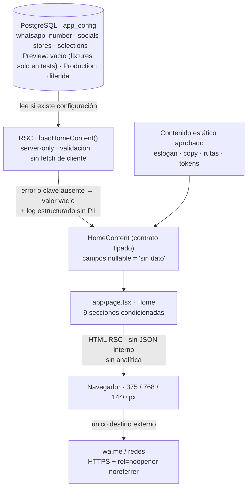
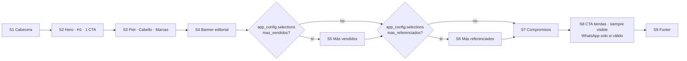

# Design Doc: Home del MVP — D'Adriana Tienda

| Campo | Valor |
|---|---|
| **Autor** | `forge-architect` (Staff Engineer, APEX FORGE) |
| **Estado** | **Approved** — aprobado por el Comandante (`apex-forge`) el **26-nov-2026**. **Sí autoriza código de producción** en el pipeline (F1 en adelante); **NO autoriza `commit`, `push` ni despliegue** sin autorización explícita posterior |
| **Fecha** | 26 de noviembre de 2026 |
| **Decisor** | `apex-forge` (Comandante) |
| **Tipo** | Archivo **nuevo**. No modifica `DESIGN_DOC.md`, `docs/02-arquitectura/design-doc-mvp.md`, los ADR existentes ni ningún otro archivo del repositorio |
| **Precedencia** | En **alcance, seguridad y gobernanza** mandan `docs/01-requisitos/mvp-requisitos.md` (Aprobado), `docs/02-arquitectura/design-doc-mvp.md` (Approved) y los arbitrajes A1…A8 del Comandante. **Este documento solo detalla la presentación del Home** (composición, secciones, tokens, componentes y sus pruebas). No deroga, reinterpreta ni amplía ninguna decisión del MVP |
| **Idioma** | Español por instrucción del Comandante. Identificadores de código y tokens en inglés (AGENTS.md) |
| **Insumos** | Guía `imagencorporarativa.md` y `logo.png` (RGBA 579×591): **insumos oficiales versionados en la raíz** (Q-HOME-09, autorizado 26-nov-2026); el logo además se sirve como `public/brand/logo.png`. Análisis estructural de `https://www.laroche-posay.co/` (solo patrones, **no identidad**) |
| **Relación con A2 / DD-MVP-23** | La excepción temporal que hace visible `presentacion/mvp/index.html` **es solo esa página estática**. No deroga A2/DD-MVP-18: la futura app sigue con Deployment Protection y `noindex` hasta cerrar Q-MVP-03/04/08 y crear la `DATABASE_URL` de Production |

> **Regla de oro:** diseño antes que código. Los fragmentos de tipos, tokens y contratos de este documento son **artefactos de diseño**, no implementación. El diseño está aprobado y el código de producción queda autorizado; los insumos oficiales se versionan según Q-HOME-09. **Esta entrega no hace `commit`, `push` ni despliegue**, y ningún despliegue se ejecuta sin autorización explícita posterior del Comandante.

---

## 0. Resumen ejecutivo

El Home del MVP debe ser una **vitrina informativa de una sola pantalla de intención clara**: presentar la identidad nueva, dirigir a Piel / Cabello / Marcas / Tiendas, mostrar selecciones curadas **solo cuando existan datos reales** y derivar al asesor por `wa.me` **solo cuando el número oficial esté configurado**. No vende, no cobra, no rastrea y no promete.

La inspiración del sitio de referencia se limita a su **ritmo editorial y sus recursos estructurales** (hero amplio, H1 central, banners, grillas, tarjetas con un solo CTA, carruseles accesibles, mucho espacio en blanco). **No se copian** sus colores, su imagen corporativa, su mega-menú de cientos de enlaces, sus 18 bundles JavaScript, el autoplay de vídeo, OneTrust, el doble GTM ni sus claims porcentuales/diagnósticos.

La solución es un Home **Server Component** con un contrato único `HomeContent`, secciones condicionadas por `app_config` y carruseles `scroll-snap` sin librerías. Hoy puede renderizarse **sin inventar un solo producto, precio, tienda, número de WhatsApp ni enlace social**: las secciones dependientes de datos se ocultan y las secciones editoriales usan el eslogan aprobado «Belleza para tu piel y tu cabello» sobre composición tipográfica. Mañana se conecta a `app_config` **sin cambiar la estructura**.

El éxito se mide con calidad observable (CWV, axe 2.2 AA, presupuesto de JS, 0 datos inventados, 0 PII, 18 E2E numerados y UAT del cliente), **no con conversiones comerciales**.

---

## 1. Contexto y problema

### 1.1 Pedido del cliente (literal, resumido)

> «Vamos a trabajar en el home de la tienda, te voy a proveer un link a un sitio para que analices el home, queremos algo así para Adriana tienda; no tomes los colores y la imagen corporativa, fíjate en los recursos y el diseño. [La Roche-Posay]. También te proporcioné en la carpeta del proyecto un archivo que se llama imagencorporativa, ahí encontrarás las especificaciones de colores para el diseño visual de la tienda. También te proporcioné el logo, se llama logo.png».

Nota de inventario: el archivo real se llama **`imagencorporarativa.md`** (sin la segunda «r» del nombre mencionado). Ambos insumos están **versionados como insumos oficiales en la raíz** del repositorio (Q-HOME-09, autorizado el 26-nov-2026); `logo.png` se sirve además desde `public/brand/logo.png` para su uso en la app.

### 1.2 Problema que resuelve

1. No existe todavía una app (no hay `package.json`): hay una presentación estática temporal y documentación de diseño. Hace falta una decisión de presentación que pueda implementarse después sin reabrir el alcance.
2. El Home debe transmitir la identidad nueva sin copiar la identidad de referencia ni la identidad histórica verde/dorada anterior (`docs/03-disenos/sistema-diseno.md`, `prototipo/`).
3. Debe poder mostrarse **hoy sin datos reales** (Q-MVP-08 abierta) sin caer en tarjetas, precios, tiendas ni contactos ficticios, y **mañana** conectarse a `app_config` sin rehacer la maquetación.
4. Debe evitar los modos de fallo del sitio de referencia: peso de JS, autoplay, ausencia de `prefers-reduced-motion`, menús con cientos de enlaces antes del `<main>` y analítica con PII.

### 1.3 Objetivos medibles y verificación

| # | Objetivo | Métrica / verificación | E2E |
|---|---|---|---|
| O1 | Ritmo editorial sin falsos datos | 9 secciones en el orden acordado; 0 tarjetas de producto, precios, tiendas, números o redes inventados en el HTML | HOME-E2E-07, -08, -09, -10 |
| O2 | Identidad nueva aplicada | 100 % de tokens del Home proceden de `imagencorporarativa.md`; 0 tokens de la identidad histórica (`#1E644C`, `#B8895A`, rosados) | HOME-E2E-13 |
| O3 | Accesibilidad | `H1` único; skip-link; landmarks; 0 violaciones críticas/serias en axe 2.2 AA a 375/768/1440; foco visible; sin trampas | HOME-E2E-01, -02, -04, -13 |
| O4 | Movimiento y peso | 0 autoplay; transiciones desactivadas con `prefers-reduced-motion`; 0 librerías de animación; Home ≤ 150 KB gzip | HOME-E2E-03, -06, -14 |
| O5 | Rendimiento | Hereda RNF-MVP-001…005: LCP p75 < 2,5 s, CLS p75 < 0,1 (objetivo 0), INP p75 < 200 ms medido 7–28 días post-deploy, TTFB p75 < 800 ms | HOME-E2E-12, -14 |
| O6 | Privacidad y seguridad | 0 PII, 0 analítica de producto, 0 GA4/GTM/OneTrust; enlaces externos con `rel`; CSP `report-only` antes de `enforce`; app con `noindex` hasta A2 | HOME-E2E-09, -10, -14, -15 |
| O7 | Reversibilidad | Toda sección dependiente de datos puede ocultarse cambiando `app_config` **sin deploy**; reversión de código < 2 min mediante deployment anterior | HOME-E2E-08, -16 |

> No se promete conversión, ventas ni crecimiento: medirlos exigiría *tracking* de personas, expresamente excluido (N-MVP-17/18, SEC-MVP-026).

---

## 2. No-objetivos

| # | No se diseña / no se construye en este Home | Motivo |
|---|---|---|
| N-HOME-01 | Slider de hero de 4 slides, con o sin autoplay | El reference lo usa, pero contradice RNF-MVP-008 y encarece LCP; decisión reversible (DD-HOME-03) |
| N-HOME-02 | Vídeo full-width en el Home | Sin recurso autorizado ni transcripción; si se incorpora después, exige `prefers-reduced-motion`, sin autoplay y transcripción (§4.2) |
| N-HOME-03 | Mega-menú de 3 niveles, buscador con API/typeahead y accesos secundarios | El menú del reference tiene cientos de enlaces antes del `<main>`; el MVP usa navegación plana y `GET /buscar?q=` |
| N-HOME-04 | Carrusel de artículos / blog / guías | No existe sección de contenidos en el MVP aprobado |
| N-HOME-05 | Carrito, cuenta, favoritos, checkout, pago, factura ni estado de pedido | N-MVP-01…06; el Home no muestra esos iconos ni enlaces |
| N-HOME-06 | Productos, precios, marcas, tiendas, números, reseñas ni enlaces sociales de ejemplo | Q-MVP-08/Q-MVP-06 abiertas: **placeholder honesto = sección oculta**, nunca dato ficticio |
| N-HOME-07 | Claims porcentuales, diagnósticos, IA, promesas clínicas ni resultados garantizados | Riesgo regulatorio y de confianza; tono cercano y experto, no técnico (§6.6) |
| N-HOME-08 | Analítica de producto, GA4, GTM, OneTrust, heatmaps ni PII | N-MVP-17/18, SEC-MVP-026; solo observabilidad técnica sin PII |
| N-HOME-09 | El aviso «Página en construcción» | Existe **solo** en `presentacion/mvp/index.html` (DD-MVP-23/ADR-MVP-006); la app no lo hereda |
| N-HOME-10 | Cambios en `vercel.json`, en la presentación estática ni en ADRs | Esta entrega es solo documental; la configuración de despliegue se decide cuando exista la app |
| N-HOME-11 | Animación con JS, `AOS`, `Swiper`, `Slick`, Vue/Vuex ni Axios | Presupuesto de JS y CSS-first (RNF-MVP-005/008) |
| N-HOME-12 | Copy **promocional / claim nuevo** adicional en el hero, el banner o los compromisos más allá del eslogan y de los cuatro textos funcionales de S7 aprobados | Q-HOME-04 quedó resuelta con «Belleza para tu piel y tu cabello» y con los cuatro textos funcionales de S7 (26-nov-2026, DD-HOME-18); se prohíben solo reclamos promocionales, porcentajes, diagnósticos y claims nuevos sin aprobación (§6.6). Los textos aprobados de S7 sí se renderizan; el CTA de WhatsApp sigue oculto sin número válido |

---

## 3. Requerimientos y restricciones

### 3.1 Funcionales (trazabilidad con RF-MVP)

| RF-MVP | Exigencia en el Home |
|---|---|
| 001–004 | Tokens nuevos de `imagencorporarativa.md`, favicon = logo circular hasta el monograma simplificado del diseñador y activos OG con composición tipográfica (sin foto autorizada, Q-HOME-05) |
| 005–011 | Tarjetas de producto y carruseles `scroll-snap` sin autoplay, alimentados por selecciones curadas |
| 012–014 | Accesos a `/piel`, `/cabello`, `/marcas`; navegación coherente; sin enlaces a rutas inexistentes |
| 015–016 | Precio COP sin decimales, **solo si el dato existe**; nunca un precio de ejemplo |
| 029–031 | Acceso a `/tiendas`; sin direcciones/horarios inventados en el Home |
| 026, 030 | CTA `wa.me` construido desde `app_config`, validado y sin PII; deshabilitado si no hay configuración válida |
| 042 | Redes solo desde `app_config` con allowlist de hostname exacto |
| 046 | Enlaces legales en el footer; bloqueantes para go-live, no para el diseño |

### 3.2 No funcionales y restricciones duras

- **Stack heredado, sin reevaluación:** Next.js `>=15.5.29 <16` (App Router/RSC), React 19, TypeScript strict, Tailwind v4 (`@theme`), PostgreSQL/Prisma, Vercel, Vitest/Playwright. La evaluación de versión mayor ya quedó documentada en `design-doc-mvp.md` §3.3 (A7); este documento **no la reabre**.
- **Rendimiento:** LCP p75 < 2,5 s · CLS p75 < 0,1 (objetivo 0) · INP p75 < 200 ms (ventana 7–28 días post-deploy) · TTFB p75 < 800 ms · **Home ≤ 150 KB gzip** (DD-MVP-10, RNF-MVP-005). El chunk de la lista de pedido **no pertenece al Home**: se construye en PDP/PLP y se absorbe en esos presupuestos (QA-03).
- **Accesibilidad:** WCAG 2.2 AA, axe 0 críticas/serias, teclado completo, foco visible, `prefers-reduced-motion`, animaciones CSS-first, contraste ≥ 4,5:1 (texto normal) y ≥ 3:1 (texto grande/UI).
- **Datos:** `app_config` en PostgreSQL es la fuente única de WhatsApp, redes, tiendas y selecciones (A1). **Ninguna variable de entorno nueva**; inventario cerrado: `NEXT_PUBLIC_SITE_URL`, `DATABASE_URL` (Preview) y `REVIEW_HASH_PEPPER`.
- **Entornos:** Previews y Production protegidas + `noindex` hasta A2; sin credenciales productivas en Preview. La excepción DD-MVP-23 **no cubre la app**.
- **Superficie:** sin Route Handlers, sin API REST pública, sin *fetch* de cliente en el Home, sin persistent storage (ni `localStorage` ni cookies para el Home).

---

## 4. Análisis de inspiración: qué se toma y qué NO se copia

Fuente analizada: `https://www.laroche-posay.co/`. **Se analizó estructura y recursos, no identidad visual.**

### 4.1 Patrones estructurales que se toman

| Patrón del reference | Adaptación al Home del MVP | Decisión |
|---|---|---|
| Hero full-width con **1 CTA por slide** | Hero único full-width con **1 CTA principal**; sin slides (DD-HOME-03) | DD-HOME-03 |
| **H1 central** y jerarquía clara | H1 único dentro del hero; H2 por sección; un objetivo visual por pantalla | DD-HOME-06 |
| Banner editorial full-width | Un banner editorial con imagen/clip decorativo y copy de marca, sin reclamos | DD-HOME-06 |
| Grilla de tarjetas de producto | Grilla/carrusel de selecciones curadas, con `srcset` y dimensiones reservadas | DD-HOME-07 |
| Tarjetas de compromiso con `tabindex=0` | 4 tarjetas informativas con foco visible, sin claims numéricos | DD-HOME-06 |
| Carrusel de artículos con navegación accesible | Carrusel **solo de productos**, `scroll-snap`, sin librería ni autoplay (DD-HOME-07) | DD-HOME-07 |
| CTA de localizador de tiendas | Enlace a `/tiendas`, sin datos de tienda en el Home | DD-HOME-05 |
| Footer en 3 columnas | Footer en 3 columnas (marca / navegación / legales + redes) | DD-HOME-13 |
| Mucho espacio en blanco | Ritmo 60/30/10 y padding generoso; secciones condicionadas, nunca relleno falso | DD-HOME-04, -08 |
| Accesibilidad positiva: skip-link, roles, `aria-expanded`, textos de carrusel, lazyload, `noscript` | Se conserva el patrón, con implementación propia y mínima | §9 |

### 4.2 Lista explícita de lo que NO se copia

| Elemento del reference | Motivo de rechazo |
|---|---|
| Colores, logotipo, tipografías e imagen corporativa | Instrucción literal del cliente; se usa `imagencorporarativa.md` y `logo.png` |
| 32 `<script>` y 18 bundles JS (Vue, Vuex, Swiper, Slick, AOS, Axios) | RNF-MVP-005 (Home ≤ 150 KB) y RNF-MVP-008 (CSS-first) |
| OneTrust + doble GTM | N-MVP-17/18, SEC-MVP-026: sin analítica ni PII |
| Vídeo con autoplay | RNF-MVP-008; sin transcripción ni recurso autorizado (N-HOME-02) |
| Ausencia de `prefers-reduced-motion` | RNF-MVP-008 exige lo contrario |
| Mega-menú con cientos de enlaces antes del `<main>` | N-HOME-03; el skip-link perdería utilidad y el HTML sería pesado |
| Buscador con API/typeahead | El MVP usa `GET /buscar?q=`; sin endpoint propio en el Home |
| Claims porcentuales y diagnósticos con IA | N-HOME-07; sin promesas clínicas ni resultados |
| Carrusel de artículos | No existe blog en el MVP (N-HOME-04) |
| Slider de 4 slides | N-HOME-01; decisión reversible si el cliente la reabre con DD nuevo |

---

## 5. Arquitectura de renderizado e información del Home

### 5.1 Flujo de renderizado (diseño, no implementación)



**Reglas del flujo:**

1. Todo se resuelve en servidor; el navegador recibe HTML ya saneado. No hay Route Handler ni JSON público con `reviews.id`, correos ni IDs internos (DD-MVP-10, H-9).
2. `loadHomeContent()` falla en **modo degradado**: devuelve arreglos vacíos y `null`, registra el incidente con `requestId` y **nunca** muestra un stack trace ni un dato inventado (DD-HOME-04).
3. El número de WhatsApp se valida `^57\d{10}$` en servidor; si no es válido, `whatsappUrl: null` y el CTA se oculta/deshabilita (SEC-MVP-010).
4. Las redes pasan por `new URL()`, `protocol === 'https:'` y hostname exacto de la allowlist (SEC-MVP-012).

**Contrato de diseño (árbol de datos, no código de producción):**

```ts
// Design-only contract — never a fixture with real-looking values.
type HomeContent = {
  hero: { headline: string; body?: string; primaryCta: { label: string; href: string } };
  navigation: Array<{ label: string; href: string }>;   // approved routes only
  whatsappUrl: string | null;                            // app_config, validated
  socials: Array<{ label: 'Instagram' | 'Facebook'; url: string }>;
  storesAvailable: boolean;                              // informs /tiendas; never gates the always-visible S8 CTA
  selections: {
    masVendidos: ProductCardData[];                      // app_config.selections
    masReferenciados: ProductCardData[];                 // curada while Q-MVP-05 is open
  };
  legalLinks: Array<{ label: string; href: string }>;    // hide if the route does not exist yet
};
```

### 5.2 Secciones ordenadas (9)

> Principio de degradación: **la regla «dato ausente ⇒ sección oculta» aplica solo a S5, S6 y a los bloques condicionados por `app_config` (CTA de WhatsApp, redes y legales)**. **S8 es navegación pura hacia `/tiendas` y SIEMPRE está visible**; su estado vacío se muestra en `/tiendas` (RF-MVP-022), nunca en el Home. Las secciones 2, 3, 4, 7, 8 y 9 son composición editorial/rutas aprobadas y pueden renderizarse hoy sin inventar datos. El estado de carga no produce desplazamiento: RSC entrega el HTML completo; si se usa Streaming, el placeholder reserva dimensiones (CLS 0).

| # | Sección | Propósito | Contenido real hoy vs. placeholder honesto | Fuente | CTA | Vacío / carga / error |
|---|---|---|---|---|---|---|
| S1 | **Cabecera global** (skip-link + logo + nav + buscador + WhatsApp condicional) | Orientar y acceder | Real: logo `public/brand/logo.png` (original versionado en la raíz), rutas `/piel`, `/cabello`, `/marcas`, `/tiendas` (RF-MVP-012/013/029). Sin dato: iconos de carrito/cuenta **no existen**. WhatsApp solo si configurado | Estático + `app_config.whatsapp_number` | `Buscar` → `/buscar?q=`; WhatsApp si válido | Si no hay número: CTA oculto, sin número de ejemplo. Carga: inline en RSC. Error: nav queda operativa |
| S2 | **Hero** full-width con H1 | Comunicar la propuesta de valor en una pantalla | Copy **aprobado** (Q-HOME-04, 26-nov-2026): H1 «Belleza para tu piel y tu cabello». Sin foto autorizada (Q-HOME-05): composición tipográfica sobre crema/verde con línea dorada; **no se usan** `Imagenes/` ni `presentacion/assets/` (Q-MVP-08 sigue abierta) | Estático (eslogan aprobado, §6.6) | 1 CTA principal: «Explorar piel» → `/piel` | Sin carrusel ni autoplay. Sin imagen → composición tipográfica, sin CLS |
| S3 | **Accesos por categoría** (3 tarjetas) | Distribuir tráfico a las rutas del catálogo | Real: etiquetas Piel, Cabello, Marcas y sus rutas aprobadas. Sin imágenes de producto | Estático (RF-MVP-012/013) | «Ver piel», «Ver cabello», «Ver marcas» | Nunca vacía: las rutas existen por diseño. Si una ruta no existiera en implementación, se oculta la tarjeta y se reporta internamente |
| S4 | **Banner editorial** full-width | Storytelling de marca sin reclamos | Copy **aprobado** con el eslogan «Belleza para tu piel y tu cabello» en tono de cuidado, confianza y bienestar; imagen luminosa **solo cuando haya fotografía autorizada** (Q-HOME-05/Q-MVP-08); mientras tanto, franja verde con detalle dorado | Estático (eslogan aprobado, §6.6) | Ninguno o 1 secundario «Conoce nuestras tiendas» → `/tiendas` | Sin imagen → fondo verde/dorado, sin hueco reservado de más de lo necesario; sin claim |
| S5 | **«Más vendidos»** (carrusel `scroll-snap`) | Mostrar selección curada | **Ningún producto hoy.** Mañana: `app_config.selections.mas_vendidos` (RF-MVP-008) | `app_config` | «Ver producto» → PDP (1 CTA por tarjeta) | Vacío → **sección oculta** (0 tarjetas falsas). Carga → RSC. Error → ocultar + log sin PII |
| S6 | **«Más referenciados»** (grilla/carrusel) | Segunda selección curada | **Ningún producto hoy.** Mientras Q-MVP-05 esté abierta, etiqueta visible «selección de la tienda» (RF-MVP-009) | `app_config` | «Ver producto» → PDP | Vacío → ocultar. Si Q-MVP-05 cierra con otra regla, se cambia la etiqueta **sin cambiar la estructura** |
| S7 | **Compromisos / por qué D'Adriana** (4 tarjetas) | Generar confianza sin prometer | Copy **aprobado por el Comandante el 26-nov-2026** (Q-HOME-04, DD-HOME-18), factual y no clínico: **«Cuidado para la piel y el cabello» · «Atención por WhatsApp» · «Tiendas físicas» · «Compra acordada con el asesor»**. Son textos funcionales, **no claims comerciales ni clínicos**; sin porcentajes, diagnósticos ni resultados. «Atención por WhatsApp» es informativo: el CTA sigue oculto si no hay número válido | Estático (tono, eslogan y copy de S7 aprobados, §6.6) | Ninguno (tarjetas informativas, foco visible) | Nunca vacía; los cuatro textos son fijos. Texto corto ≤ 2 líneas por tarjeta en móvil |
| S8 | **CTA de tiendas / contacto** | Cerrar la visita con una acción humana | «Encuentra tu tienda» → `/tiendas` (ruta aprobada): **navegación pura, siempre visible, sin depender de `app_config.stores`**. WhatsApp solo si `app_config` válido; **sin direcciones, teléfonos ni horarios en el Home** | Estático (ruta aprobada) + `app_config` **solo para WhatsApp** | `/tiendas` (siempre) y, si aplica, `wa.me` | **Sin tiendas activas: el CTA a `/tiendas` permanece visible y `/tiendas` muestra su estado vacío (RF-MVP-022)**; sin número válido: solo el CTA de tiendas. Carga: inline en RSC. Error: el enlace a `/tiendas` sigue operativo |
| S9 | **Footer global** (3 columnas) | Cerrar navegación, legales y redes | Real: marca + navegación. Legales **solo si las rutas existen** (RF-MVP-046). Redes solo si hay URLs válidas; sin «Página en construcción» | Estático + `app_config.socials` | Política / términos / contacto; Instagram y Facebook (allowlist) | Sin redes → columna de redes oculta. Sin legales → enlaces ocultos y **bloqueo de go-live**, no bloqueo de diseño |

**Ritmo visual resultante:** cabecera → hero alto → H1 → accesos → banner → selección → selección → compromisos → CTA → footer. **Máximo un CTA principal por pantalla**; las tarjetas tienen un solo enlace principal.



---

## 6. Sistema visual

### 6.1 Tokens exactos

Fuente: `imagencorporarativa.md`. **Los HEX son aproximados (tomados del logo) y deben confirmarse con el diseñador antes de congelar los tokens** (Q-HOME-03). El logotipo real `logo.png` muestra verdes/dorados coherentes con la guía; no se recalculan ni se modifican sus colores.

| Token | HEX | Uso en el Home | Regla |
|---|---|---|---|
| `color.primary` | `#1B5D4A` | Header, botón principal, secciones destacadas | Base del 30 % verde |
| `color.primaryHover` | `#22755C` | Hover del botón principal, detalles | Texto blanco encima (5,57:1) |
| `color.ink` | `#123F33` | Texto sobre fondos claros, footer | 10,79:1 sobre crema |
| `color.accent` | `#C6A050` | Líneas de 1 px, bordes, íconos, estrellas | **Solo acento (10 %); nunca texto sobre claro** |
| `color.accentSoft` | `#E6CC87` | Texto sobre verde, resaltados, foco sobre verde | 4,92:1 sobre `#1B5D4A` |
| `color.accentDark` | `#B38F44` | Hover del dorado, sombras | Decorativo; no texto sobre claro |
| `color.surface` | `#F7F5EE` | Fondo general de la página | Base del 60 % claro |
| `color.surfaceAlt` | `#EEF4F1` | Secciones alternas y tarjetas | Texto `#123F33` encima (10,56:1) |
| `color.white` | `#FFFFFF` | Tarjetas, formularios, texto sobre verde | — |

**Proporción 60/30/10:** 60 % fondos claros (`#F7F5EE` / `#EEF4F1` / blanco), 30 % verde (`#1B5D4A`, `#22755C`, `#123F33`), 10 % dorado como acento. El dorado **no** es un color de fondo masivo ni de texto sobre claro.

**Radios, bordes y ritmo derivados del círculo del logo:**

| Token | Valor | Origen / uso |
|---|---|---|
| `radius.logo` | `50 %` | Círculo de la insignia; nunca deformar |
| `radius.pill` | `999 px` | Botones y CTA principal, eco del anillo |
| `radius.card` | `16 px` | Tarjetas de categoría/producto/compromiso |
| `radius.small` | `8 px` | Badges y etiquetas cortas |
| `border.hairline` | `1 px solid #C6A050` | Divisores tipo «líneas del logo» |
| `border.card` | `1 px solid #EEF4F1` | Borde fino de tarjetas sobre blanco |
| `shadow.soft` | `0 8 px 24 px rgba(18,63,51,.08)` | Elevación sutil derivada del verde oscuro |
| `space.unit` | `8 px` | Escala de espaciado; padding de sección 40 px móvil / 64 px escritorio |
| `content.max` | `1200 px` | Ancho máximo; gutters 20 / 24 / 32 px |
| `focus.light` | `outline 2 px solid #123F33`, offset 2 px | Foco sobre fondos claros |
| `focus.dark` | `outline 2 px solid #E6CC87`, offset 2 px | Foco sobre verde |
| `motion.duration` | `160–240 ms`, `ease-out` | Solo transiciones CSS; desactivado con `prefers-reduced-motion` |

> **Foco en la cabecera (SC 1.4.11):** `focus.light` conserva su offset de 2 px. El formulario de búsqueda incrustado en la cabecera verde se apoya sobre una superficie crema continua (`bg-surface`, padding 6 px) para que el anillo tinta nunca quede pintado sobre el verde. El champaña sigue reservado a superficies verdes. `HOME-E2E-19` mide el contraste real entre el anillo y el color adyacente en 375/768/1440 px; no basta con comprobar el `outline-color`.

> **Prohibición de deriva:** no se usan los tokens del sistema histórico (`#1E644C`, `#154E3B`, `#B8895A`, `#FDFBF9`, rosados `#F7EAE7`) ni hex sueltos en componentes (DD-HOME-08). Todo token vive en `@theme` de Tailwind v4.

### 6.2 Jerarquía tipográfica responsive

Máximo **2 fuentes** y 2–3 pesos, según la guía (§3.5). **Playfair Display** para títulos; **Inter** para texto, menús, botones y precios. Se descartan Cormorant Garamond, Montserrat y Cinzel para el MVP (DD-HOME-09). Carga autoalojada con `next/font` (sin peticiones externas en runtime, sin CLS).

| Nivel | 375 px | 768 px | 1440 px | Fuente / peso | Interlineado |
|---|---:|---:|---:|---|---:|
| H1 (hero) | 32–36 px | 40 px | 48–56 px | Playfair Display 600 | 1,1 |
| H2 (sección) | 26–28 px | 32 px | 36 px | Playfair Display 600 | 1,15 |
| H3 / nombre de producto | 18 px | 18 px | 20 px | Inter 600 | 1,3 |
| Texto general | 16 px | 16–17 px | 17–18 px | Inter 400 | 1,5–1,7 |
| Texto pequeño / eyebrow | 14 px | 14 px | 14–15 px | Inter 600, `letter-spacing .08em`, **verde oscuro** | 1,4 |
| Precio COP | 18 px | 18 px | 20 px | Inter 600, `#123F33` o `#1B5D4A` | 1,3 |

Reglas: un solo H1 por página; los eyebrows **no** van en dorado sobre claro; el precio se formatea `$ 45.000` solo si viene del dato (nunca de ejemplo); sin `text-transform` que dificulte la lectura en body.

### 6.3 Contraste AA (calculado sobre los HEX aproximados)

| Par | Ratio | Veredicto |
|---|---:|---|
| `#123F33` sobre `#F7F5EE` | **10,79:1** | AA/AAA texto normal ✔ |
| `#123F33` sobre `#EEF4F1` | **10,56:1** | AA/AAA ✔ |
| `#123F33` sobre `#FFFFFF` | **11,77:1** | AA/AAA ✔ |
| `#FFFFFF` sobre `#1B5D4A` | **7,75:1** | AA/AAA ✔ (botón principal) |
| `#E6CC87` sobre `#1B5D4A` | **4,92:1** | AA texto normal ✔ (margen estrecho: revalidar al confirmar HEX) |
| `#FFFFFF` sobre `#22755C` | **5,57:1** | AA ✔ (hover) |
| `#E6CC87` sobre `#22755C` | **3,54:1** | Solo texto grande/UI ✔; **preferir blanco** en hover |
| `#123F33` sobre `#C6A050` | **4,79:1** | AA texto normal ✔ (botón dorado) |
| `#FFFFFF` sobre `#123F33` | **11,77:1** | AA/AAA ✔ (footer) |
| `#E6CC87` sobre `#123F33` | **7,48:1** | AA/AAA ✔ (footer) |
| `#C6A050` sobre `#FFFFFF` | **2,46:1** | ✘ texto — **solo línea/icono decorativo** |
| `#C6A050` sobre `#F7F5EE` | **2,25:1** | ✘ texto — **solo acento** |
| `#1B5D4A` sobre `#F7F5EE` | **7,10:1** | AA ✔ |
| `#22755C` sobre `#F7F5EE` | **5,11:1** | AA ✔ |

**Reglas de oro:** el dorado `#C6A050` nunca es texto sobre blanco/crema; sobre verde se usa champaña o blanco; en botón dorado el texto es verde oscuro; el foco nunca depende solo del dorado sobre claro (usar `focus.light`/`focus.dark`). Los pares se recalculan automáticamente en CI y se revalidan si el diseñador confirma HEX distintos (DD-HOME-10).

### 6.4 Uso del logo

- **Insumos oficiales versionados (Q-HOME-09, autorizado 26-nov-2026):** `imagencorporarativa.md` y `logo.png` viven en la **raíz del repositorio** y no se editan ni se recoloran. Para el consumo de la app, el logo se sirve además como **`public/brand/logo.png`** (copia del original, no una reinterpretación).
- **Archivo:** `logo.png`, PNG RGBA 579×591; dominantes `#1D624E`, `#CFAA5E`, `#E6D38F` y gris `#A7A6A5`, coherentes con la guía. No se inspeccionó visualmente en este modelo: se usa la descripción oficial (insignia circular verde esmeralda, borde dorado, monograma D'A y silueta femenina).
- Mantener el círculo completo, **sin deformar ni recolorar**; margen libre ≥ grosor del anillo dorado; tamaño mínimo **48 px** de ancho en pantalla (DD-HOME-11).
- **Header verde:** colocar el logo sobre una **placa circular de fondo claro** (`#F7F5EE`) para cumplir la regla «sobre fondos verdes, usar fondo claro o borde dorado visible» sin alterar el archivo.
- **Footer verde oscuro:** misma placa clara o versión con anillo dorado visible; nunca estirar ni recortar el monograma.
- **Favicon:** hasta que el diseñador entregue la versión simplificada del monograma «D'A», el favicon es **el propio logo circular** (`public/brand/logo.png`); sin redibujar en este documento ni alterar colores.
- **Open Graph:** sin fotografía autorizada (Q-HOME-05 resuelta 26-nov-2026), el activo OG usa la composición tipográfica con el eslogan aprobado; **no se genera una imagen con datos de ejemplo** y se sustituye cuando el diseñador entregue el monograma/la foto (RF-MVP-004).
- Riesgo de origen mitigado: al estar versionado, la implementación usa la copia trackeada en `public/brand/logo.png` y nunca depende de un path local no trackeado (§11).

### 6.5 Fotografía e iconografía

Luminosa y natural, fondos neutros/crema, productos con detalles verdes o dorados, piel y cabello reales sin retoques excesivos; líneas doradas finas y formas redondeadas inspiradas en el círculo del logo; iconografía lineal en verde o dorado (§6 de la guía). **No se seleccionan hoy** fotos de `Imagenes/`, `presentacion/assets/`, `prototipo/assets/` ni del reference: Q-HOME-05 quedó resuelta **sin fotografía autorizada** y Q-MVP-08 sigue abierta. El hero y el banner usan composición tipográfica + color, con `aspect-ratio` reservado para evitar CLS.

### 6.6 Tono

Cercano, cálido y experto, sin tecnicismos; mensajes de cuidado, confianza y bienestar; storytelling sin promesas clínicas. **Eslogan aprobado por el Comandante el 26-nov-2026 (Q-HOME-04): «Belleza para tu piel y tu cabello».** Se usa como H1 del hero (S2) y como copy del banner (S4); no se sustituye por los otros candidatos de la guía sin una decisión nueva. **Copy funcional de S7 aprobado el 26-nov-2026 (Q-HOME-04, DD-HOME-18): «Cuidado para la piel y el cabello», «Atención por WhatsApp», «Tiendas físicas» y «Compra acordada con el asesor»**; se usan literalmente en las cuatro tarjetas y **no son claims comerciales ni clínicos**. La mención a WhatsApp es informativa y no habilita el CTA sin número válido (HOME-E2E-09). Quedan prohibidos porcentajes de eficacia, diagnósticos, «resultados garantizados», copy promocional nuevo y lenguaje de IA/dermatológico no aprobado.

---

## 7. Inventario de componentes (props y estados)

> Todos los componentes son presentacionales; los que muestran datos reciben props ya saneadas desde el RSC. **Ninguno hace `fetch`, escribe en almacenamiento ni registra eventos de producto.** Los nombres de props son diseño, no implementación.

| Componente | Props (diseño) | Estados / variantes | Accesibilidad y notas |
|---|---|---|---|
| `SkipLink` | `target: '#main'` | oculto hasta enfocarse; visible al Tab | Primer foco interactivo de la página; salta a `<main id="main">` |
| `SiteHeader` | `logo`, `navigation[]`, `searchAction`, `whatsappUrl?`, `socials?` | desktop / móvil; con/sin WhatsApp | `<header>`, `<nav aria-label="Principal">`; menú móvil con `<details>/<summary>` nativo (sin JS de dialog); `aria-expanded` nativo; foco visible; sin iconos de carrito/cuenta; buscador `GET` a `/buscar` |
| `Hero` | `eyebrow?`, `headline`, `body?`, `primaryCta`, `image?` | con imagen autorizada / composición tipográfica; `reduce` | `<section aria-labelledby>`; **H1 único**; un solo CTA; imagen con dimensiones reservadas y prioridad; sin slider ni autoplay; si la imagen falla, degrada sin CLS |
| `CategoryCard` | `label`, `href`, `image?`, `description?` | normal / hover / foco | Enlace completo; una sola acción; `alt` descriptivo si hay imagen; radio `card` |
| `EditorialBanner` | `eyebrow?`, `title`, `body`, `image?`, `secondaryCta?` | con/sin imagen; verde / crema | `role` de sección con encabezado; máximo 1 CTA secundario; sin claim |
| `ProductCard` | `slug`, `name`, `brand?`, `priceCents?`, `availability`, `image`, `rating?` | `available` / `out_of_stock`; sin precio (no inventar) | Un CTA «Ver producto» → PDP; precio COP si existe; badge de agotado legible; `srcset` + `width`/`height` + `alt` revisado; **sin botón de pago ni de lista en el Home** |
| `CuratedCarousel` | `id`, `title`, `items[]`, `label?` | con datos / **oculto si vacío**; `reduce` | `role="region" aria-label`; `tabindex="0"` en el contenedor desplazable; `scroll-snap` CSS; sin autoplay, sin librería; flechas como enlaces/anchors, no JS de estado; foco visible en cada tarjeta |
| `CommitmentCards` | `items[]` (4) | normal / foco | Tarjetas informativas; `tabindex="0"` solo si no contienen enlace; texto ≤ 2 líneas en móvil; sin claims |
| `WhatsAppCta` | `href: string \| null`, `label`, `context?` | **visible** si href válido / **oculto o deshabilitado** si `null` | `target="_blank" rel="noopener noreferrer"`; HTTPS; número desde `app_config`; texto neutral sin PII; sin telemetría de apertura (A8) |
| `StoreCta` | `href = '/tiendas'` (ruta aprobada, constante) | **visible siempre**: navegación pura, sin variante oculta ni mensaje de estado vacío | Enlace interno con foco visible; sin datos de tienda en el Home; el estado vacío real se muestra en `/tiendas` (RF-MVP-022, HOME-E2E-11) |
| `SiteFooter` | `navigation[]`, `legalLinks[]`, `socials[]`, `logo` | 3 columnas; columnas opcionales ocultas | `<footer>`; redes con allowlist de hostname exacto y `rel` seguro; legales solo si las rutas existen; sin «Página en construcción»; sin año ni dato inventado |
| `SectionFrame` | `visible`, `title`, `children` | visible / oculto (sin dato) | Centraliza la política de degradación: **si `visible=false`, no renderiza el contenedor ni deja hueco**; evita secciones vacías y CLS |

---

## 8. Alternativas evaluadas

Criterios APEX FORGE en orden: **correctitud → mantenibilidad → rendimiento → velocidad de entrega**.

### Alternativa A — Home RSC modular con secciones condicionadas por `app_config` (GANADORA)

RSC único, contrato `HomeContent`, carruseles `scroll-snap`, contenido estático para rutas aprobadas, secciones de datos ocultas si no hay configuración.

- **Pros:** cumple RF-MVP-005…011 y RNF-MVP-005/008; renderiza hoy sin datos inventados; se conecta a `app_config` sin cambiar estructura; mínima superficie de ataque; reversible por sección y por deployment.
- **Contras:** el Home puede verse más sobrio hasta que Q-MVP-08 entregue datos reales; exige disciplina en la política de ocultación.
- **Por qué gana:** es la única que satisface simultáneamente O1, O4, O5 y O7 sin reintroducir analítica, autoplay ni librerías. Decisiones reversibles (Jeff Dean).

### Alternativa B — Réplica estructural completa del sitio de referencia (RECHAZADA)

Clonar hero slider de 4 slides, vídeo full-width, mega-menú, grillas, carrusel de artículos, localizador y analítica.

- **Pros:** familiaridad visual inmediata para el cliente; más «contenido» en la primera pantalla.
- **Contras:** ~18 bundles JS frente al límite de 150 KB; autoplay y sin `prefers-reduced-motion`; OneTrust/GTM con PII; cientos de enlaces antes del `<main>`; requiere datos, fotos y claims que no existen; contradice N-HOME-01/03/07/08 y SEC-MVP-026.
- **Motivo de rechazo:** copiaría los riesgos que el cliente pidió evitar («fíjate en los recursos y el diseño», no en la identidad ni en la implementación).

### Alternativa C — Home de una sola pantalla, sin carruseles ni selecciones (RECHAZADA)

Solo cabecera, hero, accesos y footer; sin secciones dependientes de datos.

- **Pros:** el más ligero y el que menos depende de Q-MVP-08; casi imposible de romper.
- **Contras:** incumple RF-MVP-007 (carruseles), RF-MVP-008/009 (selecciones curadas) y deja la vitrina sin contenido cuando lleguen los datos; obligaría a rehacer la maquetación más adelante.
- **Motivo de rechazo:** resuelve el vacío de datos de hoy eliminando la capacidad que el MVP pidió explícitamente. Se conserva como **modo degradado natural** de la Alternativa A (cuando `app_config` está vacía, el Home se parece a C sin dejar de ser A).

### Alternativa D — Home con librería de carrusel/animación (`Swiper`/`AOS`) (RECHAZADA)

- **Pros:** implementación rápida de flechas, paginación y transiciones; comportamiento «bonito» por defecto.
- **Contras:** añade JS al presupuesto de Home, suele incluir autoplay por defecto y complica `prefers-reduced-motion` y el foco; contradice RNF-MVP-008 y DD-MVP-11.
- **Motivo de rechazo:** es una dependencia evitable; `scroll-snap` + CSS cubre el requisito con 0 KB de librería.

**Análisis de sensibilidad:** si el cliente confirma vídeo o slider más adelante, la Alternativa A absorbe la sección nuevo sin cambiar el contrato; si Q-MVP-05 redefine «más referenciados», cambia solo la etiqueta/la regla de selección, no el componente.

---

## 9. Accesibilidad, rendimiento, seguridad y privacidad

### 9.1 Accesibilidad (WCAG 2.2 AA)

1. **Skip-link** como primer elementoenfocable, hacia `<main id="main">` (HOME-E2E-01).
2. **Landmarks** únicos: `<header>`, `<nav aria-label="Principal">`, `<main>`, `<footer>`; un solo `<h1>`; H2 por sección sin saltos (HOME-E2E-02).
3. **Foco visible** con `focus.light`/`focus.dark`; sin trampas; menú móvil con `<details>/<summary>` nativo, sin dialog propio (HOME-E2E-04).
4. **Carrusel:** `role="region"` + `aria-label`, contenedor desplazable enfocable, tarjetas enlazables, sin autoplay; textos alternativos accesibles para las acciones (no solo iconos) (HOME-E2E-06).
5. **Imágenes:** `alt` descriptivo revisado por contenido; decorativas con `alt=""`; dimensiones reservadas (HOME-E2E-12).
6. **Contraste:** pares de §6.3; dorado nunca como texto sobre claro; estados de foco/error legibles (HOME-E2E-13).
7. **Evidencia:** axe 2.2 AA + auditoría manual de teclado y lector de pantalla en 375/768/1440, como condición de release (HEREDA MVP-E2E-26).

### 9.2 Rendimiento

- RSC → HTML servido desde CDN; sin *hydration* innecesaria en el Home (DD-HOME-02).
- Fuentes autoalojadas con `next/font`; imagen principal precargada **solo si existe asset autorizado**; `lazyload` en el resto; `srcset` AVIF/WebP; dimensiones declaradas → CLS objetivo 0.
- Carruseles `scroll-snap` sin JS; 0 librerías de animación; `prefers-reduced-motion` desactiva transiciones sin romper scroll ni foco.
- Presupuesto: **Home ≤ 150 KB gzip**; LCP p75 < 2,5 s; INP p75 < 200 ms (7–28 días post-deploy); TTFB p75 < 800 ms. Proxy de laboratorio en Preview (TBT/Lighthouse), sin medir INP real hasta producción (QA-01).

### 9.3 Seguridad y privacidad

| Control | Implementación en el Home | Verificación |
|---|---|---|
| Sin PII | No hay formularios, correos, teléfonos del cliente, direcciones ni edad en el Home; el mensaje de `wa.me` usa solo SKU/nombre público/cantidades/modalidad cuando se construye en PDP/PLP | HOME-E2E-09, -10 |
| Número oficial | `app_config.whatsapp_number` validado `^57\d{10}$`; nunca desde query/hash/referrer/reseñas | HOME-E2E-09 (inyección) |
| Redes | Allowlist con `new URL()`, `https:` y hostname **exacto**; `rel="noopener noreferrer"` | HOME-E2E-10 |
| Sin analítica | 0 GA4, GTM, OneTrust, heatmaps ni *web-vitals* con identificadores; Vercel Speed Insights sin PII | HOME-E2E-14 |
| Cabeceras / CSP | Hereda DD-MVP-12: `report-only` con `report-uri` sin PII → `enforce` solo con 7 días sin violaciones + LGTM de `forge-sentinel`/`forge-infra` + E2E verde | HOME-E2E-14, -15 |
| Entornos | Preview y Production con Deployment Protection y `X-Robots-Tag: noindex` hasta A2; la excepción DD-MVP-23 cubre **solo** la presentación estática | HOME-E2E-15 |
| Secretos | El Home no introduce variables; inventario cerrado de tres; sin secretos en bundle ni logs | HOME-E2E-14 |
| Revisión humana | **OK de `forge-sentinel` requerido antes de publicar** cualquier versión del Home (datos, enlaces externos, cabeceras) | Gate de release |

### 9.4 Decisiones de diseño que protegen la privacidad

- El Home **no muestra reseñas** (pertenecen a PDP y solo `approved`); por tanto no hay riesgo de filtrar `pending`.
- No se renderiza ningún ID interno en HTML ni en datos embebidos: las tarjetas usan `slug` público.
- No se almacena nada en `localStorage`/`sessionStorage`/cookies desde el Home (SEC-MVP-013/014 no aplicables).

---

## 10. Estrategia de tests (`HOME-E2E-01…18`)

Responsable de la estrategia: `forge-qualis`. Quien construye, prueba. **Subconjunto smoke en cada PR** (marcados ●); **los 18 en release**, tres repeticiones con cuarentena de flaky (dueño `forge-qualis`, issue y fecha). Se ejecutan sobre Preview protegido con **fixtures sintéticos de test, nunca visibles en la UI del Home** (Q-HOME-02: 0 datos ficticios para el usuario) y nunca con PII real.

| ID | Caso | Verificación | PR |
|---|---|---|:---:|
| HOME-E2E-01 | Skip-link | Al pulsar Tab el primer foco es «Saltar al contenido»; al activarlo el foco queda en `<main>` | ● |
| HOME-E2E-02 | Landmarks y encabezados | Un `<header>`, un `<nav>` principal, un `<main>`, un `<footer>`; **un solo H1**; H2 sin saltos | ● |
| HOME-E2E-03 | Hero sin slider ni autoplay | Un solo bloque de hero; 0 elementos con `autoplay`; sin `<video>`; transiciones desactivadas con `prefers-reduced-motion: reduce` | ● |
| HOME-E2E-04 | Navegación móvil por teclado | `<details>` abre/cierra con Enter/Espacio; foco visible; sin trampa; `aria-expanded` refleja el estado | ● |
| HOME-E2E-05 | Buscador del header | Enviar «shampoo» navega a `/buscar?q=shampoo` por GET; sin typeahead ni petición XHR desde el Home | |
| HOME-E2E-06 | Carrusel accesible | Región con nombre accesible, contenedor enfocable, scroll con flechas del teclado, tarjetas enlazables; 0 librerías de animación en el bundle | ● |
| HOME-E2E-07 | Selección vacía | Con `app_config.selections` vacío, «Más vendidos» y «Más referenciados» **no existen en el DOM**; 0 tarjetas falsas | ● |
| HOME-E2E-08 | Selección poblada y edición sin deploy | Al sembrar la selección aparecen las tarjetas en el orden configurado; al cambiarla cambia el Home sin cambio de código | |
| HOME-E2E-09 | WhatsApp condicional | Sin configuración → CTA ausente/deshabilitado; con número válido → `wa.me/57…`, HTTPS, `rel="noopener noreferrer"`; query, hash y `referrer` inyectados no cambian el destino ni introducen PII | ● |
| HOME-E2E-10 | Redes del footer | Solo `instagram.com` / `facebook.com` con hostname exacto; un dominio inyectado se rechaza; sin enlaces de ejemplo | |
| HOME-E2E-11 | Catálogo y tiendas desde el Home (S8 siempre visible) | `/piel`, `/cabello`, `/marcas`, `/tiendas` devuelven 200 y canonical propio; sin enlaces a rutas inexistentes. **Con `app_config.stores` vacío, el CTA «Encuentra tu tienda» sigue presente en el Home y apunta a `/tiendas`, donde sí aparece el estado vacío (sin direcciones ni horarios inventados en el Home ni en el CTA)**; con tiendas activas, el mismo enlace sigue a `/tiendas` | ● |
| HOME-E2E-12 | Imágenes y CLS | `width`/`height` o `aspect-ratio`, `srcset` AVIF/WebP, `alt` revisado; CLS < 0,1 (objetivo 0) a 375/768/1440 | |
| HOME-E2E-13 | axe 2.2 AA + contraste | 0 violaciones críticas/serias; pares de §6.3 verificados; foco visible sobre claro y sobre verde; sin dorado como texto sobre claro | ● |
| HOME-E2E-14 | Presupuesto y ausencia de tracking | Home ≤ 150 KB gzip; 0 GA4/GTM/OneTrust; 0 librerías de animación; 0 secretos en bundle; CSP `report-only` activo | ● |
| HOME-E2E-15 | Protección y `noindex` | Preview sin autenticar → 401 + `X-Robots-Tag: noindex`; Production pre-go-live protegida y `noindex`; la presentación estática sigue intacta | ● |
| HOME-E2E-16 | Degradación ante error de configuración | Forzar fallo de lectura de `app_config`: secciones se ocultan, sin stack trace ni filler; log estructurado con `requestId` y sin PII | |
| HOME-E2E-17 | Copy y claims | 0 porcentajes de eficacia, diagnósticos, IA ni «resultados garantizados»; 0 apariciones de «Página en construcción» en la app | |
| HOME-E2E-18 | Footer legal y estado | Enlaces legales presentes **solo** si la ruta existe; si faltan, el check se marca como **bloqueo de go-live** (no de diseño); sin año ni datos inventados | |

**Unitarias (Vitest):** validación de `whatsappUrl`, allowlist de redes, normalización del contrato `HomeContent`, política `visible=false` y cálculo de contraste de tokens (≥ 90 % en las funciones de validación). **Integración:** cargador RSC contra PostgreSQL efímera con fixtures sintéticas; nunca contra datos de Production. **Cobertura:** ≥ 70 % global, sin descenso > 2 pp sin justificación (QA-04).

---

## 11. Riesgos y mitigaciones

| # | Riesgo | Impacto | Mitigación | Dueño |
|---|---|---|---|---|
| R-HOME-01 | HEX aproximados cambian al confirmar con el diseñador | Pares de contraste (especialmente champaña/verde, 4,92:1) podrían caer por debajo de AA | Tokens centralizados en `@theme`, script de contraste en CI y revalidación antes de congelar (Q-HOME-03) | Cliente/diseñador + `forge-frontend` |
| R-HOME-02 | Deriva del logo al copiarlo a `public/brand/logo.png` (riesgo mitigado: Q-HOME-09 autorizó versionar) | El asset servido deje de coincidir con el original oficial | Insumos oficiales en la raíz, sin editar; la copia bajo `public/brand/` es exacta y se revisa en review; favicon = logo circular hasta el monograma | Comandante + `forge-frontend` + `forge-reviewer` |
| R-HOME-03 | Home demasiado vacío hasta Q-MVP-08 | Percepción de «poco terminado» | Es **decisión consciente** (O1): ocultar antes que inventar; explicar en UAT; mejorar con copy/fotos autorizadas, no con datos falsos | Comandante + cliente |
| R-HOME-04 | Copiar «sin querer» el reference (JS, autoplay, analítica) | Rompe RNF-MVP-005/008 y SEC-MVP-026 | Lista explícita §4.2 + HOME-E2E-03/-06/-14 + review de `forge-reviewer` y `forge-sentinel` | Gatekeepers |
| R-HOME-05 | Footer con enlaces legales que no existen | 404 y bloqueo de go-live | `legalLinks` solo si la ruta existe (HOME-E2E-18); redactar políticas con `forge-sentinel` | Cliente + `forge-sentinel` |
| R-HOME-06 | Número de WhatsApp no configurado o inválido | CTA roto o destino equivocado | Validación `^57\d{10}$`, CTA oculto, HOME-E2E-09; Q-MVP-06 | Cliente + `forge-backend` |
| R-HOME-07 | Confundir la presentación estática con la app | Publicar la app sin protección apoyándose en DD-MVP-23 | A2 se mantiene; HOME-E2E-15; texto de precedencia en el encabezado; sin tocar `vercel.json` en esta entrega | Comandante + `forge-infra` |
| R-HOME-08 | Deriva hacia la identidad histórica | RF-MVP-001/002 falla | Prohibición explícita de tokens antiguos + diff de QA + HOME-E2E-13 | `forge-frontend` + `forge-reviewer` |
| R-HOME-09 | Foco/trampa en menú móvil | Violación WCAG 2.2 | `<details>/<summary>` nativo, sin dialog propio; HOME-E2E-04 | `forge-frontend` + `forge-qualis` |
| R-HOME-10 | Q-MVP-05 redefine «más referenciados» y se interpreta como tracking | Conflicto con N-MVP-17/SEC-MVP-026 | Etiqueta «selección de la tienda» mientras siga abierta; solo cambia la regla de selección, nunca se instrumenta PII | Cliente + `forge-architect` |

---

## 12. Rollout, rollback, monitoreo y métricas de éxito

### 12.1 Rollout

Sin canary (DD-MVP-15): el Home se promociona con el conjunto de la app desde `main`, siempre con Deployment Protection y `noindex` hasta que A2 se cierre por el Comandante. No se publica el Home de forma independiente mientras solo exista la presentación estática. **La aprobación del 26-nov-2026 habilita la construcción, no el despliegue: se requiere autorización explícita posterior.**

### 12.2 Rollback y criterios de reversión

| Disparador | Acción | Objetivo |
|---|---|---|
| Sección con dato incorrecto o no autorizado | Ocultar la sección desde `app_config` (sin deploy) | Inmediato, reversible |
| Regresión visual/de foco/contraste o bundle > 150 KB | Revertir el commit y re-desplegar | < 2 min (Vercel *instant rollback*) |
| Aparece un dato real antes de A2 | Restaurar Deployment Protection y `noindex` de inmediato; detener promoción | Inmediato |
| Fallo de lectura de `app_config` | Modo degradado ya diseñado + log con `requestId`; si persiste, rollback | Sin pantalla rota |

Tras cualquier reversión: smoke de 7 superficies del MVP (Home, PLP, PDP, `wa.me`, reseñas, tiendas, cabeceras) y acta cronometrada con hora de detección, hora de reversión y resultado (DD-MVP-15/QA-06).

### 12.3 Monitoreo

Solo observabilidad técnica sin PII: logs estructurados con `requestId`, errores 5xx, Vercel Speed Insights y *uptime check*. **No existe alerta de apertura de `wa.me`** (A8): se sustituye por sonda E2E sintética sin PII por release (MVP-E2E-27).

### 12.4 Métricas de éxito (calidad, no comercio)

| Métrica | Umbral |
|---|---|
| Datos inventados en el Home | **0** (productos, precios, tiendas, números, redes, fotos) |
| axe 2.2 AA | 0 violaciones críticas/serias en 375/768/1440 |
| CWV | LCP p75 < 2,5 s · CLS p75 < 0,1 (objetivo 0) · INP p75 < 200 ms (7–28 días) · TTFB p75 < 800 ms |
| Presupuesto JS | Home ≤ 150 KB gzip, 0 librerías de animación |
| HOME-E2E | 18/18 en verde en release; smoke en cada PR |
| Seguridad / privacidad | 0 PII, 0 analítica, 0 secretos, app `noindex` hasta A2, OK de `forge-sentinel` |
| Aceptación | UAT del cliente sobre el Home con capturas en 375/768/1440 |

> No se reportan conversiones ni ventas: no hay instrumentación de personas y ninguna métrica comercial puede verificarse sin violar los no-objetivos.

---

## 13. Plan de implementación por fases incrementales

> **Condición cumplida:** el Comandante aprobó este DD el 26-nov-2026 y resolvió Q-HOME-01 (construir ya el Home, Fase 2 del pipeline), Q-HOME-02, Q-HOME-04, Q-HOME-05, Q-HOME-09 y Q-HOME-10; Q-HOME-07 quedó resuelta por `forge-architect`. Se habilitan F1…F5; **solo Q-HOME-03/-06/-08 siguen abiertas** con su propuesta. Hoy **no hay app ni `package.json`**, y los `commit`/`push`/despliegue requieren autorización explícita posterior.

| Fase | Entregable pequeño y reversible | Criterio de aceptación | Puerta |
|---|---|---|---|
| F0 — Diseño ✅ | Este DD **aprobado el 26-nov-2026** | Precedencia respetada; Q-HOME-01/02/04/05/07/09/10 resueltas; **solo Q-HOME-03/06/08 abiertas** | Comandante |
| F1 — Cimientos | Scaffolding Next 15/React 19/TS strict/Tailwind v4; tokens en `@theme`; fuentes `next/font`; `SkipLink` + `SiteHeader` + `SiteFooter` | HOME-E2E-01/-02/-04/-05/-13; sin datos inventados | `forge-reviewer` |
| F2 — Composición | Hero (H1 único), accesos por categoría, banner editorial, compromisos, CTA de tiendas | HOME-E2E-03/-11/-17; CLS 0; presupuesto inicial | `forge-reviewer` + `forge-qualis` |
| F3 — Datos | Contrato `HomeContent`, loader RSC sobre `app_config`, `SectionFrame`, carruseles `scroll-snap`, tarjetas de producto y WhatsApp condicional | HOME-E2E-06/-07/-08/-09/-10/-16; edición sin deploy | `forge-sentinel` (datos/enlaces) |
| F4 — Hardening | axe + teclado/lector, `prefers-reduced-motion`, CSP `report-only`, cabeceras, presupuesto y sonda sintética | HOME-E2E-12/-14/-15/-18 + MVP-E2E aplicables | `forge-qualis` + `forge-infra` |
| F5 — Release | Smoke 7 superficies, acta de rollback < 2 min, UAT 375/768/1440, firma de gatekeepers | §12.4 en verde y A2 cerrada por el Comandante | Comandante |

**Criterio general de reversión:** cada fase se entrega en un commit pequeño sobre `main` **cuando el Comandante autorice versionar el código**, con CI en verde y sin abrir el sitio; cualquier cambio que reintroduzca pago, carrito, cuenta, tracking, PII, autoplay, datos ficticios en la UI o la identidad anterior se revierte y exige **Design Doc nuevo** (no un parche).

---

## 14. Decisiones `DD-HOME-01…18` (trazables)

| ID | Decisión | Justificación corta | Sección |
|---|---|---|---|
| DD-HOME-01 | Precedencia: el DD del MVP manda en alcance/seguridad; este doc solo detalla la presentación del Home; no deroga A2 ni DD-MVP-23 | Evita reabrir decisiones aprobadas | Encabezado, §12 |
| DD-HOME-02 | Home como RSC con loader `server-only`; sin API REST, sin *fetch* de cliente y sin JSON interno | Hereda DD-MVP-10; mínima superficie y mejor LCP | §5.1 |
| DD-HOME-03 | Hero estático único con H1 y un CTA; **sin slider ni autoplay** | RNF-MVP-008 y presupuesto; reversible si el cliente lo pide con DD nuevo | §4, §5.2, §7 |
| DD-HOME-04 | Contrato `HomeContent` con degradación limpia: dato ausente ⇒ ocultar **S5, S6 y los bloques de `app_config` (WhatsApp, redes, legales)**; nunca fixture en la UI. **S8 no se oculta: es navegación pura a `/tiendas`** | O1 y O7; renderiza hoy sin inventar | §5.1, §5.2 |
| DD-HOME-05 | `app_config` es fuente única de WhatsApp/redes/tiendas/selecciones; sin env vars nuevas; CTA inválido ⇒ oculto | A1, SEC-MVP-010/012 | §3, §5.1 |
| DD-HOME-06 | IA de 9 secciones con ritmo editorial, un H1 y máximo un CTA principal por pantalla | Patrón útil del reference sin su peso | §5.2 |
| DD-HOME-07 | Carruseles con CSS `scroll-snap`, sin librería ni autoplay, accesibles por teclado | RF-MVP-007, RNF-MVP-008, ≤ 150 KB | §7, §9.1 |
| DD-HOME-08 | Tokens de `imagencorporarativa.md` en `@theme`; HEX aproximados a confirmar; dorado solo acento; 0 tokens históricos | RF-MVP-001/002; Q-HOME-03 | §6.1 |
| DD-HOME-09 | Solo Playfair Display + Inter autoalojadas; sin Cinzel/Cormorant/Montserrat en el MVP | Guía §3.5, máximo 2 fuentes, sin CLS | §6.2 |
| DD-HOME-10 | Pares de contraste calculados y verificados en CI; dorado prohibido como texto sobre claro | RNF-MVP-009, §2.4 de la guía | §6.3 |
| DD-HOME-11 | Logo circular intacto, margen ≥ anillo, ≥ 48 px, placa clara en header/footer verde; insumos versionados en raíz + copia en `public/brand/logo.png`; favicon = logo circular hasta el monograma simplificado | Guía §5; Q-HOME-09; sin deformación ni recolor | §6.4 |
| DD-HOME-12 | Navegación plana con `<details>` nativo en móvil; buscador `GET /buscar`; sin iconos de carrito/cuenta | N-HOME-03, N-HOME-05, R-HOME-09 | §7 |
| DD-HOME-13 | Footer en 3 columnas; legales y redes solo si existen/son válidos; sin «Página en construcción» | RF-MVP-042/046; DD-MVP-23 es solo estática | §5.2, §7 |
| DD-HOME-14 | Sin vídeo, blog, artículos, claims porcentuales ni diagnósticos en el MVP | N-HOME-02/04/07 | §4.2, §6.6 |
| DD-HOME-15 | Sin analítica ni PII; CSP `report-only` → `enforce` por criterio; app con `noindex` hasta A2 | N-MVP-17/18, SEC-MVP-026, A2 | §9.3 |
| DD-HOME-16 | Presupuesto Home ≤ 150 KB gzip y CWV heredados sin renegociar umbrales | RNF-MVP-001…005, QA-01/03 | §3.2, §9.2 |
| DD-HOME-17 | 18 E2E `HOME-E2E-01…18`, smoke en PR y suite completa en release; reversión por `app_config` + deployment | DD-MVP-14/15; medición sin PII | §10, §12 |
| DD-HOME-18 | Aprobación del Comandante 26-nov-2026: construir Home, sin datos reales, eslogan aprobado, **cuatro textos funcionales de S7 aprobados** («Cuidado para la piel y el cabello», «Atención por WhatsApp», «Tiendas físicas», «Compra acordada con el asesor»; no son claims) e insumos versionados | Q-HOME-01/-02/-04/-05/-09; habilita F1…F5, sin commit/push/deploy sin autorización posterior; WhatsApp sigue condicionado a número válido | Encabezado, §6.6, §13, §15 |

---

## 15. Preguntas abiertas para el Comandante (`Q-HOME`)

> Estado al 26-nov-2026: **Q-HOME-01, -02, -04, -05, -07, -09 y -10 están RESUELTAS** (seis por el Comandante; -07 por `forge-architect`). **Solo Q-HOME-03, -06 y -08 siguen abiertas** con su propuesta actual; las **bloqueantes de go-live son -03 y -08** (Q-HOME-10 quedó resuelta, pero F5 sigue sujeta al cierre de A2). No se inventan respuestas.

| ID | Pregunta | Estado / propuesta | Dueño | Bloquea |
|---|---|---|---|---|
| Q-HOME-01 | **¿Construir ya la app (Fase 2 del pipeline) o quedarnos solo en diseño?** No hay `package.json` ni app hoy | **RESUELTA 26-nov-2026.** Decisión del Comandante: **aprobar el diseño y construir ya el Home** (Fase 2 del pipeline; habilita F1…F5 de §13). Responsable de la decisión: `apex-forge`; ejecución: `forge-frontend`. Autoriza código de producción, **no** commit/push/despliegue sin permiso posterior | Comandante | Desbloqueada (F1 en adelante) |
| Q-HOME-02 | **¿Hay datos reales disponibles ya** (productos, marcas, precios, fotos, tiendas, número de WhatsApp, redes), considerando Q-MVP-08/Q-MVP-06 abiertas? | **RESUELTA 26-nov-2026.** Decisión: **no hay datos reales**; usar **placeholders honestos** = secciones dependientes de datos ocultas y **0 datos ficticios** visibles. Responsable: Comandante (con el cliente); ejecución de la ocultación: `forge-frontend` | Cliente + Comandante | Desbloqueada (contenido dependiente de datos: S5/S6, WhatsApp en S1/S8 y redes/legales en S9; **el CTA de tiendas de S8 siempre visible**; go-live sigue sujeto a Q-MVP-08/-06 y A2) |
| Q-HOME-03 | ¿Se pueden confirmar los **HEX exactos** con el diseñador del logo? | Guía advierte que son aproximados; champaña sobre verde queda en 4,92:1 (margen estrecho) | Cliente/diseñador + `forge-frontend` | Congelación de tokens (F1) |
| Q-HOME-04 | ¿Qué eslogan de la guía se aprueba para el hero (o cuál otro)? Candidatos: «Belleza para tu piel y tu cabello», «Cuida lo que te hace brillar», «Tu belleza, tu esencia» | **RESUELTA 26-nov-2026.** Decisión del Comandante: eslogan aprobado **«Belleza para tu piel y tu cabello»**, fijado en S2 y S4 (§6.6). **Aprobación explícita adicional de los cuatro textos funcionales de S7: «Cuidado para la piel y el cabello», «Atención por WhatsApp», «Tiendas físicas» y «Compra acordada con el asesor»**; no son claims comerciales ni clínicos (DD-HOME-18, N-HOME-12). Responsable: Comandante (con el cliente); ejecución del copy: `forge-frontend`. El CTA de WhatsApp sigue oculto sin número válido (HOME-E2E-09) | Comandante + cliente | Desbloqueada (copy de S2/S4/S7) |
| Q-HOME-05 | ¿Hay **fotografía autorizada** para hero/banner/OG, o se publica primero la composición tipográfica? | **RESUELTA 26-nov-2026.** Decisión: **sin fotografía autorizada todavía**; se publica **composición tipográfica** en hero, banner y OG, sin usar `Imagenes/`, `presentacion/assets/` ni assets del prototipo. Responsable: Comandante (con el cliente); ejecución: `forge-frontend` | Cliente + Comandante + `forge-frontend` | Desbloqueada (assets de S2/S4 y OG) |
| Q-HOME-06 | Mientras Q-MVP-05 sigue abierta, ¿publicar «Más referenciados» con etiqueta «selección de la tienda» u ocultarla? | Propuesta: publicar con etiqueta, sin tracking (RF-MVP-009) | Cliente + `forge-architect` | S6 |
| Q-HOME-07 | ¿Incluir vídeo editorial en una fase posterior? | **RESUELTA 26-nov-2026.** Decisión: **no en el MVP; cualquier inclusión futura exige DD nuevo** (con transcripción, sin autoplay y `prefers-reduced-motion`, N-HOME-02). Responsable de la decisión: `forge-architect` | `forge-architect` | Desbloqueada; reabrir solo con DD nuevo |
| Q-HOME-08 | ¿Rutas y responsables de política de privacidad, términos y contacto? | Propuesta: rutas por definir en el DD de contenido; mientras tanto, enlaces ocultos | Cliente + `forge-sentinel` | Go-live (RF-MVP-046) |
| Q-HOME-09 | ¿Se autoriza **versionar** `logo.png` e `imagencorporarativa.md` (hoy sin trackear) como insumos oficiales? | **RESUELTA 26-nov-2026.** Decisión: **sí se autoriza versionarlos** como insumos oficiales; ruta definitiva: **`logo.png` e `imagencorporarativa.md` en la raíz**, con el logo servido además como **`public/brand/logo.png`**. Responsable: Comandante (autorización); ejecución: `forge-frontend` | Comandante + `forge-frontend` | Desbloqueada (implementación de F1) |
| Q-HOME-10 | ¿Confirmar que la app seguirá con Deployment Protection y `noindex` (A2) y que la presentación estática queda intacta? | **RESUELTA 26-nov-2026.** Decisión vigente (A2 / DD-MVP-18): **la app se mantiene con Deployment Protection y `X-Robots-Tag: noindex` hasta que el Comandante cierre A2**; **DD-MVP-23 cubre solo la presentación estática** (`presentacion/mvp/index.html`) y no se extiende a la app. Responsable de la decisión: Comandante; ejecución: `forge-infra`. Sin tocar `vercel.json` en esta entrega | Comandante + `forge-infra` | Desbloqueada (F5 sigue sujeta al cierre de A2) |

---

**Cierre del documento aprobado:** `forge-architect` · **aprobado por `apex-forge` el 26-nov-2026** (estado `Approved`). El código de producción está autorizado, sujeto al LGTM de `forge-reviewer`, al OK de `forge-sentinel` antes de publicar y a la validación de `forge-qualis`. **No se ha modificado ningún otro archivo; no se han realizado `commit`, `push` ni despliegue**, que requieren autorización explícita posterior.

---

## 16. Enmienda aprobada 26-nov-2026 — DD-HOME-19 (render dinámico del Home)

Durante la verificación de F3, `forge-reviewer` detectó que un build limpio marcaba `/` como **estático** (`○ /`): `loadHomeContent()` se ejecutaba en "Generating static pages" y el HTML quedaba congelado con el `app_config` de compilación. Eso contradice O7, DD-HOME-04, la puerta F3 ("edición sin deploy"), HOME-E2E-08 y la reversión inmediata de §12.2.

**Decisión del Comandante (autonomía del "cómo", 26-nov-2026):** el Home se renderiza **en servidor por petición** (`export const dynamic = 'force-dynamic'` y `revalidate = 0` en `app/page.tsx`). Se prefiere la corrección funcional sobre el caché completo de página: ocultar o mostrar una sección debe surtir efecto al siguiente refresco, sin rebuild ni deploy.

**Tradeoff documentado:** se pierde el HTML estático servido íntegramente desde CDN (parte de DD-HOME-02/§9.2). Se conserva RSC sin `fetch` de cliente, sin JSON público y sin hidratación innecesaria; el presupuesto sigue siendo Home ≤ 150 KB gzip y TTFB p75 < 800 ms, que debe verificarse en Preview/Producción. Si en el futuro se necesita caché de página, se reintroducirá solo con ISR + invalidación explícita que garantice ocultación inmediata y un DD nuevo; no con prerenderizado silencioso.

**Evidencia requerida antes de F5:** E2E con `app_config` sintético modificada con la app ya levantada, comprobando que el DOM cambia **sin rebuild**, además de los 18 `HOME-E2E` y las tres repeticiones de release. Esta enmienda no autoriza commit, push ni despliegue.
