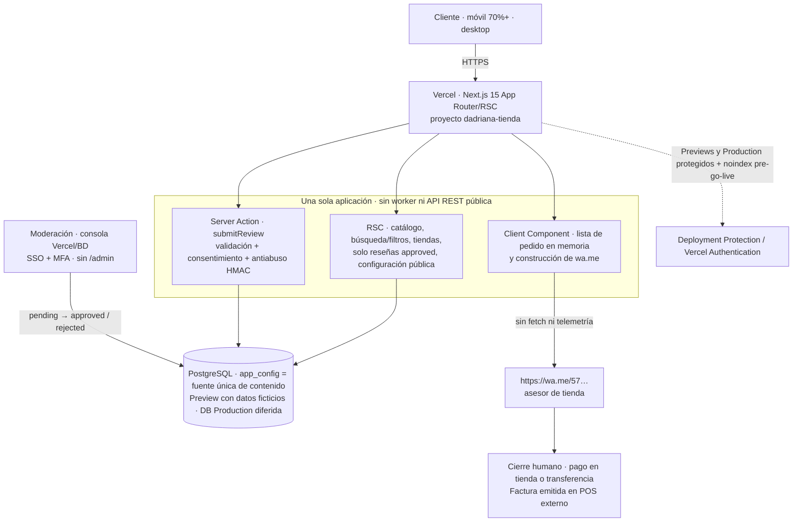

# Design Doc: MVP redefinido — D'Adriana Tienda (vitrina + WhatsApp)

| Campo | Valor |
|---|---|
| **Autor** | `forge-architect` (Staff Engineer, APEX FORGE) |
| **Fase** | Fase 1 del pipeline APEX FORGE — diseño antes de código |
| **Estado** | **Approved** — LGTM final de `forge-reviewer` y OK de diseño de `forge-sentinel`, `forge-qualis` y `forge-infra`; aprobado por el Comandante el 25-nov-2026. Las evidencias de release siguen siendo condiciones de Go-Live |
| **Fecha** | 25 de noviembre de 2026 (enmendado el 25-nov-2026 con arbitrajes A1…A8 y hallazgos H/Q/F/T) |
| **Decisor** | `apex-forge` (Comandante) |
| **Fuente del «qué»** | [`mvp-requisitos.md`](../01-requisitos/mvp-requisitos.md) — 47 RF-MVP, 19 RNF-MVP, 26 SEC-MVP, 18 N-MVP, 9 Q-MVP (aprobado el 25-nov-2026) |
| **Contexto histórico** | [`decisiones-comandante.md`](./decisiones-comandante.md) (C-01…C-15), [`design-doc.md`](./design-doc.md) y `DESIGN_DOC.md` — **no modificados** |
| **Regla de precedencia** | Para el MVP manda `mvp-requisitos.md`, los arbitrajes del Comandante A1…A8 y este documento; para Fase 2 siguen vigentes el diseño anterior y C-01…C-15. Ningún archivo previo se elimina, edita o reemplaza. |
| **Idioma** | Español por instrucción del Comandante para este MVP. El código y sus comentarios serán en inglés (AGENTS.md). |

> **Regla de oro:** ningún código de producción se escribe hasta que este documento pase a **Approved**. Los esquemas, contratos y fragmentos aquí mostrados son artefactos de diseño, no implementación.

---

## 0. Resumen ejecutivo

D'Adriana Tienda necesita una **vitrina digital de confianza** para productos de belleza para la piel y el cabello en Colombia, con una **identidad visual nueva**, catálogo navegable, búsqueda y filtros, reseñas moderadas, disponibilidad publicada, tiendas físicas y enlaces oficiales a redes. La aplicación **informa y organiza la intención de compra; no transa**.

El cierre de la venta es humano: el cliente deriva al asesor por **`wa.me`** y decide entre **pagar en la tienda física** o **acordar una transferencia por WhatsApp**. La **factura electrónica la emite el asesor en su POS externo**; la web no cobra, no factura, no pide NIT ni datos de tarjeta. La «lista de pedido» es un borrador **en memoria, sin persistencia**: se pierde al cerrar la pestaña y solo sirve para componer el mensaje.

La arquitectura ganadora es **Next.js 15 (App Router/RSC) full-stack en Vercel + PostgreSQL/Neon con Server Actions**, sin worker, Redis, carrito, pedidos ni panel interno. Next queda fijado en `>=15.5.29 <16`; la migración a la mayor 16 exige ADR nuevo en Fase 2 (A7).

**Estado de la infra confirmado hoy:** repositorio `git@github.com:castrosergio1008/dadriana-tienda.git` (rama `main`, `origin` vinculado, sin commit ni push), proyecto de Vercel `dadriana-tienda`, **sin dominio** (Q-MVP-04 abierta) ⇒ canonical temporal `https://dadriana-tienda.vercel.app`. Los Previews y **la Production permanecen con Deployment Protection y `X-Robots-Tag: noindex` hasta cerrar Q-MVP-03/04/08 y crear la `DATABASE_URL` de Production** (A2). La `DATABASE_URL` de **Preview sí existe**, siempre con datos ficticios. `app_config` en PostgreSQL es la **fuente única de contenido** para número de WhatsApp, redes, tiendas y selecciones curadas (A1): las variables de entorno son `NEXT_PUBLIC_SITE_URL` y `DATABASE_URL`, **más la excepción explícita autorizada por el Comandante `REVIEW_HASH_PEPPER`** (secreta, exclusiva de Vercel Encrypted Environment Variables) para el HMAC versionado de reseñas.

---

## 1. Contexto, problema y objetivos medibles

### 1.1 Contexto

El cliente redefinió el MVP el 25-nov-2026. El diseño aprobado el 24-nov-2026 describe un e-commerce transaccional completo (carrito, checkout Wompi/ePayco, DIAN, pedidos, logística, lotes FEFO, POS web y paneladmin). Esa documentación **permanece intacta** y es la referencia de Fase 2. El MVP actual es un **recorte de alcance decidido por el cliente**, no una corrección de errores del diseño anterior.

### 1.2 Problema que resuelve

1. El canal digital actual no transmite una imagen de marca nueva ni organiza la intención de compra.
2. El asesor recibe consultas desordenadas por WhatsApp sin SKU, cantidades ni modalidad de cierre.
3. Las reseñas y la disponibilidad publicada deben existir **sin recoger PII innecesaria, sin carrito y sin promesas que la app no puede cumplir**.

### 1.3 Objetivos medibles (ligados a RF-MVP)

| Objetivo | Métrica verificable | RF-MVP / RNF |
|---|---|---|
| Vitrina completa y navegable | Home, `/piel`, `/cabello`, `/marcas`, PLP, PDP, búsqueda, tiendas y páginas de contenido devuelven 200 con metadatos propios | 005, 006, 012–014, 029, 046 |
| Identidad nueva aplicada | 0 componentes con tokens verde/dorado anteriores; capturas en 375/768/1440 px en UAT | 001–004 |
| Intención de compra derivada correctamente | 100 % de los E2E generan `wa.me` con número oficial, SKU, cantidades y modalidad; 0 campos de PII en el texto | 023–028 |
| Precio y disponibilidad coherentes | Mismo precio en 5 superficies; mismo estado en Home, PLP, búsqueda, PDP y mensaje | 015–016, 037–041 |
| Reseñas fiables y privadas | 100 % nacen `pending`; 0 pendientes en HTML/API/sitemap/caché; promedio calculado solo sobre `approved` | 032–036 |
| Rendimiento medible con honestidad | LCP p75 < 2,5 s y CLS p75 < 0,1 en release; **INP p75 < 200 ms se mide post-deploy con ventana 7–28 días en Speed Insights**, criterio que **sustituye al «Continuo» de RNF-MVP-002 y que `forge-qualis` acepta explícitamente**; en Preview se usa proxy de laboratorio (TBT/Lighthouse + trazas de carrusel, filtros y formulario); TTFB p75 < 800 ms; p95 de búsqueda < 300 ms con catálogo fixture del tamaño previsto | RNF-MVP-001…005 |
| Accesibilidad | 0 violaciones críticas/serias en axe 2.2 AA y auditoría manual de teclado/lector de pantalla como evidencia de release | RNF-MVP-006…009 |
| Operación segura | 0 secretos en repo/bundle; Previews y Production protegidos pre-go-live con `noindex`; CSP `report-only` antes de `enforce` | 043–045, SEC-MVP-021…023 |
| Disponibilidad | SLO 99,5 % / 30 días ≈ **216 min** de presupuesto de error; *feature freeze* si se consume > 50 % en la primera quincena | RNF-MVP-017 |

> No se promete una métrica de conversión comercial: medir conversiones exigiría *tracking* de personas, excluido por N-MVP-17/RNF-MVP-011. El éxito se mide con calidad observable y UAT del cliente.

---

## 2. No-objetivos y preservación del diseño anterior

### 2.1 No-objetivos (N-MVP-01…18)

| ID | No se construye en este MVP | Motivo / reevaluación |
|---|---|---|
| N-MVP-01 | Pagos en línea, pasarela o BNPL | Cierre decidido por el cliente; Fase 2 solo si revoca la decisión |
| N-MVP-02 | Datos de tarjeta (PAN, CVV) en la app | Sin flujo de pago; riesgo PCI innecesario (SEC-MVP-024) |
| N-MVP-03 | Facturación electrónica en la app (DIAN/NIT/PDF) | La emite el asesor en su POS externo (SEC-MVP-025) |
| N-MVP-04 | Carrito (persistente, checkout, cupones) | La lista de pedido es solo un borrador de comunicación |
| N-MVP-05 | Cuenta de cliente (registro, login, OAuth, wishlist) | El contacto ocurre por WhatsApp |
| N-MVP-06 | Seguimiento, estados o historial de pedido en la app | El asesor confirma la venta (SEC-MVP-026) |
| N-MVP-07 | Logística propia, guías, domicilios | No solicitado; cierre en tienda o transferencia |
| N-MVP-08 | Lotes, FEFO, vencimientos, reservas | Q-MVP-01 abierta: no se inventa fuente de verdad |
| N-MVP-09 | Panel interno propio con login/roles | Por defecto se usa consola Vercel/BD con SSO+MFA (SEC-MVP-015) |
| N-MVP-10 | WhatsApp Cloud API, plantillas y correos transaccionales | Se usa `wa.me`; API se evalúa después |
| N-MVP-11 | Reseñas con foto, votos útiles, preguntas, compra verificada | Requieren cuenta/pedidos, excluidos |
| N-MVP-12 | Cupones, descuentos, promociones, carrito abandonado | No hay checkout ni cuenta |
| N-MVP-13 | Integración contable/ERP o POS web propio | El POS del asesor ya existe y es externo |
| N-MVP-14 | Multi-moneda y multi-idioma | COP y `es-CO` propuestos (Q-MVP-09) |
| N-MVP-15 | App nativa, PWA instalable, modo offline | Web responsive con un solo codebase |
| N-MVP-16 | Marketplace multi-vendedor | Marca/retail propio |
| N-MVP-17 | Búsqueda semántica, ML, personalización, A/B testing | Sin volumen ni señales propias |
| N-MVP-18 | Analítica avanzada y dashboard de negocio | Solo observabilidad técnica mínima (RNF-MVP-016) |

### 2.2 Declaración explícita de preservación

**Nada del diseño anterior se eliminó.** `DESIGN_DOC.md`, `prototipo/`, `docs/02-arquitectura/design-doc.md`, C-01…C-15, los ADR-001…ADR-006, `docs/03-disenos/`, `docs/04-datos/`, `docs/05-scrum/`, `docs/06-seguridad/`, `docs/07-infra/` y `docs/08-review/` permanecen intactos. Este Design Doc y los ADR-MVP son **archivos nuevos**. Los no-objetivos significan únicamente «no se gasta esfuerzo hoy en esta entrega»; la sección 13 detalla qué se reutiliza y por qué no se borra. En particular, `docs/07-infra/checklist-lanzamiento.md` **pertenece al diseño transaccional y no aplica al MVP** (ver runbook en §10.5).

---

## 3. Requerimientos y restricciones

### 3.1 Funcionales

Cubiertos por los 47 RF-MVP de [`mvp-requisitos.md`](../01-requisitos/mvp-requisitos.md). Los dominios que condicionan la arquitectura son:

| Dominio | IDs | Restricción arquitectónica derivada |
|---|---|---|
| Marca nueva | RF-MVP-001…004 | Tokens nuevos aprobados; activos OG/favicon; referencia histórica intacta |
| Catálogo y búsqueda | RF-MVP-005…022 | Lectura vía RSC; filtros en URL; sinónimos en español; sin índice externo |
| Lista → WhatsApp | RF-MVP-023…028 | Estado en memoria; construcción del enlace sin endpoint propio; sin PII |
| Tiendas y contenido | RF-MVP-029…031, 042, 046 | Contenido canónico en `app_config`/PostgreSQL; allowlist de dominios sociales |
| Reseñas | RF-MVP-032…036 | `pending` por defecto; consentimiento versionado; baja/rectificación por `wa.me` sin token |
| Disponibilidad | RF-MVP-037…041 | Campo publicado informativo; sin reserva, ETA ni estado de pedido |
| Despliegue/config | RF-MVP-043…047 | Vercel + Postgres; secretos fuera del repo; rollback y smoke post-deploy |

### 3.2 No funcionales y restricciones duras

- **RNF-MVP-001…005:** LCP p75 < 2,5 s · CLS p75 < 0,1 · TTFB p75 < 800 ms · p95 de búsqueda < 300 ms con catálogo fixture del tamaño previsto. El presupuesto de JS gzip es Home ≤ 150 KB · PLP ≤ 160 KB · PDP ≤ 170 KB; el chunk de la lista (≤ 140 KB) **se mide como parte de la ruta donde se monta (PDP/PLP) y se absorbe en esos presupuestos**, no como plantilla propia (QA-03).
- **RNF-MVP-006…009:** WCAG 2.2 AA, teclado completo, `prefers-reduced-motion`, animaciones CSS-first, contraste ≥ 4,5:1 / ≥ 3:1 con los tokens **nuevos**. Evidencia de release: axe + auditoría manual de teclado/lector de pantalla.
- **RNF-MVP-010:** canonical, `sitemap.xml`, `robots.txt`, OG y URLs de filtros reproducibles; canonical temporal apunta a `https://dadriana-tienda.vercel.app`.
- **RNF-MVP-011…014:** privacidad de reseñas, antiabuso con HMAC, secretos/entornos y cabeceras de seguridad (CSP `report-only` → `enforce` con criterio documentado).
- **RNF-MVP-015…019:** compatibilidad Vercel/Next 15 (`>=15.5.29 <16`)/Neon, TypeScript strict sin `any` salvo frontera justificada, cobertura global ≥ 70 % y **≥ 90 % en `buildWhatsAppUrl`, `submitReview` y el parser de filtros**; un descenso > 2 pp exige justificación escrita en el PR (QA-04).
- **Observabilidad honesta (A8):** `RNF-MVP-016` queda con `requestId`, logs estructurados, errores 5xx y Speed Insights. **No existe alerta de «fallos de generación/apertura del enlace `wa.me`»** porque no hay endpoint ni telemetría de servidor; se sustituye por una sonda E2E sintética sin PII por release.
- **Disponibilidad (QA-07):** SLO 99,5 % / 30 días ≈ 216 min de presupuesto de error; si se consume > 50 % en la primera quincena se aplica *feature freeze*. No se copian el 99,9 %/43,2 min ni el canary 5/25/100 del diseño anterior.
- **Legales:** Ley 1581/2012 y Decreto 1074/2015 con plazos ≤ 10 días hábiles para consultas y ≤ 15 para reclamos, y tabla de retención publicada (RF-MVP-046). Menor detectado en moderación ⇒ **borrado** (A5).

### 3.3 Evaluación de versiones mayores del stack (exigida por AGENTS.md)

Se evalúa antes de escribir código, con datos consultados el 25-nov-2026:

| Tecnología | Stack fijado | Última estable observada | Evaluación y decisión |
|---|---|---|---|
| Next.js | 15 App Router | 16.4.6 (Active LTS); 15.5.29 es Maintenance LTS con parche de seguridad de nov-2026 y fin de soporte ene-2027 | **Fijar `>=15.5.29 <16`** (A7/H-5). El cliente fijó la versión y el MVP no incorpora worker, pagos ni adaptadores sensibles al cambio de major. La migración a 16 solo se hace con **ADR nuevo en Fase 2** y antes del fin de soporte de 15. |
| React | 19 | 19.3.1 (misma major) | Mantener React 19 parcheado; sin cambio de major. |
| Tailwind CSS | v4 | 4.3.5 (misma major) | Mantener v4; tokens nuevos en `@theme`. |
| PostgreSQL / Prisma / Vercel / Vitest / Playwright | Según AGENTS.md | Sin cambio de major que bloquee el MVP | Sin desviación del stack. |

> Esta evaluación **no reabre** la decisión del cliente: documenta el riesgo de ciclo de vida y su mitigación (pin de parche + ADR de migración). Ver DD-MVP-03.

---

## 4. Opciones de arquitectura consideradas

Criterios ponderados según la prioridad APEX FORGE: **correctitud → mantenibilidad → rendimiento → velocidad de entrega**. Escala 1–10 (10 = mejor).

| # | Criterio | Peso | Justificación del peso en este MVP |
|---|---|---:|---|
| C1 | Correctitud del flujo y privacidad (`wa.me`, reseñas, consentimiento) | 25 % | Un mensaje con PII o una reseña pendiente visible es un fallo de release |
| C2 | Velocidad de entrega y simplicidad operativa | 20 % | El cliente quiere vitrina verificable, no plataforma transaccional |
| C3 | Coste total de propiedad | 20 % | Sin ingresos transaccionales en la app: cada servicio extra es coste sin retorno |
| C4 | Rendimiento / CWV / SEO | 15 % | La vitrina compite en móvil y en compartibilidad por WhatsApp |
| C5 | Mantenibilidad y testabilidad | 10 % | Equipo pequeño; cobertura ≥ 70 % y CI en verde |
| C6 | Reversibilidad y evolución a Fase 2 | 10 % | El diseño anterior debe poder reactivarse sin reescribir datos |

### 4.1 Matriz ponderada

| Criterio | Peso | **A. Next.js full-stack + Postgres + Server Actions** | **B. Estático + CMS externo sin BD propia** | **C. Reutilizar monolito modular de Fase 2** |
|---|---:|---:|---:|---:|
| C1 | 25 % | **9** (2,25) | 7 (1,75) | 8 (2,00) |
| C2 | 20 % | **9** (1,80) | 9 (1,80) | 4 (0,80) |
| C3 | 20 % | **8** (1,60) | 7 (1,40) | 4 (0,80) |
| C4 | 15 % | **9** (1,35) | 8 (1,20) | 8 (1,20) |
| C5 | 10 % | **9** (0,90) | 6 (0,60) | 8 (0,80) |
| C6 | 10 % | 9 (0,90) | 5 (0,50) | **10** (1,00) |
| **TOTAL** | **100 %** | **🏆 8,80** | **7,25** | **6,60** |

### 4.2 Análisis de cada opción

**Opción A — Next.js 15 full-stack en Vercel + PostgreSQL/Neon con Server Actions (GANADORA).**
Un solo proyecto, un solo despliegue, un solo pipeline. RSC para toda lectura; una Server Action para el envío de reseñas; estado de la lista en memoria en un Client Component; `app_config` en PostgreSQL como fuente única de contenido editable. Sin worker, Redis, índice de búsqueda, colas ni panel.
- *Pros:* cumple los no-objetivos sin código muerto; el número de WhatsApp se valida en servidor y se inyecta como prop pública desde `app_config`; `pending` nunca entra a la respuesta pública; Previews y Production protegidos pre-go-live; mínima superficie de ataque; alineada con el stack.
- *Contras:* el proveedor de BD sigue pendiente (Q-MVP-03); la moderación depende de consola humana, no de una UI propia.
- *Motivo de elección:* gana en correctitud, coste y velocidad sin perder rendimiento ni mantenibilidad. Es reversible: migrar a la Opción C en Fase 2 es añadir capas, no rehacer el producto (DD-MVP-02).

**Opción B — Sitio estático + CMS externo sin BD propia (RECHAZADA).**
Contenido y catálogo en un CMS headless, sitio generado estáticamente y formulario de reseñas delegado al proveedor.
- *Pros:* despliegue muy rápido y barato; poco código propio; CDN natural.
- *Contras:* el consentimiento versionado, la retención, la invisibilidad de `pending` y la verificación de baja/rectificación quedan sujetas a las capacidades del CMS; depender de un tercero para PII eleva el riesgo; las URLs de filtros y la coherencia de disponibilidad son más frágiles; migrar a BD propia después implica reimportar contenido y revisar consentimientos.
- *Motivo de rechazo:* ahorra semanas iniciales pero transfiere el control de los requisitos bloqueantes `SEC-MVP-001/-002/-007/-008`. Q-MVP-03 (titularidad de BD) **no** se resuelve sustituyendo la BD por un CMS: se resuelve confirmando titularidad y proveedor.

**Opción C — Reutilizar el monolito modular del diseño anterior (Fase 2) (RECHAZADA para el MVP).**
`apps/web`, `apps/worker`, `packages/core`, `packages/ui`, Redis, Meilisearch, pasarelas, DIAN, lotes FEFO, panel y 42 historias / 280 puntos.
- *Pros:* máxima continuidad con el trabajo aprobado; mejor punto de partida si el cliente reactiva el e-commerce transaccional.
- *Contras:* construye carrito, checkout, pedidos, pagos, facturación, logística y RBAC que el cliente excluyó; multiplica despliegues, secretos, superficie de revisión y coste; eleva el riesgo de incumplir N-MVP-01…13 y SEC-MVP-024…026.
- *Motivo de rechazo:* resolvería problemas que este MVP no tiene. Se conserva íntegro como destino de Fase 2 (sección 13).

**Análisis de sensibilidad:** si Q-MVP-03 decide un proveedor distinto a Neon, la Opción A no cambia (solo cambia el proveedor de PostgreSQL). Si se autorizara persistir la lista de pedido o un panel, reaparecen SEC-MVP-013/-014 y SEC-MVP-016…020: eso exige un Design Doc nuevo, no un parche de este (DD-MVP-05 y DD-MVP-09).

---

## 5. Arquitectura elegida

### 5.1 Componentes y límites



**Reglas de límite (no negociables):**

1. Toda lectura pública pasa por RSC; no se crea una API REST pública de lectura.
2. La única escritura pública es la Server Action de reseñas. No hay Rutas de API, webhooks ni colas. Tampoco hay endpoint público de mutación para baja/rectificación.
3. El navegador nunca recibe secretos, IPs en claro, correos ni credenciales; solo datos públicos ya saneados.
4. El número de WhatsApp, las redes, las tiendas y las selecciones curadas salen de `app_config` en PostgreSQL (A1); **nunca** de variables de entorno, query, hash, referrer, reseñas ni entrada del usuario.
5. El borrador de pedido vive solo en memoria del Client Component; **prohibido** `localStorage`, `sessionStorage`, cookies, IndexedDB y *service worker* que lo cachee.
6. No se modela ni se expone: `orders`, `payments`, `invoices`, `carts`, `users` de cliente, `shipments`, `tracking`, `inventory_lots`, `reservations` ni `audit_logs` de panel.
7. Las cabeceras y la configuración de despliegue viven **como código versionado** (`next.config.*`, `vercel.json`) y en el runbook; no dependen de clicks manuales en la consola (A6/F-2).

### 5.2 Modelo de datos mínimo y fuente única de contenido

Convención reutilizada de C-02: importes en `price_cents` (`BIGINT`) para precisión; **no se calcula IVA ni total de cobro**. El precio se formatea en COP sin decimales (`$ 45.000`).

**A1 — `app_config` en PostgreSQL es la fuente canónica única de contenido editable sin deploy:** número oficial de WhatsApp, URLs de Instagram/Facebook, tiendas físicas y selecciones curadas («más vendidos» / «más referenciados»). Las tablas `sites` y `curated_selections` son proyecciones normalizadas de esa misma configuración para consulta eficiente; no constituyen una segunda fuente de verdad. **No existen variables de entorno para ninguno de esos valores.**

| Entidad | Campos clave | Reglas de diseño |
|---|---|---|
| `categories` | `id`, `slug` (único), `name`, `parent_id?`, `active`, `sort_order` | `piel` y `cabello` con ruta propia; subcategoría simple opcional (RF-MVP-012) |
| `brands` | `id`, `slug` (único), `name`, `active`, `sort_order` | Índice alfabético en `/marcas`; sin enlace roto si no tiene productos (RF-MVP-013) |
| `products` | `id`, `slug` (único), `sku` público, `name`, `brand_id`, `category_id`, `description`, `price_cents`, `currency='COP'`, `availability_status` (`available` / `out_of_stock`), `availability_updated_at?`, `published` | URL propia y compartible; el estado es **informativo**, sin reserva ni ETA; mecanismo de actualización abierto en Q-MVP-01 |
| `product_images` | `id`, `product_id`, `url`, `alt`, `width`, `height`, `position`, `is_primary` | AVIF/WebP, `srcset`, dimensiones declaradas, `alt` revisado (RF-MVP-010) |
| `reviews` | `id`, `product_id`, `alias`, `rating` 1–5, `body` texto plano ≤ 500, `status` (`pending`/`approved`/`rejected`), `rejection_reason` interno, `consent_version`, `policy_version`, `consented_at`, `contact_email_hmac?`, `email_hmac_key_version`, `ip_hmac`, `ip_hmac_key_version`, `created_at` | Toda reseña nace `pending`. Correo e IP se guardan **solo como `HMAC-SHA256(peppers[version], valor)` con pepper secreto y rotatable** (A4/DD-MVP-21); la versión usada se persiste en `email_hmac_key_version` e `ip_hmac_key_version` para que rotar no rompa la verificación. Nunca en claro ni en la respuesta pública. `id` y `product_id` no se exponen en JSON público (H-9). |
| `sites` | `site_id`, `slug`, `name`, `address`, `schedule`, `phone`, `maps_url`, `whatsapp_number?`, `active` | Proyección de `app_config.stores`; vocabulario `site_id` heredado de C-01; etiqueta UI «tienda»; sin stock ni turnos |
| `curated_selections` | `id`, `key` (`mas_vendidos` / `mas_referenciados`), `product_id`, `position`, `label`, `active` | Proyección de `app_config.selections`; editable sin deploy (RF-MVP-008/-009); «más referenciados» queda curada hasta Q-MVP-05 |
| `app_config` | `key`, `value` saneado, `updated_at` | Claves `whatsapp_number`, `instagram_url`, `facebook_url`, `stores`, `selections`, textos legales y etiquetas; valores públicos validados en servidor. **Ninguna variable de entorno duplica estas claves.** |

> **No existe `review_verification_tokens`.** La alternativa con token de un solo uso queda **diferida a un Design Doc nuevo si se autoriza panel** (A3). La baja/rectificación del MVP se verifica contra el correo HMAC proporcionado por el autor **usando `email_hmac_key_version` persistida, nunca la versión vigente** (A4/DD-MVP-22), sin token en URL, query, logs ni `Referer`.

**Prohibición explícita de modelo:** no existen tablas de pedidos, carrito, cuentas de cliente, pagos, comprobantes, facturas, envíos, lotes, reservas, movimientos de inventario, consentimientos de cuenta ni auditoría de panel. La disponibilidad es un campo publicado en `products`; **no** se inventa fuente de verdad, frecuencia ni permisos de actualización (Q-MVP-01).

### 5.3 Flujo de compra informativa → `wa.me`

```mermaid
sequenceDiagram
    participant C as Cliente
    participant R as RSC (PDP/PLP)
    participant L as Lista en memoria (Client Component)
    participant W as wa.me / asesor
    C->>R: Navega categoría, busca o filtra
    R-->>C: Producto: SKU, nombre, precio COP, disponibilidad; número desde app_config
    C->>L: Agregar / cambiar cantidad / eliminar (solo si available)
    C->>L: Elegir modalidad: tienda física o transferencia acordada
    L->>L: Componer texto neutral (SKU, cantidades, precios de referencia, modalidad, tienda si aplica)
    L->>W: window.open("https://wa.me/57…?text=…", "_blank", "noopener,noreferrer")
    W-->>C: Confirmación en pantalla: «Tu asesor te responderá por WhatsApp»
```

- Sin petición al servidor, sin endpoint propio, sin identificador de pedido, sin promesa de factura ni despacho.
- El mensaje incluye la nota de que la facturación electrónica la gestiona el asesor en su punto de venta (RF-MVP-027).
- El subtotal, si se muestra, se rotula **«valor de referencia»**, nunca «monto a pagar» (SEC-MVP-011).
- Tope de ítems en memoria propuesto: 20 para evitar URLs excesivamente largas; al superarlo se muestra aviso y no se agrega el ítem (DD-MVP-05).
- El ID del borrador es aleatorio **en memoria** y no contiene PII; desaparece al cerrar la pestaña.
- **A8:** no se instrumenta ni se alerta sobre «apertura del enlace»: no hay endpoint ni telemetría de servidor. La verificación es una **sonda E2E sintética sin PII por release** (MVP-E2E-27); el monitoreo en producción se limita a `requestId`, logs estructurados, 5xx y Speed Insights.

### 5.4 Flujo de reseña → moderación → publicación

```mermaid
sequenceDiagram
    participant C as Cliente
    participant F as Formulario público (RSC + Client)
    participant A as Server Action submitReview
    participant DB as PostgreSQL
    participant M as Moderador (consola SSO+MFA)
    C->>F: alias, calificación, texto, correo opcional, consentimiento sin marcar
    F->>A: payload (honeypot vacío, consent=true, versión actual)
    A->>A: validar, normalizar a texto plano, HMAC-SHA256(correo/IP) con pepper, 3/h, 1 por correo/producto
    A->>DB: INSERT status=pending + consent_version/policy_version/timestamp
    A-->>C: «Pendiente de revisión» (sin publicación inmediata)
    M->>DB: revisar; aprobar o rechazar con motivo interno; si es menor, BORRAR
    DB-->>F: filtro status=approved en RSC + revalidación; HTML no-store/private
    C->>F: promedio y listado calculados solo sobre aprobadas
```

Controles obligatorios derivados de la revisión de `forge-sentinel`:

- **H-7:** la consulta RSC filtra **explícitamente** `status=approved`; el HTML con reseñas se sirve con `Cache-Control: no-store, private`; la aprobación/rechazo revalida la ruta/etiqueta; `sitemap.xml` incluye **todas las páginas públicas** (home, categorías, marcas, PLP, PDP, tiendas y contenidos legales) y **solo excluye reseñas pendientes o rechazadas** —no páginas públicas— junto con URLs internas/privadas.
- **A5/H-1:** si el moderador detecta un menor, se **borran** la reseña, el correo HMAC y los metadatos asociados. Esta es una **excepción explícita** a la regla de conservar evidencia de consentimiento; queda registrada en el procedimiento de moderación (no en un log con PII).
- **A3/H-3:** cada reseña publicada muestra un enlace `wa.me` neutral «Solicitar baja o corrección». El moderador verifica manualmente contra el correo HMAC que el autor proporciona, **recalculando con la versión de pepper persistida en `email_hmac_key_version`** y ejecuta la baja/corrección en la consola. Sin token en query/URL/logs/`Referer`, sin endpoint público de mutación y sin documento de identidad. Plazos: **≤ 10 días hábiles** para consultas y **≤ 15 días hábiles** para reclamos. La alternativa con token de un solo uso queda diferida a un DD nuevo si se autoriza panel.
- `pending` y `rejected` no aparecen en HTML SSR, respuesta pública, `sitemap.xml` ni caché; Previews y Production pre-go-live siempre con `noindex` (SEC-MVP-007, A2).

---

## 6. Superficie de servidor y generación del `wa.me`

### 6.1 Superficie mínima

| Superficie | Tipo | Responsabilidad | Límites |
|---|---|---|---|
| Páginas y layout | RSC | Catálogo, búsqueda/filtros desde URL, tiendas, reseñas aprobadas, metadata, `sitemap.xml`, `robots.txt` | Solo lectura; `status=approved`; sin IDs internos en JSON público |
| `submitReview` | Server Action | Única escritura pública: validar con esquema estricto, consentimiento versionado, texto plano, honeypot, rate limiting y antiabuso con HMAC | Sin subida de archivos; sin PII en la respuesta; ORM parametrizado |
| Enlace de baja/rectificación | `wa.me` neutral + consola | Mensaje al asesor; verificación manual contra correo HMAC y ejecución en consola SSO+MFA | Sin token en URL, sin endpoint público de escritura, sin documento |
| Moderación / contenido | Consola Vercel/BD | Aprobar/rechazar/borrar reseñas, editar `app_config`, tiendas y selecciones | Sin `/admin`, sin login propio (SEC-MVP-015) |

> **No se crean** Route Handlers `/api/...`, webhooks, trabajos asíncronos, sesiones JWT de cliente, tokens de API ni superficies de pago/facturación/tracking.

**Contrato mínimo de la acción (diseño, no implementación):**

```ts
// Design-only contract — not production code.
type ReviewInput = {
  productId: string;
  alias: string;          // 1..40, plain text
  rating: 1 | 2 | 3 | 4 | 5;
  body: string;           // <= 500 characters, normalized on the server
  contactEmail?: string;  // optional; stored only as versioned HMAC-SHA256 with pepper
  consentAccepted: true;  // checkbox starts unchecked
  consentVersion: string;
  policyVersion: string;
  honeypot: "";           // filled => silent rejection
};
// Result: { status: "pending" } or a generic 429/400 error without PII.
```

```ts
// Design-only contract — built in the browser, no fetch.
type WhatsAppDraft = {
  sku: string;
  name: string;
  quantity: number;
  priceCents: bigint;
  closure: "STORE_PICKUP" | "BANK_TRANSFER";
  siteId?: string;
};
// buildWhatsAppUrl(numberFromAppConfig, draft[]) => https://wa.me/<57 + 10 digits>?text=<encoded>
```

### 6.2 Generación del enlace sin endpoint propio

1. El servidor lee el número de `app_config`, valida `^57\d{10}$` y lo pasa como prop pública al Client Component; si la configuración es inválida, la acción de envío se deshabilita y se reporta el error internamente.
2. El componente construye la URL con `encodeURIComponent` a partir del estado en memoria; `https` obligatorio y `rel="noopener noreferrer"` en cualquier enlace externo.
3. El destino no se lee nunca de `window.location.search`, `hash`, `document.referrer`, reseñas ni entradas del usuario (SEC-MVP-010); se prueba inyección por los cuatro vectores (MVP-E2E-22).
4. El texto se genera con plantilla fija y se audita con tests de patrones PII: nombre, apellido, teléfono del cliente, correo, dirección, cédula, datos de tarjeta/cuenta, notas de salud y fotos de personas están prohibidos (SEC-MVP-011).
5. No se registra analítica ni telemetría del evento; la confirmación en pantalla es puramente local (RF-MVP-028, A8). Q-MVP-06 mantiene abierta la evaluación de WhatsApp Business API para Fase 2.

---

## 7. Nueva identidad visual y sistema de diseño

### 7.1 Principio

La identidad verde/dorada anterior queda como **referencia histórica** en `docs/03-disenos/` y `prototipo/`; **ningún componente nuevo usa sus tokens**. La nueva identidad se define en un archivo **nuevo** de sistema de diseño (no se edita `sistema-diseno.md`), con versionado `brand-tokens/v1`.

### 7.2 Proceso de aprobación

| Paso | Entregable | Aprobador | Gate |
|---|---|---|---|
| 1. Descubrimiento | Moodboard y referencias autorizadas por el cliente; alcance **solo digital** salvo confirmación (Q-MVP-07) | Cliente | Sin promesas clínicas ni de resultados |
| 2. Tokens | Paleta, tipografías, espaciado, radios, sombras, estados y movimiento; archivo nuevo de tokens | Cliente (estética) + `forge-architect` (factibilidad) | Contraste ≥ 4,5:1 texto normal y ≥ 3:1 texto grande/UI (RNF-MVP-009) |
| 3. Componentes | Botones, tarjetas, badges, carrusel, inputs, foco/error/éxito/agotado/pendiente | `forge-frontend` + `forge-reviewer` | Cada componente declara su token y sus 4 estados (RF-MVP-003) |
| 4. Activos | Favicon, imagen Open Graph, vista previa al compartir en WhatsApp | Cliente + `forge-architect` | RF-MVP-004 alineado con canonical temporal |
| 5. Copy y privacidad | Aviso de ≥ 18 años, consentimiento, política y plazos 10/15 días | `forge-sentinel` | Bloqueante antes de habilitar reseñas |
| 6. Congelación | Guía de marca firmada por cliente y Comandante | `apex-forge` | RF-MVP-001 se da por cerrado |

### 7.3 Reglas de implementación

- Tailwind v4 con tokens en `@theme`; sin hex sueltos en componentes.
- Carruseles con CSS `scroll-snap`, **sin autoplay**; `prefers-reduced-motion: reduce` desactiva transiciones sin romper scroll ni foco; cero librerías de animación (RF-MVP-007, RNF-MVP-008).
- Imágenes AVIF/WebP con dimensiones reservadas, `alt` descriptivo revisado por contenido y precarga de la principal; CLS objetivo 0 (RF-MVP-010).
- Fuentes autoalojadas con `next/font` para evitar CLS y referencias externas bloqueantes.
- Los tokens anteriores y las maquetas `docs/03-disenos/maquetas/` se conservan sin editar como evidencia de la referencia histórica (sección 13).

---

## 8. Seguridad y privacidad

### 8.1 Trazabilidad `SEC-MVP-001…026`

| ID | Estado | Cómo se satisface en este diseño | Verificación |
|---|---|---|---|
| SEC-MVP-001 | **BLOQUEANTE** | Campos mínimos en `reviews`; correo e IP solo `HMAC-SHA256(peppers[version], valor)` con versión persistida; nunca proyectados ni en JSON público | Esquema + MVP-E2E-18 |
| SEC-MVP-002 | **BLOQUEANTE** | Casilla sin marcar; `consent_version`/`policy_version`/timestamp persistidos; envío directo → 400 genérico sin PII | MVP-E2E-13 |
| SEC-MVP-003 | APLICA | Aviso «solo mayores de 18 años»; sin campo de edad; **detector en moderación ⇒ borrado** de reseña, correo y metadatos (excepción al consentimiento) | MVP-E2E-16 |
| SEC-MVP-004 | APLICA | Sin campos sensibles ni de terceros; texto normalizado; moderación edita/rechaza/borra | MVP-E2E-14 |
| SEC-MVP-005 | APLICA | Validación en servidor, ORM parametrizado, texto plano inerte, sin *uploads* | MVP-E2E-14 |
| SEC-MVP-006 | APLICA | Honeypot, 3 envíos/h por IP HMAC, dedup por correo HMAC+producto (o IP HMAC+producto/alias si no hay correo), 429 genérico | MVP-E2E-15 y -17 |
| SEC-MVP-007 | **BLOQUEANTE** | `status=approved` en RSC; HTML `no-store, private`; revalidación tras moderar; `sitemap` con todas las páginas públicas y sin reseñas pendientes/rechazadas; `noindex` en Previews y Production pre-go-live | MVP-E2E-11/-19/-23 |
| SEC-MVP-008 | **BLOQUEANTE** | Enlace `wa.me` neutral; verificación manual contra correo HMAC **con la versión persistida** por el moderador; sin token en URL/logs/`Referer`; 10/15 días hábiles | MVP-E2E-20 |
| SEC-MVP-009 | APLICA | Retención: reseña publicada + 12 meses tras baja; metadatos antiabuso 30 días; consentimiento solo mientras sea necesario; **excepción de borrado por menor** | MVP-E2E-21 |
| SEC-MVP-010 | APLICA | Número desde `app_config`, validado `^57\d{10}$`; nunca desde URL; HTTPS y `rel` seguro | MVP-E2E-22 |
| SEC-MVP-011 | APLICA | Texto neutral con SKU, cantidades, precios de referencia y modalidad; ID aleatorio en memoria; sin PII | MVP-E2E-01 y -22 |
| SEC-MVP-012 | APLICA | Redes desde `app_config` con `new URL()`, `protocol === 'https:'` y **hostname exacto**; sin IDs internos en JSON público ni enlaces de usuarios en reseñas | MVP-E2E-10 |
| SEC-MVP-013 | **NO APLICABLE** | Sin persistencia de la lista (decisión del Comandante); volvería a aplicar automáticamente si se autorizara | MVP-E2E-03/-24 |
| SEC-MVP-014 | **NO APLICABLE** | Sin TTL ni purga porque no hay almacenamiento del borrador | MVP-E2E-24 |
| SEC-MVP-015 | APLICA POR DEFECTO | Sin `/admin`, sin login/contraseñas en código; consola Vercel/BD con SSO+MFA y privilegios mínimos | Escaneo de rutas en CI |
| SEC-MVP-016 | CONDICIONAL | Solo si se decide panel: SSO/OIDC + MFA, cookies `HttpOnly`/`Secure`/`SameSite`, ≤ 8 h, fallo cerrado | No aplica hoy; Q-MVP-01/Q-MVP-02 |
| SEC-MVP-017 | CONDICIONAL | Solo si hay panel: `moderador`/`inventario`/`admin`, denegación por defecto | No aplica hoy |
| SEC-MVP-018 | CONDICIONAL | Solo si hay panel: auditoría *append-only* 180 días, sin PII | No aplica hoy |
| SEC-MVP-019 | CONDICIONAL | Solo si hay panel: token anti-CSRF, `Origin`/`Referer`, CORS sin comodines | No aplica hoy |
| SEC-MVP-020 | CONDICIONAL | Solo si hay panel: validación numérica y de texto en servidor | No aplica hoy |
| SEC-MVP-021 | **BLOQUEANTE** | `.gitignore` con `.env*` **y excepción `!.env.example`**; secretos solo en Vercel; inventario = `NEXT_PUBLIC_SITE_URL`, `DATABASE_URL` y la excepción autorizada `REVIEW_HASH_PEPPER`; `DATABASE_URL` Production diferida; gitleaks limpio en CI | MVP-E2E-24 + evidencia de gitleaks |
| SEC-MVP-022 | APLICA | Development / Preview / Production separados; **Previews y Production protegidos y `noindex` pre-go-live**; DB de Preview con datos ficticios; sin credenciales productivas en Preview | MVP-E2E-23 |
| SEC-MVP-023 | APLICA | Cabeceras concretas como código (§8.3); CSP `report-only` con `report-uri` sin PII y criterio de promoción a `enforce` | MVP-E2E-25 + `curl -I` |
| SEC-MVP-024 | **BLOQUEANTE** | Sin campos PAN/CVV, cuentas, comprobantes ni SDK de pago; variables de pago del diseño anterior no se heredan | MVP-E2E-24 |
| SEC-MVP-025 | **BLOQUEANTE** | Sin DIAN, NIT/cédula fiscal, PDF tributario ni descarga de factura; variables DIAN no se heredan | MVP-E2E-24 |
| SEC-MVP-026 | **BLOQUEANTE** | Sin endpoint público por correo/teléfono/documento, sin ID secuencial ni estado en el mensaje; borrador en memoria; sin GA4/Sentry heredados | MVP-E2E-24 |

Bloqueantes de release: `SEC-MVP-001`, `-002`, `-007`, `-008`, `-021`, `-024`, `-025`, `-026`. No aplicables: `-013`, `-014`. Condicionales a panel: `-016`…`-020`.

### 8.2 Secretos y variables de entorno

**Inventario cerrado (A1 + excepción autorizada por el Comandante, DD-MVP-21):** tres variables de entorno. `NEXT_PUBLIC_SITE_URL` (pública; canonical temporal `https://dadriana-tienda.vercel.app`), `DATABASE_URL` (secreta; la de **Preview existe** con datos ficticios, la de **Production no se crea todavía**) y **`REVIEW_HASH_PEPPER` (secreta, excepción explícita a A1)** para el HMAC versionado de correo e IP.

| Variable | Tipo | Development | Preview | Production pre-go-live | Regla |
|---|---|---|---|---|---|
| `NEXT_PUBLIC_SITE_URL` | Pública | `http://localhost:3000` | URL del Preview | `https://dadriana-tienda.vercel.app` | Canonical/OG/sitemap; se actualiza al resolver Q-MVP-04 |
| `DATABASE_URL` | **Secreta** | BD local o rama de desarrollo autorizada | **SÍ existe**, rama/DB de Preview con datos ficticios | **NO CREAR TODAVÍA** (Q-MVP-03/A2) | Solo Vercel Encrypted Environment Variables; nunca en repo ni bundle |
| `REVIEW_HASH_PEPPER` | **Secreta — excepción DD-MVP-21** | Valor local de prueba, nunca productivo | Valor de Preview, distinto del de Production | Valor de Production; el formulario público sigue deshabilitado | **Exclusiva de Vercel Encrypted Environment Variables**; no es pública, no va en `app_config`, no se commitea; `.env.example` solo con `<VALUE>`; historial de versiones en el runbook |

> **Eliminadas del inventario:** `NEXT_PUBLIC_WHATSAPP_NUMBER`, `NEXT_PUBLIC_INSTAGRAM_URL` y `NEXT_PUBLIC_FACEBOOK_URL`. El número y las redes se leen de `app_config`. **Si esas variables ya existen en la consola de Vercel, no se usan y pueden borrarse**; el borrado se registra en el runbook (§10.5). Tampoco se heredan las variables de pago, DIAN, GA4 ni Sentry del diseño anterior (`docs/07-infra/arquitectura-despliegue.md:284-297`).

**Rotación (DD-MVP-22):** publicar el pepper nuevo como versión `N+1`, conservar el anterior como `REVIEW_HASH_PEPPER_PREVIOUS` (o historial versionado equivalente en Vercel) **solo durante la ventana de rotación**, rehashear en escritura/lectura y registrar fecha + versión + responsable en el runbook. `REVIEW_HASH_PEPPER_PREVIOUS` **no es una cuarta variable permanente**: se retira cuando todos los registros estén rehasheados. La verificación de baja/rectificación usa `email_hmac_key_version`/`ip_hmac_key_version` persistidos, nunca la versión vigente; sin este procedimiento la comparación se rompe. Procedimiento completo en [`runbook-mvp.md`](../../07-infra/runbook-mvp.md) §2.1.

`CONSENT_VERSION` y `POLICY_VERSION` **no son variables de entorno**: son valores gobernados en `app_config`/política publicada y se persisten en cada reseña. La configuración de CSP y del proveedor son archivos versionados (§8.3, §10.5).

**H-8:** `.gitignore` debe contener `.env*` y la excepción `!.env.example`; `.env.example` solo con marcadores `<VALUE>` (incluido `REVIEW_HASH_PEPPER=<VALUE>`). La evidencia de `gitleaks` limpio se adjunta al release (MVP-E2E-24).

**Cuándo se crea `DATABASE_URL` en Production:** cuando se cumplan los 10 pasos de la sección 10.3. Hasta entonces, la URL `dadriana-tienda.vercel.app` sirve solo para verificación técnica con protección y `noindex`; **no se publica contenido indexable ni se habilita el formulario público**.

### 8.3 Cabeceras y configuración como código (A6/H-4/F-7/H-10/F-3)

`next.config.*` y `vercel.json` (archivos nuevos, sin secretos) fijan:

| Configuración | Valor concreto |
|---|---|
| `poweredByHeader` | `false` (sin `X-Powered-By`) |
| CSP | `Content-Security-Policy-Report-Only: default-src 'self'; object-src 'none'; frame-ancestors 'none'; base-uri 'none'; ...; report-uri <_endpoint_sin_PII>`; el *report-uri* no incluye correo, IP, token ni parámetros de reseña |
| Criterio de promoción | Mínimo 7 días de reportes sin violaciones reales en Preview/Production protegida, E2E completo en verde bajo `report-only`, LGTM de `forge-sentinel` + `forge-infra`; solo entonces cambiar a `Content-Security-Policy` en `enforce` y repetir los E2E (MVP-E2E-25) |
| `Referrer-Policy` | `strict-origin-when-cross-origin` |
| `X-Frame-Options` | `DENY` |
| `X-Content-Type-Options` | `nosniff` |
| `Permissions-Policy` | `camera=(), microphone=(), geolocation=()` |
| `upgrade-insecure-requests` | Habilitado (todo el tráfico HTTPS) |
| HSTS | Verificado con `curl -I` en el host temporal de Vercel **y** en el dominio definitivo cuando se resuelva Q-MVP-04 |
| Protección | Vercel Authentication/SSO en Previews **y en Production pre-go-live**; **sin contraseñas compartidas** |

### 8.4 Controles adicionales de `forge-sentinel`

- **H-7:** filtro `status=approved` en la consulta RSC, `no-store`/`private` en HTML con reseñas, revalidación tras moderar y `sitemap.xml` solo con aprobadas (detalle en §5.4).
- **H-9 allowlist de redes:** validar cada URL con `new URL()`, exigir `protocol === 'https:'` y comparar `hostname` **exacto** (`instagram.com`, `www.instagram.com`, `facebook.com`, `www.facebook.com` según la lista autorizada); **no** usar sufijos (`instagram.com.evil.test`). Los enlaces de usuarios en reseñas se rechazan en moderación. Los JSON públicos no incluyen `reviews.id` ni `product_id` internos: usan `slug`/`sku` públicos.
- **A4 hashing:** HMAC-SHA256 con pepper secreto y rotatable guardado en Vercel para correo e IP. Nunca hash plano reversible por diccionario. Si el autor no proporciona correo, la deduplicación se hace por `HMAC(IP) + producto/alias`.
- **A5 menores:** borrado de reseña, correo y metadatos al detectarse en moderación, con excepción explícita a la conservación de evidencia de consentimiento.

---

## 9. Estrategia de pruebas y puertas de calidad

Responsable de la estrategia: `forge-qualis`; quien construye, prueba. La sección 10.5 describe las fases 2–8 del pipeline APEX FORGE del MVP.

### 9.1 Unitarias (Vitest)

- Formato COP sin decimales y coherencia de `price_cents` en las 5 superficies.
- `buildWhatsAppUrl`: número válido desde `app_config`, codificación del texto, modalidad obligatoria, 0 patrones PII, sin ID secuencial, tope de 20 ítems.
- `submitReview`: longitud, calificación, normalización a texto plano, `<script>` inerte, consentimiento sin marcar, versiones, honeypot, correo opcional.
- Rate limiter y HMAC: cuarto envío por hora → 429 genérico; `HMAC-SHA256(peppers[version], valor)` con pepper rotatable y versión persistida; dedup por correo HMAC+producto y por IP HMAC+producto/alias; la verificación usa la versión guardada, no la vigente.
- Sinónimos `shampoo ↔ champú`, parser de filtros desde URL y estado vacío con 3 alternativas.
- Mapeo de disponibilidad `available`/`out_of_stock` y bloqueo de agregado en PDP/PLP.
- **QA-04:** cobertura global ≥ 70 %; **≥ 90 % en `buildWhatsAppUrl`, `submitReview` y el parser de filtros**. Descenso > 2 pp en cualquier métrica exige justificación escrita en el PR; sin justificación, el check falla.

### 9.2 Integración (Vitest + PostgreSQL efímera por job)

**QA-08:** cada job de CI crea una **PostgreSQL efímera** con fixtures sintéticas; nunca se usa PII real. El entorno Preview se reserva para smoke/E2E con datos sembrados y aislados.

- `submitReview` inserta `pending` con `email_hmac_key_version`/`ip_hmac_key_version`; la consulta anónima a PDP y al render SSR no devuelve pendientes ni rechazadas; tras aprobación aparece y cambia el promedio; `sitemap` incluye todas las páginas públicas y excluye solo reseñas pendientes/rechazadas.
- Baja/rectificación: enlace `wa.me` neutral, verificación manual contra correo HMAC **recalculado con la versión persistida**, antes y después de una rotación; sin token en URL, query, logs ni `Referer`.
- Borrado por menor: reseña, correo HMAC y metadatos desaparecen; se documenta la excepción al consentimiento.
- Purga por retención con reloj simulado: 12 meses tras baja, 30 días de metadatos antiabuso.
- Aislamiento de entornos: Preview nunca lee datos de Production; protección SSO y `noindex` activos; Production pre-go-live también protegida.
- CSP en `report-only` sin romper carrusel, formularios ni enlaces externos; `report-uri` sin PII.
- Migraciones aditivas (`expand → contract`) ejecutadas primero en la BD efímera y ensayadas en Preview; **ensayo de restore en Preview antes del go-live** (F-12).

### 9.3 E2E numerados (Playwright) — `MVP-E2E-01…28`

Ejecución: **subconjunto smoke en cada PR** (los marcados ●); **las 28 filas ×3 repeticiones en release**. Si una fila falla de forma intermitente en 2 de 3 ejecuciones, entra en **cuarentena de flaky** con issue, dueño (`forge-qualis`) y fecha de resolución; no se excluye del gate sin LGTM del Comandante.

| ID | Caso | Verificación | PR |
|---|---|---|:---:|
| MVP-E2E-01 | Home → `/piel` → PDP → lista → modalidad → `wa.me` | Número de `app_config`, SKU, cantidades, modalidad y confirmación sin ID de pedido | ● |
| MVP-E2E-02 | Editar cantidades, eliminar ítem y agotado | Contador correcto; el agotado no se agrega ni por URL directa | ● |
| MVP-E2E-03 | Cerrar pestaña y reabrir | Lista vacía: **0 persistencia** | |
| MVP-E2E-04 | Búsqueda `shampoo`, filtros combinados y URL compartible | Misma reproducción en otro navegador; canonical correcto | ● |
| MVP-E2E-05 | Carrusel con teclado y `prefers-reduced-motion: reduce` | Sin autoplay ni animación; foco visible | |
| MVP-E2E-06 | Coherencia de precio en 5 superficies como E2E | Editar `price_cents` en datos sin deploy; mismos valores en tarjeta, carrusel, PDP, resultados y mensaje | |
| MVP-E2E-07 | Disponibilidad sin deploy en 5 superficies | Editar `availability_status`; coherente en Home, PLP, búsqueda, PDP y `wa.me` | |
| MVP-E2E-08 | Selecciones curadas editables sin deploy | Cambiar `app_config.selections` y verificar «más vendidos» y «más referenciados» | |
| MVP-E2E-09 | Tiendas activas/inactivas y `wa.me` por tienda | Activar/desactivar sin deploy; número correcto; `target="_blank"` y `rel="noopener noreferrer"` | ● |
| MVP-E2E-10 | Redes y allowlist | `new URL()`, `https:`, hostname exacto; dominio inyectado rechazado; sin IDs internos en JSON | |
| MVP-E2E-11 | Rutas, metadatos y activos | 200 en rutas; `sitemap.xml` con todas las páginas públicas y sin reseñas pendientes/rechazadas; `robots.txt`, OG, favicon y canonical temporal | ● |
| MVP-E2E-12 | Reseña feliz | Nace `pending`; confirmación «pendiente de revisión»; sin publicación | ● |
| MVP-E2E-13 | Negativa 1: consentimiento | Casilla sin marcar; envío directo → 400 genérico sin PII | ● |
| MVP-E2E-14 | Negativa 2: inyección en reseña | `<script>`/HTML se renderiza inerte; sin *uploads* | |
| MVP-E2E-15 | Negativa 3: antiabuso | Cuarto envío/h → 429 genérico; dedup por HMAC(correo)+producto o HMAC(IP)+producto/alias | |
| MVP-E2E-16 | Negativa 4: menor detectado en moderación | **Borrado** de reseña, correo HMAC y metadatos; excepción documentada | |
| MVP-E2E-17 | Honeypot en UI y servidor | Relleno → rechazo silencioso; sin PII en respuesta ni logs | |
| MVP-E2E-18 | Inspección de PII | Fila cruda de `reviews` y logs: solo HMAC con `email_hmac_key_version`/`ip_hmac_key_version`, sin correo/IP en claro ni token | |
| MVP-E2E-19 | PDP con pendiente, rechazada y aprobada | Solo aprobada y su promedio; `no-store, private`; revalidación tras moderar; `sitemap` limpio | ● |
| MVP-E2E-20 | Baja/rectificación por `wa.me` neutral | Sin token en URL/query/logs/`Referer`; verificación manual por correo HMAC **con la versión persistida**, válida antes y tras rotar el pepper; plazos 10/15 en política | |
| MVP-E2E-21 | Purga por retención con reloj simulado | 12 meses tras baja y 30 días de metadatos antiabuso | |
| MVP-E2E-22 | Inyección en `wa.me` | Query, hash, `referrer` y reseña no cambian el número ni introducen PII | ● |
| MVP-E2E-23 | Protección de entornos | Preview sin autenticar → 401 + `X-Robots-Tag: noindex`; Production pre-go-live también protegida y `noindex` | ● |
| MVP-E2E-24 | Guard estático de no-objetivos | 0 pagos/DIAN/factura/tracking; 0 `localStorage`/`sessionStorage`/IndexedDB/service worker; 0 token en URL; gitleaks limpio; `.env.example` permitido | ● |
| MVP-E2E-25 | Suite E2E bajo CSP `enforce` | Criterio de promoción de §8.3 cumplido; E2E verde con `enforce` antes de go-live | |
| MVP-E2E-26 | axe 2.2 AA + auditoría manual | 0 violaciones críticas/serias; evidencia de teclado y lector de pantalla en 375/768/1440 px | ● |
| MVP-E2E-27 | Sonda sintética post-deploy sin PII | Sustituye a la alerta inexistente de apertura `wa.me`; por release | |
| MVP-E2E-28 | Proxy de laboratorio en Preview | TBT/Lighthouse + trazas de carrusel, filtros y formulario; INP p75 real se observa 7–28 días post-deploy | |

### 9.4 Puertas de calidad

| Momento | Gate | Bloquea |
|---|---|---|
| Cada PR | ESLint + Prettier + `tsc --noEmit` strict + Vitest (global ≥ 70 %, críticos ≥ 90 %, sin descenso > 2 pp sin justificación) + gitleaks + bundle budget + **smoke E2E marcados ●** + `next.config.*`/`vercel.json` sin deriva | Merge |
| Build | Next.js `>=15.5.29 <16` en verde; Home ≤ 150 KB, PLP ≤ 160 KB, PDP ≤ 170 KB gzip; el chunk de la lista se absorbe en PDP/PLP (QA-03) | Preview |
| Preview | 28 E2E ×1, axe 0 críticas/serias, **TTFB p75 < 800 ms**, **p95 de búsqueda < 300 ms**, proxy TBT/Lighthouse, protección SSO y `noindex`, CSP `report-only` | Promoción |
| Release | 28 E2E ×3 con cuarentena de flaky; verificación de los 8 `SEC-MVP` bloqueantes; **smoke post-deploy en 7 superficies** (Home, PLP, PDP, `wa.me`, reseñas, tiendas, cabeceras); sonda sintética; ensayo de rollback con acta cronometrada < 2 min; evidencia de auditoría manual de teclado/lector; cierre verificado de Q-MVP-01/02/03 según §10.3; firmas de `forge-reviewer`, `forge-sentinel`, `forge-qualis`, `forge-infra` y del Comandante | Go-live |
| Post-go-live | INP p75 con ventana 7–28 días en Speed Insights —**sustituye al «Continuo» de RNF-MVP-002 y cuenta con la aceptación explícita de `forge-qualis`**—; SLO 99,5 %/30 días con *feature freeze* si > 50 % del presupuesto en la primera quincena; postmortem sin culpables en ≤ 72 h para Sev-1/Sev-2 | Seguimiento |

> Lighthouse CI y Speed Insights miden CWV sin PII. No se instala analítica de producto: N-MVP-17/18 y SEC-MVP-026.

---

## 10. Despliegue y operación

### 10.1 Infra confirmada y configuración versionada

- Repo: `git@github.com:castrosergio1008/dadriana-tienda.git`, dueño `castrosergio1008`, rama `main`, `origin` vinculado, **sin commit ni push** (no se hacen en esta entrega).
- Vercel: proyecto **`dadriana-tienda`**; Framework Preset **`Next.js`**; Root Directory **`.`**; Production Branch **`main`**; **PR Previews ON**; **Deployment Protection ON en Previews y en Production mientras no haya go-live**.
- Sin dominio propio (Q-MVP-04 abierta): canonical y URLs públicas temporalmente `https://dadriana-tienda.vercel.app`.
- Previews con **Vercel Authentication/SSO** (sin contraseñas compartidas), datos ficticios y `noindex`; `DATABASE_URL` de Preview **sí existe** y es distinta de cualquier credencial productiva.
- Esta configuración se versiona en `vercel.json` y en el [`runbook-mvp.md`](../../07-infra/runbook-mvp.md); los clicks en consola son solo verificación, no fuente de verdad (F-2).

> **Excepción temporal `DD-MVP-23` (25-nov-2026):** el Comandante eligió publicar `presentacion/mvp/index.html` como página estática en **`dadriana-tienda`**, sin aplicación ni `package.json`. Es un artefacto de comunicación, no la tienda: se sirve con `X-Robots-Tag: noindex, nofollow` **y** `<meta name="robots" content="noindex, nofollow">`, sin secretos, sin variables de entorno y sin datos reales. La protección se retira **solo para ese despliegue estático temporal** mediante un `vercel.json` temporal; **no deroga A2/DD-MVP-18 para la futura app**: la Deployment Protection se restaura antes de desplegar la aplicación o en cuanto aparezcan datos reales. Detalle en [ADR-MVP-006](./adr-mvp/ADR-MVP-006.md) y en el [runbook §3.4](../../07-infra/runbook-mvp.md).

### 10.2 Matriz de entornos

| Entorno | Fuente | Datos | Protección | Cabeceras | `DATABASE_URL` |
|---|---|---|---|---|---|
| Development | Local / rama de desarrollo autorizada | Ficticios | Local | `report-only` | Local, nunca productiva |
| Preview (por PR) | Commit del PR | Ficticios, sembrados y aislados | Vercel Authentication/SSO | `X-Robots-Tag: noindex`, `report-only` → `enforce` | **SÍ existe**, separada de Production |
| Production pre-go-live | `main` | Sin contenido indexable | **Deployment Protection ON** | `X-Robots-Tag: noindex`, `report-only` → `enforce` | **NO CREAR TODAVÍA** — ver 10.3 |
| Production post-go-live | `main` | Reales autorizados (Q-MVP-08) | Protección retirada solo tras A2 | `enforce`, sin `noindex` | Creada tras el checklist 10.3 |
| Presentación temporal (`DD-MVP-23`) | `presentacion/mvp/index.html` estático, sin build de app | Ninguno: texto ilustrativo; sin catálogo, precios, tiendas ni contacto real | Retirada solo para este despliegue estático; se restaura antes de la app o ante datos reales | `X-Robots-Tag: noindex, nofollow` + meta `robots`; CSP estricta en `enforce`; sin secretos | **No se usa ni se crea** |

> La fila de la presentación es un artefacto temporal, **no un entorno nuevo de la aplicación**. No cambia las reglas de las filas anteriores: A2/DD-MVP-18 sigue vigente para Preview, Production pre-go-live y post-go-live de la app.

### 10.3 Checklist para crear `DATABASE_URL` en Production y abrir el sitio

1. Q-MVP-01 cerrada por el cliente y registrada por escrito: mecanismo de actualización de disponibilidad, quién lo opera y decisión sobre panel mínimo (por defecto consola SSO+MFA, SEC-MVP-015); sin este cierre no se abre Production (§12.2:618).
2. Q-MVP-03 cerrada y registrada por escrito: proveedor definitivo (propuesta Neon), titularidad de la cuenta y región confirmadas por el cliente.
3. Q-MVP-04 cerrada o aceptación explícita del canonical temporal; Q-MVP-08 con datos reales autorizados.
4. Cuentas de Vercel y de la BD con SSO + MFA y privilegios mínimos; dueño técnico asignado.
5. Backup/PITR y política de retención verificados, **con ensayo de restore en Preview** (F-12).
6. Migraciones probadas en BD efímera y en Preview con datos ficticios; reversión ensayada.
7. Política de privacidad, consentimiento y procedimiento de baja/rectificación por `wa.me` revisados por `forge-sentinel` (RF-MVP-046, A3).
8. Q-MVP-02 cerrada y registrada por escrito: moderador operativo designado (persona y criterios) y procedimiento de borrado por menor documentado (A5), con verificación de baja por correo HMAC (A3).
9. OK explícito de `forge-infra` y `forge-sentinel` documentado; gitleaks limpio y evidencia de `.gitignore` con `!.env.example`.
10. Crear `DATABASE_URL` como secreta en Vercel Production, ejecutar smoke de 7 superficies, retirar Deployment Protection y `noindex`, y recién entonces habilitar el formulario público.

### 10.4 Rollout, rollback, SLO y monitoreo

- **Rollout:** despliegue directo desde `main` a la URL de Vercel; sin canary por banderas en el MVP (tráfico bajo y sin transacciones). Si se abre dominio propio o aparece volumen, se reevalúa con Design Doc nuevo.
- **Rollback objetivo < 2 min (QA-06):** disparadores = 5xx por encima del SLO o aparición de una reseña pendiente en una superficie pública. Acción: Vercel *instant rollback* al deployment anterior; las migraciones son aditivas (`expand → contract`) para que el código anterior siga funcionando; si una reseña es indebida, se marca `rejected` o se borra desde la consola (con la excepción de menor de A5). Tras el rollback, **smoke post-rollback de 7 superficies** y **acta cronometrada** con hora de detección, hora de reversión y resultado; **sin acta no hay Go-Live**.
- **Monitoreo honesto (A8):** logs estructurados con `requestId` en Vercel, errores 5xx y Speed Insights. **No hay alerta de apertura de `wa.me`**; se usa la sonda E2E sintética sin PII por release (MVP-E2E-27). *Uptime check* cada 5 min. Sin PII en logs.
- **SLO (QA-07):** 99,5 % / 30 días ≈ 216 min de presupuesto de error; consumo > 50 % en la primera quincena ⇒ *feature freeze*. No se copian 99,9 %/43,2 min ni canary 5/25/100 del diseño anterior.
- **Smoke post-deploy (7 superficies):** Home, PLP, PDP, `wa.me`, reseñas, tiendas y cabeceras de seguridad.
- **Incidentes:** postmortem sin culpables en ≤ 72 h para Sev-1/Sev-2, con línea de tiempo y acciones correctoras.
- **Al cambiar de dominio (Q-MVP-04):** actualizar `NEXT_PUBLIC_SITE_URL`, canonical, Open Graph, `sitemap.xml` y enlaces compartidos; verificar HSTS con `curl -I` en el dominio definitivo; redirigir el antiguo `vercel.app` si el proveedor lo permite.

### 10.5 CI/CD del MVP (fases 2–8 del pipeline APEX FORGE del MVP)

> **Aclaración (F-8):** esta sección describe las **fases 2–8 del pipeline APEX FORGE aplicadas al MVP** (planificación, construcción, auto-testing, review, seguridad, CI y liberación). **No es el «producto Fase 2»** del e-commerce transaccional, que sigue documentado y intacto en la sección 13.

- Workflow en `.github/workflows/` con jobs: `lint`, `typecheck`, `unit`, `integration` (PostgreSQL efímera), `build`, `gitleaks` y `bundle budget`; la promoción a Preview ejecuta E2E y axe.
- `main` protegido: PR + **required checks** en verde + **1 LGTM de `forge-reviewer`**; los cambios que toquen datos, secretos o cabeceras requieren además OK de `forge-sentinel`. **Sin autoaprobación del autor**.
- `CODEOWNERS` por rutas: `docs/01-requisitos/` y `docs/02-arquitectura/` → `forge-architect`; `docs/06-seguridad/` → `forge-sentinel`; `docs/05-scrum/` → `forge-qualis`; `docs/07-infra/` y configuración de despliegue → `forge-infra`.
- Preferir la **integración Git de Vercel**; `VERCEL_TOKEN` solo como GitHub Secret si hiciera falta, nunca en el repositorio ni en logs.
- **No se heredan** las variables de pago, DIAN, GA4 ni Sentry del diseño anterior (`docs/07-infra/arquitectura-despliegue.md:284-297`). Si existen en la consola, se documentan como no usadas y se eliminan (A1).
- Procedimiento operativo detallado en el [`runbook-mvp.md`](../../07-infra/runbook-mvp.md), que declara explícitamente que `docs/07-infra/checklist-lanzamiento.md` **no aplica al MVP** por pertenecer al diseño transaccional.

---

## 11. Riesgos y mitigaciones

| # | Riesgo | Impacto | Mitigación | Dueño |
|---|---|---|---|---|
| R1 | Q-MVP-01 sin resolver: disponibilidad sin fuente de verdad | Estado publicado desactualizado | Campo informativo; sin promesa de stock; ADR-MVP-002 deja la decisión abierta; mitigación temporal que no sustituye el cierre de Q-MVP-01 antes del go-live (§12.2:618, checklist §10.3) | Cliente + `forge-architect` + `forge-backend` |
| R2 | Q-MVP-03: titularidad/proveedor de BD | Bloquea `DATABASE_URL` en Production y go-live | Checklist 10.3; Preview con DB ficticia; **no crear la variable** antes del cierre | Cliente + `forge-infra` |
| R3 | Q-MVP-04: sin dominio; canonical temporal | Enlaces compartidos cambian después | `NEXT_PUBLIC_SITE_URL` centraliza canonical/OG/sitemap; verificación HSTS al cambiar | Cliente + `forge-infra` |
| R4 | Número de WhatsApp incorrecto o manipulado | Cliente llega a un asesor equivocado | `app_config` + validación `^57\d{10}$` + MVP-E2E-22 + Q-MVP-06 | Cliente + `forge-backend` + `forge-sentinel` |
| R5 | PII en texto libre de reseñas o en el mensaje | Incumplimiento de Ley 1581 | HMAC con pepper rotatable, texto plano, escaneo en tests, moderación y política | `forge-sentinel` + moderador |
| R6 | Reseña pendiente visible por caché | Violación bloqueante | `status=approved` en RSC, `no-store/private`, revalidación, `sitemap` limpio (H-7) | `forge-backend` + `forge-qualis` |
| R7 | CSP rompe carrusel/formularios | Regresión funcional | `report-only` con reportes sin PII, criterio de 7 días + LGTM, luego `enforce` con E2E verde | `forge-infra` + `forge-frontend` |
| R8 | Datos reales incompletos (Q-MVP-08) | Contenido ilustrativo en producción | Protección/noindex hasta cierre; Preview con datos ficticios; UAT | Cliente (operación) |
| R9 | Rediseño no aprobado a tiempo | Bloqueo de RF-MVP-001 | Proceso de 6 pasos con congelación de tokens; referencia histórica intacta | Cliente + Comandante |
| R10 | Next 15 pierde soporte ene-2027 | Riesgo de seguridad a medio plazo | Pin `>=15.5.29 <16`, vigilancia de parches y ADR nuevo en Fase 2 | `forge-architect` + `forge-infra` |
| R11 | «Más referenciados» mal interpretado como tracking | Conflicto con N-MVP-17/SEC-MVP-026 | Selección curada en `app_config` hasta Q-MVP-05; señal futura agregada y sin PII, con DD nuevo | Cliente + `forge-frontend` |
| R12 | Reintroducir carrito/pago/factura «de pasada» | Rompe no-objetivos bloqueantes | Guard estático MVP-E2E-24 + revisión de `forge-reviewer` y `forge-sentinel` | Comandante + Gatekeepers |
| R13 | Deriva de configuración (consola ≠ repo) | Producción sin protección o con cabeceras distintas | `vercel.json`/`next.config.*` versionados, runbook y required checks (F-2) | `forge-infra` |
| R14 | Falsa sensación de monitoreo de `wa.me` | Alerta inexistente / ruido | Observabilidad honesta A8: sonda sintética por release, sin telemetría de servidor | `forge-qualis` + `forge-infra` |

---

## 12. Supuestos y preguntas abiertas

### 12.1 Supuestos del diseño (si cambian, cambia el alcance)

| # | Supuesto | Impacto si es falso |
|---|---|---|
| S-MVP-01 | El cliente mantiene la decisión de vitrina sin pago en la app | Requiere Design Doc nuevo y revisión `forge-sentinel` de pago/facturación |
| S-MVP-02 | Existe un número oficial de WhatsApp usable en `wa.me` y se carga en `app_config` (Q-MVP-06) | Se bloquea RF-MVP-026/030 |
| S-MVP-03 | El volumen inicial permite prescindir de worker, Redis e índice de búsqueda | Reevaluar rendimiento de búsqueda con datos reales (Q-MVP-08) |
| S-MVP-04 | El rediseño es solo digital (Q-MVP-07) | Añadir material físico sale del alcance del MVP |
| S-MVP-05 | Las variables de pago/DIAN/GA4/Sentry del diseño anterior no se usan (A1) | Si se activan, violan SEC-MVP-024…026 y exigen DD nuevo |

### 12.2 Preguntas abiertas Q-MVP-01…09 (no se inventan respuestas)

| ID | Pregunta | Estado / propuesta | Dueño | Momento | Bloquea |
|---|---|---|---|---|---|
| Q-MVP-01 | Mecanismo de actualización del inventario, quién lo opera y si se crea panel mínimo | **Abierta por decisión del cliente.** Sin fuente, frecuencia ni permisos asumidos; por defecto consola SSO+MFA (SEC-MVP-015) | Cliente + `forge-architect` + `forge-backend` + `forge-sentinel` | Sprint 0 / refinement Sprint 1, antes del go-live | RF-MVP-037…040, SEC-MVP-015…020, go-live |
| Q-MVP-02 | Quién modera reseñas, con qué criterios y con qué herramienta | **Abierta.** Propuesta: persona de tienda/marketing con revisión de privacidad; verificación de baja por correo HMAC (A3); sin panel asumido | Cliente (operación) + `forge-sentinel` + `forge-architect` | Sprint 0, antes de habilitar el formulario público | RF-MVP-032…036, SEC-MVP-007…009 |
| Q-MVP-03 | Proveedor y titularidad de la BD | **Abierta.** Propuesta Neon/PostgreSQL; pendiente de titularidad, región y proveedor definitivo | Cliente + `forge-infra` | Antes de crear la BD y la `DATABASE_URL` de Production | RF-MVP-044, RNF-MVP-013/015 |
| Q-MVP-04 | Dominio definitivo | **Abierta — SIN DOMINIO:** se usa `https://dadriana-tienda.vercel.app` como canonical temporal; protección y `noindex` se mantienen hasta su cierre | Cliente + `forge-infra` | Antes de compartir enlaces como definitivos y de abrir Production | RF-MVP-043, RNF-MVP-010 |
| Q-MVP-05 | Definición operativa de «más referenciados» | **Abierta.** Propuesta: consultas/compartidos; prohibido tracking con PII; mientras tanto selección curada en `app_config` | Cliente + `forge-frontend` | Sprint 1 (refinement) | RF-MVP-009 (S) |
| Q-MVP-06 | Número de WhatsApp oficial y mecanismo (`wa.me` vs. Business API) | **Abierta.** Por defecto `wa.me` con número en `app_config`; API en Fase 2 | Cliente + `forge-backend` + `forge-sentinel` | Sprint 1, antes de implementar el envío | RF-MVP-026, RF-MVP-030 |
| Q-MVP-07 | Alcance del rediseño: ¿solo digital o también material de tienda? | **Abierta.** Este MVP cubre solo lo digital salvo confirmación | Cliente + `forge-frontend` | Sprint 0, antes de aprobar la guía de marca | RF-MVP-001…004 |
| Q-MVP-08 | Datos reales de tiendas, catálogo, marcas, fotos y precios autorizados | **Abierta.** El prototipo usa datos ilustrativos; su cierre es condición para retirar protección/noindex | Cliente (operación y contenido) + `forge-frontend` | Sprint 1, antes de cargar datos reales | RF-MVP-005…016, RF-MVP-029…031 |
| Q-MVP-09 | Moneda e idioma definitivos | **Abierta.** Propuesta COP y `es-CO`, sin selector | Cliente + `forge-architect` | Sprint 0 | RF-MVP-015, RNF-MVP-018 |

> Ninguna de estas preguntas se da por cerrada en este documento. Cualquier respuesta que cambie el alcance (panel, persistencia de la lista, pago, facturación, tracking, token de baja) obliga a un Design Doc nuevo y al LGTM del Comandante. Su verificación se registra como condición de release en §9.4 (fila Release) y en el checklist de §10.3.

---

## 13. Reutilización del diseño anterior (Fase 2)

> **Nada se borró.** La tabla siguiente explica qué se conserva y por qué su permanencia es una decisión, no un olvido.

| Artefacto anterior | Estado en este MVP | Por qué se conserva |
|---|---|---|
| `DESIGN_DOC.md` (raíz) y `docs/02-arquitectura/design-doc.md` | Intactos; referencia de Fase 2 | Contienen el e-commerce completo aprobado el 24-nov-2026; son la hoja de ruta si el cliente reactiva pago, pedidos o logística |
| `docs/02-arquitectura/decisiones-comandante.md` (C-01…C-15) | Intactos y vigentes como tabla maestra histórica | C-02 (centavos), C-01 (`site_id`) y C-12 (precedencia) se reutilizan; C-03…C-15 se difieren, no se derogan para Fase 2 |
| `docs/02-arquitectura/adr/ADR-001…006`, `opciones-arquitectura.md`, `diagramas.md` | Intactos | Justifican el monolito modular, pagos, inventario, datos, auth y despliegue de Fase 2; la Opción A del MVP es un subconjunto de esa arquitectura |
| `docs/01-requisitos/requisitos-funcionales.md` (RF-001…081), `historias-usuario.md`, backlog y scrum | Intactos | RF-015…019 (carrito), RF-026…033 (pagos), RF-034…041 (pedidos/tracking), RF-062…068 (admin) y RF-078…081 (FEFO) siguen disponibles para Fase 2 |
| `docs/03-disenos/` (sistema de diseño, guía de imágenes, wireframes y 10 maquetas) | Intactos; **referencia histórica verde/dorada** | Evidencia de la identidad aprobada y base de comparación para la nueva; RF-MVP-001 exige no editarlos |
| `prototipo/` | Intacto | Prototipo navegable aprobado en S0; insumo de UAT y de la nueva identidad |
| `docs/04-datos/` (ERD, Prisma documental, reglas de negocio, máquinas de estado) | Intactos; solo se reutilizan convenciones (`price_cents`, `site_id`) | El modelo mínimo del MVP es un subconjunto intencional; los esquemas de pedido/inventario se reactivan en Fase 2 si aplica |
| `docs/06-seguridad/` (SEC-001…031 y planes) | Intactos; base de los 26 `SEC-MVP` | La revisión de `forge-sentinel` del MVP se apoya en ese marco sin modificarlo |
| `docs/07-infra/` y `docs/08-review/` (LGTM anterior) | Intactos; `checklist-lanzamiento.md` **no aplica al MVP** | Registros de aprobación y decisiones de hosting/coste del diseño transaccional; el MVP usa su propio runbook |
| Variables de pago/DIAN/GA4/Sentry de `docs/07-infra/arquitectura-despliegue.md:284-297` | **No se heredan** | N-MVP-01/03/17 y SEC-MVP-024…026; si existen en consola se documentan como no usadas y se eliminan |

**_regla de no borrado:** verificación por diff en QA: ninguno de estos archivos aparece como modificado o eliminado por la entrega del MVP. Si en el futuro se decide retirarlos, se hace con un Design Doc explícito y aprobación del Comandante, nunca como consecuencia del recorte.

---

## 14. Decisiones nuevas del MVP (`DD-MVP`)

IDs nuevos, sin colisionar con C-01…C-15 ni con los `DD-Qn` históricos.

| ID | Decisión | Justificación corta | ADR relacionado | Estado |
|---|---|---|---|---|
| DD-MVP-01 | Vitrina + derivación por WhatsApp; cierre humano (tienda o transferencia); factura en POS externo | Decisión del cliente y no-objetivos N-MVP-01/02/03 | ADR-MVP-001 | Propuesta |
| DD-MVP-02 | Arquitectura A: Next.js full-stack en Vercel + Postgres con Server Actions; sin worker/Redis/CMS | Ganadora 8,80/10; mínima superficie y coste | — | Propuesta |
| DD-MVP-03 | Next.js fijado `>=15.5.29 <16`, React 19 y Tailwind v4; migrar a 16 solo con ADR nuevo en Fase 2 | A7/H-5; stack fijado por el cliente con pin de seguridad | — | Propuesta |
| DD-MVP-04 | `wa.me` construido en el navegador desde `app_config`, sin endpoint propio ni telemetría de apertura | SEC-MVP-010/011 y A8 | ADR-MVP-001 | Propuesta |
| DD-MVP-05 | Lista de pedido en memoria, sin persistencia, con tope de 20 ítems e ID aleatorio | RF-MVP-023; SEC-MVP-013/014 no aplicables | ADR-MVP-001 | Propuesta |
| DD-MVP-06 | Modelo de datos mínimo con HMAC-SHA256 para correo/IP; sin token de verificación | Sin pedidos, pagos, facturas, carrito, cuentas ni tracking; A4/A3 | ADR-MVP-002 | Propuesta |
| DD-MVP-07 | Disponibilidad informativa; mecanismo de actualización diferido a Q-MVP-01 | No inventar fuente de verdad, frecuencia ni permisos | ADR-MVP-002 | Propuesta |
| DD-MVP-08 | Reseñas `pending → approved/rejected`; baja/rectificación por `wa.me` sin token | SEC-MVP-001/-002/-007/-008 y A3 | ADR-MVP-003 | Propuesta |
| DD-MVP-09 | Sin panel interno por defecto; moderación desde consola Vercel/BD con SSO+MFA | N-MVP-09; `SEC-MVP-015` aplica, `-016…020` condicionales | ADR-MVP-003 | Propuesta |
| DD-MVP-10 | Superficie de servidor mínima: solo `submitReview`; el resto lectura vía RSC | Reduce superficie de ataque y coste | — | Propuesta |
| DD-MVP-11 | Identidad visual nueva con tokens aprobados; conservar `docs/03-disenos/` y `prototipo/` | RF-MVP-001…004; decisión reversible | ADR-MVP-004 | Propuesta |
| DD-MVP-12 | CSP `report-only` con criterio a `enforce`; cabeceras como código; secretos solo en Vercel | SEC-MVP-021…023 y A6 | — | Propuesta |
| DD-MVP-13 | Despliegue en `dadriana-tienda`; `main` = producción; Previews **y Production pre-go-live protegidos**; sin dominio → `vercel.app` | Infra confirmada y A2 | ADR-MVP-005 | Propuesta |
| DD-MVP-14 | Pruebas Vitest + Playwright + axe + CWV; 28 E2E numerados, smoke de PR y ×3 en release | RNF-MVP-019 y hallazgos QA-01/QA-03…QA-09/T-01…T-14 | — | Propuesta |
| DD-MVP-15 | Rollout directo desde `main` sin canary; rollback < 2 min con acta cronometrada y smoke post-rollback | Sin transacciones ni volumen que justifiquen banderas; QA-06 | ADR-MVP-005 | Propuesta |
| DD-MVP-16 | Gobernanza: este doc manda para el MVP; el diseño anterior sigue vigente para Fase 2; Q-MVP con dueño y momento | Evita reabrir decisiones y colisiones de IDs | — | Propuesta |
| DD-MVP-17 | `app_config` en PostgreSQL es la fuente única de WhatsApp, redes, tiendas y selecciones; inventario de entorno = `NEXT_PUBLIC_SITE_URL`, `DATABASE_URL` y la excepción `REVIEW_HASH_PEPPER` | A1/F-4/F-5; edición sin deploy y sin duplicidad de configuración | ADR-MVP-002 / ADR-MVP-005 | Propuesta |
| DD-MVP-18 | Production protegida y `noindex` hasta cerrar Q-MVP-03/04/08 y crear `DATABASE_URL`; Preview con DB ficticia | A2/H-6/F-1/F-6; evita publicar contenido no autorizado | ADR-MVP-005 | Propuesta |
| DD-MVP-19 | Baja/rectificación por `wa.me` neutral y verificación manual con correo HMAC; sin token en URL ni endpoint público | A3/H-3; cumple SEC-MVP-008 por «correo usado» | ADR-MVP-003 | Propuesta |
| DD-MVP-20 | CI/CD del MVP con workflow versionado, required checks, CODEOWNERS y sin variables heredadas de pago/DIAN/GA4/Sentry | F-8/F-9/F-11; fases 2–8 del pipeline del MVP, no el producto Fase 2 | ADR-MVP-005 | Propuesta |
| DD-MVP-21 | Excepción autorizada a A1: `REVIEW_HASH_PEPPER` como tercera variable, secreta y exclusiva de Vercel, para `HMAC-SHA256(peppers[version], valor)`; columnas `email_hmac_key_version`/`ip_hmac_key_version` en `reviews` | H-2/A4; el pepper no es contenido, no va en `app_config` ni en el repo | ADR-MVP-002 / ADR-MVP-005 | Propuesta |
| DD-MVP-22 | Rotación sin romper baja/rectificación: pepper `N+1`, conservar el anterior como `REVIEW_HASH_PEPPER_PREVIOUS` durante la ventana, rehash en escritura/lectura y registro fecha + versión + responsable | La verificación usa la versión persistida, no la vigente; sin procedimiento la comparación falla | ADR-MVP-002 / ADR-MVP-003 / runbook | Propuesta |
| DD-MVP-23 | Exposición pública temporal de `presentacion/mvp/index.html` en `dadriana-tienda`: HTML estático sin app ni `package.json`, sin datos reales ni secretos; visible por URL, no indexable, con reversión al llegar la app | Elección del Comandante para compartir la presentación; excepción acotada que **no deroga** A2/DD-MVP-18 | ADR-MVP-006 | Aceptada el 25-nov-2026; temporal y reversible |

---

## 15. ADRs del MVP, firmas y siguiente paso

ADRs nuevos creados junto con este documento:

- [`adr-mvp/ADR-MVP-001.md`](./adr-mvp/ADR-MVP-001.md) — Vitrina + WhatsApp en lugar de e-commerce transaccional.
- [`adr-mvp/ADR-MVP-002.md`](./adr-mvp/ADR-MVP-002.md) — Modelo de datos mínimo, fuente única de contenido e inventario diferido.
- [`adr-mvp/ADR-MVP-003.md`](./adr-mvp/ADR-MVP-003.md) — Sin panel interno; moderación y baja/rectificación desde consola.
- [`adr-mvp/ADR-MVP-004.md`](./adr-mvp/ADR-MVP-004.md) — Rediseño de identidad conservando el diseño anterior.
- [`adr-mvp/ADR-MVP-005.md`](./adr-mvp/ADR-MVP-005.md) — Despliegue, entornos protectores y CI/CD del MVP.
- [`adr-mvp/ADR-MVP-006.md`](./adr-mvp/ADR-MVP-006.md) — Exposición pública temporal de la presentación: excepción acotada a A2/DD-MVP-18.
- Runbook operativo: [`docs/07-infra/runbook-mvp.md`](../../07-infra/runbook-mvp.md).

**Límite de la excepción (`DD-MVP-23`):** publicar la presentación no autoriza a desplegar la app sin protección ni a publicar datos reales. La protección se restaura **antes de desplegar la aplicación o en cuanto aparezcan datos reales**; `noindex` se mantiene siempre en la presentación, que es visible por URL pero no indexable.

| Rol | Estado | Condición |
|---|---|---|
| `forge-architect` | Enmiendas integradas | A1…A8, H-1…H-10, QA-01…QA-09, F-1…F-13 y T-01…T-14 reflejados; matriz en §17 |
| `forge-sentinel` | **OK de diseño recibido** | Confirmó H-1…H-10, A3/A4/A5 y la excepción `REVIEW_HASH_PEPPER` (DD-MVP-21/22). H-6…H-10 siguen siendo condiciones de release |
| `forge-qualis` | **OK de diseño recibido** | Confirmó QA-01…QA-09, la correspondencia T-01…T-14 con los 28 E2E y el criterio INP 7–28 días; los 6 ajustes de trazabilidad ya están aplicados. Evidencias de release aún pendientes |
| `forge-infra` | **OK condicionado recibido** | Confirmó F-1…F-13, `vercel.json` y runbook. Configuración desplegada y evidencias de release aún pendientes |
| `forge-reviewer` | **LGTM final recibido** | Verificó diseño, no-objetivos y ausencia de alcance transaccional |
| `apex-forge` (Comandante) | **Aprobado el 25-nov-2026** | Aprobación final del Design Doc → Fase 2 del pipeline del MVP |

**Siguiente paso:** Fase 2 (planificación: tareas pequeñas, dependencias y criterios de aceptación). No se escriben commits, push ni código de producción hasta la solicitud explícita del usuario; el Go-Live además requiere las evidencias de release descritas en §9.4 y §10.3.

---

## 16. Enmiendas del Gatekeeper (REQUEST CHANGES)

| Bloqueante | Resolución | Decisiones |
|---|---|---|
| Pepper HMAC y rotación | `REVIEW_HASH_PEPPER` se añade como tercera variable, secreta y exclusiva de Vercel; `reviews` persiste `email_hmac_key_version` e `ip_hmac_key_version`; la verificación usa la versión guardada; rotación documentada en el runbook §2.1 | `DD-MVP-21`, `DD-MVP-22` |
| Trazabilidad uno a uno | Los hallazgos de calidad pasan a llamarse `QA-01…QA-09` para no colisionar con `Q-MVP-01…09`; se añade la matriz §17 con H-1…H-10, QA-01…QA-09, F-1…F-13 y T-01…T-14 | — |

`Q-MVP-01…09` siguen siendo las preguntas abiertas del producto y **no se renombran**. El documento quedó **aprobado por el Comandante con LGTM final de `forge-reviewer`**; las evidencias de release siguen siendo condiciones de Go-Live.

---

## 17. Matriz de cierre de revisiones

Convención de estado: **cerrado en diseño** = la decisión y el control están especificados; **condición de release** = además debe verificarse antes del Go-Live. Las referencias `archivo:línea` apuntan al texto vigente tras estas enmiendas y son **orientativas** después de añadir `DD-MVP-23`/`ADR-MVP-006`: si un número de línea se desplaza, mandan el ID de decisión y el encabezado de sección.

### 17.1 `forge-sentinel` — H-1…H-10

| ID original | Dónde se cierra (archivo:línea) | Control operativo | Estado |
|---|---|---|---|
| H-1 | `design-doc-mvp.md:283`; `adr-mvp/ADR-MVP-003.md:21` | Menor detectado en moderación ⇒ borrado de reseña, correo HMAC y metadatos, con excepción explícita al consentimiento | condición de release |
| H-2 | `design-doc-mvp.md:228`, `:413`, `:417`; `adr-mvp/ADR-MVP-002.md:23`, `:25` | `REVIEW_HASH_PEPPER` como excepción a A1; `HMAC-SHA256(peppers[version], valor)` con versiones persistidas; pepper no público ni en `app_config` | condición de release |
| H-3 | `design-doc-mvp.md:284`; `adr-mvp/ADR-MVP-003.md:19` | Baja/rectificación por `wa.me` neutral, verificación manual con correo HMAC; sin token en URL, query, logs ni `Referer`; 10/15 días hábiles | condición de release |
| H-4 | `design-doc-mvp.md:425`, `:440`; `runbook-mvp.md:99`, `:102` | Cabeceras como código: `poweredByHeader: false`, CSP `report-only` con `report-uri` sin PII, `Referrer-Policy`, `X-Frame-Options`, `Permissions-Policy`, HSTS con `curl -I` | condición de release |
| H-5 | `design-doc-mvp.md:125`, `:660` | Next fijado `>=15.5.29 <16`; migración a 16 solo con ADR nuevo en Fase 2 | cerrado en diseño |
| H-6 | `design-doc-mvp.md:27`, `:676`; `adr-mvp/ADR-MVP-005.md:21`; `runbook-mvp.md:49` | Production con Deployment Protection y `noindex` hasta cerrar Q-MVP-03/04/08 y crear `DATABASE_URL`; sin formulario público | condición de release |
| H-7 | `design-doc-mvp.md:282`, `:382`, `:444`, `:493` | Filtro `status=approved` en RSC, HTML `no-store/private`, revalidación, `sitemap` con todas las páginas públicas y sin reseñas pendientes/rechazadas | condición de release |
| H-8 | `design-doc-mvp.md:421`, `:506`; `runbook-mvp.md:58` | `.gitignore` con `.env*` y `!.env.example`; `.env.example` con `<VALUE>`; gitleaks limpio en CI | condición de release |
| H-9 | `design-doc-mvp.md:228`, `:387`, `:445`, `:492` | Allowlist con `new URL()`, `https:` y hostname exacto; sin IDs internos en JSON público ni enlaces de usuarios en reseñas | condición de release |
| H-10 | `design-doc-mvp.md:425`, `:440`; `runbook-mvp.md:102`, `:104` | HSTS verificado con `curl -I` en host temporal y dominio definitivo; CSP promocionado a `enforce` solo con criterio documentado y E2E verde | condición de release |

### 17.2 `forge-qualis` — QA-01…QA-09

| ID original | Dónde se cierra (archivo:línea) | Control operativo | Estado |
|---|---|---|---|
| QA-01 | `design-doc-mvp.md:52`, `:520`, `:510` | INP p75 post-deploy con ventana 7–28 días en Speed Insights; sustituye al «Continuo» de RNF-MVP-002; `forge-qualis` acepta el criterio; proxy TBT/Lighthouse en Preview | cerrado en diseño |
| QA-02 | `design-doc-mvp.md:115`, `:259`, `:561`, `:509` | Sin alerta de apertura de `wa.me`: no hay endpoint ni telemetría; sonda E2E sintética sin PII por release; `requestId`, logs estructurados, 5xx y Speed Insights | condición de release |
| QA-03 | `design-doc-mvp.md:110`, `:517` | Presupuesto «lista ≤140 KB» medido como chunk de la ruta PDP/PLP y absorbido en esos presupuestos, no como plantilla propia | condición de release |
| QA-04 | `design-doc-mvp.md:114`, `:463`, `:516` | Cobertura global ≥70 % y ≥90 % en `buildWhatsAppUrl`, `submitReview` y parser de filtros; descenso >2 pp exige justificación en el PR | condición de release |
| QA-05 | `design-doc-mvp.md:52`, `:518` | TTFB p75 <800 ms y p95 de búsqueda <300 ms con catálogo fixture del tamaño previsto | condición de release |
| QA-06 | `design-doc-mvp.md:560`, `:519`; `runbook-mvp.md:113` | Rollback <2 min con disparadores, smoke post-rollback de 7 superficies y acta cronometrada; sin acta no hay Go-Live | condición de release |
| QA-07 | `design-doc-mvp.md:116`, `:562`, `:520`; `runbook-mvp.md:192` | SLO 99,5 %/30 días ≈216 min y *feature freeze* si >50 % en la primera quincena; sin 99,9 % ni canary 5/25/100 | condición de release |
| QA-08 | `design-doc-mvp.md:467`, `:469` | PostgreSQL efímera por job en CI con fixtures sintéticas; Preview solo para smoke/E2E con datos sembrados y aislados | condición de release |
| QA-09 | `design-doc-mvp.md:477`, `:479`, `:512`, `:519` | 28 casos `MVP-E2E-01…28` numerados, smoke de PR, ×3 en release y cuarentena de flaky con dueño y fecha | condición de release |

> `forge-qualis` **ya confirmó** la correspondencia de la sección 17.4 y el criterio INP de la sección 17.2 (OK de diseño); la ejecución y la evidencia de esos 28 casos siguen siendo condiciones de release.

### 17.3 `forge-infra` — F-1…F-13

| ID original | Dónde se cierra (archivo:línea) | Control operativo | Estado |
|---|---|---|---|
| F-1 | `design-doc-mvp.md:27`, `:676`; `adr-mvp/ADR-MVP-005.md:21`; `runbook-mvp.md:49` | Protección activa también en Production pre-go-live; sin contenido indexable ni formulario público | condición de release |
| F-2 | `design-doc-mvp.md:214`, `:531`, `:534`; `adr-mvp/ADR-MVP-005.md:19`; `runbook-mvp.md:38`, `:43` | Framework Preset `Next.js`, Root Directory `.`, Production Branch `main`, PR Previews ON, configuración versionada en `vercel.json`/runbook | condición de release |
| F-3 | `design-doc-mvp.md:440`, `:533`; `runbook-mvp.md:48` | Previews con Vercel Authentication/SSO, sin contraseñas compartidas | condición de release |
| F-4 | `design-doc-mvp.md:407`, `:413`, `:415`; `adr-mvp/ADR-MVP-005.md:20` | Eliminadas `NEXT_PUBLIC_WHATSAPP_NUMBER`, `NEXT_PUBLIC_INSTAGRAM_URL` y `NEXT_PUBLIC_FACEBOOK_URL`; si existen en consola, no se usan y se borran | condición de release |
| F-5 | `design-doc-mvp.md:220`, `:228`; `adr-mvp/ADR-MVP-002.md:21` | `app_config` como fuente única de contenido; tiendas y selecciones como proyecciones, sin env vars de contenido | cerrado en diseño |
| F-6 | `design-doc-mvp.md:541`, `:550`; `runbook-mvp.md:49` | `DATABASE_URL` de Preview con datos ficticios; `DATABASE_URL` de Production no se crea hasta el checklist de 10 pasos | condición de release |
| F-7 | `design-doc-mvp.md:425`; `adr-mvp/ADR-MVP-005.md:22`; `runbook-mvp.md:102` | Cabeceras/config como código en `next.config.*` y `vercel.json`, sin deriva respecto a la consola | condición de release |
| F-8 | `design-doc-mvp.md:569`, `:571`; `adr-mvp/ADR-MVP-005.md:23` | Workflow en `.github/workflows/` con jobs lint, typecheck, unit, integración, build, gitleaks y bundle budget; fases 2–8 del pipeline del MVP | condición de release |
| F-9 | `design-doc-mvp.md:572`, `:573`, `:574`; `runbook-mvp.md:19`, `:83` | Required checks en `main`, PR + 1 LGTM, CODEOWNERS, sin autoaprobación; `VERCEL_TOKEN` solo si hace falta, integración Git preferida | condición de release |
| F-10 | `design-doc-mvp.md:88`, `:576`; `runbook-mvp.md:11`, `:212` | Runbook propio del MVP; `checklist-lanzamiento.md` declarado no aplicable por pertenecer al diseño transaccional | cerrado en diseño |
| F-11 | `design-doc-mvp.md:115`, `:561`; `adr-mvp/ADR-MVP-005.md:24` | Observabilidad honesta: sin alerta de `wa.me`; sonda E2E sintética por release y RNF-MVP-016 con `requestId`, 5xx y Speed Insights | condición de release |
| F-12 | `design-doc-mvp.md:475`, `:550`; `runbook-mvp.md:172` | Backup/PITR verificado y ensayo de restore en Preview antes del go-live, con evidencia adjunta | condición de release |
| F-13 | `adr-mvp/ADR-MVP-005.md:1`, `:9`; `design-doc-mvp.md:691` | ADR-MVP-005 de despliegue/entornos/CI-CD absorbe F-1…F-9 y queda enlazado desde el Design Doc | cerrado en diseño |

### 17.4 Casos de prueba — T-01…T-14

| ID original | Dónde se cierra (archivo:línea) | Control operativo | Estado |
|---|---|---|---|
| T-01 | `design-doc-mvp.md:491`, `:492` | Tiendas y redes: activas/inactivas, `wa.me` por tienda, `rel`, allowlist de hostname exacto ⇒ `MVP-E2E-09`, `MVP-E2E-10` | condición de release |
| T-02 | `design-doc-mvp.md:489` | Disponibilidad sin deploy en 5 superficies ⇒ `MVP-E2E-07` | condición de release |
| T-03 | `design-doc-mvp.md:490` | Selecciones curadas editables sin deploy ⇒ `MVP-E2E-08` | condición de release |
| T-04 | `design-doc-mvp.md:493` | Rutas y metadatos 200, `sitemap.xml`, `robots.txt`, OG, favicon y canonical ⇒ `MVP-E2E-11` | condición de release |
| T-05 | `design-doc-mvp.md:488` | Coherencia de precio en 5 superficies como E2E ⇒ `MVP-E2E-06` | condición de release |
| T-06 | `design-doc-mvp.md:500` | Inspección de PII en fila cruda de `reviews` y logs, con versiones HMAC ⇒ `MVP-E2E-18` | condición de release |
| T-07 | `design-doc-mvp.md:498` | Borrado de menor ⇒ `MVP-E2E-16` | condición de release |
| T-08 | `design-doc-mvp.md:503` | Purga por retención con reloj simulado ⇒ `MVP-E2E-21` | condición de release |
| T-09 | `design-doc-mvp.md:506` | Guard estático de no-objetivos: 0 pagos/DIAN/factura/tracking y 0 almacenamiento local ⇒ `MVP-E2E-24` | condición de release |
| T-10 | `design-doc-mvp.md:507` | Suite E2E bajo CSP `enforce` con criterio de promoción ⇒ `MVP-E2E-25` | condición de release |
| T-11 | `design-doc-mvp.md:505` | Preview sin autenticar ⇒ 401 + `noindex`; Production pre-go-live protegida ⇒ `MVP-E2E-23` | condición de release |
| T-12 | `design-doc-mvp.md:504` | Inyección en `wa.me` por query, hash, `referrer` y reseña ⇒ `MVP-E2E-22` | condición de release |
| T-13 | `design-doc-mvp.md:495`, `:499` | Consentimiento y honeypot en UI: casilla sin marcar, 400 genérico sin PII y rechazo silencioso ⇒ `MVP-E2E-13`, `MVP-E2E-17` | condición de release |
| T-14 | `design-doc-mvp.md:495`, `:496`, `:497`, `:498` | Fila «4 negativas» desplegada en 4 filas atómicas ⇒ `MVP-E2E-13`, `MVP-E2E-14`, `MVP-E2E-15`, `MVP-E2E-16` | condición de release |

**Cobertura:** los 14 IDs T están cubiertos por los 28 casos existentes; **no hace falta añadir casos nuevos**. El total final sigue siendo **28 casos `MVP-E2E-01…28`**. `forge-qualis` ya confirmó esta correspondencia y el criterio INP de la sección 17.2 (OK de diseño); ejecutarlos y adjuntar la evidencia sigue siendo condición de release.
