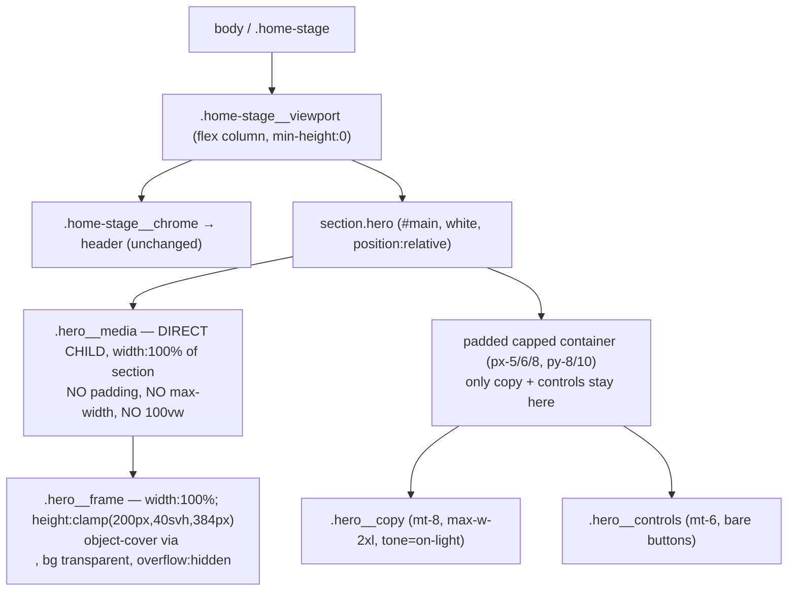

# Design Doc: DD-HOME-27 v0.4 — Banda full-bleed con altura natural, sin recorte (amends DD-HOME-24)

| Field | Value |
|---|---|
| **ID** | `DD-HOME-27`, version **v0.4 — ENMIENDA APROBADA EN DISEÑO** |
| **Author** | `forge-architect` (APEX FORGE) |
| **Status** | **Diseño v0.4 aprobado y ejecutado el 27-nov-2026, con LGTM de `forge-reviewer`; publicación bloqueada por `forge-sentinel`.** NO autoriza commit, push ni deploy. **§14 es la fuente de verdad para toda la geometría**; §1–§13 se conservan como registro histórico de v0.1–v0.3. El veto de `forge-sentinel` por marca BellSk y claims sigue vigente y no se reabre |
| **Date** | 2026-11-27 |
| **Decisor** | `apex-forge` (Comandante). Gatekeeper: `forge-reviewer`. Security: `forge-sentinel` (reuse of existing OK expected). QA/Release: `forge-qualis` + `forge-infra` |
| **Relationship** | **Amends** `DD-HOME-24` (`design-doc-home-slide-claro.md`), specifically C-HOME-07 / F-24-03 / F-24-04 and the N-24-02 boundary. It does **not** rewrite DD-HOME-22/22.5/23 and does not change the header workstream (DD-HOME-25/26) |
| **ADR** | [`ADR-HOME-27-01`](./adr/ADR-HOME-27-01.md) — escrito y aceptado por el Comandante: registra la inversión deliberada de `C-HOME-07` |
| **Scope of this deliverable** | Design only, including the v0.4 amendment. **No production code was written, no test was edited, no asset was changed and no commit/push/deploy was performed for v0.4.** The already executed v0.3 implementation and the header workstream changes (`SiteHeader.tsx`, `HeaderSearch.tsx`, header docs/tests) were left untouched |

---

> **⚠️ Nota de versión (v0.4).** El cliente pidió «Necesito que muestres todo el alto de la imagen, ya que la estás recortando» y eligió «Altura natural, ancho completo». **§14 manda sobre cualquier valor de altura, `object-fit`, visibilidad o densidad descrito en §1–§13.** Esas secciones se conservan como registro de lo que se diseñó y ejecutó en v0.3; no deben ejecutarse como geometría vigente.

## 0. Resumen ejecutivo (Español)

El cliente pidió lo contrario de lo que aprobamos hace horas en DD-HOME-24: **las fotos deben ocupar todo el ancho, sin marco**, con `object-cover`, y con el título y los controles **debajo, sobre blanco**. El cliente ya cerró que "todo el espacio" significa **100 % del ancho (borde a borde), pero con bloque compacto**: **no** pantalla completa (`no 100svh`). Este documento no reabre esas tres decisiones; las toma como input y propone cómo implementarlas.

**Decisión central:** convertir `.hero__frame` de un cuadrado centrado de ≤448 px en una **banda de ancho completo y altura compacta**, moviendo `.hero__media` para que sea hijo directo de `section.hero` (fuera del contenedor con `max-width` y `padding`). Se mantiene el mismo nodo DOM y el mismo nombre de clase para minimizar el cambio y hacer el rollback trivial. La altura propuesta es `clamp(200px, 40svh, 384px)`: **360 px a 900 px de alto** (frente a los 432 px actuales, −72 px / −17 %) y **325 px a 375×812**. El ancho pasa de 432 px a 1440 px en desktop.

**La nitidez se cerró con el cliente: alternativa C-2** (aceptar el límite y medirlo de verdad, no por la URL de `srcset`). El cliente también confirmó la altura propuesta (`clamp(200px, 40svh, 384px)`) y el encuadre centro (`object-position: center`, sin configuración por slide).

**Enmienda v0.3 — assets del cliente (§13).** Tras revisar los cuatro PNG que proporcionó, el cliente decidió **usarlos tal cual en lugar de los tres JPG cuadrados**: `hero_1` a `hero_4`, todos de 1018×376, con marca **BellSk** y texto incrustado. El carrusel pasa de tres a **cuatro slides**. Esto supera la decisión anterior de «mantener los assets»: se documenta el peaje real de nitidez (0,71 px de fuente por CSS px a 1440) y de recorte (solo 43 % del ancho visible en móvil), y exige visto bueno de `forge-sentinel` por marca/reclamos de terceros antes de publicar.

**Enmienda v0.4 — altura natural (§14).** El cliente pidió ver **todo el alto** de la imagen y eligió «Altura natural, ancho completo». La banda conserva todo el ancho del documento (sin CSS `width:100vw`), pero `.hero__frame` pasa de `height:clamp(200px,40svh,384px)` a `aspect-ratio:1018 / 376; height:auto`, y `<Image>` de `object-cover` a `object-contain`. Como la proporción del marco es exactamente la del bitmap, se ve el 100 % del ancho y del alto, sin bandas ni recorte; la altura se reserva antes de cargar la imagen y CLS sigue siendo 0. Peaje honesto: en escritorio la banda ya no es compacta (532 px a 1440) y el H1/CTA bajan; la densidad no mejora (0,71 px de fuente por px CSS a 1440). El veto de `forge-sentinel` por marca BellSk y claims no se reabre.

**No se ha escrito código, no se han editado tests, no se han tocado assets y no se ha versionado nada para v0.4.** El diseño está aprobado; la ejecución espera el GO de ejecución del Comandante.

---

## 1. Context and problem

### 1.1 Client request (verbatim intent)

> «Quiero que las imágenes del slide se ocupen todo el espacio, que no lleven marco. ¿Cómo podemos hacerlo? Idealo y presentame el plan.»

This contradicts approved DD-HOME-24 decisions. It must be recorded as an **explicit amendment**, not silently absorbed:

| DD-HOME-24 (approved 2026-11-27, C-HOME-07) | DD-HOME-27 (requested) |
|---|---|
| `object-contain`; whole photo, no crop | **`object-cover`**; crop to fill |
| Centred square frame, side ≤ 448 px, `--color-surface` background | **Full-width band (100 % of content width), no visible frame** |
| `sizes="(min-width: 640px) 448px, calc(100vw - 40px)"` | **`sizes="100vw"`** |
| Assets immutable (N-24-02); hashes approved (Q-HOME-05) | **Resuelta:** el cliente autorizó sustituirlos por los cuatro PNG de §13; C-27 queda cerrada con densidad 0,71 a 1440 |

### 1.2 Decisions the client already closed — INPUT, not reopened

1. **"Todo el espacio" = full viewport width, edge to edge (100 % width), with a compact block.** It is **not** full height (`not 100svh`). The slide must not become giant again.
2. **Fit = `object-cover`.** Crop the photo to fill; no side bands.
3. **Title and controls go below the photo, on white.** No veil/overlay on the image.

F-24-01 (no scrim), the `tone="on-light"` copy and the existing controls/autoplay state machine are therefore **preserved**, not renegotiated.

### 1.3 Verified current state (evidence in repo)

| Location | Verified fact |
|---|---|
| `components/HomeStage.tsx:122-141` | Padded, capped wrapper `mx-auto w-full max-w-[var(--content-max)] px-5 py-8 md:px-6 md:py-10 lg:px-8` contains `.hero__media > .hero__frame`; three `<Image fill ... className="object-contain" sizes="(min-width: 640px) 448px, calc(100vw - 40px)">`; wrappers `absolute inset-0 opacity-100/0` with `aria-hidden` on inactive slides |
| `components/HomeStage.tsx:146` | `.hero__copy mx-auto mt-8 max-w-2xl text-center` |
| `components/HomeStage.tsx:149-192` | Controls below copy on white; six buttons with exact accessible names; `[data-playback-toggle]` exemption intact |
| `components/HomeStage.tsx:117-120` | Pause handlers live on `section.hero` only — unchanged by this DD |
| `components/HomeStage.tsx:35-37` | `data-hydrated` marker — unchanged |
| `app/globals.css:81-109` | `.home-stage__viewport` flex column, `min-height:0`; `.home-stage__chrome` white, `flex:none`; `section.hero` `flex:none; min-height:0; position:relative; bg-white`; `.hero__frame` `width:min(100%,48svh,28rem); aspect-ratio:1/1; margin-inline:auto; bg-surface; overflow:hidden` |
| `app/globals.css:111+` | Global `prefers-reduced-motion` reset — unchanged |
| `components/Hero.tsx:14-48` | `HeroCopy` with `tone="on-light"` (ink text, accent-dark line, primary CTA) — retained |
| `lib/hero-slides.ts:1-27` | Three local immutable assets in v0.1/v0.2 (`hero-01.jpg` 1080×1080, `hero-02.jpg` 1080×1080, `hero-03-crema-hidratante.jpg` 1241×1241); `alt=""`; `isLocalSlidePath` allowlist. **SUPERSEDED by §13: four 1018×376 PNGs, four slides** |
| `app/page.tsx` | `heroCopy` arrives with `tone="on-light"`; skip link `#main` → `section.hero` (`HomeStage.tsx:113-121`); `<main id="contenido">` is a sibling (`:197-199`) |
| `package.json` | `next >=15.5.29 <16`, `react ^19` — current stack, no version change |
| `node_modules/next/dist/server/image-optimizer.js:871` | `withoutEnlargement: true` — the optimizer cannot add pixels to a source image |

### 1.4 Why now

The compact square solved "the slide is too tall", but the client experiences the white margin around the square as a *frame*. The requested change shifts the constraint from "show the whole photo" to "use the whole width". Correctness, not aesthetics, now hinges on (a) not introducing horizontal overflow, (b) keeping CLS at zero while the band geometry is reserved before load, and (c) being honest about source resolution.

---

## 2. Non-goals

| ID | Non-goal |
|---|---|
| N-27-01 | **No full-height hero.** No `100svh`/`100dvh` on the band or the section; the slide stays a compact block in normal flow. |
| N-27-02 | **No scrim / veil / gradient / translucent tint** over the photograph. F-24-01 and HOME-E2E-41 stay in force. |
| N-27-03 | **No new dependency, no client-side fetch, no new image library.** `next/image`, the local manifest and the allowlist remain the only pipeline. |
| N-27-04 | **No regeneration or re-encoding.** The client explicitly authorised *replacing* the three square JPGs with the four supplied PNGs (§13); N-24-02 is amended to that extent. No upsampling, no synthetic detail, no remote origin. |
| N-27-05 | **No change** to header, search/lupa workstream, autoplay timing, pause/hover/focus/reduce logic, skip link, accessible names, `alt=""`, or `<main id="contenido">`. |
| N-27-06 | **No test edits and no production code in this deliverable.** §7 is a proposal table only. |
| N-27-07 | **No commit, push, build, deploy or versioning** until `apex-forge` explicitly authorises it. |
| N-27-08 | No change to the stack: no major-version evaluation needed — no technology is added or upgraded. (Verified `next >=15.5.29 <16`, `react ^19`, Tailwind v4 in use.) |

---

## 3. Requirements and constraints

### 3.1 Functional

| ID | Requirement |
|---|---|
| F-27-01 | The photo band spans the full content width of the viewport (edge to edge), at **every** width 320…1440+. |
| F-27-02 | ~~The band is **compact in height**: `clamp(200px, 40svh, 384px)`, never `100svh`.~~ **SUPERSEDED by §14 (v0.4):** height must follow the bitmap ratio (`aspect-ratio:1018 / 376; height:auto`), so it is no longer compact on desktop and no longer depends on viewport height. Still never `100svh`. |
| F-27-02v4 | Full source visible: 100 % of width **and** height of each PNG, with the height reserved before load (CLS 0). Geometry table in §14.4. |
| F-27-03 | ~~`object-fit: cover`; no letterboxing/pillarboxing; no visible frame border or card background.~~ **Fit SUPERSEDED by §14 (v0.4): `object-contain`**; no letterboxing/pillarboxing occurs because the frame ratio equals the bitmap ratio. No visible frame border or card background is retained. |
| F-27-04 | Copy and controls stay below the band on `rgb(255,255,255)`, with gaps within the existing 0…96 px contract. |
| F-27-05 | Three slides, cross-fade via opacity, same active-index state machine, `aria-hidden` on inactive slides. |
| F-27-06 | Skip link still targets `#main` = `section.hero`; one H1, one CTA, six controls, `aria-current` unique. |

### 3.2 Non-functional

| ID | Requirement | Gate |
|---|---|---|
| NF-27-01 | **Zero horizontal overflow**: `document.documentElement.scrollWidth <= window.innerWidth` at all tested widths and after every slide change. No CSS `width:100vw` in layout. | HOME-E2E-34 + manual classic-scrollbar check |
| NF-27-02 | **CLS < 0.1**; band height reserved by CSS before image load. Δ rect and Δ `scrollHeight` ≤ 1 px across slide changes. | HOME-E2E-36, -44 |
| NF-27-03 | **LCP candidate** is hero-01 image or the approved H1; slide 01 keeps `priority` and emits exactly one slide preload. | HOME-E2E-39, -36 |
| NF-27-04 | **a11y**: axe 2.2 AA, 0 critical/serious; ink text ≥ 4.5:1, focus ≥ 3:1; `prefers-reduced-motion` respected. | HOME-E2E-13/-19/-27/-34/-43 + axe |
| NF-27-05 | **Bundle**: Home First Load JS ≤ **150,000 B gzip**; global chunks ≤ **300,000 B** (`scripts/check-bundle.mjs:17`). No new client code expected. | `npm run build` + `check:bundle` in CI |
| NF-27-06 | **Security/privacy**: local assets only, `/_next/image` optimiser, CSP unchanged, no PII, no new remote origin. | `forge-sentinel` reuse of existing OK |
| NF-27-07 | **Sharpness trade-off must be explicit.** If C-2 (keep assets) is chosen, the acceptance criteria must state the effective source density instead of pretending `w=3840` means 3840 real pixels. | §4.4 + HOME-E2E-42 revised |

### 3.3 Order of priority (per APEX FORGE rules)

1. **Correctness** — no overflow, no CLS, no broken focus/skip link.
2. **Maintainability** — one DOM node, two small file edits, trivial rollback.
3. **Performance** — reserved geometry, priority on slide 01, no extra JS.
4. **Delivery speed** — anything that requires new photography is a follow-up, not a blocker for the layout change.

---

## 4. Proposed solution

### 4.1 Architecture: one structural move, two value changes

> **SUPERSEDED by §14 (v0.4):** the structural move (media as direct child of `section.hero`, `width:100%`, no CSS `100vw`, §4.2) **stands**; the height and `object-fit` values in the diagram and sketch below are historical v0.3 geometry. The v0.4 geometry is `aspect-ratio:1018 / 376; height:auto` + `object-contain`.



Minimal interface sketch (declarative shape only — **not** an implementation to be committed):

```html
<section id="main" class="hero relative …">
  <div class="hero__media">          <!-- direct child: full content width -->
    <div class="hero__frame">        <!-- same class, new geometry -->
      … 3 × <Image fill sizes="100vw" class="object-cover" … />
    </div>
  </div>
  <div class="mx-auto w-full max-w-[var(--content-max)] px-5 py-8 md:px-6 md:py-10 lg:px-8">
    … .hero__copy, .hero__controls …
  </div>
</section>
```

**Why this wins:** it gets true edge-to-edge width from normal block layout (`width:100%` of `section.hero`, whose width is the document content width) rather than from a viewport unit. That single choice eliminates the desktop scrollbar overflow class of bugs and needs no `overflow-x:clip`. Keeping `.hero__frame` as the same DOM node means all existing selectors (`assertSharpFrame`, `readSlideMetrics`, HOME-E2E-41 overlay scan) still find the band; only their expected values change. Rollback is two value reversions plus moving the block back inside the wrapper.

### 4.2 Question A — How to achieve full bleed without `overflow-x`

Three options were evaluated with real geometry. 100 % width means the **document content width** (`document.documentElement.clientWidth`), which excludes a classic scrollbar. `100vw` means the **layout viewport width** (`window.innerWidth`), which **includes** it in Chromium desktop. That 15 px difference is the whole decision.

| Option | Mechanism | 320 | 375 | 768 | 1024 | 1440 | Scrollbar (15 px) at 1440 | Verdict |
|---|---|---|---|---|---|---|---|---|
| **(i) Media as direct child of `section.hero`** | Block fills parent content box; no padding, no cap | 320 | 375 | 768 | 1024 | 1440 | band = 1425 = `clientWidth`; **no overflow** | ✅ **RECOMMENDED** |
| (ii) `width:100vw; margin-left:calc(50% - 50vw)` inside padded container | Escapes container mathematically | 320 | 375 | 768 | 1024 | 1440 | `100vw` = 1440 while available = 1425 → band starts at −7.5, ends at 1432.5 → **15 px horizontal overflow**; needs `overflow-x:clip` on an ancestor | ❌ Reject |
| (iii) `-mx-5 md:-mx-6 lg:-mx-8` on `.hero__media` | Cancels the wrapper padding | 320 | 375 | 768 | 1024 | **1200 only** (container is capped by `--content-max:1200px`) | no overflow, but at ≥1200 it leaves 120 px gutters → **not full bleed** | ❌ Reject |

Notes on option (i):

- `.home-stage` / `.home-stage__viewport` / `section.hero` have no horizontal padding (verified in `app/globals.css`), so the band's left edge is `0` and right edge is `clientWidth`.
- `sizes="100vw"` is a **srcset hint**, not a layout declaration. It is safe to keep `100vw` there: over-requesting by ≤15 px is absorbed by Next's device-size rounding. The prohibited pattern is **CSS** `width:100vw`.
- Do **not** add `overflow-x:hidden/clip` to "fix" option (ii): it can clip focus rings and can mask real overflow from the E2E assertion.
- `heroTop == headerBottom ±1` is preserved because the band is the first child of the hero and the hero still has no viewport floor.

### 4.3 Question B — Compact band height

> **SUPERSEDED by §14 (v0.4).** The analysis, table and rejected variants below are kept as the historical record of the "compact block" decision. The current geometry is the natural-height band defined in §14, which is **not compact on desktop**; the full-bleed/no-`100vw` reasoning from §4.2 is unaffected.

**Proposal (historical v0.3): `height: clamp(200px, 40svh, 384px)`** on `.hero__frame`, with `width:100%`, `aspect-ratio:auto` (removed), `background-color:transparent` (the `--color-surface` matte disappears with `object-cover`), `margin-inline:0` and `overflow:hidden` retained.

| Viewport | Proposed band (W×H) | Current square side | Δ height | Share of viewport height | Visible share of square source (`H/W`) |
|---|---|---|---|---|---|
| 320×568 | 320×227 | ~273 | −46 | 40 % | 71 % |
| **375×812** | **375×325** | 335 | **−10** | 40 % | 87 % |
| 600×900 | 600×360 | 432 | −72 | 40 % | 60 % |
| **768×600** | **768×240** | 288 | **−48** | 40 % | 31 % |
| 768×900 | 768×360 | 432 | −72 | 40 % | 47 % |
| 1024×900 | 1024×360 | 432 | −72 | 40 % | 35 % |
| **1440×900** | **1440×360** | 432 | **−72** | 40 % | 25 % |
| 1440×1080 | 1440×384 (cap) | 448 (cap) | −64 | 36 % | 27 % |

**Justification.** The client explicitly rejected a giant slide but asked for the full width. At 900 px of viewport height the band is **360 px, 72 px (−17 %) shorter** than DD-HOME-24's 432 px square, while being 3.33× wider. On mobile (375×812) it is 325 px vs 335 px, so the compact feel is preserved; the actual crop depends on the source finally used (§4.4 for the old square assets, §13.3 for the four PNGs). `40svh` keeps the block proportional to the viewport on short screens; the 200 px floor avoids an unusably thin strip below ~500 px of height; the 384 px ceiling prevents it from growing on tall monitors. Because `height` is a fixed CSS value, the box is reserved on first paint → **CLS 0** without a fake clock. Copy + controls below still fit: at 375×812 the band ends around y≈377 (header ≈52) and the remaining ≈435 px cover copy, controls and padding.

**Rejected height variants:** `min(100svh, …)` violates N-27-01; a pure `aspect-ratio` band would couple height to width and grow past the compact ceiling at 1440; `48svh` (current value) keeps 432 px and does not answer the "not giant" constraint strongly enough at desktop.

### 4.4 Question C — Sharpness with square sources and `object-cover`

> **Historical analysis for the three original square JPGs — SUPERSEDED by §13.** The client later supplied four 1018×376 PNGs and chose them instead; the current numbers, inventory and crop table are in §13.2/§13.3. The reasoning about `withoutEnlargement` and the vacuous URL-based assertion still applies.

For a band `W×H` and a square source `S×S`, `scale = max(W/S, H/S)`. In every target case `W > H`, so `scale = W/S`, the image is drawn `W×W`, and the visible slice is `H/W` of the source height.

| Band | Source S | scale | Drawn size | Source px per CSS px (`S/W`) | DPR 1 | DPR 2 |
|---|---|---|---|---|---|---|
| 375×325 | 1080 | 0.347 | 375×375 | **2.88** | covered | covered |
| 600×360 | 1080 | 0.556 | 600×600 | 1.80 | covered | 1.11× upscale |
| 768×240 | 1080 | 0.711 | 768×768 | 1.41 | covered | 1.42× upscale |
| 1024×360 | 1080 | 0.948 | 1024×1024 | 1.06 | just covered | 1.90× upscale |
| **1440×360** | 1080 | **1.333** | **1440×1440** | **0.75** | **1.33× upscale** | **2.67× upscale** |
| 1440×360 | 1241 (slide 03) | 1.160 | 1440×1440 | 0.86 | 1.16× upscale | 2.32× upscale |

**Important correction to the test premise.** `assertSharpFrame` (`home-slide.spec.ts:250-299`) does **not** compare `naturalWidth` to `displayWidth × DPR`; it compares `sourceWidth`, which is the **`w` query parameter** of `currentSrc` (`:278-280`, `:297`). With `sizes="100vw"`, Next would request `w=1920` at 1440/DPR1 and `w=3840` at 1440/DPR2, so **the current assertion would pass** — but because `next/dist/server/image-optimizer.js:871` uses `withoutEnlargement: true`, the served bitmap is still 1080 px. The test would become vacuous. The design must therefore change the assertion deliberately, not let it pass by accident.

| Alternative | Pros | Cons | Verdict |
|---|---|---|---|
| **C-1 — Regenerate / replace derivatives at ≥2880 px wide** | Real detail on DPR2; keeps a meaningful sharpness test; best visual result | **Reverts N-24-02**; Q-HOME-05 hashes and `approvedSlides` fixtures change; needs new source photography (upsampling 1080 does not add detail); client authorisation and asset lead time | ❌ Not now; ✅ follow-up if client says "must be crisp" |
| **C-2 — Keep the chosen assets, relax and document the sharpness assertion** | Zero regeneration; reversible; ships now | Accepts blur on large screens; with the v0.3 PNGs the real density is 0,71 px/CSS px at 1440 DPR1 and 2,83× upscale at DPR2 (§13.3) | ✅ **ACEPTADA por el cliente; implementar con los PNG de §13** |
| **C-3 — Cap band width (`max-width`) to keep the scale ≤1** | Sharpness preserved | Directly contradicts the client's "ancho completo / borde a borde"; reintroduces the very frame being removed | ❌ Reject |

**C-2 acceptance wording (to be copied into the test comment, not into code now):** "DD-HOME-27 C-2: source-capped. Requested `w` may exceed the source; real density is source width / band width. With the v0.3 PNGs, at 1440 px DPR1 the band delivers 0,71 source px per CSS px; explicitly accepted by the client. Assertion verifies the real decoded bitmap width and records the effective density, not imaginary pixels from the `w` query."

### 4.5 Question D — `sizes` and `<Image>`

> **`className` row SUPERSEDED by §14 (v0.4): `object-contain`.** All other attributes remain valid: `fill`, `sizes="100vw"`, `priority` on slide 01, lazy 02–04, `decoding`, `alt=""`, local sources.

| Attribute | Current (DD-HOME-24) | Proposed (DD-HOME-27) | Rationale |
|---|---|---|---|
| `fill` | yes | **yes, unchanged** | Band reserves the box; image fills it and `object-cover` crops |
| `sizes` | `(min-width: 640px) 448px, calc(100vw - 40px)` | **`100vw`** | The displayed width is the content width, not a 448 px frame; `100vw` over-requests by at most one scrollbar width |
| `priority` | slide 01 only | **unchanged** | One slide preload; HOME-E2E-36 expects exactly one |
| `loading` | `undefined` / `'lazy'` | **unchanged** | 02/03 lazy |
| `decoding` | `'async'` | **unchanged** | No new behaviour |
| `alt` | `''` | **unchanged** | Decorative slides; N-22-02 still stands |
| `className` | `object-contain` | **`object-cover`** | Client decision 2 |
| `src` / allowlist | local manifest + `isLocalSlidePath` | **unchanged** | No remote origin; CSP untouched |
| new libs / fetch | none | **none** | N-27-03 |

### 4.6 What is conserved vs. reverted (explicit amendment ledger)

| DD-HOME-24 clause | Status in DD-HOME-27 | Note |
|---|---|---|
| F-24-01 no scrim, no tint, white hero | ✅ **Conserved** | HOME-E2E-41 unchanged |
| Square frame ≤448 px, `aspect-ratio:1/1`, `--color-surface` matte | ❌ **Reverted** | Client asked for no frame and full width |
| `object-contain` (whole photo) | ❌ **Reverted** | Client chose `object-cover` (crop accepted) |
| `sizes` adjusted to the square | ❌ **Reverted** | Now `100vw` |
| Copy + controls below, on white, ink text | ✅ **Conserved** | HOME-E2E-43 unchanged; only the measured gap value changes (still 0…96) |
| N-24-02 assets immutable, hashes approved | ⚠️ **Conditionally conserved** | Conserved under C-2 (recommended); reverted only if client authorises C-1 |
| Compact block, `flex:none`, `min-height:0`, no `100svh` | ✅ **Conserved and reinforced** | Height lowered from `48svh` to `40svh` |
| Autoplay 5 s, pause/hover/focus/reduce, skip link, ARIA names | ✅ **Conserved** | No state-machine edits |
| `data-hydrated` SSR marker | ✅ **Conserved** | Clock tests unaffected |

### 4.7 Why this design wins over "keep the square but stretch the image"

A pure CSS tweak (`object-cover` inside the existing square) would satisfy the fit but **not** "todo el espacio" — the photo would remain 432 px wide with white gutters, which is precisely the complaint. A pure width tweak without moving the node (option ii/iii) fails either the scrollbar or the `max-width` cap. The proposed pair — structural move + fixed height — is the smallest change that satisfies all three closed client decisions simultaneously.

---

## 5. Alternatives evaluated

| # | Alternative | Pros | Cons | Why rejected |
|---|---|---|---|---|
| A1 | Keep DD-HOME-24 square, only change `object-fit` | One-line change; zero test churn | Does not remove the frame or the gutters; client explicitly rejected it | Fails client decision 1 |
| A2 | Full-bleed **and** full-height (`100svh`) hero | Maximum "todo el espacio" | Reintroduces the giant slide the client just removed; copy/controls would overlay or push below fold; contradicts N-27-01 | Fails client decision 1 and DD-HOME-24's compact-block rationale |
| A3 | `width:100vw; margin-left:calc(50% - 50vw)` | No JSX restructure | 15 px horizontal overflow with classic scrollbar; would need `overflow-x:clip` that can hide bugs and clip focus | NF-27-01 |
| A4 | Negative margins `-mx-5/6/8` | Pure Tailwind, no CSS edit | Capped at 1200 px → 120 px gutters at 1440; not borde a borde | Fails F-27-01 at desktop |
| A5 | **Direct child media + `clamp()` height** | True full width, no viewport unit, CLS 0, minimal DOM change, trivial rollback | Requires moving a JSX block and rewriting geometry assertions | ✅ **Chosen** |
| C1/C2/C3 | Sharpness options | See §4.4 | See §4.4 | C-2 recommended; C-1 deferred; C-3 rejected |
| T1 | Delete the sharpness assertion entirely | Fastest | Removes a QA guard and hides a real visual trade-off | Rejected: C-2 keeps a documented, source-capped assertion |

---

## 6. Risks and mitigations

| ID | Risk | Impact | Mitigation |
|---|---|---|---|
| R-27-01 | Desktop scrollbar: CSS `100vw` sneaks into layout | Horizontal overflow, fails NF-27-01 | Option (i) uses `width:100%` of the section; add an explicit assertion that no `100vw` appears in a layout declaration; manual check at 1440 with classic scrollbar |
| R-27-02 | Heavy crop cuts the product/subject (only 25 % of photo height visible at 1440×360) | Visual defect not caught by geometry tests | Visual review at 375/768/1440 before merge; `object-position` is an **open question** (Q-27-D); default remains `center center` |
| R-27-03 | Blur on large/HiDPI screens | Perceived quality regression | C-2 documented in acceptance criteria; C-1 offered as authorised follow-up; HOME-E2E-42 rewritten so it cannot pass vacuously |
| R-27-04 | Copy/controls pushed below fold on short viewports | Usability | 200 px floor; verify 768×600 and 320×568 manually; existing 0…96 px gap contract retained |
| R-27-05 | CLS or slide-to-slide jump | Fails NF-27-02 | Fixed `height` on `.hero__frame`; assets unchanged; HOME-E2E-36/-44 gates |
| R-27-06 | Focus / skip-link regression when moving DOM | a11y failure | Only the media block moves; `section.hero`, `#main`, handlers and control order untouched; HOME-E2E-13/-19/-27 + skip link + axe gates |
| R-27-07 | Test churn masks a real regression | False green | §7 table reviewed by `forge-qualis`; new HOME-E2E-55 proves the full-bleed contract explicitly, not just the absence of the old square |
| R-27-08 | Contradiction with approved DD-HOME-24 left undocumented | Governance defect | §4.6 ledger + `ADR-HOME-27-01` decision recorded by the Comandante before implementation |
| R-27-09 | Existing uncommitted header workstream changes are swept into this change | Scope creep | Work only in `HomeStage.tsx`, `globals.css`, the two e2e specs and this doc; do not stage unrelated files |

---

## 7. Testing strategy (proposal only — NO test files were edited)

Owner of strategy: `forge-qualis`. Implementer of tests: the engineer who builds the change (Fase 3/4), **after** this DD is approved.

### 7.1 Exact impact table

| File : lines | Test ID | Current assertion | Proposed newValue / action |
|---|---|---|---|
| `tests/e2e/home-slide.spec.ts:10` | constant `SIZES` | `'(min-width: 640px) 448px, calc(100vw - 40px)'` | `'100vw'` |
| `home-slide.spec.ts:250-299` | `assertSharpFrame(expectedSide)` | frame square; `objectFit==='contain'`; `naturalWidth===naturalHeight`; `sourceWidth ≥ ceil(displayWidth*dpr)` | Rename to `assertSharpBand(page, {width,height})`; assert `width/height` from §4.3 table, `objectFit==='cover'`, `frame.left===0 && frame.right===clientWidth±1`; drop aspect-ratio assertion; keep square-source provenance only in HOME-E2E-38; sharpness per C-2 (source-capped comment) or C-1 if client authorises |
| `home-slide.spec.ts:539-632` | **HOME-E2E-34** | `frameSide` 335@375×812, 432@900-high, 288@768×600; 10 cases; overlap 0; 0 overflow; touch 375/767 | Keep 10 cases, replace `frameSide` with `(width,height)`: 375×812→(375,325); 600×900→(600,360); 767×900→(767,360); 768×900→(768,360); 820×900→(820,360); 900×900→(900,360); 1023×900→(1023,360); 1024×900→(1024,360); 1440×900→(1440,360); 768×600→(768,240). Keep `heroTop==headerBottom±1`, `overlap===0`, flex/`min-height:0`/`flexGrow:0`, overflow check, touch cases |
| `home-slide.spec.ts:730-795` | **HOME-E2E-36** | `expect(sizes).toBe(SIZES)`; AVIF/WebP; exactly 1 slide preload; lazy 02/03; CLS<0.1 | Change `SIZES` to `100vw` and extend lazy list to 02/03/**04**; **keep** all other assertions including CLS < 0.1 |
| `home-slide.spec.ts:797-821` | **HOME-E2E-38** | sha256 of the three assets equals approved fixtures | **Changed by v0.3:** update `approvedSlides` to the sha256 of the four PNGs and re-approve provenance; BellSk brand/claims are gated by `forge-sentinel` before release |
| `home-slide.spec.ts:823-850` | **HOME-E2E-39** | LCP = hero-01 IMG or approved H1 | **Unchanged**; record p75 LCP manually because the priority image is now larger; no new hard threshold |
| `home-slide.spec.ts:888-936` | **HOME-E2E-41** | 0 `.hero__scrim`, no gradient/rgba over photo, hero white | **Unchanged** — the band has transparent/white background and no overlays |
| `home-slide.spec.ts:938-962` | **HOME-E2E-42** (DPR1) | `contain`, square, enough pixels, 10 cases | `cover`, band table from §4.3; sharpness assertion → source-capped variant (C-2) or full (C-1) |
| `home-slide.spec.ts:963-977` | **HOME-E2E-42** (DPR2) | same at 375 and 1440 | Same; add explicit comment that DPR2 at 1440 is 2,83× upscaled with the v0.3 PNGs and accepted under C-2 |
| `home-slide.spec.ts:979-1048` | **HOME-E2E-43** | `copy.top ≥ frame.bottom`, `controls.top ≥ copy.bottom`, gaps 0…96, ink colours | **Assertions unchanged.** Expected measured gap frame→copy becomes ≈64 px (32 px `py-8` + 32 px `mt-8`); still within 0…96 |
| `home-slide.spec.ts:1050-1092` | **HOME-E2E-44** | Δ rect ≤1 px, Δ scrollHeight ≤1 px, shifts ≤0.02 / CLS <0.1 | **Unchanged** — fixed CSS height keeps it valid |
| `tests/e2e/home.spec.ts:99-106` | skip link | first focusable → `#main` | **Unchanged** — `section.hero` keeps `id="main"` |
| `home.spec.ts:118+`, `:342`, `:537`, `:669`, `:197-210` | HOME-E2E-29/-13/-19/-27 + axe | structure, focus pairs, contrast, AA | **Unchanged** — no text/colour/control changes |
| `home.spec.ts:367-374` | HOME-E2E-13 surface whitelist | includes `rgb(247,245,238)`, `rgb(255,255,255)`, `rgb(238,244,241)` | **Unchanged** — white already allowed; removing the matte introduces no new light surface |
| **NEW** | **HOME-E2E-54** (required under C-2/v0.3) | — | Source-cap sharpness: fetch `/_next/image?url=…&w=3840&q=75`, decode response in Node, assert real width ≤1018 for each of the four PNGs and record effective density (0,71 at 1440); prevents the URL-based assertion from lying |
| **NEW** | **HOME-E2E-55** | — | Full-bleed contract: at 320/375/768/1024/1440, `frame.left===0`, `frame.right===document.documentElement.clientWidth±1`, `frame.width===clientWidth`, no horizontal overflow, and no `width:100vw` in served CSS layout rules |

### 7.2 Manual verification / geometry

- Browser DevTools at 1440×900 and 375×812: measure band `getBoundingClientRect()` against `document.documentElement.clientWidth`.
- Force a classic scrollbar (desktop Chromium) and confirm no horizontal scrollbar appears.
- Visual review of the crop at 375/768/1440; confirm the subject is not decapitated (drives Q-27-D).
- Keyboard pass: skip link → header → hero controls; focus ring visible on white.
- `prefers-reduced-motion: reduce`: no autoplay; toggle still works.
- Pause on hover/focus and the `[data-playback-toggle]` exemption unchanged.

### 7.3 QA gates (Fase 8)

1. `npm run lint` → 0 errors.
2. `npm run typecheck` → 0 errors.
3. `npm run test` + `npm run test:integration` → green, no coverage drop.
4. `npm run test:e2e:smoke` → HOME-E2E-27/-29/-30/-34/-36/-37/-38/-40/-41/-42/-43/-44 + new -45/-46.
5. `npm run test:a11y` → axe 0 critical/serious.
6. `npm run test:e2e` full + `test:e2e:dynamic` with `retries: 0`.
7. `npm run build` + `check:bundle` in the dedicated CI job → Home ≤150,000 B gzip, global ≤300,000 B.
8. `forge-reviewer` LGTM; `forge-sentinel` OK reused (no data/auth/secret change); `forge-qualis` + `forge-infra` GO; `apex-forge` authorises commit/push/deploy.

---

## 8. Rollout and rollback

**Rollout.** Static Vercel preview → visual/geometry review by the client on the preview URL → canary by percentage of traffic if the platform configuration supports it, otherwise preview-only promotion → full promotion after 24 h with no layout/CLS/console regressions. Monitor: CLS p75, LCP p75, horizontal-overflow telemetry if available, support tickets about "foto cortada/desenfocada". No feature flag is required: the change is a pure layout swap and can be reverted by redeploy.

**Rollback (trivial, <30 min including CI).** Revert the two production files to DD-HOME-24 values:

1. `components/HomeStage.tsx`: move `.hero__media` back inside the padded container; `className="object-contain"`; `sizes="(min-width: 640px) 448px, calc(100vw - 40px)"`.
2. `app/globals.css`: `.hero__frame { width:min(100%,48svh,28rem); aspect-ratio:1/1; margin-inline:auto; background-color:var(--color-surface); overflow:hidden }`.
3. Revert the test updates to §7.1's "current" column; run the full gate list; redeploy.

Assets, autoplay, copy, controls and header are untouched by both directions, so rollback cannot affect them. If C-1 was authorised and new assets shipped, keep the new files (additive) and revert only the layout — the old hashes remain in fixtures.

---

## 9. Success metrics

| Metric | Target | Source |
|---|---|---|
| Band geometry | `left===0`, `right===clientWidth±1` at 320/375/768/1024/1440 | HOME-E2E-55, `getBoundingClientRect()` |
| Band height | 325 px @375×812, 360 px @900-high, 240 px @768×600 (±1 px) | HOME-E2E-34/-42 |
| Compactness | Band height ≤ 40 % of viewport height; never `100svh` | CSS review + geometry test |
| Overflow | 0 horizontal overflow at all widths and after each slide change | HOME-E2E-34 |
| CLS | < 0.1; Δ rect ≤1 px across slides | HOME-E2E-36/-44 |
| LCP | Candidate = hero-01 or approved H1; no degradation > 10 % vs baseline (recorded, not gated) | HOME-E2E-39 |
| Sharpness | C-2: effective density `S/W` documented and accepted (0.75 @1440 DPR1); C-1: `S ≥ ceil(W·DPR)` | HOME-E2E-42/-45 |
| a11y | axe 2.2 AA 0 critical/serious; skip link and focus unchanged | `home.spec.ts`, axe |
| Bundle | ≤150,000 B gzip Home; ≤300,000 B global | `check:bundle` |
| Governance | `ADR-HOME-27-01` records the reversal of C-HOME-07 before merge | Doc review |

---

## 10. Decision log

| ID | Decisión | Owner | Estado |
|---|---|---|---|
| **Q-27-C** | ¿Regenerar fotos ≥2880 px o mantenerlas y documentar el límite? | Cliente | **RESUELTA 27-nov-2026: C-2.** No regenerar; aceptar el límite y medirlo con HOME-E2E-54. En v0.3 el cliente además sustituyó los tres JPG por sus cuatro PNG (§13), con densidad real 0,71 a 1440 |
| Q-27-D | ¿Ajustar `object-position` para favorecer el producto? | Cliente | **RESUELTA: centro.** `object-position: center`, sin configuración por slide |
| Q-27-E | ¿Confirmar 360 px a 900 px de alto como bloque compacto? | Cliente | **RESUELTA: sí.** `clamp(200px, 40svh, 384px)` |
| Q-27-A | Enmienda explícita a `C-HOME-07` y ADR | `apex-forge` | **RESUELTA: sí.** `ADR-HOME-27-01` escrito y aceptado |
| Q-27-T | ¿Acepta QA la aserción de nitidez *source-capped*? | `forge-qualis` | Abierta para la Fase 4; el criterio ya está redactado en §4.4 y no bloquea el diseño |

---

## 11. Implementation plan (small steps, exact files, ordered)

| Step | File(s) | Change | Gate |
|---|---|---|---|
| 0 | This doc + `docs/02-arquitectura/adr/ADR-HOME-27-01.md` | Done: design closed, amendment recorded, client decisions logged | **Pendiente: GO del cliente para iniciar Fase 2** |
| 1 | `app/globals.css` (`:102-109`) | `.hero__frame`: `width:100%`, `height:clamp(200px,40svh,384px)`, remove `aspect-ratio` and `--color-surface`, `margin-inline:0`, keep `overflow:hidden` | `npm run lint`, visual check |
| 2 | `components/HomeStage.tsx` (`:122-146`) | Move `.hero__media` to direct child of `section.hero`; keep padded wrapper for copy/controls only; `object-cover`; `sizes="100vw"`; no other prop/handler changes | `npm run typecheck`, HOME-E2E-36 |
| 2b | `public/slides/hero-{1,2,3,4}.png`, `lib/hero-slides.ts` | Copy the four supplied PNGs unchanged; extend `HeroSlide` id/src unions, manifest and allowlist to four slides (§13.4); old JPGs stay for rollback | `tests/unit/hero-slides.test.ts`, HOME-E2E-38 hashes |
| 3 | `tests/e2e/home-slide.spec.ts`, `tests/e2e/home.spec.ts`, `tests/unit/hero-slides.test.ts` | Apply §7.1 table plus §13.4 (3→4 slides); add HOME-E2E-54 and HOME-E2E-55 | CI smoke + a11y + full e2e |
| 4 | All | QA gates §7.3; **`forge-sentinel` + content/legal OK sobre marca BellSk y reclamos (bloquea publicación)**; `forge-reviewer` LGTM; `forge-qualis` + `forge-infra` GO | Release approval |
| 5 | Vercel | Preview → client review → canary/full promotion; monitor CLS/LCP/overflow | Rollback drill ready |

**Estimation:** **3 Fibonacci points, ≈6–8 h** (≈1 h CSS+JSX, ≈0,5 h asset copy/manifest, ≈3–4 h test updates incl. two new tests and 3→4 slide churn, ≈2 h gates/review/rollback drill). Assumes C-2 and the supplied PNGs (step 2b); regenerating photography would be a separate follow-up.

**Explicit prohibitions for this draft:** no production code, no test edits, no commit, no push, no deploy. This task only produced documentation: this Design Doc, `ADR-HOME-27-01` and the C-HOME-27 entry in `decisiones-comandante.md`.

---

## 12. Architect's verdict

**v0.2 — DISEÑO CERRADO, SIN CÓDIGO.** El diseño satisface las decisiones cerradas por el cliente con un cambio de producción en dos archivos, conserva todos los contratos no visuales aprobados (sin velo, bloque compacto, texto abajo, autoplay, a11y, assets locales) y deja explícito y reversible el único peaje honesto: la nitidez en pantallas grandes. El ADR que registra la inversión de `C-HOME-07` ya existe. Falta únicamente el **GO del cliente** para entrar en Fase 2; el arquitecto no ha ejecutado tests, builds ni versionado nada.

---

## 13. Enmienda v0.3 — assets proporcionados por el cliente (SUPERA §4.4/§7)

### 13.1 Decisión del cliente

El cliente revisó los cuatro PNG que él mismo proporcionó y decidió: **usarlos tal cual, en lugar de los tres JPG cuadrados**, y **usar los cuatro** en el carrusel. No se regeneran ni se re-encodean; se sustituyen. Esta sección es la fuente de verdad para todo lo relacionado con assets.

### 13.2 Inventario verificado

| Archivo entregado | Dimensiones | Peso | Contenido detectado por OCR | Destino propuesto |
|---|---:|---:|---|---|
| `hero_1.png` | 1018×376 (2,707:1) | 578 KB | «EYES CONTOUR / DARK CIRCLE», «YOUTH AND BEAUTY», marca BellSk | `/slides/hero-1.png` → slide 01 |
| `hero_2.png` | 1018×376 | 508 KB | «Cuida tu piel, controla el brillo y luce radiante», marca BellSk | `/slides/hero-2.png` → slide 02 |
| `hero_3.png` | 1018×376 | 530 KB | «Lápiz antiacné», «Tea Tree Oil», «reduce espinillas / previene brotes» | `/slides/hero-3.png` → slide 03 |
| `hero_4.png` | 1018×376 | 486 KB | «LA MAGIA DE LA METALTERAPIA», «oro y plata revitalizan», marca BellSk | `/slides/hero-4.png` → slide 04 |

No son derivados de los assets anteriores: la distancia de hash perceptual entre cada PNG y cada JPG aprobado está entre 95 y 141 sobre 256 bits (azar ≈ 128). Los tres JPG cuadrados quedan fuera del manifiesto; no se borran del repositorio en este cambio para mantener el rollback.

### 13.3 Geometría real de los PNG en la banda

> **La tabla de peajes de v0.3 queda SUPERADA por §14.4 (v0.4).** Se conserva como registro histórico la fórmula `scale = max(W/1018, H/376)` con `object-cover`, que recortaba el exceso: a 1440 se veía solo el 68 % de la altura y en móvil el 43–52 % del ancho. Ese es precisamente el recorte que el cliente acaba de rechazar. **Fuente de verdad para geometría: §14.**

Con v0.4, el marco tiene la misma proporción que el bitmap, por lo que `object-contain` escala con `scale = W/1018`, dibuja `1018×scale` por `376×scale` y **no recorta ni deja bandas**. La altura es `W × 376 / 1018` (redondeo CSS, ±1 px), independiente de la altura del viewport.

| Viewport | Banda (W×H) | Escala | Ancho visible | Alto visible | Densidad real (px fuente / px CSS) |
|---|---|---:|---:|---:|---:|
| 320 | 320×118 | 0,314 | 100 % | 100 % | 3,18 |
| 375 | 375×139 | 0,368 | 100 % | 100 % | 2,71 |
| 600 | 600×222 | 0,589 | 100 % | 100 % | 1,70 |
| 767 | 767×283 | 0,753 | 100 % | 100 % | 1,33 |
| 768 | 768×284 | 0,754 | 100 % | 100 % | 1,33 |
| 820 | 820×303 | 0,806 | 100 % | 100 % | 1,24 |
| 900 | 900×332 | 0,884 | 100 % | 100 % | 1,13 |
| 1023 | 1023×378 | 1,005 | 100 % | 100 % | 1,00 |
| 1024 | 1024×378 | 1,006 | 100 % | 100 % | 0,99 |
| 1440 | 1440×532 | 1,415 | 100 % | 100 % | **0,71** |

La densidad real **no cambia** respecto a v0.3: a 1440 se escala 1,415× (2,83× en DPR 2) con 0,71 px de fuente por px CSS. HOME-E2E-54 sigue midiendo esa densidad real del bitmap servido, no el parámetro `w`. Lo que cambia es la visibilidad: ahora se ve el 100 % de ambos ejes. El peaje ya no es el recorte, sino la altura en escritorio (§14.4).

### 13.4 Cambios de contrato derivados

> **Filas SUPERADAS por §14 (v0.4):** `app/globals.css` (geometría del marco), `components/HomeStage.tsx` (`object-fit`) y `tests` (expectativas de altura/visible). El inventario de assets, `alt=""`, la marca/reclamos y el veto de `forge-sentinel` **no se superan ni se reabren**. Las filas de abajo ya reflejan el estado v0.4.

| Archivo | Cambio |
|---|---|
| `public/slides/hero-{1,2,3,4}.png` | Copiar los cuatro PNG desde la raíz; sin re-encode. Mantener los JPG antiguos solo para rollback |
| `lib/hero-slides.ts` | `HeroSlide['id']` pasa a `'slide-01'…'slide-04'`; `src` a las cuatro rutas PNG; `heroSlides` tiene cuatro entradas; `isLocalSlidePath` sigue válido (`/slides/`, sin `://` ni `/Imagenes/`) |
| `app/globals.css` | `.hero__frame`: `width:100%` y `overflow:hidden` se conservan; `height:clamp(200px,40svh,384px)` → **`aspect-ratio:1018 / 376; height:auto`**. Sin `width:100vw` (§4.2 sigue vigente) |
| `components/HomeStage.tsx` | `.hero__media` pasa a hijo directo de `section.hero`; el contenedor con padding envuelve solo copia y controles. `Image` usa `sizes="100vw"`, `fill` y **`object-contain`** (antes `object-cover`); `object-position:center`, `alt=""`, handlers de pausa, `data-hydrated`, `#main` y `<main id="contenido">` intactos |
| `alt` | Se mantiene `alt=""` para no inventar copia ni duplicar el H1/CTA. **Riesgo conocido registrado:** el texto incrustado queda fuera del árbol accesible; `forge-qualis` aceptó `QA-EXC-27-01` condicionadamente y `forge-sentinel` mantiene el veto de publicación hasta resolver marca y claims |
| Marca y reclamos | Los PNG muestran **BellSk** y reclamos de salud/belleza de terceros. `forge-sentinel` + revisión de contenido/legal deben aprobarlos **antes de merge**; es un bloqueador de publicación, no de implementación |
| Tests | Pasar de 3 a 4 slides en `tests/unit/hero-slides.test.ts`, `tests/e2e/home-slide.spec.ts` (HOME-E2E-36/38/39, puntos, `aria-current`, ciclo 1→2→3→4→1, HOME-E2E-44) y `tests/e2e/home.spec.ts` si hay aserciones de conteo; actualizar hashes de `approvedSlides` en HOME-E2E-38. **En v0.4, además, sustituir las alturas esperadas por §14.4, `objectFit==='contain'`, visibilidad 100 %/100 % y el desplazamiento del H1/CTA; HOME-E2E-54 sigue midiendo la misma densidad 0,71 a 1440.** |

### 13.5 Rollback

Revertir los dos cambios de layout (§4.1) y restaurar el manifiesto de tres JPG cuadrados con `object-contain` devuelve exactamente DD-HOME-24. Los cuatro PNG son aditivos: pueden permanecer en `public/slides/` sin efecto mientras no estén en el manifiesto. **Para la enmienda v0.4, el rollback inmediato es volver a la geometría v0.3 (`clamp` + `cover`); ver §14.6.**

### 13.6 Estado (27-nov-2026)

> **Estado v0.3 — registro histórico (SUPERADO por §14.7).** GO de implementación recibido («ejecuta el plan») y ejecutado. Lint, typecheck, 68/68 tests unitarios, 107/107 E2E (`retries: 0`), build y `check:bundle` en verde. `forge-reviewer` dio **LGTM**; `forge-qualis` y `forge-infra` dieron **GO técnico condicionado**; `forge-qualis` registró `QA-EXC-27-01` para el texto incrustado fuera del árbol accesible. `forge-sentinel` mantiene **BLOQUEAR PUBLICACIÓN** por la marca BellSk y los claims incrustados: hacen falta licencia escrita del titular (alcance, plazo y territorio) o sustitución por marca propia, y evidencia/reformulación/retirada de los claims bloqueantes. Ese **LGTM y ese veto se referían exclusivamente a la implementación v0.3** (banda `clamp(200px,40svh,384px)` + `object-cover`); no cubren la geometría v0.3→v0.4 de §14.

**Estado actual v0.4.** Enmienda **aprobada, ejecutada y revisada** el 27-nov-2026. Se cambiaron `app/globals.css`, `components/HomeStage.tsx` y los tests de geometría; lint, typecheck, 68/68 unitarios, **110/110 E2E** (`retries: 0`), build y `check:bundle` en verde (Home 110.851 B gzip / 150.000 B; total 258.984 / 300.000). `forge-reviewer` dio **LGTM v0.4** sin bloqueantes y `forge-qualis` reconfirmó su GO técnico condicionado; `QA-EXC-27-01` sigue válida porque los PNG son idénticos. **No hay autorización para commit, push ni deploy.** El veto de `forge-sentinel` y `QA-EXC-27-01` **siguen vigentes y no se reabren**: este cambio es solo geometría sobre los mismos cuatro PNG byte-for-byte, por lo que la marca y los claims —ahora totalmente visibles— requieren las mismas condiciones de release. Rollback v0.4: revertir `app/globals.css` y `components/HomeStage.tsx` a los valores v0.3 (`clamp(200px,40svh,384px)` + `object-cover`) y, si se quiere llegar a DD-HOME-24, conservar los tres JPG y revertir además `lib/hero-slides.ts` y tests. Si se versiona, incluir los ocho PNG (raíz y `public/slides/`) porque los tests usan la raíz como fixture.

---

## 14. Enmienda v0.4 — altura natural, sin recorte

### 14.1 Pedido del cliente y decisión del Comandante

> «Necesito que muestres todo el alto de la imagen, ya que la estás recortando».

Ante la pregunta de cómo hacerlo, el cliente eligió **«Altura natural, ancho completo»**. El Comandante aprueba en diseño la geometría descrita abajo. **Esta sección es la fuente de verdad para geometría a partir de v0.4**; las secciones 1–13 se conservan como registro histórico de v0.1–v0.3, no como instrucción a ejecutar. No se reabre la decisión de usar los cuatro PNG del cliente: son los mismos archivos byte-for-byte y el veto legal sobre ellos permanece.

La decisión protege los dos contratos que el cliente no ha cambiado: **la banda sigue ocupando todo el ancho disponible del documento** y **no se introduce CSS `width:100vw`**. La solución de overflow de §4.2 (`.hero__media` como hijo directo de `section.hero`, `width:100%` del contenido, sin scrollbar de 15 px) queda intacta.

### 14.2 Secciones que esta enmienda supera

| Sección v0.3 | Estado en v0.4 | Fuente vigente |
|---|---|---|
| §4.1 (diagrama y sketch: `height:clamp(200px,40svh,384px)` + `object-cover`) | **Superada en geometría.** Se conserva el movimiento estructural del nodo y todo §4.2 | §14.3 |
| §4.3 (banda «compacta» `clamp(200px,40svh,384px)`, tabla y justificación por `svh`) | **Superada.** La altura ya no depende del viewport | §14.3, §14.4 |
| F-27-02 (§3.1, altura compacta) y F-27-03 en lo relativo a `object-cover` | **Superadas**; se añade F-27-02v4 (visibilidad 100 % y altura reservada) | §3.1, §14.3 |
| Tabla de peajes de §13.3 (68 % de alto visible a 1440, 43–52 % de ancho en móvil) | **Superada.** Esos porcentajes describen exactamente el recorte rechazado | §13.3 actualizada, §14.4 |
| Filas de §13.4 para `app/globals.css`, `components/HomeStage.tsx` y tests | **Superadas** en geometría, `object-fit` y expectativas numéricas | §13.4 actualizada, §14.3, §14.5 |
| §13.6 (estado v0.3 ejecutado; LGTM y veto referidos a esa implementación) | **Superado como estado actual**; conservado como histórico | §13.6 actualizada, §14.6 |
| §5 (A5), §6 (R-27-02/-04/-05), §7.1, §9 y pasos 1–3 de §11 | **Superados** donde citen alturas `clamp`, `cover` o recorte | §14.4, §14.5 |

**No se supera nada de:** §4.2, N-27-02 (sin velo), NF-27-01/02/04, inventario y proveniencia de §13.1/§13.2, `alt=""`, `QA-EXC-27-01` ni el veto de `forge-sentinel` por BellSk/claims.

### 14.3 Decisión técnica y por qué gana

- **Marco:** `.hero__frame` pasa de `height:clamp(200px,40svh,384px)` a **`aspect-ratio: 1018 / 376; height:auto`**. Conserva `width:100%`, `overflow:hidden`, `margin-inline:0` y fondo transparente. La proporción `1018:376` es la del bitmap, así que el navegador reserva la altura **antes** de cargar la imagen: **CLS sigue siendo 0**, sin reloj falso ni salto entre slides.
- **Ajuste:** `<Image>` pasa de `object-cover` a **`object-contain`**. Como la proporción del marco es exactamente la del bitmap, `contain` llena el marco sin bandas y sin recorte. `cover` produciría los mismos píxeles en este caso, pero **expresa la intención contraria** («recortar para llenar») y fallaría silenciosamente si algún día cambiara la proporción del asset; `contain` garantiza el pedido del cliente por construcción.
- **Invariantes:** `fill`, `sizes="100vw"`, `object-position:center`, `alt=""`, `priority` en el slide 01, lazy en 02–04, los cuatro PNG byte-for-byte, el ciclo 1→2→3→4→1, el texto y los controles debajo sobre blanco, los handlers de pausa, `data-hydrated`, `#main` y `<main id="contenido">` **no cambian**. No se añaden dependencias, fetch ni JS de cliente.

**Por qué gana:** es el cambio más pequeño que elimina el recorte sin tocar el ancho ni el pipeline de imágenes; mantiene un solo nodo DOM y selectores existentes; la altura se resuelve en CSS puro con CLS 0; y la reversión es de dos valores. Las alternativas se documentan en §14.5.

### 14.4 Alturas, visibilidad y densidad resultantes

`height = ancho × 376 / 1018` (redondeo CSS, ±1 px). La altura **ya no depende de la altura del viewport**: 768×600 daba 240 px en v0.3 y ahora da 284 px.

| Ancho de viewport | Altura de la banda | Ancho visible | Alto visible | Densidad real (px fuente / px CSS) |
|---:|---:|---:|---:|---:|
| 320 | 118 px | 100 % | 100 % | 3,18 |
| 375 | 139 px | 100 % | 100 % | 2,71 |
| 600 | 222 px | 100 % | 100 % | 1,70 |
| 767 | 283 px | 100 % | 100 % | 1,33 |
| 768 | 284 px | 100 % | 100 % | 1,33 |
| 820 | 303 px | 100 % | 100 % | 1,24 |
| 900 | 332 px | 100 % | 100 % | 1,13 |
| 1023 | 378 px | 100 % | 100 % | 1,00 |
| 1024 | 378 px | 100 % | 100 % | 0,99 |
| 1440 | 532 px | 100 % | 100 % | **0,71** |

La densidad real **no mejora ni empeora**: a 1440 la imagen se dibuja 1440×532 con escala 1,415×, es decir **0,71 px de fuente por px CSS** (2,83× en DPR 2). HOME-E2E-54 sigue midiendo exactamente eso. Lo que cambia es la visibilidad: antes se veía el **68 % de la altura a 1440** y el **43–52 % del ancho en móvil**; ahora se ve el **100 % de ambos ejes**.

**Peajes nuevos, documentados con honestidad y aceptados por el Comandante:**

1. La banda **deja de ser «compacta» en escritorio**: 532 px a 1440 son 172 px más que los 360 px de v0.3 y 100 px más que el cuadrado de 432 px de DD-HOME-24. El H1 y el CTA bajan; en viewports cortos como 768×600 (284 px) hay que verificar manualmente que copia y controles sigan legibles sin solape.
2. En móvil la banda es **más baja**: 139 px a 375 frente a 325 px de v0.3 (–186 px). Es la consecuencia directa de mostrar el bitmap completo sin recortar.
3. El texto incrustado queda ahora **totalmente visible**, incluidos marca y claims. Eso no cura el riesgo legal: `forge-sentinel` mantiene **BLOQUEAR PUBLICACIÓN** en los mismos términos; este cambio es solo geometría sobre los mismos assets.

### 14.5 Alternativas evaluadas

| Alternativa | Pros | Contras | Veredicto |
|---|---|---|---|
| Mantener `clamp(200px,40svh,384px)` + `cover` (v0.3) | Cero cambio; banda compacta | Sigue recortando: 68 % de alto a 1440, 43–52 % de ancho en móvil; incumple el pedido literal | ❌ Rechazada |
| Mantener `clamp` y cambiar solo a `contain` | Muestra la imagen completa | El marco no tiene la proporción del bitmap: aparecen bandas vacías (letterbox/pillarbox) y se pierde el efecto de ancho completo limpio | ❌ Rechazada |
| `aspect-ratio:1018 / 376` + `cover` | Idéntico en píxeles a la opción elegida con estos assets | Afirma un recorte que el cliente acaba de prohibir y degradaría mal si cambiara el asset | ❌ Rechazada |
| **`aspect-ratio:1018 / 376` + `contain`** | 100 % del bitmap, sin bandas ni recorte, CLS 0, ancho intacto, reversible | Banda más alta en desktop; H1/CTA bajan | ✅ **Elegida por el Comandante** |
| Altura fija en px igual a la natural a 1440 (`height:532px`) | Muy simple | No escala: banda desproporcionada en móvil y overflow potencial; rompe NF-27-01/02 | ❌ Rechazada |

### 14.6 Testing, rollout y rollback

**Estrategia de testing (a ejecutar en Fase 3/4, validada por `forge-qualis`; este documento NO edita tests):** HOME-E2E-34 debe sustituir las alturas esperadas por la tabla de §14.4 en los diez anchos y eliminar la dependencia de `svh`; HOME-E2E-42 (DPR 1 y 2) debe esperar `objectFit:contain`, proporción 1018/376 y visibilidad 100 %/100 %; HOME-E2E-54 permanece **inalterada** y sigue midiendo 0,71 a 1440; HOME-E2E-55 permanece **inalterada** (ancho = `clientWidth`, sin `width:100vw`); HOME-E2E-36/-38/-39/-44 y el ciclo 1→2→3→4→1 no cambian; HOME-E2E-43 debe recalibrar el hueco marco→copia porque el H1 y el CTA bajan. Revisión visual manual a 375/768/1440 y, en desktop con barra de scroll clásica, comprobación de CLS y overflow.

**Gates:** lint, typecheck, unitarios, E2E con `retries: 0`, axe AA, build y `check:bundle`. Se exige un **LGTM nuevo** de `forge-reviewer` para la geometría v0.4: el LGTM anterior cubría solo v0.3.

**Rollout:** preview → revisión visual del cliente (confirmar que se ve el bitmap completo) → canary si la configuración lo permite → promoción; monitorear CLS p75, LCP p75, overflow horizontal y tickets de «foto cortada».

**Rollback (trivial):** devolver `.hero__frame` a `height:clamp(200px,40svh,384px)` y `<Image>` a `object-cover` (v0.3), o continuar hasta DD-HOME-24 si se quiere el marco cuadrado. No hay datos, migraciones ni assets nuevos que revertir.

### 14.7 Métricas de éxito y gobernanza

| Métrica | Objetivo |
|---|---|
| Visibilidad | 100 % del ancho y del alto de los cuatro PNG en los diez anchos |
| Geometría | Proporción del marco ≈ 2,705; banda = `clientWidth`; sin CSS `width:100vw`; sin overflow |
| CLS | < 0,1 y Δ rect ≤ 1 px entre slides |
| Densidad | 0,71 px de fuente por px CSS a 1440 (idéntica a v0.3, medida por HOME-E2E-54) |
| Contrato no visual | Cuatro slides, ciclo 1→2→3→4→1, pausas, a11y AA y texto/controles sobre blanco intactos |

**Gobernanza:** v0.4 está **aprobada, ejecutada y con LGTM de `forge-reviewer`**. No hay autorización para commit, push o deploy. El LGTM registrado en §13.6 correspondía a v0.3; el LGTM v0.4 cubre solo la geometría de §14. El veto de `forge-sentinel` y `QA-EXC-27-01` **siguen vigentes y no se reabren**. `ADR-HOME-27-01` y `C-HOME-27` registran la enmienda.

## 15. Enmienda del slide 04 — `ADR-HOME-28-01` (27-nov-2026)

> **Adición, no reescritura.** Esta sección registra el cambio de asset pedido por el cliente («cambia la imagen hero_4 por hero_5»). §13 y §14 permanecen íntegros como registro de v0.3/v0.4; la única excepción de asset es el slide 04. No se modifica la geometría aprobada en §14.4 ni el contrato de accesibilidad de §13.4. Estado: **aprobado en diseño**; sin autorización para commit, push ni deploy.

> **Nota — enmienda v0.8 del cliente (vigente).** El cliente pidió usar **`hero-5.jpg`** (2880×1100, ≈2.618:1, SHA-256 `efbfd27f8c9dee42dab666fdd1148de3932e47a62c67f3e9efe22d1322fcb0ee`), copiado byte-for-byte a `public/slides/hero-5.jpg`. **Supersede** la nota v0.7 que sigue: el hueco horizontal es ahora `(frameW − frameH · 2880/1100)/2` ≈ **6/12/24 px** a 375/768/1440. El marco 1018/376, `object-contain`, el centrado y los otros tres slides no cambian.
>
> **Nota histórica — enmienda v0.7 del cliente (`ADR-HOME-28-01` §13).** El cliente sustituyó el asset una vez más: el archivo definitivo pasó a ser **`SOLO POR HOY (2880 x 1200 px).jpg`**, 2880×1200 (2,4:1), con SHA-256 `d36949f11cd9a6e4f499edaf1d8f25e6fe705af82eeec9b981ea703541539b07`, copiado byte-for-byte a `public/slides/hero-5.jpg`. Todas las cifras de §15 basadas en 2880×900 o 2880×1000 quedan **supersedidas**: el hueco es horizontal (`(frameW − frameH · 2880/1200)/2`, ≈21/43/82 px a 375/768/1440) y la densidad sigue siendo 2,00 px por px de banda a 1440. La geometría de §14.4, el `object-contain` global y el resto de slides no cambian. Para rollback solo está disponible `hero_4.png` (raíz y `public/slides/`, SHA `283bf014…`): el `hero_5.jpg` de v0.5 no está en disco y el `hero-5.jpg` actual en raíz es 2880×1100 con SHA `efbfd27f…`, distinto del `hero-5.jpg` de v0.6 (`6898831f…`). La nota v0.6 (§12 del ADR) queda como registro cronológico no verificable hoy.

### 15.1 Inventario aditivo

| Asset | Proporción | Destino | Estado |
|---|---|---|---|
| `hero_1.png` … `hero_3.png` | 2,707:1 (1018×376) | `public/slides/hero-1.png` … `-3.png` | Sin cambios; SHA histórico |
| `hero_4.png` | 2,707:1 (1018×376) | raíz y `public/slides/hero-4.png` | Se conserva para rollback; ya no está en el manifiesto |
| `hero-5.jpg` (**v0.8 vigente**) | **≈2,618:1 (2880×1100)** | raíz y **`public/slides/hero-5.jpg`** | Copia byte-for-byte, SHA-256 `efbfd27f…`, sin recodificar ni convertir |
| `SOLO POR HOY (2880 x 1200 px).jpg` | 2,4:1 (2880×1200) | solo registro histórico | Asset v0.7, supersedido por `hero-5.jpg` |
| `hero-6.jpg` (**v0.9 vigente**) | ≈2,727:1 (3000×1100) | raíz y **`public/slides/hero-6.jpg`** | Copia byte-for-byte, SHA-256 `651966ea…`; **quinto slide**, no sustituye al cuarto |

El JPEG aportado por el cliente sustituye a `hero_4.png` **solo en el cuarto elemento** del manifiesto: en v0.8 se mantienen cuatro slides, el id `slide-04`, `alt=""`, el orden, el autoplay de 5 s, las pausas y el único Client Component. La **enmienda v0.9 añade un quinto elemento**, `slide-05` → `hero-6.jpg`, sin tocar los anteriores; el carrusel pasa a cinco slides con los mismos controles, pausas y `alt=""`. El texto y la marca incrustados en el asset vigente (`hero-5.jpg`, v0.8) están **aprobados para publicación** por la petición expresa del cliente; `forge-sentinel` reconfirmó el **OK exclusivo para el slide 04**. Los slides 01–03 siguen bloqueados por `QA-EXC-27-01`. En v0.7 este elemento ocupaba el `SOLO POR HOY (2880 x 1200 px).jpg`; quedó supersedido por el `hero-5.jpg` que el cliente pidió usar después.

### 15.2 Bandas y densidad del asset (v0.8 vigente; tabla v0.7 histórica)

El marco sigue siendo `.hero__frame { width:100%; aspect-ratio:1018 / 376; height:auto; overflow:hidden; }` con `<Image … fill sizes="100vw" className="object-contain">`. El asset **vigente** (`hero-5.jpg`, 2880×1100, ≈2,618:1) es más alto que el marco (≈2,707:1), así que `contain` escala el bitmap a la altura completa del marco y deja un hueco lateral sobre el fondo blanco de `section.hero` de `(frameW − frameH·2880/1100)/2`: **≈6 / 5 / 9 / 12 / 13 / 17 / 24 px** a 320 / 375 / 600 / 768 / 820 / 1024 / 1440. La tabla siguiente registra los huecos del asset v0.7 (2880×1200), ya supersedido:

| Ancho | Altura del marco | Hueco izquierda/derecha (slide 04) |
|---:|---:|---:|
| 320 | 118 px | ≈18 px |
| 375 | 139 px | ≈21 px |
| 600 | 222 px | ≈34 px |
| 768 | 284 px | ≈43 px |
| 820 | 303 px | ≈46 px |
| 1024 | 378 px | ≈58 px |
| 1440 | 532 px | ≈82 px |

La altura sigue reservada antes de cargar la imagen (**CLS 0**, Δ de rect ≤1 px entre slides) y se ve el **100 % del bitmap**: no hay recorte, `object-position` se mantiene en `50% 50%` en los cinco slides y no se añade `background-color` al marco. `object-cover` recortaría el bitmap aprobado; por eso se rechaza.

La densidad del asset vigente a 1440 es **2,00 px de fuente por px CSS de banda** (2880/1440), frente a **0,71** de los PNG 01–03 (idéntica en v0.7 y v0.8). `next/image` sigue sin hacer upsampling: la petición `w=3840` devuelve como máximo 2880 px para este JPEG. `BAND_CASES`, `assertSharpBand`, HOME-E2E-34/-42/-43/-44/-55 y la tabla de alturas de §14.4 quedan intactos; HOME-E2E-54 conserva el cap por extensión y HOME-E2E-56 mide el pillarbox y la estabilidad del rect.

### 15.3 Verificación, rollback y gobernanza

Unitarias y E2E comprueban el SHA en raíz y en `public/slides/`, las cinco rutas del manifiesto, la ausencia de campos nuevos, el preload exclusivo de `hero-1`, el cap por extensión (1018/2880/3000, densidades 0,71/2,00/≈2,08 a 1440) y los huecos calculados arriba. Es obligatoria la **revisión visual en preview a 375/768/1440** antes de cualquier promoción: las bandas son un defecto visual localizado y aceptado en diseño, no una pérdida de contenido.

**Rollback (trivial):** volver a `'/slides/hero-4.png'` en las dos líneas del manifiesto y restaurar los dos fixtures (SHA y array de rutas), sin tocar CSS ni JSX. `hero_4.png` permanece en raíz y en `public/slides/` con su hash histórico `283bf014…`; `hero-5.jpg` puede quedarse sin efecto mientras no esté en el manifiesto. Sin BD, migraciones ni secretos.

**Gobernanza:** `ADR-HOME-28-01` está **aprobado en diseño** por `apex-forge`; v0.8 tiene **LGTM de `forge-reviewer` (ronda 3)** y constancia por escrito de `forge-sentinel` de que su OK cubre solo el slide 04 con `hero-5.jpg`. La v0.9 añade el slide 05 con `hero-6.jpg` y su propio **OK de `forge-sentinel` con alcance exclusivo**; el LGTM de `forge-reviewer` para v0.9 quedó cerrado en ronda 2. `decisiones-comandante.md` registra `C-HOME-28`…`i` en §4j y la fila de firmas en §5. No hay autorización para commit, push ni deploy.
