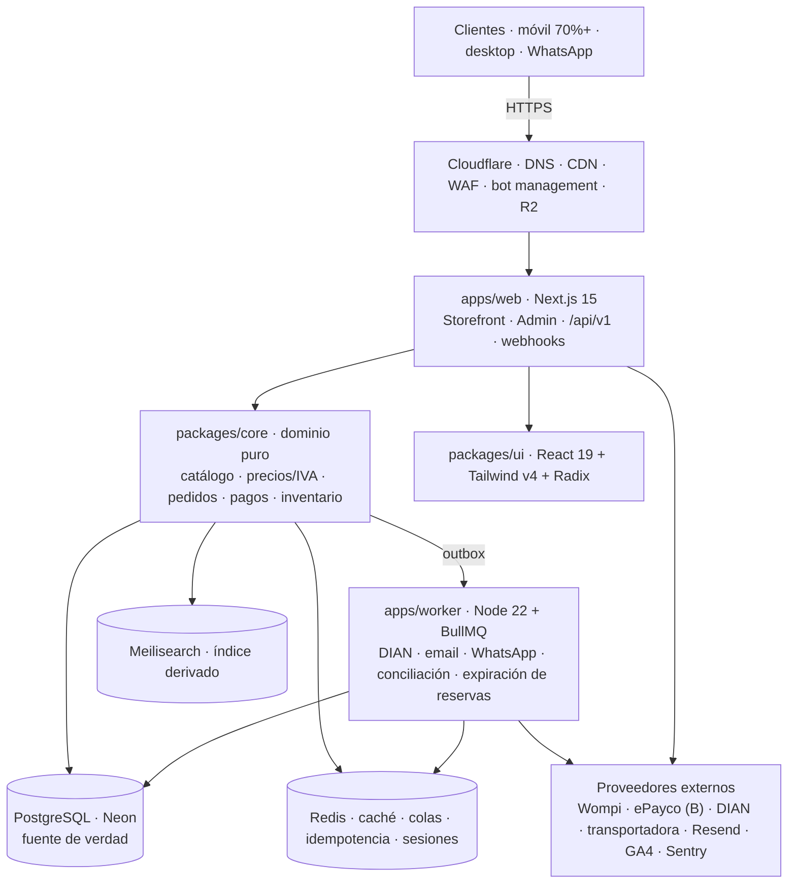
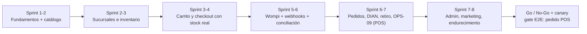

# Design Doc: E-commerce multi-sede Adriana Tienda

| Campo | Valor |
|---|---|
| **Autor** | `forge-architect` (Staff Engineer, APEX FORGE) |
| **Estado** | **Approved** — aprobado por el Comandante `apex-forge` el 24 de noviembre de 2026 |
| **Fecha** | 23 de noviembre de 2026 (enmendado y aprobado el 24 de noviembre de 2026) |
| **Decisor** | `apex-forge` (Comandante) |
| **Revisores requeridos** | `forge-reviewer` (diseño), `forge-sentinel` (pagos/PII/DIAN), `forge-qualis` (tests/rollout), `forge-infra` (infra/costos) |
| **Precedencia de documentos (C-12)** | Este Draft **absorbe y sustituye** al `[DESIGN_DOC.md v1.0](../../DESIGN_DOC.md)` (11-nov-2026). En caso de conflicto manda este documento; el v1.0 queda como registro histórico, no como fuente operativa. |
| **Tabla maestra de decisiones** | `[decisiones-comandante.md](./decisiones-comandante.md)` — C-01…C-12. Ante dos documentos en conflicto manda esa tabla; después manda este Design Doc enmendado. |
| **Alcance de la enmienda** | Requisito crítico de **2 sedes físicas** (etiqueta UI «sucursales», identificador `site_id`), lotes con FEFO, venta POS y unificación de clientes/pedidos, con marco **Scrum**. |
| **Regla de oro** | Ninguna línea de código de producción se escribe antes de que este documento pase a **Approved**. Los contratos y esquemas aquí mostrados son artefactos de diseño, no implementación. |

---

## Resumen ejecutivo (español)

Vamos a convertir el prototipo aprobado (Home, PLP, PDP, carrito, checkout y rastreo, con identidad verde/dorada) en una tienda real para Colombia sobre un **monolito modular Next.js 15 + PostgreSQL**, con **dos sedes físicas (`sites`) como ciudadanos de primera clase**: stock por lote con selección **FEFO**, reservas con expiración, retiro en tienda, despacho desde la sede que tenga inventario, transferencias entre sedes y venta presencial (historia `OPS-09`, Sprint 6) que comparte catálogo, precios e historial de clientes con la web.

El pago será **fácil y sin dolor**: checkout hospedado de **Wompi** (tarjeta, PSE, Nequi, Daviplata, efectivo y BNPL nativo), con **ePayco como plan B** detrás de un adaptador común. Nuestro código nunca toca datos de tarjeta (SAQ-A), y el pedido solo se confirma por webhook verificado o conciliación. Los precios van en COP con **IVA de 19% incluido**; todos los importes se almacenan como **`BIGINT` en centavos** (`*_cents`) y el IVA se expresa como **1900 basis points**. Cada pedido pagado genera factura electrónica DIAN vía proveedor tecnológico.

La operación se gobernará con **JWT de corta duración en cookies `httpOnly` + refresh rotatorio**, cuatro roles (Cliente, Vendedor tienda, Admin, Superadmin) y ámbito de sede para el vendedor; **MFA en MVP para Admin/Superadmin** y sesión de tablet de **8 h para Vendedores**. La auditoría es inmutable y un worker gestiona todo lo asíncrono. Trabajaremos en **sprints Scrum de dos semanas**, con Definition of Done que exige tests, accesibilidad WCAG 2.2 AA y revisión obligatoria.

**Lo que NO haremos en el MVP:** marketplace, multi-moneda, suscripciones, app nativa, motor propio de facturación DIAN, microservicios, búsqueda semántica ni descuentos automáticos por lote próximo a vencer. Está documentado en el `[alcance-y-no-objetivos.md](./alcance-y-no-objetivos.md)`.

**Decisiones que requieren confirmación del cliente antes de código:** integración con POS/ERP existente, proveedor DIAN y resolución de numeración, montos de contraentrega y umbral de envío gratis. Están listadas en la §10 con prefijo `DD-Qn`. Las decisiones ya resueltas por el Comandante están en `[decisiones-comandante.md](./decisiones-comandante.md)` (C-01…C-12).

---

## 1. Contexto y problema

### 1.1 El negocio

Adriana Tienda vende productos de belleza —cuidado facial, capilar y corporal— en Colombia con **dos sedes físicas** (etiqueta UI «sucursales»; identificador canónico **`sites` / `site_id`**, C-01). El cliente aprobó un prototipo navegable (S0) que cubre Home, PLP con filtros, PDP con variantes, carrito, checkout de una página y rastreo, sobre la identidad real de marca (verde profundo `#1E644C`, dorado `#B8895A`, tipografías Fraunces e Inter). Referencias de mercado: Recamier y Bellskin.

Catálogo estimado: **300–800 SKUs**, 8–15 marcas, ~20 categorías de dos niveles, variantes por tamaño/tono. Moneda **COP**, interfaz **español**, IVA **19% incluido** en el precio mostrado. Almacenamiento: importes **`*_cents` (`BIGINT`)**; prohibidos `Float` y los importes en unidades principales (C-02).

### 1.2 El problema

Hoy no existe canal transaccional propio. El prototipo es convincente en la vitrina pero **no opera**: pagos, stock, pedidos y clientes son simulados (`localStorage` / `sessionStorage`). Para sentar bases profesionales hay que resolver tres problemas de fondo:

1. **Confianza transaccional:** precio con IVA, stock real, fecha estimada, factura DIAN y política de retracto claros.
2. **Operación multi-sede (crítico):** con dos tiendas físicas no sirve un stock global. Si la web promete "recoge hoy en la Sede 1" y esa sede no tiene la unidad, el cliente se encuentra un pedido incompatible. Además, la venta presencial y la web deben sumar en el **mismo inventario y el mismo historial del cliente**.
3. **Fricción de pago:** el checkout colombiano exige PSE, billeteras y cuotas; pedir tarjeta de crédito exclusivamente pierde ventas, y procesar PAN en nuestro servidor añade alcance PCI innecesario.

### 1.3 Principios que guían el diseño

| Principio | Aplicación concreta |
|---|---|
| **Correctitud primero** | Reserva FEFO atómica sobre `inventory_lots`, IVA cuadrado por línea en centavos, webhooks idempotentes, estados monotónicos. |
| **Decisiones reversibles** | Adaptadores para pagos, DIAN y transportadoras; `packages/core` sin dependencia de framework; migraciones *expand → contract*. |
| **Diseño antes que código** | Este documento + ADRs + diagramas se aprueban antes del primer `package.json` de producción. |
| **El cliente dice el qué** | Nosotros decidimos el cómo; los umbrales de negocio (envío gratis, contraentrega) se confirman, no se imponen. |
| **Cambios pequeños y revisados** | Scrum quincenal, trunk con CI en verde, LGTM obligatorio y rollout con canary. |

---

## 2. No-objetivos

Ver el `[alcance-y-no-objetivos.md](./alcance-y-no-objetivos.md)` para el detalle completo. Resumen:

- No marketplace multi-vendedor, ni multi-moneda/multi-idioma, ni suscripciones, ni app nativa en MVP.
- No desarrollo propio del motor de facturación DIAN: se usa proveedor tecnológico habilitado.
- No microservicios: el modelo por sede se resuelve con una transacción en PostgreSQL.
- No búsqueda vectorial/ML, ni personalización predictiva en MVP.
- No reemplazar un POS/ERP externo sin confirmación (ver `DD-Q1` en §10); el MVP incluye **registro de venta presencial** (`OPS-09`, Sprint 6, RF-036), no integración con terminales de hardware.

---

## 3. Requerimientos

### 3.1 Funcionales

Cubiertos en el `[requisitos-funcionales.md](../01-requisitos/requisitos-funcionales.md)` (RF-001 a RF-081). Los dominios críticos para esta decisión son:

| Dominio | IDs | Punto de atención del diseño |
|---|---|---|
| Sedes e inventario | RF-048..RF-061 | Stock por sede, reservas TTL, transferencias, POS, unificación |
| **Lotes, vencimientos y FEFO (C-01)** | RF-078..RF-081 | `inventory_lots` como fuente de verdad, aviso a 90 días, bloqueo a 15 días, proyección `inventory_by_site` |
| Pagos | RF-026..RF-033 | Wompi + plan B, webhooks, conciliación, SAQ-A, importes sin IVA en la nota de coste |
| Checkout | RF-020..RF-025 | Click & collect vs. despacho con sede de fulfillment |
| Pedidos | RF-034..RF-041 | Máquina de estados con IDs canónicos (§4.4.1), canal WEB/POS, retracto |
| Admin / auditoría | RF-062..RF-068 | RBAC con ámbito de sede, logs inmutables, MFA Admin/Superadmin |

### 3.2 No funcionales

Ver el `[requisitos-no-funcionales.md](../01-requisitos/requisitos-no-funcionales.md)` (RNF-001 a RNF-032). Los límites que condicionan la arquitectura:

- **Rendimiento:** LCP p75 < 2,5 s, INP < 200 ms, CLS < 0,1; JS por plantilla ≤ 150/160/170/190 KB (Home/PLP/PDP/Checkout).
- **Accesibilidad:** WCAG 2.2 AA, teclado completo, `aria-live`, `prefers-reduced-motion`, animaciones CSS-first.
- **Seguridad:** OWASP ASVS 2, SAQ-A (sin PAN), secretos fuera del repo, cookies `httpOnly` con `SameSite=Strict` (excepción `Lax` documentada para el retorno de Wompi), MFA para Admin/Superadmin, `Bearer` solo servidor a servidor; login 5/15 min por IP+cuenta con backoff y CAPTCHA; checkout 20 req/min (C-04, C-05).
- **Disponibilidad:** 99,9% mensual; RPO ≤ 5 min, RTO ≤ 1 h; PITR 7 días + dump frío con retención de 30 días (C-09); degradación elegante de búsqueda y mensajería.
- **Escalabilidad:** 50k sesiones/mes, 1.000 pedidos/mes, 2.000 SKUs y hasta 5 sedes sin rediseño.

### 3.3 Restricciones legales y fiscales (Colombia)

| Norma | Implicación técnica |
|---|---|
| Ley 1480/2011 | Precio total con IVA, derecho de retracto de 5 días hábiles, reversión del pago |
| DIAN (factura electrónica UBL 2.1 + CUFE) | Emisión automática post-pago, nota crédito, numeración autorizada, contingencia |
| Ley 1581/2012 + Decreto 1377/2013 | Consentimiento versionado y revocable, PII cifrada, supresión con retención fiscal de 5 años |
| Decisión Andina 516 / INVIMA | Registro sanitario en ficha de producto cuando aplique |
| Ley 527/1999 | Validez de mensajes de datos y firma electrónica |

> **Decisión (C-02):** todos los importes son **`*_cents` (`BIGINT`)**. El IVA del 19 % se expresa como **`vat_rate_bps = 1900`** (*basis points*; prohibido usar `1900` como `rate` decimal). Se calcula **por línea de pedido** sobre precios con impuesto incluido: `base_cents = round_half_up(total_line_cents / 1.19)`, `iva_cents = total_line_cents − base_cents`. La suma de bases e IVA debe cuadrar exactamente con el total del pedido; se cubre con tests unitarios de casos límite.

---

## 4. Solución propuesta

### 4.1 Arquitectura general



**Despliegue:** `web` en Vercel (ISR gestionada, preview deploys, rollback instantáneo); `worker` en Fly.io/Railway junto a Redis; Neon para PostgreSQL; Cloudflare delante de todo. Detalle en el `[diagramas.md](./diagramas.md)`.

> **Decisión:** se adopta el **monolito modular (Opción A)** con dominio en `packages/core` y worker separado. Se rechazan microservicios y headless commerce; la matriz ponderada y los motivos están en el `[opciones-arquitectura.md](./opciones-arquitectura.md)`.

### 4.2 Estrategia de pagos — decisión y justificación

**Pasarela principal: Wompi (Bancolombia). Plan B: ePayco. Mercado Pago y Stripe: evaluados y descartados, sin adaptador en el contrato (C-12).**

Criterios exigidos por el cliente, evaluados con tarifas publicadas (consulta oct-2026, **verificar vigente antes de firmar**):

| Criterio | Peso | Wompi | ePayco | Mercado Pago | Stripe (con PSE) |
|---|---:|---:|---:|---:|---:|
| Facilidad de integración y reducción de alcance PCI (checkout hosted) | 20% | 9 | 7 | 8 | 9 |
| Cobertura PSE / débito / crédito / billeteras / efectivo | 30% | **10** | 9 | 7 | 4 |
| Costo por transacción | 20% | 9 | 8 | 6 | 6 |
| Webhooks, firma y reconciliación | 15% | 8 | 8 | 8 | **9** |
| Confianza de marca local y conversión | 15% | **9** | 8 | 8 | 6 |
| **Total** | **100%** | **🏆 9,15** | **8,10** | **7,30** | **6,60** |

| Proveedor | Soporte local | Costo estimado en venta de COP 190.000* | Veredicto |
|---|---|---|---|
| **Wompi** | Tarjeta nacional/internacional, PSE, Nequi, Daviplata, Botón Bancolombia, efectivo en corresponsales, QR y BNPL nativo (SU+Pay / Compra y Paga Después) | COP 6.825 (3,59%) | **Elegido**: una sola integración cubre todo el MVP, respaldo Bancolombia, checkout hospedado → SAQ-A |
| **ePayco** | Tarjeta, PSE, Efecty, billeteras; sin BNPL nativo | COP 6.790 (3,57%) | **Plan B**: se implementa el adaptador en staging desde Sprint 5 y se activa por bandera si Wompi falla o cambia tarifa |
| **Mercado Pago** | Tarjeta, PSE, Efecty; fuerte en links y redes | COP 8.391 (4,42%) | Descartado: costo mayor y menor cobertura local. **No se implementa adaptador `mercado-pago`; se reevaluaría en Fase 2** (C-12) |
| **Stripe (con PSE)** | Tarjetas sólidas; PSE **no nativo** en Colombia → requeriría proveedor adicional (verificar vigente) | n/d + costo extra | Descartado: no reduce el alcance de integración ni resuelve efectivo/billeteras locales |

\* Fórmula: `(tarifa% × 190.000 + cargo fijo)`. **Los importes publicados son sin IVA (C-09)**: se suprime el ajuste de impuesto añadido y el rótulo «con IVA» de la nota anterior para evitar doble conteo. Tarifas de lista, antes de retenciones; no son compromiso contractual.

> **Decisión:** Wompi es la pasarela principal con **checkout hospedado/redirección**. Nuestro servidor nunca recibe PAN ni CVV → **SAQ-A**. El pedido se confirma **solo** por webhook firmado o conciliación; la redirección del navegador jamás cambia el estado a pagado. Existe un puerto común `createIntent / getStatus / refund / verifyWebhook` con adaptadores `wompi`, `epayco` (plan B) y `cash-on-delivery`. **No existe adaptador `mercado-pago` en el contrato** (C-12). Cambiar de proveedor es añadir un adaptador, no rehacer checkout.

**Flujo resumido (C-06):** `POST /api/v1/checkout` con `cartId`, `fulfillmentType`, `grandTotalCents` e `Idempotency-Key` → reserva FEFO 30 min sobre `inventory_lots` → `nextAction.checkoutUrl` de Wompi → redirección → webhook `APPROVED` verificado y deduplicado → transición a `PAID` → outbox con factura DIAN, correo, WhatsApp y guía. **No existe `POST /orders` de creación**: `/orders` solo consulta. Secuencia completa en el `[diagramas.md](./diagramas.md)`.

**Contraentrega (COD):** no pasa por pasarela. Pedido en `PENDING_PAYMENT` con `paymentMethod = COD` (etiqueta UI «Pendiente de pago en tienda», §4.4.1), con límite de monto, zona, OTP y confirmación por WhatsApp. No emite factura hasta cobro confirmado.

### 4.3 Modelo de inventario multi-sede con lotes y FEFO — decisión y justificación (C-01)

> **Decisión (C-01):** la **fuente de verdad es `inventory_lots(lot_id, site_id)`** con selección **FEFO** (*first expired, first out*). `inventory_by_site(variant_id, site_id)` es **solo una proyección derivada**, actualizada **en la misma transacción**, que debe cumplir `on_hand = Σ lots.on_hand` y `reserved = Σ lots.reserved`. No existe un stock global escribible. Vocabulario único: **`site_id` / `sites`**; «sucursal» es únicamente la etiqueta UI en español. Quedan prohibidos `branch_id`, `branches` y `sucursal_id` como identificadores técnicos.

| Regla | Implementación documentada |
|---|---|
| Unicidad | Fuente de verdad: `(lot_id, site_id)`; proyección: `(variant_id, site_id)`. `on_hand`, `reserved`, `in_transit` enteros ≥ 0 |
| Integridad | `CHECK (reserved ≤ on_hand)` en ambas tablas; job diario de reconciliación `inventory_lots` ↔ `inventory_by_site` con alerta de desvío |
| Selección FEFO | Se ordenan los lotes activos del `site_id` por `expiry_date ASC`, se omiten lotes bloqueados y se reserva del primero con saldo suficiente (RF-079) |
| Vencimientos | **Aviso al operador a 90 días** del vencimiento; **bloqueo de venta a 15 días**; sin descuento automático en Fase 1 (RF-080, RF-081) |
| Reserva | Se crea **en la misma transacción** que el pedido `PENDING_PAYMENT`; TTL 30 min; job la expira y libera tanto el lote como la proyección |
| Anti-sobreventa | `UPDATE inventory_lots SET reserved = reserved + :qty WHERE lot_id=:l AND site_id=:s AND on_hand − reserved ≥ :qty` (condicional atómica); actualiza la proyección en la misma TX |
| Click & collect | Reserva en la **`site_id` elegida por el cliente**; código de retiro; estados `PAID → PREPARING → READY_FOR_PICKUP → DELIVERED` (`fulfillmentType = STORE_PICKUP`) |
| Despacho a domicilio | `site_id` de fulfillment por prioridad configurable + disponibilidad; se persiste `fulfillment_site_id`; si ninguna sede cubre el pedido, se ofrece **split** o alternativa antes de cobrar |
| Venta en tienda (POS) | Pedido con `channel = POS` y `site_id` del vendedor; descuenta el lote FEFO de esa sede con el mismo catálogo y precios; comparte historial del cliente. Historia de entrega: **`OPS-09` — Registro de venta presencial** (8 pts, Sprint 6, depende de la historia de inventario de lotes); gate E2E en §7 |
| Transferencias | `DRAFT → IN_TRANSIT → RECEIVED/CANCELLED`: origen `on_hand −`, origen `in_transit +`, destino `in_transit −`, destino `on_hand +`; siempre balanceado y auditado |
| Ajustes y conteos | Todo movimiento es inmutable con actor, sede, lote, motivo y `requestId`; conteo físico requiere aprobación antes de aplicar |

**Por qué gana:** FEFO sobre lotes hace que la promesa de disponibilidad sea **verdadera en el punto de entrega** y añade la trazabilidad exigible a cosméticos con vencimiento; el `UPDATE` atómico evita sobreventa y permite que POS, web y transferencias concurran sobre el mismo saldo sin locks distribuidos. El costo es fragmentación de disponibilidad; se mitiga con el split entre sedes y con umbrales de alerta. La alternativa «stock por variante+sede sin lotes» se rechaza: no permite trazabilidad ni bloqueo por vencimiento (§5).

> **Cerrada (C-01):** antes `DD-Q9` / `RM-Q9` — «¿se adoptan lotes con FEFO?». Resuelta afirmativamente por el Comandante: fuente de verdad `inventory_lots`, aviso a 90 días, bloqueo a 15 días, sin descuento automático en Fase 1. Ver `[decisiones-comandante.md](./decisiones-comandante.md)`.

> **Abierta (`DD-Q4`):** ¿el despacho a domicilio debe permitir **split entre sedes** en el MVP, o preferimos mostrar "no disponible" y perder esa venta para simplificar el picking? Responde: Cliente + Admin de operación (Sprint 3).

### 4.4 Estrategia de datos y auditoría

> **Decisión:** **PostgreSQL (Neon) es la única fuente de verdad**. Meilisearch es un índice derivado y Redis es caché/colas: ninguno puede contener el único registro de un pedido o de un saldo de stock.

Esquemas lógicos (implementados con Prisma `multiSchema`; detalle en `[ADR-004](./adr/ADR-004-estrategia-datos-prisma.md)`):

| Esquema | Entidades principales | Regla de integridad |
|---|---|---|
| `auth` | `users`, `roles`, `permissions`, `sessions`, `refresh_tokens`, `consents`, `user_sites` | Un operador puede tener una o más sedes asignadas; el cliente no tiene sede |
| `catalog` | `brands`, `categories`, `products`, `variants`, `attributes`, `attribute_values`, `media`, `reviews` | SKU único por variante; *soft delete*; precios `*_cents` (`BIGINT`) |
| `inventory` | `sites`, `lots`, `inventory_lots` (**fuente de verdad**), `inventory_by_site` (**proyección**), `reservations`, `inventory_movements`, `site_transfers`, `site_transfer_items`, `store_pickups`, `stock_counts` | `reserved ≤ on_hand` en lotes y proyección; FEFO; movimientos inmutables; transferencias balanceadas |
| `orders` | `carts`, `cart_items`, `orders`, `order_items`, `order_status_history`, `payments`, `payment_transactions`, `shipments`, `invoices`, `coupons`, `redemptions` | Snapshot inmutable de precio/nombre/impuesto/dirección en centavos; estados monotónicos con los IDs de §4.4.1 |
| `content` | `pages`, `banners`, `posts`, `faqs` | Versionado; publicación sin deploy |
| `audit` | `audit_logs`, `webhook_events`, `outbox_events`, `idempotency_keys` | *Append-only*; `unique(provider, event_id)`; TTL de idempotencia 24 h |

**Política de auditoría:**

| Aspecto | Regla |
|---|---|
| Qué se audita | Toda acción administrativa y operativa: actor, rol, sede, acción, entidad, `before/after` (PII enmascarada), IP, `requestId`, timestamp UTC |
| Inmutabilidad | `audit_logs` solo `INSERT`; sin UPDATE/DELETE desde la aplicación; acceso restringido a Superadmin |
| Retención | Operativa 2 años; fiscal 5 años (Estatuto Tributario); PII se anonimiza antes del borrado, conservando la factura |
| Correlación | Cada evento de dominio escribe un `outbox_events`; el worker consume con `jobId = outbox.id` |
| PII | `phone`, `documentNumber` y snapshots de despacho cifrados AES-256-GCM; búsqueda por índice ciego SHA-256 con *pepper* en gestor de secretos |

**Convenciones de contrato interno** (documentación, no implementación):

```json
// Ejemplo de contrato — POST /api/v1/checkout (único endpoint de creación de pedido; C-06)
{
  "headers": {
    "Idempotency-Key": "9f1c...",
    "Cookie": "access_token=<jwt>; checkout_session=<opaque>"
  },
  "body": {
    "cartId": "01J-CART-...",
    "fulfillmentType": "STORE_PICKUP",
    "siteId": "sede-principal",
    "couponCode": "ADRIANA10"
  },
  "response_201": {
    "orderId": "01J...",
    "number": "AT-2026-000123",
    "status": "PENDING_PAYMENT",
    "grandTotalCents": 22800000,
    "taxBreakdown": { "baseCents": 19159664, "ivaCents": 3640336, "vatRateBps": 1900 },
    "reservationExpiresAt": "2026-11-23T15:30:00Z",
    "nextAction": { "type": "REDIRECT", "checkoutUrl": "https://checkout.wompi.co/..." }
  }
}
```

El access token viaja en **cookie `httpOnly`**; `Authorization: Bearer` queda reservado a integraciones **servidor a servidor** (webhook, worker, DIAN), nunca al storefront (C-04). La cookie de checkout usa `SameSite=Lax` **solo** para el retorno desde Wompi; el resto usa `SameSite=Strict`. Errores con envelope `{ error: { code, message, details? }, requestId }`; paginación por cursor; importes en **centavos (`BIGINT`)**; IDs UUID v7; fechas ISO-8601 UTC. Formato único de pedido `AT-2026-000123` y cupón `ADRIANA10` (C-12).

### 4.4.1 Mapeo de estados: etiqueta UI en español → identificador canónico (C-08)

Los nombres en español son **etiquetas de UI**, nunca identificadores de `orders.status`. El identificador canónico es el que viaja en el contrato y se persiste en `orders.status`.

| Etiqueta UI (español) | Identificador canónico | Subsistema dueño | Nota |
|---|---|---|---|
| Pendiente de pago | `PENDING_PAYMENT` | `orders.status` | Reserva FEFO activa, TTL 30 min |
| Pendiente de pago en tienda (COD) | `PENDING_PAYMENT` | `orders.status` + `payments.method = COD` | La etiqueta distingue el método; no crea un estado propio |
| Pagado | `PAID` | `orders.status` | Solo por webhook verificado o conciliación |
| En preparación | `PREPARING` | `orders.status` | |
| Empaquetado | `PACKED` | `orders.status` | |
| Listo para retiro | `READY_FOR_PICKUP` | **`orders.status`** | Estado propio del pedido; **no** se deriva de `store_pickups.status = READY` |
| En ruta | `OUT_FOR_DELIVERY` | `orders.status` | El estado de la guía es `shipments.status`; distinto |
| Entregado / Entregado en tienda | `DELIVERED` | `orders.status` | Un único estado canónico; el canal se distingue por `fulfillmentType` |
| Cancelado | `CANCELLED` | `orders.status` | Terminal |
| Reembolsado | `REFUNDED` | `orders.status` | Terminal |
| Devolución solicitada | `RETURN_REQUESTED` | `orders.status` | No retrocede a `DELIVERED` |
| Devolución rechazada | `RETURN_REJECTED` | `orders.status` | Terminal; cierra el retracto rechazado |

> **Transiciones corregidas (C-08):** se elimina `RETURN_REQUESTED → DELIVERED`. `RETURN_REQUESTED → RETURN_REJECTED` es terminal. `DELIVERED` es terminal **salvo** que exista un `RETURN_REQUESTED` vigente. `PAID` es el estado canónico tras el webhook; el pago tardío se registra con bandera `reviewRequired` en `payments`, sin introducir un duplicado de `orders.status`. Los identificadores `PAID_NEEDS_REVIEW`, `SHIPPED`, `RETURNED`, `DRAFT` y `PICKED_UP_READY` están retirados por C-13: no existen como `OrderStatus`.

### 4.5 Autenticación y protección del panel administrativo

> **Decisión (C-04):** **JWT de acceso de 15 minutos + refresh token rotatorio de 7 días** en cookies **`httpOnly + Secure + SameSite=Strict`**. El access token viaja **solo en cookie** en storefront y panel admin; **nunca** en `localStorage` ni en un `Bearer` legible por JavaScript. `Authorization: Bearer` queda **exclusivamente** para integraciones **servidor a servidor** (webhooks, worker, DIAN) y así se documenta en el contrato. **Excepción documentada:** la cookie de sesión de checkout usa `SameSite=Lax` únicamente para el retorno desde Wompi; el resto de cookies permanecen en `Strict`. RBAC con ámbito de sede; **MFA TOTP en MVP para Admin/Superadmin**; los **Vendedores usan sesión de tablet de 8 h sin MFA** (MFA para vendedores diferida a Fase 2).

| Rol | Permisos clave | Ámbito |
|---|---|---|
| **Cliente** | Ver/editar sus datos, pedidos, direcciones, consentimientos, wishlist | Solo sus recursos |
| **Vendedor tienda** | Ver inventario de su sede, crear pedidos POS, confirmar retiros, transferencias que involucren su sede | **Solo su sede** (`user_sites`); sesión de tablet 8 h, sin MFA en MVP |
| **Admin** | Catálogo, pedidos de todas las sedes, cupones, inventario, transferencias, reseñas, reportes | Todas las sedes; **MFA obligatoria** |
| **Superadmin** | Usuarios, roles, MFA, configuración sensible, auditoría, break-glass | Global; **MFA obligatoria**, acciones doblemente auditadas |

**Protección del panel `/admin/**`:** middleware que valida sesión y `role` antes de renderizar; cada Server Action y Route Handler revalida permiso **en servidor** (nunca solo en la UI); claims de sede incluidos en el JWT y contrastados con DB; revocación inmediata por `jti` en denylist de Redis; **login: 5 intentos / 15 min por IP + cuenta, con backoff exponencial y CAPTCHA tras el quinto intento**; **checkout: 20 peticiones / min por sesión con `Idempotency-Key` obligatoria** (C-05); la cuenta break-glass se guarda en gestor de secretos y dispara alerta al usarse.

> **Decisión:** un Vendedor **nunca** puede ver pedidos de otra sede aunque conozca el número: la consulta se filtra por `site_id` en la capa de datos, no en el componente.

### 4.6 Frente a las alternativas (por qué gana)

- Frente a **Express separado (B)**: evitamos un salto de red en el critical path y dos pipelines, manteniendo la misma transacción de stock.
- Frente a **microservicios (C)**: la reserva multi-sede sigue siendo una transacción local ACID, no una saga distribuida.
- Frente a **headless (D)**: controlamos el checkout y la facturación DIAN, y las dos sedes no dependen de las limitaciones de una plataforma.
- Frente a **stock global**: la promesa de retiro en una sede concreta pasa a ser verificable.
- Frente a **stock por variante+sede sin lotes**: FEFO añade trazabilidad por lote y bloqueo por vencimiento, exigibles a cosméticos (C-01).
- Frente a **importes en unidades principales o `Float`**: `BIGINT` en centavos cuadra con *minor units* de Wompi y evita errores de redondeo en el IVA por línea (C-02).

Detalle completo y matriz ponderada en el `[opciones-arquitectura.md](./opciones-arquitectura.md)` (A: 8,90 vs. B: 7,75 vs. C: 6,65 vs. D: 6,25).

### 4.7 Scrum y organización de la entrega

Sprints de **2 semanas**. El `[historias-usuario.md](../01-requisitos/historias-usuario.md)` describe el **núcleo de diseño** (27 historias / 151 pts, con `INV-01` de lotes/FEFO y `OPS-09` de POS); el `[backlog-inicial.md](../05-scrum/backlog-inicial.md)` y el `[plan-sprints.md](../05-scrum/plan-sprints.md)` son el backlog completo de entrega (**42 historias / 280 puntos**, ya recalculado con Fibonacci estricta según **C-11** y verificado por `forge-qualis`). No se suman ambos inventarios. Eventos: Planning, Daily, Refinement, Review y Retrospectiva. DoD exige tests, linter, axe, LGTM de `forge-reviewer`, visto bueno de `forge-sentinel` en pagos/PII y verde en CI. El Comandante y el cliente priorizan; el equipo decide el cómo.

**C-03 — POS en el MVP:** la historia `OPS-09 — Registro de venta presencial` (8 pts) se planifica en el **Sprint 6**, depende de la historia de inventario de lotes/FEFO y su escenario E2E de pedido POS es **gate de release** (§7 y §8). Es la implementación de RF-036 / RF-056 y HU-019.

Dependencias críticas del plan:



> **Decisión:** las historias de sedes, lotes e inventario (EP-05) se implementan **antes** de los pagos. Sin saldo FEFO por sede no se puede prometer retiro ni evitar sobreventa.

---

## 5. Alternativas evaluadas

| Opción | Pros | Contras | Motivo de rechazo |
|---|---|---|---|
| **B. Next.js + Express separado** | Separación UI/dominio, API Swagger, escalado independiente | Dos despliegues, latencia extra, +USD 80–180/mes, no mejora la corrección multi-sede | Se guarda como **ruta de extracción futura**; no aporta al MVP |
| **C. Microservicios** | Aislamiento y escala extremos | Saga distribuida para stock, alta complejidad ops, costo y lentitud de entrega | Resuelve un problema de escala inexistente y **aumenta el riesgo de sobreventa** |
| **D. Headless (Shopify/Medusa/VTEX)** | Time-to-market corto, checkout maduro | Multi-sede real limitado, DIAN vía apps, comisiones, checkout cerrado (salvo Plus) | El 40% difícil (sedes, DIAN, rendimiento) sigue siendo custom **y** se paga licencia |
| **Stock global con disponibilidad calculada** | Más simple al inicio | No puede garantizar retiro en una sede, transferencias inconsistentes | Rechazado: contradice el requisito crítico |
| **Stock por `(variant_id, site_id)` sin lotes** | Menos filas y consultas más simples | Sin trazabilidad de lote, sin control de vencimientos, incumple requisito legal de cosméticos | Rechazado por C-01: se adopta `inventory_lots` + FEFO |
| **`Int` en unidades principales / `Float` para dinero** | Aparentemente más simple | Redondeo del IVA por línea y desajuste con *minor units* de la pasarela | Rechazado por C-02: `BIGINT` en centavos y 1900 bp |
| **Diferir POS a Fase 2** | Menos trabajo en Sprint 6 | Rompe una de las tres razones del modelo multi-sede y el gate E2E | Rechazado por C-03: `OPS-09` entra en el MVP |
| **Pago con tarjeta directa (captura de PAN)** | Control total del flujo | Alcance PCI-DSS SAQ-D, alto riesgo de seguridad | Rechazado: rompe RNF-013 |

---

## 6. Riesgos y mitigaciones

| # | Riesgo | Prob. | Impacto | Mitigación | Dueño |
|---|---|---|---|---|---|
| R1 | Sobreventa por concurrencia entre POS y web sobre el mismo lote y sede | Media | Alto | `UPDATE` condicional atómico sobre `inventory_lots` + `CHECK` en DB + reserva FEFO en la misma transacción + test con 100 hilos concurrentes | Backend |
| R2 | Webhooks duplicados o fuera de orden | Media | Alto | `unique(provider, event_id)`, firma verificada, estados monotónicos, reconciliación diaria | Backend |
| R3 | Wompi no disponible el día de lanzamiento | Baja | Alto | Adaptador ePayco implementado en staging; bandera de activación; prueba de caos | Arquitecto + Backend |
| R4 | Proveedor DIAN no habilitado a tiempo | Media | Alto | Contratar en Sprint 0; contingencia documentada; monitor de facturas pendientes | Comandante |
| R5 | POS/ERP externo del cliente incompatible con el modelo de sedes | Media | Medio | Confirmar en §10; si existe, adaptador de sincronización en Fase 2 | Comandante |
| R6 | Fricción en checkout por métodos de pago localizados | Media | Medio | Checkout hospedado, sin campos de tarjeta propios; simulador de cuotas; PSE y Nequi visibles | Frontend + Pagos |
| R7 | Degradación de Core Web Vitals por imágenes del catálogo | Media | Alto | Pipeline AVIF/WebP, `sizes`, presupuesto en CI, fotos ≥800 px exigidas al cliente | Frontend |
| R8 | Fuga de PII en exportes o auditoría | Baja | Alto | Enmascaramiento, cifrado AES-256-GCM, revisión `forge-sentinel`, permisos por rol | Sentinel |
| R9 | Devoluciones/retracto fuera de plazo legal | Media | Medio | Cálculo de 5 días hábiles, estados dedicados, nota crédita automática | Negocio + Backend |
| R10 | Costos de pasarela erosionan margen | Media | Medio | Negociar tarifa por volumen, incentivar PSE/Nequi, monitorear *take rate* | Negocio |
| R11 | Split entre sedes mal entendido por operación | Media | Medio | Confirmación explícita antes de cobrar; picking list por sede; decisión abierta `DD-Q4` en §4.3 | Admin de operación |
| R12 | Migración de planillas de stock con errores | Alta | Medio | Importación con `dry-run`, conciliación por SKU, lote y sede, conteo físico antes de go-live | Backend + Cliente |
| R13 | Venta de lotes próximos a vencer o vencidos | Media | Alto | Aviso a 90 días, bloqueo de venta a 15 días, FEFO estricto y job de reconciliación de proyección (C-01) | Backend + Operación |
| R14 | Desvío entre `inventory_lots` y `inventory_by_site` | Baja | Alto | Actualización de ambas tablas en la misma transacción + job diario de reconciliación con alerta (C-01) | Backend |

---

## 7. Estrategia de testing

| Nivel | Herramienta | Cobertura exigida | Validado por |
|---|---|---|---|
| Unitaria | Vitest | ≥ 70% global, ≥ 80% en `packages/core`; **100% en IVA (centavos y 1900 bp), selección FEFO, reservas y máquina de estados** | Quien construye + `forge-qualis` |
| Integración | Vitest + Testcontainers (Postgres/Redis) | Transacciones, idempotencia, **100 intentos concurrentes sobre el mismo `inventory_lots` → 1 reserva**, proyección cuadrada, transferencias balanceadas, dedupe de webhooks | Backend + `forge-qualis` |
| Contrato | Fixtures firmados + validación Zod | Wompi, ePayco, DIAN, transportadora: todos los eventos mapeados; `POST /api/v1/checkout` con `nextAction.checkoutUrl` | Backend |
| E2E | Playwright (móvil 375 px + desktop) | **21 escenarios**: compra invitado/registrado, tarjeta aprobada/rechazada, PSE (mock), COD, cupón, **retiro en tienda (`READY_FOR_PICKUP`)**, **pedido POS (`OPS-09`) — gate de release**, transferencia, reembolso, tracking, lote próximo a vencer y bloqueado | `forge-qualis` |
| Accesibilidad | axe-core + auditoría manual | 0 violaciones críticas en flujos críticos; teclado y `prefers-reduced-motion` | Frontend + `forge-qualis` |
| Rendimiento | Lighthouse CI + k6 | Sin regresión > 10%; 200 rps sostenidos; verificación de 5/15 min y 20 req/min en staging | `forge-infra` |
| Seguridad | `npm audit`, Semgrep, ZAP, gitleaks | 0 críticos; sin secretos; CSP, SAQ-A, cookies `httpOnly`/`SameSite`, `Bearer` solo S2S y MFA Admin/Superadmin verificados | `forge-sentinel` |

**Regla:** el que construye escribe los tests. Ningún sprint se acepta con tests rojos o cobertura en descenso. Los tests de sobreventa FEFO, de webhook y **el E2E de pedido POS** son **bloqueantes de release** (C-03). `forge-qualis` añade el escenario POS a su plan con el ID `OPS-09`.

---

## 8. Rollout y rollback

**Liberación gradual**

| Momento | Acción |
|---|---|
| T-4 semanas | Congelar alcance, UAT con negocio, carga de catálogo y **conteo físico por sede y lote**, pruebas de caos (Wompi caído, Redis caído, Meilisearch caído) |
| T-2 semanas | Runbook de operación (pedidos, retiros, transferencias, reembolsos), restore real de backup, alertas y on-call |
| T-1 semana | Canary interno con pagos reales de bajo monto en ambas sedes; verificar correo, WhatsApp, factura y guía |
| Día D | Verificación del gate E2E de **pedido POS (`OPS-09`)** → deploy con `checkout_enabled = false` → smoke tests → **5% tráfico 24 h** → 25% 24 h → 100% → monitoreo reforzado 72 h |

**Monitoreo:** SLOs de disponibilidad 99,9%, API p95 < 400 ms, checkout success > 97% (excluyendo rechazos del banco), webhook p95 < 60 s, factura p95 < 15 min, job failures < 1%. Alertas con dueño y umbral; postmortem sin culpables en ≤ 72 h para Sev-1/Sev-2.

**Rollback**

- **Código:** rollback instantáneo en Vercel al deployment anterior (< 2 min); el worker se revierte con la imagen Docker previa.
- **Funcionalidad:** apagar `checkout_enabled`, `wompi_enabled` o `pickup_enabled` por bandera sin redeploy.
- **Base de datos:** migraciones *expand → contract*; el código anterior sigue funcionando; prohibida migración destructiva en el mismo release.
- **Datos (C-09):** **PITR de 7 días + dump frío diario con retención de 30 días** para MVP (RPO ≤ 5 min, RTO ≤ 1 h). La ampliación a PITR de 30 días (USD 50–100/mes) es una mejora aprobable por el cliente, **no** un requisito bloqueante. Si hay corrupción de stock, se reconcilia desde `inventory_movements` con el último conteo físico validado por lote y sede.

---

## 9. Métricas de éxito

| Categoría | Métrica | Meta (12 meses / go-live) | Fuente |
|---|---|---|---|
| Negocio | Ventas online como % del total | ≥ 30% | Reporte de pedidos por canal |
| Negocio | Conversión móvil | ≥ 1,8% (hipótesis; benchmark a verificar) | GA4 |
| Negocio | Ticket promedio (AOV) | ≥ COP 190.000 | DB de pedidos |
| Negocio | Abandono de carrito | ≤ 65% | GA4 |
| Operación | Pedidos con retiro en tienda entregados sin incidencia | ≥ 98% | `order_status_history` |
| Operación | Descuentos FEFO por sede y lote cuadrados en conteo mensual | 100% | `inventory_lots` vs. `inventory_by_site` vs. conteo |
| Operación | Pedidos pagados sin factura DIAN al cierre del día | 0 | Monitor de facturación |
| Operación | Diferencias de conciliación Wompi sin resolver > 24 h | 0 | Job de conciliación |
| Técnica | LCP / INP / CLS p75 | < 2,5 s / < 200 ms / < 0,1 | CrUX + RUM |
| Técnica | Disponibilidad y 5xx | 99,9% / < 0,1% | Uptime + APM |
| Calidad | Cobertura en dominio / flujos críticos | ≥ 80% / 100% | CI |

> **Decisión:** sin métrica y fuente de datos, una acción no existe. Todo evento del embudo se instrumenta con GA4 + Consent Mode v2; todo evento de operación se escribe en `outbox_events`.

---

## 10. Preguntas abiertas y registro de decisiones (C-07)

**Prefijo obligatorio:** `DD-Qn` para este Design Doc; `RM-Qn` para el plan maestro ([`docs/README.md`](../README.md)). Se elimina el ID `Qn` suelto para evitar colisiones entre documentos. La tabla maestra es `[decisiones-comandante.md](./decisiones-comandante.md)`; cada fila puede referenciar `C-01`…`C-12`.

| ID | Pregunta / decisión | Estado | Quién responde | Cuándo | Impacto si se resuelve distinto |
|---|---|---|---|---|---|
| `DD-Q1` | ¿Existe POS/ERP actual (Siigo, Alegra, World Office u otro) que deba integrarse, o el pedido POS web reemplaza el proceso en MVP? | Abierta | Cliente + Comandante | S0 | Cambia el alcance de RF-036 y añade adaptador |
| `DD-Q2` | ¿Proveedor tecnológico DIAN y resolución de numeración vigentes? ¿Quién asume el costo? | Abierta | Cliente + Comandante | S0 | Riesgo R4; contingencia documentada |
| `DD-Q3` | ¿Se aprueban umbral de envío gratis COP 150.000, monto máximo de contraentrega y TTL de reserva de 30 min? | Abierta | Cliente + Admin de operación | Sprint 1 | Ajuste de reglas declarativas, no de arquitectura |
| `DD-Q4` | ¿El despacho a domicilio permite **split entre sedes** en MVP o se muestra "no disponible"? | Abierta | Cliente + Admin de operación | Sprint 3 | Afecta HU-006 y el diseño de picking |
| `DD-Q5` | ¿Hay cuentas corporativas con transportadoras o se usa agregador (Envia.com / MiPaquete)? | Abierta | Cliente + `forge-infra` | Sprint 2 | Define adaptador logístico |
| `DD-Q6` | ¿Se autoriza el BNPL nativo de Wompi en MVP y hay contrato para Addi/Sistecrédito? | Abierta | Cliente + Finanzas | Sprint 4 | Addi/Sistecrédito difiere a Fase 2 |
| `DD-Q7` | ¿Quién produce fotografía ≥800 px, fichas técnicas, ingredientes y registros INVIMA? | Abierta | Cliente | Sprint 1 | Riesgo R2/R7 |
| `DD-Q8` | ¿Restricción de despliegue (AWS obligatorio, IP fija para DIAN)? | Abierta | Cliente + `forge-infra` | S0 | El worker ya da salida con IP fija; revisar Vercel |
| `DD-Q9` | ¿Se adopta inventario por **lotes con selección FEFO**? (**antes Q9 / RM-Q9**) | **CERRADA — C-01** | Comandante | 23-nov-2026 | Sin FEFO no hay trazabilidad de cosméticos; ver §4.3 |
| `DD-Q10` | ¿Quién ejerce formalmente el Product Owner y asiste a Sprint Review cada dos semanas? (antes Q9 del Design Doc) | Abierta | Cliente | S0 | Riesgo de priorización difusa |
| `DD-Q11` | ¿TRM de planeación y retención de PITR para MVP? | **CERRADA — C-09** | Comandante | 23-nov-2026 | TRM 4.000/USD estimada; PITR 7 días + dump frío 30 días |
| `DD-Q12` | ¿MFA para vendedores en MVP? | **CERRADA — C-04** | Comandante | 23-nov-2026 | Solo Admin/Superadmin; vendedores, tablet 8 h; MFA vendedores en Fase 2 |
| `DD-Q13` | ¿Aceptan operación los SLO de 99,9 % y RTO ≤ 1 h para las 2 sedes? ¿Contingencia si cae el panel POS? | Abierta | Cliente + Comandante | S0 | Define venta en papel con conciliación diferida (RNF-019/RNF-022) |
| `DD-Q14` | ¿Se aceptan 151 pts de núcleo de diseño (27 historias) para 8 sprints o se recorta EP-08/EP-07? | Abierta | Comandante + Cliente | Planificación S0 | Define el alcance del MVP; el backlog completo se recalcula por C-11 |
| `DD-Q15` | ¿Qué se incluye antes en Fase 2: hardware POS (N-16) o bundles con descuento (N-10)? | Abierta | Cliente | Sprint Review 1 | Prioriza la hoja de ruta posterior al MVP |

### Decisiones del Comandante propagadas a este documento

| ID | Decisión | Sección donde se aplica |
|---|---|---|
| `C-01` | `inventory_lots(lot_id, site_id)` + FEFO; `inventory_by_site` proyección; `site_id`/`sites` | §3.1, §4.2, §4.3, §4.4, §6, §7, §10 |
| `C-02` | `BIGINT` centavos; IVA 1900 basis points | §1.1, §3.3, §4.4, §5 |
| `C-03` | POS en MVP con `OPS-09` en Sprint 6 y gate E2E | §2, §4.3, §4.7, §7, §8 |
| `C-04` | Cookie `httpOnly`; `Bearer` solo S2S; `Strict` con excepción `Lax`; MFA Admin/Superadmin | §3.2, §4.4, §4.5, §7, §10 |
| `C-05` | Login 5/15 min IP+cuenta con backoff y CAPTCHA; checkout 20 req/min | §3.2, §4.5, §7 |
| `C-06` | `POST /api/v1/checkout` único; sin `POST /orders` de creación | §4.2, §4.4, §7 |
| `C-07` | IDs `DD-Qn`/`RM-Qn` y tabla maestra de decisiones | §10 |
| `C-08` | IDs canónicos de estado + tabla de mapeo UI | §4.4.1, §4.7 |
| `C-09` | TRM 4.000 estimada; PITR 7 + dump 30; comisión sin IVA | §4.2, §4.4, §8, §10 |
| `C-10` | Contraste `#B8895A` 5,82:1 y tokens semánticos (responsable: frontend) | §3.2 (referencia) |
| `C-11` | Fibonacci estricto y recálculo de puntos (responsable: `forge-qualis`) | §4.7 |
| `C-12` | Sin adaptador `mercado-pago`; formato `AT-2026-000123` y cupón `ADRIANA10`; precedencia de este Draft; `aria-live` en implementación | Encabezado, §4.2, §4.4 |

---

## Firmas (diseño aprobado)

| Rol | Nombre | Estado |
|---|---|---|
| `forge-architect` | — | Diseño emitido y enmendado (C-01…C-15) |
| `apex-forge` (Comandante / Decisor) | — | ✅ **Approved** — 24 nov 2026 |
| `forge-reviewer` | — | ✅ **LGTM final** — 24 nov 2026 (`docs/08-review/re-review-final.md`, 21/21 hallazgos cerrados) |
| `forge-sentinel` | — | ✅ OK condicionado de diseño (`docs/06-seguridad/visto-bueno-diseno.md`); verificación en staging antes del go-live |
| `forge-qualis` | — | ✅ Firma de diseño aprobada (`docs/05-scrum/visto-bueno-qualis.md`); firma de ejecución el Día D |
| `forge-infra` | — | ✅ APROBADO DE DISEÑO (`docs/07-infra/visto-bueno-infra.md`) |

> Las firmas de ejecución (staging, canary y go-live) se emiten el Día D con evidencia real. Este `Approved` autoriza únicamente a iniciar la Fase 2 (planificación y construcción).
