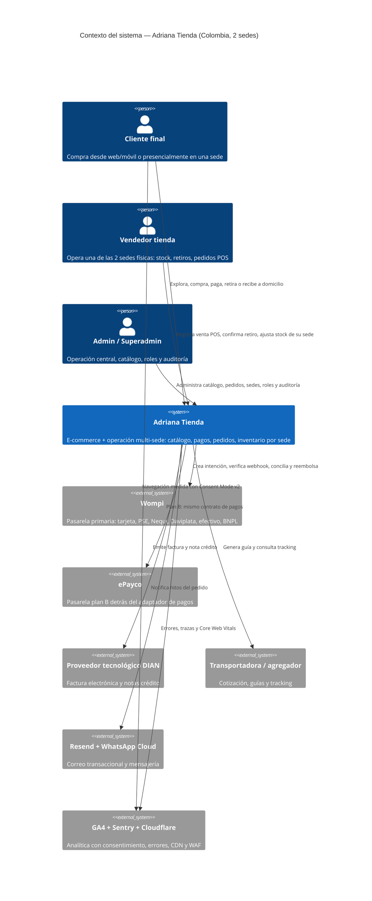
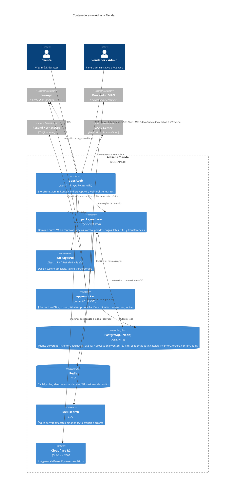
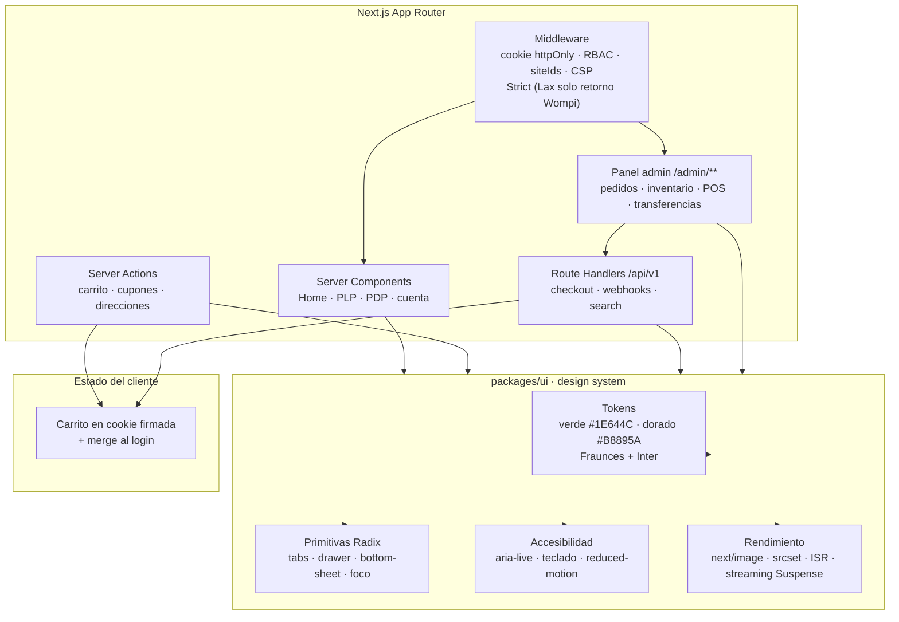
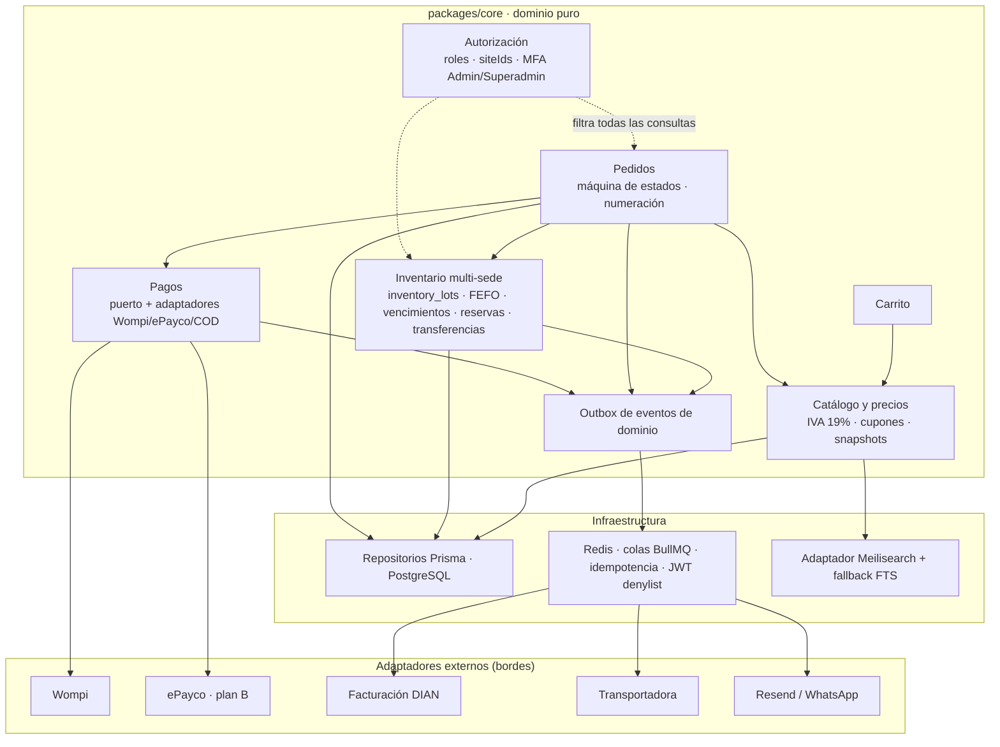
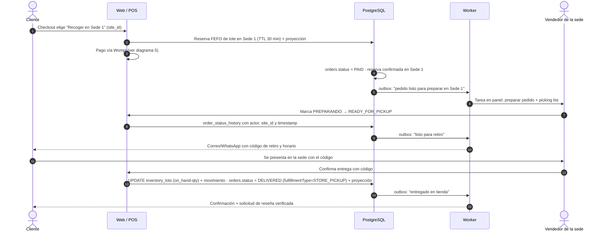
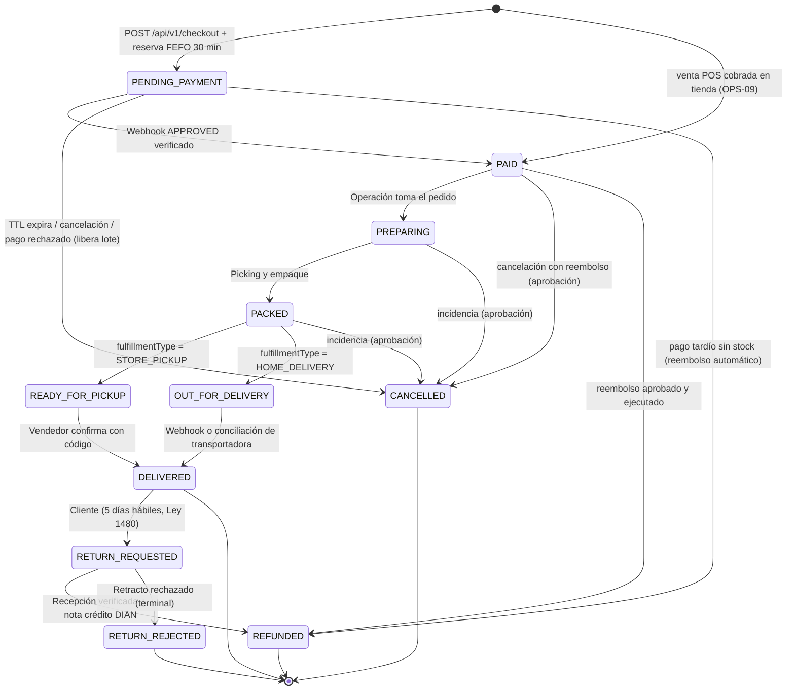
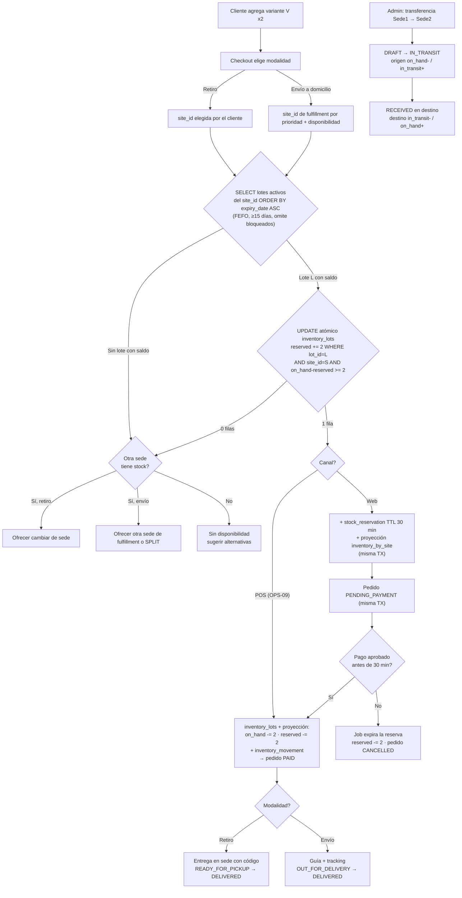
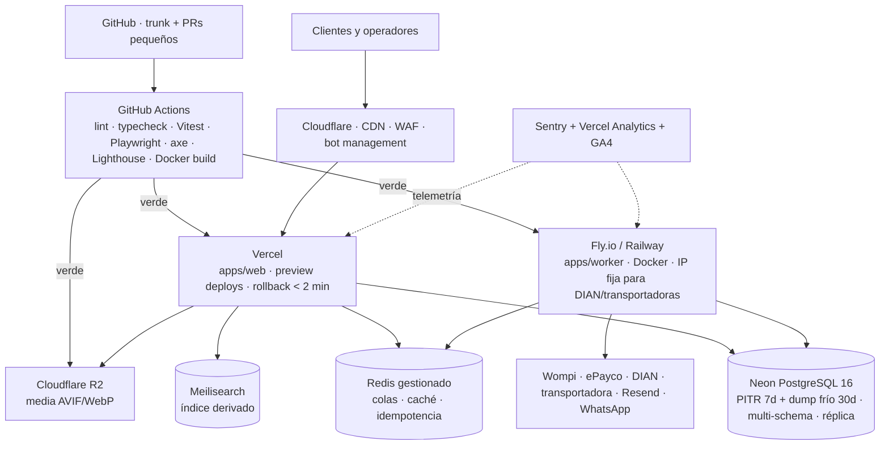

# Diagramas de Arquitectura — Adriana Tienda

| Campo | Valor |
|---|---|
| **Autor** | `forge-architect` (Staff Engineer, APEX FORGE) |
| **Estado** | Draft — complemento visual del `design-doc.md` |
| **Fecha** | 23 de noviembre de 2026 |
| **Notación** | Mermaid (bloques `mermaid`). Los diagramas C4 usan las etiquetas `C4Context` / `C4Container` de Mermaid. |
| **Decisiones aplicadas** | [decisiones-comandante.md](./decisiones-comandante.md) — C-01 (lotes/FEFO y `site_id`), C-03 (`OPS-09`), C-04 (auth), C-06 (`POST /api/v1/checkout`), C-08 (estados canónicos). |

> **Leyenda general:** los colores/etiquetas siguen la identidad aprobada (verde `#1E644C` = sistema propio; dorado `#B8895A` = integraciones; gris = actores). Las flechas indican **quién inicia** la interacción. Todo evento escrito en PostgreSQL pasa por `outbox_events` y es consumido por el worker. «Sucursal» es etiqueta UI; el identificador técnico es **`site_id`/`sites`**.

---

## 1. C4 — Nivel 1: Contexto del sistema



**Leyenda (español):** el sistema Adriana Tienda es el único que concentra datos de clientes y saldos de inventario. Los sistemas en dorado son proveedores externos sustituibles mediante adaptadores. El cliente nunca interactúa directamente con DIAN ni con la transportadora.

---

## 2. C4 — Nivel 2: Contenedores



**Leyenda (español):** `apps/web` y `apps/worker` son los dos únicos procesos desplegables. `packages/core` no depende de Next.js: por eso puede extraerse detrás de una API Express en el futuro sin reescribir reglas. PostgreSQL es el único lugar donde un saldo de stock o un pedido es definitivo, y dentro de él `inventory_lots` manda sobre la proyección (C-01). El token de acceso del navegador viaja en cookie `httpOnly`; `Bearer` solo se usa servidor a servidor (C-04).

---

## 3. Componentes del frontend



**Leyenda (español):** el middleware es la primera barrera del panel administrativo; la UI nunca decide permisos, solo los refleja. Las Server Actions y los Route Handlers revalidan autorización en servidor. El carrito del invitado vive en cookie firmada y se fusiona al iniciar sesión.

---

## 4. Componentes del backend



**Leyenda (español):** las flechas punteadas de `Autorización` son **filtros transversales**: un Vendedor solo consulta pedidos e inventario de su sede porque el repositorio añade `site_id` a la query, no porque la pantalla lo oculte. Los adaptadores externos están en el borde: cambiar de proveedor no toca el dominio. No existe adaptador `mercado-pago` (C-12).

---

## 5. Secuencia: checkout con pasarela y webhook

```mermaid
sequenceDiagram
    autonumber
    actor C as Cliente
    participant W as apps/web
    participant D as PostgreSQL
    participant R as Redis
    participant P as Wompi
    participant K as Worker

    C->>W: POST /api/v1/checkout (cookie httpOnly, Idempotency-Key, cartId, fulfillmentType)
    W->>W: Valida sesión, precios en *_cents, IVA 1900 bp y cupón
    W->>D: BEGIN TX
    W->>D: SELECT lotes activos del site_id ORDER BY expiry_date ASC (FEFO, ≥15 días)
    W->>D: UPDATE inventory_lots SET reserved+qty WHERE lot_id y site_id y on_hand-reserved >= qty
    W->>D: UPDATE inventory_by_site SET reserved+qty (misma TX)
    alt Sin stock suficiente
        D-->>W: 0 filas afectadas
        W-->>C: 409 "Sin disponibilidad en la sede elegida" + alternativas
    else Stock reservado
        W->>D: INSERT order PENDING_PAYMENT + order_items (snapshots en centavos) + reservation TTL 30 min + idempotency_key
        D-->>W: COMMIT
        W->>P: createIntent (monto en centavos, return_url, webhook_url)
        P-->>W: nextAction.checkoutUrl
        W-->>C: 201 con nextAction.checkoutUrl → redirección a Wompi
        C->>P: Paga con tarjeta / PSE / Nequi / cuotas
        P-->>C: Redirección de vuelta (status=approved; cookie checkout SameSite=Lax)
        Note over C,W: La redirección NO confirma el pedido
        P->>W: POST /webhooks/wompi (firma + event_id)
        W->>W: Verifica firma HMAC; Bearer solo S2S
        alt Firma inválida
            W-->>P: 401 + alerta a Sentry
        else Firma válida
            W->>D: INSERT webhook_event (unique provider+event_id)
            alt Evento duplicado
                D-->>W: Conflicto
                W-->>P: 200 sin reprocesar
            else Evento nuevo
                W->>R: Encola job con jobId = webhook_event.id
                W-->>P: 200 ACK inmediato
                R->>K: Entrega job
                K->>D: Transición PENDING_PAYMENT → PAID (estado monotónico)
                K->>D: Confirma lote FEFO: on_hand-qty, reserved-qty en inventory_lots + movement; actualiza proyección
                K->>D: INSERT outbox_events (factura, email, WhatsApp, guía)
                K->>K: Emite factura DIAN, notifica y crea borrador de guía
                K-->>C: Correo/WhatsApp con número de pedido y ETA
            end
        end
    end
```

**Leyenda (español):** `POST /api/v1/checkout` es el **único** endpoint de creación de pedido (C-06; no existe `POST /orders`). La reserva FEFO y el pedido nacen en **una sola transacción**, con la proyección actualizada en ella (C-01). El webhook se acknowledgea rápido y se procesa en el worker. La vuelta del navegador es informativa: nunca cambia el estado. `Idempotency-Key`, `unique(provider, event_id)` y la cookie `httpOnly` evitan cobros, pedidos duplicados y exposición del token (C-04).

---

## 6. Secuencia: retiro en tienda (click & collect)



**Leyenda (español):** la reserva garantiza que el **lote** existe en la `site_id` elegida, no en otra. `READY_FOR_PICKUP` es un estado propio de `orders.status`, no un derivado de `store_pickups.status` (C-08). El código de retiro es el control de entrega. El descuento definitivo de `on_hand` del lote ocurre al confirmar la entrega, aunque la reserva ya había apartado la unidad; el movimiento queda auditado con actor y sede.

---

## 7. Estados del pedido



**Leyenda (español):** los identificadores son los canónicos de C-08; la tabla «etiqueta UI en español → identificador canónico» está en el [design-doc.md §4.4.1](./design-doc.md). Pago y pedido son máquinas distintas sincronizadas por eventos. Los estados son **monotónicos**: un pedido pagado nunca vuelve a `PENDING_PAYMENT`. Las dos ramas de entrega (`READY_FOR_PICKUP` y `OUT_FOR_DELIVERY`) convergen en `DELIVERED`. **`RETURN_REQUESTED → DELIVERED` se elimina**: el retracto rechazado termina en `RETURN_REJECTED` (terminal); `DELIVERED` deja de ser terminal solo cuando existe un `RETURN_REQUESTED`. `READY_FOR_PICKUP` es `orders.status`, no un derivado de `store_pickups.status`. El pago tardío se registra con bandera `reviewRequired` en `payments`, sin introducir estados duplicados en `orders.status`. Todo cambio escribe historial y outbox.

---

## 8. Flujo: reserva de inventario multi-sede



**Leyenda (español):** la fuente de verdad es `inventory_lots(lot_id, site_id)` (C-01): FEFO elige el lote activo con `expiry_date` más próxima del `site_id` correcto (aviso al operador a 90 días, bloqueo de venta a 15 días, RF-079..RF-081). El corazón es el `UPDATE` condicional atómico: si dos canales (web y POS, `OPS-09`) intentan tomar la última unidad, solo uno obtiene 1 fila afectada; el `CHECK (reserved ≤ on_hand)` en PostgreSQL es la última red de seguridad. `inventory_by_site` se actualiza en la **misma transacción** y es solo proyección (`on_hand = Σ lots.on_hand`). Los estados son los canónicos de C-08 (`PENDING_PAYMENT`, `PAID`, `CANCELLED`, `READY_FOR_PICKUP`, `OUT_FOR_DELIVERY`, `DELIVERED`) y las transferencias usan `DRAFT → IN_TRANSIT → RECEIVED/CANCELLED`. El split y el cambio de sede son decisiones del cliente **antes** de cobrar, nunca después.

---

## 9. Despliegue



**Leyenda (español):** todo pasa por Cloudflare (CDN, WAF, protección de origen). El `web` se despliega en Vercel para ISR y rollback instantáneo; el `worker` corre en contenedor Docker con **IP fija**, útil si el proveedor DIAN o la transportadora exigen whititelist. PostgreSQL con **PITR de 7 días + dump frío diario con retención de 30 días (C-09)** es la única fuente de verdad (RPO ≤ 5 min, RTO ≤ 1 h); la ampliación a PITR de 30 días es una mejora aprobable por el cliente, no un requisito del MVP. El rollback de código es independiente del rollback de datos.

---

## Trazabilidad entre diagramas

| Escenario | Diagramas relacionados | Historias |
|---|---|---|
| Compra con pago en línea | 2, 4, 5, 7, 9 | HU-009, HU-011, HU-013 |
| Retiro en tienda | 1, 2, 6, 7, 8 | HU-016, HU-017 |
| Venta en tienda física (POS) | 1, 4, 7, 8 | `OPS-09`, HU-015, HU-019 |
| Transferencia entre sedes | 4, 8 | HU-018 |
| Seguridad del panel | 1, 3, 4 | HU-022, HU-023 |

> **`OPS-09 — Registro de venta presencial`** (8 pts, Sprint 6, depende de la historia de lotes/FEFO de EP-05) se planifica en el MVP por C-03; su escenario E2E de pedido POS es gate de release (ver `[design-doc.md §7](./design-doc.md)`).
