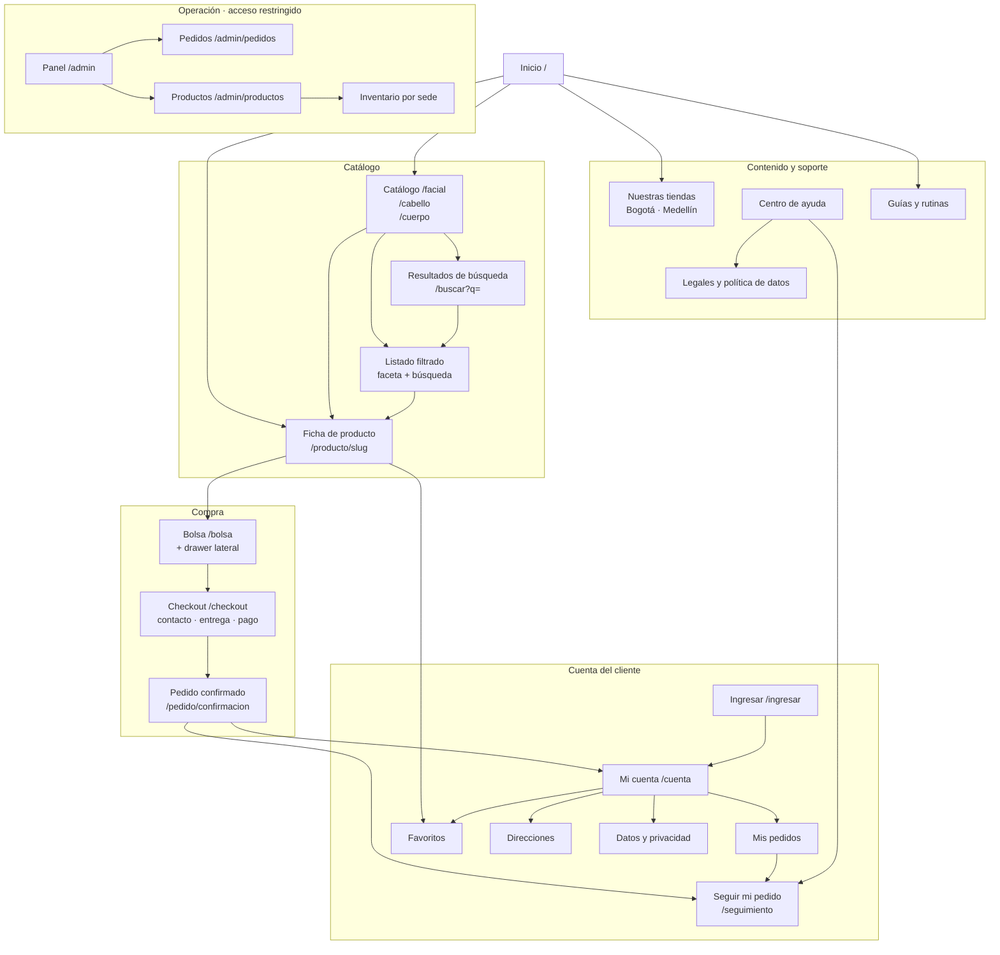
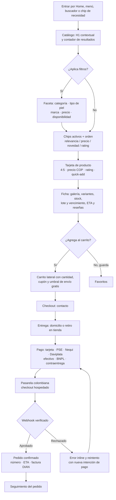
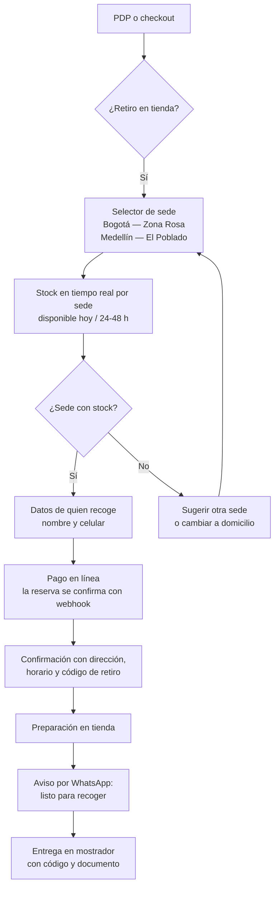
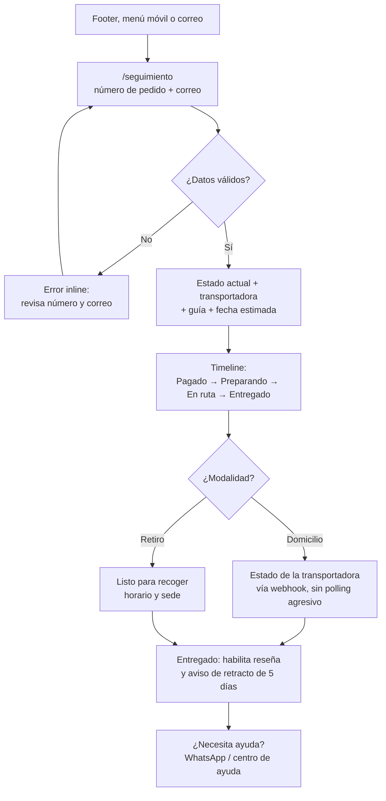
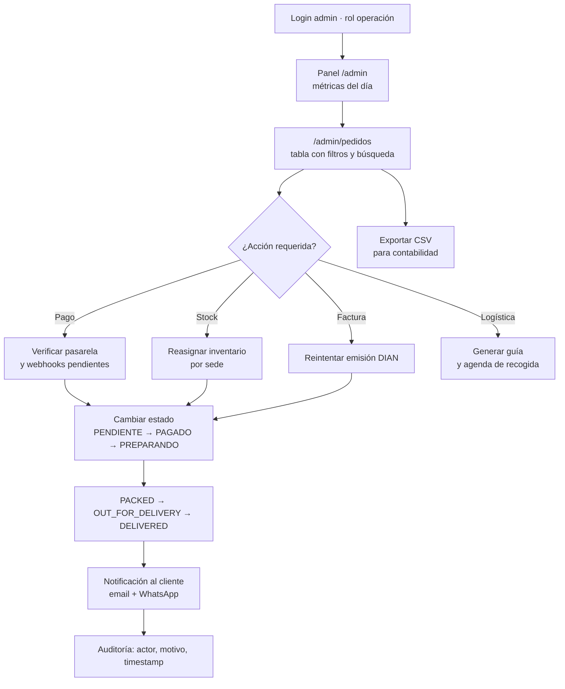

# Wireframes y arquitectura de navegación — Adriana Tienda

| Campo | Valor |
|---|---|
| **Alcance** | Storefront + admin operativo, previo a la implementación |
| **Referencias de ancho** | Desktop 1440 px · Tablet 768 px · Móvil 375 px (con control a 320 px) |
| **Relación** | Desarrolla el §9.5 y §9.6 del `DESIGN_DOC.md`; los bloques descritos aquí se materializan en `maquetas/` |
| **Estado** | Propuesta para revisión del cliente |

> Las maquetas HTML son **representaciones visuales estáticas**: no hay lógica, ni router, ni
> estado. Los diagramas Mermaid de este documento sí describen el comportamiento previsto en
> producción.

---

## 1. Mapa del sitio



**Reglas de URL:** limpias, en español y sin parámetros de plataforma. Las facetas curadas
(categoría y marca) son rutas indexables; el resto de combinaciones se representan en query y
se canonicalizan a la ruta base. Los filtros relevantes se reflejan en la URL para poder
compartirlos y volver atrás.

---

## 2. Flujos de usuario

### 2.1 Catálogo → filtro → producto → carrito → checkout → pago → confirmación



**Puntos de fricción eliminados frente a la referencia:** un solo CTA en la ficha, filtros por
necesidad, `quick-add` desde el listado, stock y ETA visibles antes de pagar, y precio con IVA
siempre explícito.

### 2.2 Retiro en tienda (dos sucursales)



**Regla:** el retiro nunca se confirma por la redirección del navegador. El estado cambia a
«pagado» solo con webhook verificado; la tienda recibe la orden en su cola de preparación.

### 2.3 Seguimiento de pedido



### 2.4 Administración de pedidos



Estados y transiciones siguen la máquina del §8.12 del Design Doc. El panel prioriza
**densidad y velocidad**: tabla, filtros compactos, atajos de teclado y una sola acción
destructiva por fila confirmada.

---

## 3. Arquitectura de navegación

| Elemento | Desktop (1440 px) | Tablet (768 px) | Móvil (375 px) |
|---|---|---|---|
| **Barra de anuncio** | 36 px, verde, 3 mensajes separados por `·` | 36 px, 2 mensajes | 32 px, 1 mensaje rotativo estático |
| **Header** | 72 px sticky: logo · categorías · buscador · favoritos · cuenta · bolsa | 64 px: logo · buscador · bolsa · `Menu` | 60 px: `Menu` · logo · bolsa; buscador en segunda fila |
| **Mega-menú** | Panel de 3 columnas al hover/foco: Categorías · Necesidades · Marcas, con imagen editorial | Panel desplegable a ancho completo | Acordeón dentro del panel lateral |
| **Breadcrumb** | Debajo del header, 13 px, `Inicio / Cabello / Tratamientos` | Igual, con truncamiento | Una línea, solo nivel inmediatamente superior |
| **Buscador** | Input 320 px con overlay de sugerencias agrupadas | Input flexible; overlay a ancho completo | Pantalla completa al enfocar; recientes y populares |
| **Filtros PLP** | Rail fijo de 280 px a la izquierda | Bottom-sheet accesible desde «Filtros (N)» | Bottom-sheet con CTA sticky «Aplicar (N)» |
| **Bolsa** | Drawer lateral de 400 px desde la derecha | Drawer de 90 % de ancho | Bottom-sheet casi a pantalla completa |
| **Footer** | 4 columnas + franja legal | 2 columnas + acordeones | Acordeones + franja legal |
| **CTA de compra PDP** | Buy box junto a la galería | Buy box apilado, sticky al hacer scroll | Buy-bar sticky inferior con precio + CTA |

**Reglas transversales**

- El header sticky nunca tapa el foco: los destinos de ancla llevan `scroll-margin-top: 88px`.
- El drawer y el bottom-sheet capturan el foco, responden a `Esc` y devuelven el foco al
  disparador al cerrarse.
- El buscador agrupa resultados en Productos · Marcas · Categorías · Contenido, con
  navegación por flechas y `aria-activedescendant`.
- El breadcrumb es también el refuerzo SEO: genera `BreadcrumbList` JSON-LD.
- Ninguna acción principal depende del hover: en táctil, `quick-add` y filtros son siempre
  visibles.

---

## 4. Wireframes por breakpoint

La jerarquía se describe de arriba abajo; `[H1]` marca el único encabezado principal de cada
pantalla. Los bloques entre paréntesis indican la proporción aproximada del ancho.

### 4.1 Desktop — 1440 px

#### Home

```
┌──────────────────────────────────────────────────────────────────────────┐
│ Anuncio: envío gratis $150.000 · recoge en tienda · retracto 5 días      │
├──────────────────────────────────────────────────────────────────────────┤
│ [Logo]  Facial  Cabello  Cuerpo  Marcas  Ofertas   [ Buscar… ]  ♡  ☺  🛍2 │
├──────────────────────────────────────────────────────────────────────────┤
│ [H1] HERO editorial 60% + panel de propuesta 40%  CTA «Ver colección»   │
├──────────────────────────────────────────────────────────────────────────┤
│ Sellos de confianza: envío · retiro · pagos seguros · desarrollado        │
├──────────────────────────────────────────────────────────────────────────┤
│ [H2] Compra por necesidad  ·  6 chips en una fila                         │
├──────────────────────────────────────────────────────────────────────────┤
│ [H2] Categorías destacadas  ·  3 tarjetas 4:3 (Facial / Cabello / Cuerpo) │
├──────────────────────────────────────────────────────────────────────────┤
│ [H2] Los más vendidos  ·  grid 4 columnas · card 4:5 · quick-add          │
├──────────────────────────────────────────────────────────────────────────┤
│ Banner de campaña + reseñas agregadas 4.8 / 1.240 verificadas            │
├──────────────────────────────────────────────────────────────────────────┤
│ [H2] Nuestras tiendas  ·  2 tarjetas: Zona Rosa / El Poblado              │
├──────────────────────────────────────────────────────────────────────────┤
│ Newsletter (consentimiento) · Footer 4 columnas · franja legal            │
└──────────────────────────────────────────────────────────────────────────┘
```

#### Catálogo

```
│ breadcrumb │ [H1] Cabello · 84 productos │ orden: relevancia ▾            │
├──────────────┬───────────────────────────────────────────────────────────┤
│ Filtros 280px│ chips activos: [Cabello ×] [Garnier ×] [Limpiar todo]      │
│ Categoría    │ ┌───────┐ ┌───────┐ ┌───────┐ ┌───────┐                   │
│ Tipo de piel │ │ 4:5   │ │ 4:5   │ │ 4:5   │ │ 4:5   │  card + quick-add  │
│ Marca        │ └───────┘ └───────┘ └───────┘ └───────┘                   │
│ Precio       │ ┌───────┐ ┌───────┐ ┌───────┐ ┌───────┐                   │
│ Disponible   │ └───────┘ └───────┘ └───────┘ └───────┘                   │
│ Rating       │ Paginación «Cargar más» / 1 2 3 … · texto SEO              │
└──────────────┴───────────────────────────────────────────────────────────┘
```

#### Ficha de producto

```
│ breadcrumb                                                               │
├──────────────────────────┬───────────────────────────────────────────────┤
│ Galería 7/12             │ Marca · [H1] producto · ★ 4.8 (128) · badges  │
│ ┌──────────────────────┐ │ Precio COP + precio anterior tachado          │
│ │ imagen 4:5 principal │ │ Presentación: [250 ml] [400 ml] [1 L]         │
│ └──────────────────────┘ │ Stock por sede + ETA en Bogotá/Medellín       │
│ [▣][▣][▣][▣] thumbs      │ Lote L-2409 · Vence 05/2027 (etiqueta FEFO)   │
│                          │ Cantidad [− 1 +]  ♡ favorito                  │
│                          │ [Único CTA] Agregar al carrito                │
│                          │ Retiro en tienda vs despacho · medios de pago  │
├──────────────────────────┴───────────────────────────────────────────────┤
│ Tabs: Detalles · Modo de uso · Ingredientes · Especificaciones           │
│ Reseñas verificadas · Relacionados (4 cards)                             │
└──────────────────────────────────────────────────────────────────────────┘
```

#### Checkout

```
│ [H1] Finalizar compra · pasos: 1 Contacto → 2 Entrega → 3 Pago           │
├──────────────────────────────────────────┬───────────────────────────────┤
│ 1 Contacto (expandido)                   │ Resumen sticky                │
│ 2 Entrega: domicilio / retiro en tienda  │ 2 ítems con miniaturas        │
│ 3 Pago: tarjeta · PSE · Nequi · BNPL     │ cupón · subtotal · envío       │
│ Validación inline · privacidad · seguro  │ [H2] Total COP                │
│ [Único CTA] Pagar de forma segura        │ candado + Wompi               │
└──────────────────────────────────────────┴───────────────────────────────┘
```

#### Admin (pedidos y productos)

```
│ Sidebar 240px │ Topbar: búsqueda ·usuario · alertas                     │
│ Pedidos       │ [H1] Pedidos │ métricas: 4 tarjetas del día              │
│ Productos     │ filtros: estado · fecha · sede · pago   [Exportar]       │
│ Inventario    │ tabla densa: N° · cliente · total · estado · acción     │
│ Cupones       │ paginación · alertas de stock bajo                       │
└───────────────┴──────────────────────────────────────────────────────────┘
```

### 4.2 Tablet — 768 px

- **General:** contenedor de 24 px de margen, 8 columnas, sin rail lateral fijo.
- **Home:** hero apilado (imagen arriba, texto abajo), categorías en 3 columnas, productos en
  3 columnas, sellos en 2×2, tiendas en 2 columnas.
- **Catálogo:** barra de herramientas con «Filtros (N)» y orden en `select`; chips en una fila
  desplazable; grid de 3 columnas; filtros en bottom-sheet de 85 % de altura.
- **Producto:** galería y buy box apilados; miniaturas en fila; tabs en una sola fila;
  relacionados en 3 columnas; reseñas debajo.
- **Carrito:** drawer de 90 % de ancho; resumen se mantiene al fondo de la vista.
- **Checkout:** pasos en acordeón a ancho completo; resumen colapsable arriba por defecto;
  al expandirse muestra los mismos datos que el sticky de desktop.
- **Cuenta y seguimiento:** dos columnas (menú lateral estrecho + contenido); timeline
  horizontal.
- **Admin:** tabla con scroll horizontal controlado; sidebar colapsable a iconos.

### 4.3 Móvil — 375 px

```
HOME
┌─────────────────────────┐
│ ☰   [logo]        🛍2   │  header 60 px
│ [🔍 Buscar productos… ] │  buscador segunda fila
│ anuncio: envío gratis   │
│ ┌─────────────────────┐ │
│ │ HERO 4:5            │ │  [H1] propuesta de valor + CTA
│ └─────────────────────┘ │
│ 4 sellos en grid 2×2    │
│ [H2] Necesidades → chips desplazables
│ [H2] Categorías → 2 columnas
│ [H2] Más vendidos → 2 columnas, quick-add visible
│ Tiendas → tarjetas apiladas
│ Newsletter · footer en acordeones
└─────────────────────────┘

CATÁLOGO
┌─────────────────────────┐
│ ‹ Cabello · 84 productos │  breadcrumb de un nivel
│ [Filtros (2)] [Orden ▾] │
│ [Cabello ×] [Garnier ×] │  chips desplazables
│ ┌────────┐ ┌────────┐   │  2 columnas · imagen 4:5
│ │ card   │ │ card   │   │
│ └────────┘ └────────┘   │
│ [Cargar más productos]  │
└─────────────────────────┘

PRODUCTO
┌─────────────────────────┐
│ galería 4:5 + thumbs     │
│ marca · [H1] · ★ · badge │
│ precio + precio anterior │
│ presentación (chips)     │
│ stock por sede + ETA     │
│ L-2409 · Vence 05/2027   │
│ acordeones de contenido  │
│ reseñas · relacionados   │
│ ─────────────────────── │
│ buy-bar sticky abajo:    │
│ $ 89.900  [Agregar]      │
└─────────────────────────┘

CHECKOUT
┌─────────────────────────┐
│ [H1] Pagar               │
│ ▸ Resumen (2 ítems)      │  colapsado por defecto, orden -1
│ 1 Contacto               │
│ 2 Entrega                │
│ 3 Pago                   │
│ [Pagar · $ 198.800]      │
└─────────────────────────┘

ADMIN (acceso operativo, también responsive)
┌─────────────────────────┐
│ ☰ Panel · Pedidos       │
│ 4 métricas en 2×2        │
│ [buscar] [estado ▾]      │
│ tabla → tarjetas apiladas│
│ cliente · total · estado │
└─────────────────────────┘
```

**Reglas de jerarquía móvil**

1. La propuesta de valor del hero se lee en el primer viewport: titular, una frase y un CTA.
2. El precio y el CTA de compra nunca quedan por debajo de un bloque de texto extenso: buy-bar
   sticky.
3. Los filtros no compiten con el contenido: bottom-sheet con contador y CTA de aplicación.
4. Las acciones destructivas (eliminar, cancelar) van al final de la pantalla y piden confirmación.
5. Sin scroll horizontal: tablas admin se transforman en tarjetas; chips se desplazan dentro de
   su propio contenedor con `aria-label`.

---

## 5. Matriz de pantallas ↔ maquetas

| Pantalla | Maqueta | Breakpoints observados en la maqueta |
|---|---|---|
| Home | `maquetas/index.html` | 375 / 768 / 1440 |
| Catálogo con filtros | `maquetas/catalogo.html` | Rail desktop → bottom-sheet móvil |
| Ficha de producto | `maquetas/producto.html` | Galería 7/5 → apilada + buy-bar; etiqueta de lote/vencimiento junto al stock |
| Bolsa + drawer | `maquetas/carrito.html` | Página + drawer representado |
| Checkout | `maquetas/checkout.html` | Sticky desktop → resumen colapsable móvil |
| Confirmación | `maquetas/pedido-confirmado.html` | Un solo diligenciamiento, móvil primero |
| Mi cuenta | `maquetas/cuenta.html` | Tabs → acordeones |
| Seguimiento | `maquetas/seguimiento-pedido.html` | Timeline vertical/horizontal |
| Admin pedidos | `maquetas/admin-pedidos.html` | Tabla → tarjetas |
| Admin productos | `maquetas/admin-productos.html` | Tabla → tarjetas + alertas de stock |

---

## 6. Criterios de aceptación de la navegación

- [ ] Desde Home se llega a cualquier categoría en **un clic** y a un producto en **dos**.
- [ ] Filtros, orden y búsqueda conservan estado en la URL y soportan «atrás» del navegador.
- [ ] El drawer de bolsa se abre desde cualquier pantalla y cierra con `Esc`.
- [ ] El checkout se completa sin recargas innecesarias y sin perder datos al corregir errores.
- [ ] El seguimiento funciona sin iniciar sesión (número + correo).
- [ ] El panel admin muestra el estado de pago y de factura antes de permitir acciones logísticas.
- [ ] La ficha de producto muestra lote y vencimiento de forma discreta (C-01), sin lógica en la maqueta.
- [ ] Ninguna pantalla tiene scroll horizontal a 320/375/768/1440 px.
- [ ] Las transiciones y el sticky respetan `prefers-reduced-motion`.
