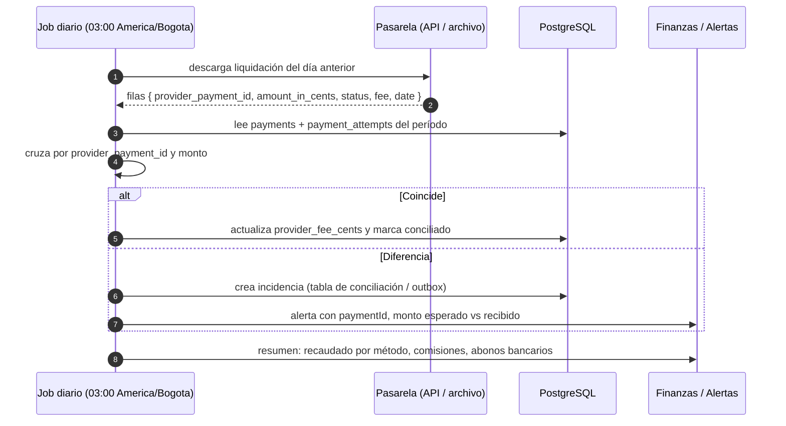

# Flujos de Pago — Adriana_tienda

> **Estado:** Propuesta de diseño (fase de diseño). **No es implementación.**
> El proveedor concreto lo decide `forge-architect` (DESIGN_DOC: **Wompi** primario, **ePayco**
> plan B). Este modelo es **agnóstico**: el dominio habla de `PaymentProvider`, no de Wompi.
> **Fuente operativa:** decisiones C-01, C-02, C-04, C-08 y C-12 de
> `docs/02-arquitectura/decisiones-comandante.md`. `mercado-pago` no es un adaptador activo.

---

## 1. Decisiones de pago

> **Decisión:** **Hosted checkout** (el cliente sale a la página de la pasarela). La tienda
> nunca recibe, procesa ni almacena datos de tarjeta. Reduce el alcance PCI a **SAQ-A**.

> **Decisión:** El resultado del pago lo determina **el webhook firmado**, nunca la redirección
> del navegador. La página de retorno solo muestra un estado optimista y hace polling.

> **Decisión:** Un solo `Idempotency-Key` por checkout/pago y `unique(provider, event_id)` para
> webhooks. Reintentos no duplican pedidos ni descuentan stock dos veces.

> **Decisión (C-02):** todos los importes son `*_cents BIGINT`; IVA 19 % = `1900 basis points`
> y se deriva por línea con `base_cents = round_half_up(total_line_cents / 1,19)`,
> `iva_cents = total_line_cents - base_cents`.

> **Decisión (C-04):** el retorno de Wompi es la **única** excepción `SameSite=Lax` de la cookie
> de sesión de checkout; el resto usa `SameSite=Strict`. El webhook se verifica con HMAC y el
> `Bearer` queda reservado a worker/DIAN servidor a servidor.

---

## 2. Flujo principal: carrito → orden → pago → confirmación

```mermaid
sequenceDiagram
    autonumber
    actor C as Cliente
    participant W as Web (Next.js)
    participant B as BFF / Core
    participant D as PostgreSQL
    participant P as Pasarela (Wompi/ePayco)
    participant K as Worker / Outbox

    C->>W: Agrega productos al carrito
    W->>B: POST /cart/items
    B->>D: upsert cart_items (sin reservar stock)

    C->>W: Inicia checkout
    W->>B: POST /checkout/quote
    B->>D: lee precios, cupón, cobertura
    B-->>W: totales (cents) + quoteId (TTL 30 min)

    C->>W: Elige sede/entrega y confirma
    W->>B: POST /checkout (Idempotency-Key)
    B->>D: ¿clave ya usada?
    alt Replay idempotente
        D-->>B: respuesta previa
        B-->>W: mismo orderId (Idempotent-Replay: true)
    else Nueva operación
        B->>D: TX: crea/actualiza Customer, Order (PENDING_PAYMENT)
        B->>D: TX: FEFO elige lote + site_id; UPDATE inventory_lots reserved += q (reserved <= on_hand)
        B->>D: TX: actualiza inventory_by_site en la MISMA transacción (proyección)
        B->>D: TX: crea Reservation(ACTIVE, expires_at = now+30m)
        B->>D: guarda IdempotencyKey + requestHash + respuesta
        B->>P: POST /payments (monto = grand_total_cents, BIGINT)
        P-->>B: paymentId + checkoutUrl
        B->>D: guarda Payment(PENDING) + PaymentAttempt
        B-->>W: 201 { orderId, orderNumber: AT-2026-000123, nextAction.checkoutUrl, reservationExpiresAt }
    end

    W->>P: Redirige al cliente a nextAction.checkoutUrl
    C->>P: Paga (tarjeta / PSE / Nequi / BNPL)
    P-->>C: Redirección de retorno a /checkout/return (cookie checkout SameSite=Lax)

    Note over W,B: La redirección NO confirma el pedido

    P->>B: POST /webhooks/payments/wompi (firma HMAC)
    B->>D: insert WebhookEvent(eventId, payload) — unique
    alt eventId duplicado
        B-->>P: 200 { result: "DUPLICATE" } (sin efectos)
    else Evento nuevo
        B->>B: verifica firma + timestamp + monto
        alt Firma inválida o monto distinto
            B->>D: status = IGNORED + alerta
            B-->>P: 401 / 200 ignorado (sin cambio de estado)
        else Válido
            B->>D: TX: Reservation ACTIVE→CONFIRMED; reserved-=q; on_hand-=q
            B->>D: TX: movimiento SALE; Payment PAID; Order PAID
            B->>D: TX: outbox (factura DIAN, email, WhatsApp, guía)
            B->>D: WebhookEvent PROCESSED
            B-->>P: 200 { result: "PROCESSED" }
        end
    end

    K->>D: poll outbox_events (status=PENDING)
    K->>C: email/WhatsApp de confirmación + factura
    W->>B: GET /orders/{number} (polling en página de retorno)
    B-->>W: status = PAID / PREPARING
```

---

## 3. Verificación de webhook

> El cuerpo **crudo** (bytes exactos) se usa para calcular el HMAC. Cualquier
> re-serialización JSON invalida la firma.

| Paso | Acción | Fallo ⇒ |
|---|---|---|
| 1 | Leer `X-Event-Id`, `X-Event-Type`, `X-Timestamp`, `X-Signature`. | `400 MISSING_WEBHOOK_HEADER` |
| 2 | Rechazar si `|now - timestamp| > [webhook_tolerance_seconds = 300]`. | `401 STALE_WEBHOOK` |
| 3 | Calcular HMAC-SHA256(body, secreto del proveedor desde gestor de secretos) y comparar en tiempo constante. | `401 INVALID_SIGNATURE` + alerta `forge-sentinel` |
| 4 | Insertar `webhook_events` con `unique(provider, event_id)`. | Duplicado ⇒ `200`, sin efectos |
| 5 | Verificar que `amount_in_cents` del evento == `payments.amount_cents` == `orders.grand_total_cents`. | `IGNORED` + bloqueo para revisión |
| 6 | Verificar que `event_type` es uno esperado (`transaction.updated`). | `IGNORED` |
| 7 | Aplicar solo si la transición de estado es válida; si no, `IGNORED` con `last_error`. | Alerta operativa |

> **Nota:** Los secretos se rotan con *overlap*: se aceptan hasta dos secretos activos durante
> 24 h para no perder eventos en la ventana de rotación.

---

## 4. Idempotencia en tres capas

| Capa | Mecanismo | Efecto |
|---|---|---|
| Cliente → API | `Idempotency-Key` (24 h) + hash del body | Reintentos devuelven la misma respuesta, sin nuevo pedido. |
| Pasarela → API | `unique(provider, event_id)` en `webhook_events` | Webhook duplicado se descarta con `200`. |
| Interno → BD | `unique(provider, provider_payment_id)` y `unique(provider_txn_id)` | No se duplican pagos ni intentos. |

**Regla de oro:** la transacción que confirma el pago incluye **todo**: estado del pago,
descuento de stock, movimiento de inventario, evento outbox y `WebhookEvent.PROCESSED`. Si
falla cualquier parte, se hace rollback y el webhook queda `RECEIVED` para reintento.

---

## 5. Timeouts y casos límite

| Escenario | Detección | Comportamiento |
|---|---|---|
| Cliente cierra el navegador al pagar | No hay retorno | El webhook manda; la orden se confirma igual. |
| Webhook perdido | Job cada 10 min consulta transacciones `PENDING` > 5 min | Si la pasarela dice `APPROVED`, se aplica el mismo flujo de confirmación; si sigue `PENDING`, se reintenta. |
| Reserva expira antes del pago | `expires_at < now` | Orden → `CANCELLED`, reserva → `EXPIRED → RELEASED`. |
| Pago aprobado **después** del TTL | Webhook `APPROVED` con reserva expirada | Se acepta el dinero (`payment_status = PAID`) y la orden **permanece `PENDING_PAYMENT`** (estado canónico C-08): el job de TTL no la cancela. Se re-reserva FEFO; con stock ⇒ orden → `PAID`; sin stock ⇒ orden → `REFUNDED` + reembolso automático + cupón de disculpa (RN-013). |
| Doble clic en "Pagar" | Botón deshabilitado + Idempotency-Key | Un solo `paymentId`. |
| Pago declinado | Webhook `DECLINED` | `Payment FAILED`, reserva se libera, se ofrece otro método. El carrito se conserva. |
| Monto manipulado | Comparación en webhook | Se rechaza, se bloquea la orden y se alerta a seguridad. |
| Pasarela caída | `503` al crear intención | Se muestra método alterno (plan B activable por flag), sin liberar la reserva hasta el TTL. |
| PSE en proceso | Estado `PENDING` del proveedor | No se confirma hasta `APPROVED`; se muestra "verificando pago". |

---

## 6. Reembolsos

```mermaid
sequenceDiagram
    autonumber
    actor C as Cliente
    actor F as Finanzas (admin)
    participant B as Core
    participant D as PostgreSQL
    participant P as Pasarela
    participant K as Worker / Outbox

    C->>B: POST /orders/{n}/return-request (dentro de 5 días hábiles)
    B->>D: Order DELIVERED → RETURN_REQUESTED + historial (C-08)
    F->>D: recibe y verifica producto (sellado y vigente ⇒ restock)
    alt Retracto aceptado
        F->>B: POST /refunds (Idempotency-Key, amount, reason)
        B->>D: valida saldo reembolsable; crea Refund(APPROVED)
        B->>P: API de reembolso (reference = provider_payment_id)
        P-->>B: refundId / confirmación
        B->>D: PaymentAttempt(type=REFUND, SUCCESS); Refund COMPLETED
        B->>D: Payment → REFUNDED / PARTIALLY_REFUNDED; Order RETURN_REQUESTED → REFUNDED
        B->>D: outbox: nota crédito DIAN + email al cliente
        K->>C: comprobante de reembolso
    else Retracto rechazado (fuera de plazo / producto no vendible)
        F->>B: PATCH /admin/orders/{id}/status → RETURN_REJECTED (terminal)
        B->>D: audit_logs + notificación con fundamento; SIN reembolso
    end
```

| Regla | Detalle |
|---|---|
| Saldo | `amount_cents <= payment.amount_cents - Σ reembolsos anteriores`. |
| Stock | Solo se repone si el producto está sellado y vigente (RN-024); se usa movimiento `RETURN`. |
| Fallo de pasarela | `Refund FAILED`, reintento manual; **nunca** se marca como reembolsado sin confirmación. |
| Nota crédito | Se emite solo tras reembolso confirmado; referencia el `cufe` de la factura original. |
| Trazabilidad | `refunds.approved_by` + `audit_logs` con `before/after`. |
| Rechazo | `RETURN_REQUESTED → DELIVERED` **está prohibido** (C-08); el rechazo termina en `RETURN_REJECTED`, sin reverso de pago ni reposición de stock. |

---

## 7. Conciliación



| Frecuencia | Actividad |
|---|---|
| Cada 10 min | Revisión de transacciones `PENDING` > 5 min (webhook perdido). |
| Diaria | Descarga y cruce de liquidación; incidencias con SLA de 48 h (RN-036). |
| Semanal | Contraentrega: cruce con recaudo reportado por la transportadora. |
| Mensual | Cierre vs. abonos bancarios; exporte a contabilidad. |

---

## 8. Minimalización PCI: qué NO se almacena

| Dato | ¿Se almacena? | Motivo |
|---|---|---|
| Número de tarjeta (PAN) | **NO** | Hosted checkout; nunca toca nuestro servidor. |
| CVV / CVC | **NO, bajo ninguna circunstancia** | Prohibido incluso en logs. |
| Fecha de expiración de tarjeta | **NO** | La gestiona la pasarela. |
| Nombre impreso en la tarjeta | **NO** | — |
| Token de tarjeta de la pasarela | **NO** en MVP | Se podría evaluar en Fase 2 para "pagar de nuevo" con consentimiento. |
| `provider_payment_id`, `provider_txn_id` | SÍ | Referencia de conciliación, no dato de pago sensible. |
| Últimos 4 dígitos | Solo si la pasarela los devuelve **y** se decide mostrarlos; en MVP **NO** | Reduce superficie. |
| Monto, método, cuotas, comisión | SÍ | Necesarios para contabilidad y conciliación. |
| Payload crudo del webhook | SÍ, **sanitizado** | Se eliminan cabeceras de autorización y cualquier campo de tarjeta; se purga en 30 días. |
| Dirección / teléfono del cliente | SÍ, **cifrados** en snapshots | Necesarios para entrega; AES-256-GCM + hash ciego. |

> **Decisión:** `raw_payload` se sanea con una lista blanca de campos antes de persistirse.
> Un webhook con campos de tarjeta se rechaza y se alerta, aunque la firma sea válida.

---

## 9. Criterios de aceptación

1. Un webhook duplicado no cambia ningún estado ni descuenta stock dos veces.
2. Un pago aprobado tras expirar la reserva nunca confirma entrega sin stock asignado.
3. No existe ningún campo en la BD con PAN, CVV ni token de tarjeta.
4. La firma inválida se detecta antes de cualquier escritura de estado de negocio.
5. La conciliación diaria produce incidencias trazables con SLA de 48 h.
6. El reembolso queda reflejado en pasarela, `refunds`, nota crédito y auditoría.
