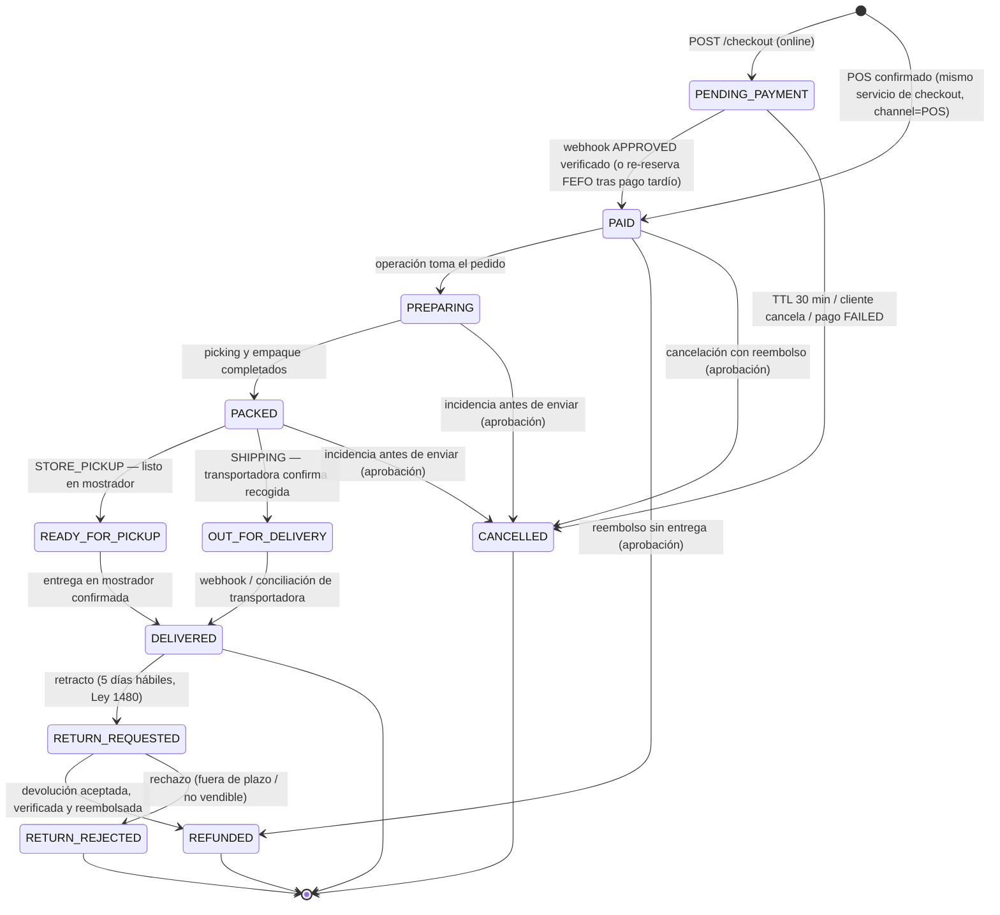
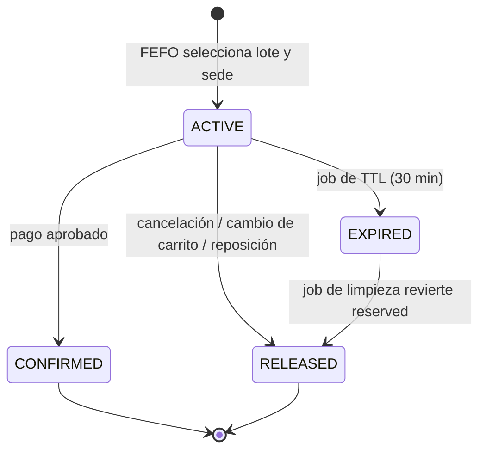
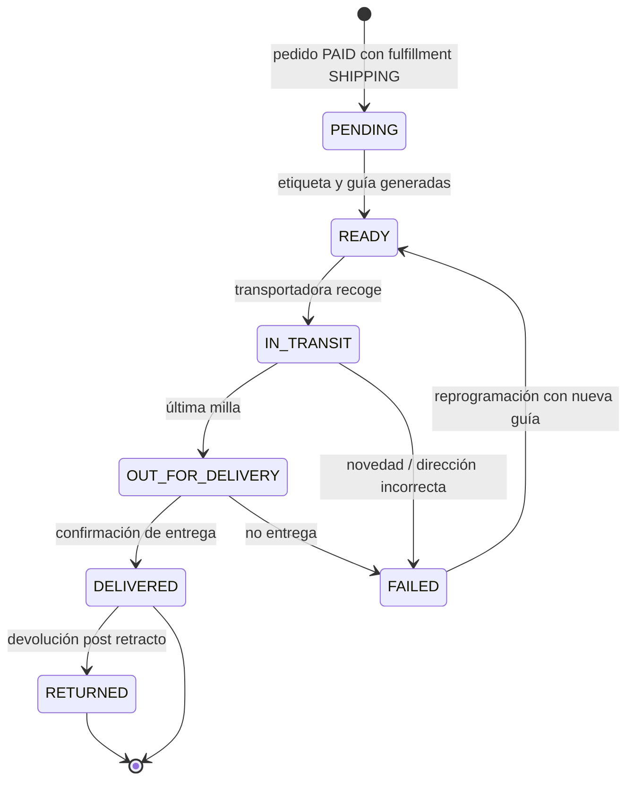
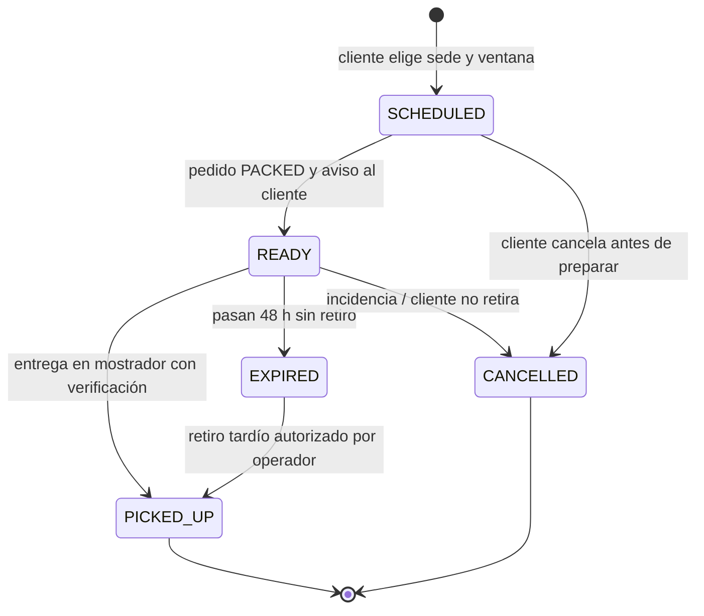
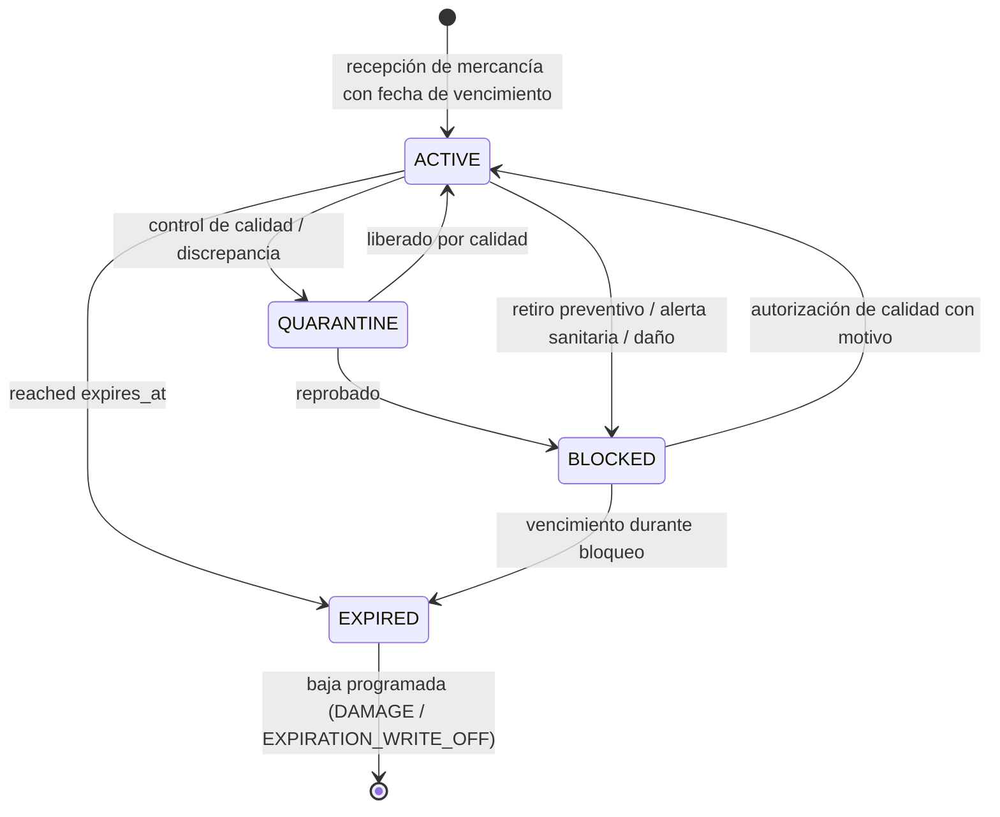

# Máquinas de Estado — Adriana_tienda

> **Estado:** Propuesta de diseño (fase de diseño). **No es implementación.**
> Toda transición se persiste en `order_status_history` / `payment_attempts` / campos de estado
> y emite un `outbox_event`. Ninguna transición es implícita: siempre hay un **actor** y una
> **razón**.
> **Fuente operativa:** decisión C-08 de
> `docs/02-arquitectura/decisiones-comandante.md`; ver también C-01 (inventario) y C-03 (POS).

---

## 1. Principios comunes

> **Decisión:** El webhook firmado es la única fuente de verdad del resultado del pago; la
> redirección del navegador nunca cambia el estado del pedido.

1. **El webhook manda:** el resultado del pago lo determina el evento verificado de la
   pasarela, nunca la redirección del navegador.
2. **Transiciones guardadas:** solo se permite el cambio si se cumple la regla indicada; si no,
   el evento se registra como `IGNORED` y se alerta.
3. **Efectos atómicos:** cambio de estado + movimientos de inventario + evento outbox en la
   misma transacción de base de datos.
4. **Auditoría:** `actor`, `from`, `to`, `reason`, `timestamp` y `trace_id`.
5. **Estados terminales** no aceptan salidas salvo las expresamente marcadas.

---

## 2. Pedido (`OrderStatus`) — estados canónicos C-08

> **Decisión (C-08):** los identificadores son los de la tabla §2.1.1. Los nombres en español
> que aparecen en RF/ADR son **etiquetas de UI**, nunca valores de enum. La máquina es
> monotónica: ninguna transición retrocede. Se eliminan `RETURN_REQUESTED → DELIVERED`,
> `PAID_NEEDS_REVIEW`, `DRAFT`, `SHIPPED`, `RETURNED` y `PICKED_UP_READY` como estados de pedido.

> **`READY_FOR_PICKUP` es un estado propio de `orders.status`** (C-08), no un derivado de
> `store_pickups.status`. El subsistema de retiro mantiene su propio ciclo
> (`SCHEDULED → READY → PICKED_UP`); al entrar en `READY_FOR_PICKUP`, `store_pickups.status`
> debe ser `READY`, y al confirmar `PICKED_UP` la orden pasa a `DELIVERED` (MT-05).

### 2.1.1 Mapeo etiqueta UI → identificador canónico (C-08)

| Etiqueta UI (español) | `orders.status` | Subsistema dueño / nota |
|---|---|---|
| Pendiente de pago | `PENDING_PAYMENT` | `orders.status` |
| Pagado | `PAID` | `orders.status` |
| En preparación | `PREPARING` | `orders.status` |
| Empaquetado | `PACKED` | `orders.status` |
| **Listo para retiro** | **`READY_FOR_PICKUP`** | **`orders.status`**, no `store_pickups.status` |
| En camino | `OUT_FOR_DELIVERY` | `orders.status` (la guía usa `shipments.status`) |
| Entregado / Entregado en tienda | `DELIVERED` | `orders.status` (una sola etiqueta, un solo estado) |
| Cancelado | `CANCELLED` | `orders.status` |
| Reembolsado | `REFUNDED` | `orders.status` |
| Devolución solicitada / Retracto | `RETURN_REQUESTED` | `orders.status` |
| Retracto rechazado | `RETURN_REJECTED` | `orders.status` (terminal) |

### 2.1 Transiciones de pedido

| Transición | Actor | Disparador | Regla / efecto obligatorio |
|---|---|---|---|
| `→ PENDING_PAYMENT` | Cliente (BFF) | `POST /checkout` | Crea reserva FEFO en `inventory_lots`, fija `expires_at = now + 30 min` y snapshot de precios; actualiza la proyección en la misma transacción (C-01). |
| `→ PAID` (POS) | Vendedor con `pos.sell` | `POST /pos/sales` (alias de `/checkout`) | Descuento FEFO atómico en la misma transacción, pago presencial confirmado, factura y movimiento `SALE` inmediatos (OPS-09 / RN-017). |
| `PENDING_PAYMENT → PAID` | Pasarela (webhook) | `transaction.updated` `APPROVED` | Firma válida, monto exacto, reserva `ACTIVE`; confirma reserva, descuenta stock, encola factura y notificación. |
| `PENDING_PAYMENT → CANCELLED` | Job de expiración / cliente | `expires_at < now` o cancelación | Solo si `payment_status = PENDING`; libera reserva (`RELEASED`), sin factura. |
| `PAID → PREPARING` | Operador de sede dueña | Toma de pedido | Verifica disponibilidad física en la sede dueña (`site_id`). |
| `PREPARING → PACKED` | Operador | Picking completado | Genera guía (si `SHIPPING`) o código de retiro (si `STORE_PICKUP`). |
| `PACKED → READY_FOR_PICKUP` | Operador de sede | Pedido listo en mostrador | Requiere `store_pickups.status = READY` y stock físico apartado; avisa al cliente. |
| `PACKED → OUT_FOR_DELIVERY` | Transportadora / operador | Recogida confirmada | Actualiza `shipments.status`, notifica tracking. |
| `READY_FOR_PICKUP → DELIVERED` | Vendedor de sede | Entrega en mostrador | Verifica código + documento; exige `store_pickups.status = PICKED_UP`. |
| `OUT_FOR_DELIVERY → DELIVERED` | Transportadora / conciliación | Webhook de entrega o reporte diario | Habilita reseña verificada y aviso de retracto. |
| `DELIVERED → RETURN_REQUESTED` | Cliente / transportadora | Radicación de retracto | Dentro de 5 días hábiles; congela liquidación. |
| `RETURN_REQUESTED → REFUNDED` | Finanzas | Reverso confirmado por pasarela | Producto verificado como vendible (RN-024); crea nota crédito DIAN y registra `refund`. |
| `RETURN_REQUESTED → RETURN_REJECTED` | Finanzas / operación | Fuera de plazo o producto no vendible | **Terminal**; sin reembolso, sin reposición, con notificación fundada y auditoría. |
| `PAID → REFUNDED` | Finanzas | Reembolso antes de entrega | Requiere aprobación y reverso confirmado; nunca se reabre. |
| `Cualquiera → CANCELLED` | Operador con permiso | Solo antes de `READY_FOR_PICKUP`/`OUT_FOR_DELIVERY` | Si hubo pago, exige reembolso aprobado. Un pedido pagado **nunca** vuelve a `PENDING_PAYMENT`. |

> **Pago tardío (RN-013, C-08):** un `APPROVED` posterior al TTL **no crea un estado
> adicional**. El dinero se acepta (`payment_status = PAID`) y la orden permanece en
> `PENDING_PAYMENT`; el job de TTL no la cancela porque el pago ya está confirmado. El sistema
> re-reserva FEFO: con stock ⇒ `PAID`; sin stock ⇒ `REFUNDED` + cupón de disculpa + alerta.
> Nunca se publica `PAID` sin stock asignado.

---

## 3. Pago (`PaymentStatus`)

```mermaid
stateDiagram-v2
    [*] --> PENDING : se crea intención de pago
    PENDING --> PAID : webhook APPROVED + monto válido
    PENDING --> FAILED : webhook DECLINED / ERROR / timeout
    PENDING --> VOIDED : cancelación antes de captura
    PAID --> PARTIALLY_REFUNDED : reembolso parcial confirmado
    PAID --> REFUNDED : reembolso total confirmado
    PARTIALLY_REFUNDED --> REFUNDED : reembolso del saldo restante
    PAID --> CHARGEBACK : controversia reportada por pasarela
    CHARGEBACK --> PAID : fallo a favor del comercio (rara); requiere conciliación
    FAILED --> PENDING : nuevo intento con misma clave de idempotencia
    FAILED --> [*]
    VOIDED --> [*]
    REFUNDED --> [*]
```

| Transición | Actor | Regla |
|---|---|---|
| `PENDING → PAID` | Pasarela (webhook verificado) | `amount_cents` del evento == `payment.amount_cents` == `order.grand_total_cents`; firma HMAC válida. |
| `PENDING → FAILED` | Pasarela / job de timeout | Código de declinación mapeado a mensaje seguro; **nunca** se devuelve el mensaje crudo al cliente. |
| `PENDING → VOIDED` | Operador | Solo si la pasarela confirma la anulación. |
| `PAID → REFUNDED` | Finanzas | Reverso por API + `payment_attempts(type=REFUND)` + `refunds`. |
| `PAID → CHARGEBACK` | Pasarela | Alerta inmediata a `forge-sentinel` y retención del cliente. |
| `FAILED → PENDING` | Cliente | Crea **nuevo** `payment_attempt`; el `payment_id` puede reutilizarse, el `provider_txn_id` no. |

---

## 4. Reserva de inventario (`ReserveStatus`)

| Transición | Actor | Regla |
|---|---|---|
| `→ ACTIVE` | BFF de carrito/checkout | `UPDATE inventory_lots SET reserved = reserved + qty WHERE lot_id AND site_id AND on_hand - reserved >= qty`. Si 0 filas ⇒ sin stock (RN-009). |
| `ACTIVE → CONFIRMED` | Webhook de pago | En la misma transacción: `reserved -= qty`, `on_hand -= qty`, movimiento `SALE`, reservation `CONFIRMED`. |
| `ACTIVE → RELEASED` | Cliente / sistema | `reserved -= qty`, movimiento `RESERVATION_RELEASE`, reason. |
| `ACTIVE → EXPIRED` | Job cada minuto | `expires_at < now`; luego `EXPIRED → RELEASED` en la misma transacción. |
| Re-reserva tras pago tardío | Sistema | Crea **nueva** reserva `ACTIVE` ligada al `order_id`; la anterior quedó `EXPIRED`. |

> **Regla crítica:** una reserva `EXPIRED` **nunca** se reactiva. Si el pago llega tarde, se
> crea una reserva nueva; si no hay stock, se reembolsa (RN-011).

---

## 5. Cumplimiento: Envío y Retiro

### 5.1 Envío a domicilio (`ShipmentStatus`)

> `ShipmentStatus.RETURNED` es un estado **de la guía**, distinto de `orders.status`; la orden
> usa `RETURN_REQUESTED` / `REFUNDED` / `RETURN_REJECTED` (C-08).

### 5.2 Retiro en tienda (`PickupStatus`)

| Transición | Actor | Regla |
|---|---|---|
| `SCHEDULED → READY` | Operador de sede | Requiere `orders.status = PACKED` y stock físico apartado en esa sede. |
| `READY → PICKED_UP` | Vendedor de sede | Verifica **código de retiro + documento**; registra `picked_up_by` y `picked_up_at`. |
| `READY → EXPIRED` | Job | 48 h sin retiro; libera reserva, genera alerta y decide reembolso/reatribución según RN-016. |
| `EXPIRED → PICKED_UP` | Operador con permiso | Solo si el stock sigue disponible; se documenta excepción. |
| `FAILED → READY` | Operador | Nueva guía; el costo de la primera guía se registra como pérdida operativa. |

> **Sincronía con la orden (C-08, MT-05):** `store_pickups.status = READY` dispara
> `orders.status = READY_FOR_PICKUP`; `PICKED_UP` dispara `orders.status = DELIVERED`.
> `READY` del subsistema de retiro **no sustituye** al estado de la orden.

---

## 6. Lote (`LotStatus`)

| Transición | Actor | Regla |
|---|---|---|
| `→ ACTIVE` | Operador de inventario | Requiere `lot_code`, `received_at` y `expires_at` (o declaración explícita de "sin vencimiento"). |
| `ACTIVE → QUARANTINE` | Control de calidad | Bloquea venta; no genera movimiento de salida. |
| `QUARANTINE → ACTIVE` | Control de calidad | Requiere `blocked_reason` documentado y auditoría. |
| `ACTIVE → BLOCKED` | Operador / sistema | `blocked_reason` obligatorio; libera reservas activas de ese lote (RN-022). |
| `ACTIVE → EXPIRED` | Job diario | `expires_at < CURRENT_DATE`; bloquea venta y dispara baja. |
| `EXPIRED → baja` | Operador autorizado | Movimiento `EXPIRATION_WRITE_OFF`, ajuste contable y destrucción certificada si aplica. |

---

## 7. Matriz de actores y permisos requeridos

| Actor | Puede transicionar |
|---|---|
| **Cliente (BFF)** | Carrito → checkout, cancelación antes de pago, solicitud de retracto. |
| **Pasarela (webhook firmado)** | `Payment PENDING → PAID/FAILED/CHARGEBACK`, `Order PENDING_PAYMENT → PAID`. |
| **Vendedor POS (permiso `pos.sell`)** | Creación de pedido POS vía alias de `/checkout`: `→ PAID`, con descuento FEFO atómico (OPS-09). |
| **Job de TTL/reconciliación** | Reserva `ACTIVE → EXPIRED → RELEASED`, Orden `PENDING_PAYMENT → CANCELLED` (solo con `payment_status = PENDING`), Lote `ACTIVE → EXPIRED`. |
| **Operador de sede** | Orden `PAID → PREPARING → PACKED → READY_FOR_PICKUP`, retiro `READY → PICKED_UP`, transferencias. |
| **Transportadora (webhook/API)** | `Shipment READY → IN_TRANSIT → DELIVERED/FAILED`; Orden `OUT_FOR_DELIVERY → DELIVERED`. |
| **Finanzas / Admin (permiso `orders.refund`)** | Reembolsos, cancelaciones con pago, `RETURN_REQUESTED → REFUNDED/RETURN_REJECTED`, liberación de lotes. |
| **Sistema (outbox worker)** | Emisión de notificaciones, facturas y eventos derivados; **no** cambia estados de negocio por iniciativa propia. |

---

## 8. Reglas transversales de transición

| # | Regla |
|---|---|
| MT-01 | Toda transición exitosa inserta un registro de historial (o `payment_attempts`) con `from`, `to`, `actor`, `reason`, `trace_id`. |
| MT-02 | Toda transición que afecta stock usa `SELECT ... FOR UPDATE` sobre la fila de `inventory_lots` o update condicional atómico. |
| MT-03 | Los eventos de webhook duplicados se responden `200` y no generan segunda transición. |
| MT-04 | Un evento fuera de orden se guarda como `IGNORED` con `last_error` y dispara alerta; nunca se fuerza la transición. |
| MT-05 | El cambio de estado del pedido y el de su cumplimiento son coherentes: `PACKED` con `STORE_PICKUP` ⇒ `store_pickups.status ∈ {SCHEDULED, READY}`; `orders.status = READY_FOR_PICKUP` exige `store_pickups.status = READY` y `PICKED_UP` exige `orders.status = DELIVERED`. Con `SHIPPING`, `orders.status = OUT_FOR_DELIVERY` exige `shipments.status ∈ {IN_TRANSIT, OUT_FOR_DELIVERY}`. |
| MT-06 | **Estados terminales de pedido (C-08): `CANCELLED`, `REFUNDED` y `RETURN_REJECTED`.** `DELIVERED` es terminal **solo mientras no exista `RETURN_REQUESTED`**: dentro de los 5 días hábiles puede abrir `RETURN_REQUESTED`, que nunca retrocede a `DELIVERED`. Ningún estado terminal se reabre; el retracto rechazado termina en `RETURN_REJECTED`. |
| MT-07 | Ninguna transición expone mensajes de error internos al cliente; se usa catálogo de códigos públicos. |
