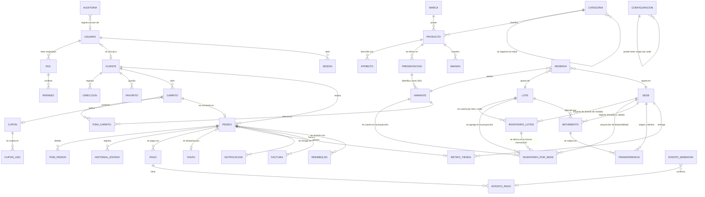

# Modelo Conceptual de Datos — Adriana_tienda

> **Estado:** Propuesta de diseño (fase de diseño). **No es implementación.**
> **Dueño:** `forge-backend` · **Alineación:** `DESIGN_DOC.md` §10 (arquitectura general).
> **Alcance:** e-commerce de belleza para Colombia (COP, español) con **dos sedes físicas**.
> **Fuente operativa:** decisiones C-01, C-02 y C-03 de
> `docs/02-arquitectura/decisiones-comandante.md`. Identificadores técnicos de sede:
> **`sites` / `site_id`**; «sede» es la etiqueta de negocio en español.

---

## 1. Propósito

Este documento describe los **objetos de negocio** y sus relaciones en lenguaje no técnico. Es
la capa de agreement entre negocio, producto e ingeniería: si una regla no aparece aquí, no
debe aparecer en el ERD lógico ni en la API. Los documentos `modelo-logico-er.md`,
`diccionario-datos.md`, `modelo-prisma-documental.md`, `maquinas-estado.md` y
`reglas-negocio.md` derivan de este modelo.

> **Decisión:** El modelo es **relacional y transaccional** (PostgreSQL). La fuente de verdad
> es la base de datos; el índice de búsqueda, la caché y los mensajes son proyecciones
> derivadas que pueden reconstruirse. Coherente con `DESIGN_DOC.md` §10.1.

---

## 2. Los siete agregados del negocio

| # | Agregado | Pregunta que responde | Entidades que lo forman |
|---|---|---|---|
| A | **Identidad y personas** | ¿Quién es el cliente y qué puede hacer? | Usuario, Rol, Permiso, Cliente, Dirección, Sesión |
| B | **Catálogo** | ¿Qué vendemos y cómo se muestra? | Marca, Categoría, Subcategoría, Producto, Atributo, Presentación, Variante/SKU, Imagen |
| C | **Inventario y sedes** | ¿Dónde está el producto y cuánto queda? | Sede (`sites`), Lote, **Inventario por lote y sede (`inventory_lots`, fuente de verdad)**, Proyección de disponibilidad (`inventory_by_site`), Movimiento de inventario, Reserva, Transferencia entre sedes |
| D | **Compra** | ¿Qué quiere llevar el cliente? | Carrito, Ítem de carrito, Cupón, Cupón usado |
| E | **Venta** | ¿Qué se vendió y por cuánto? | Pedido (online o POS), Ítem de pedido, Historial de estados, Pago, Intento de pago, Envío, Retiro en tienda, Factura |
| F | **Postventa y confianza** | ¿Qué pasó después de la venta? | Reembolso, Notificación, Reseña, Favorito, Consentimiento |
| G | **Plataforma** | ¿Cómo se opera y se audita? | Auditoría, Configuración, Evento webhook, Clave de idempotencia, Evento outbox |

> **Decisión:** **Usuario ≠ Cliente.** `Usuario` es la credencial (email, password, roles,
> acceso al panel). `Cliente` es la identidad comercial con historial unificado, direcciones y
> favoritos. Un usuario de panel puede no ser cliente; un cliente puede no tener usuario
> (checkout como invitado). Esto permite unificar el historial de un mismo correo aunque
> compre primero como invitado y luego se registre.

---

## 3. Diagrama ER conceptual

---

## 4. Relaciones en lenguaje de negocio

| Relación | Cardinalidad | Regla que la gobierna |
|---|---|---|
| Cliente → Direcciones | 1:N | Puede tener varias; **solo una principal por tipo** (despacho / facturación). |
| Producto → Variantes | 1:N | Todo producto vendible tiene al menos una variante activa; el SKU vive en la variante, no en el producto. |
| Presentación → Variante | 1:N | "50 ml", "400 ml", "Tono 5.3" son variantes; la presentación es el valor normalizado (cantidad + unidad). |
| Categoría → Subcategoría | 1:N (árbol) | Subcategoría es una categoría hija. Ej.: `Cabello → Tratamiento → Mascarilla`. |
| Variante → Lote | 1:N | Un SKU puede tener varios lotes con fecha de vencimiento distinta. |
| Lote → Inventario por lote y sede | 1:N | `inventory_lots(lot_id, site_id)` es la **fuente de verdad**: el mismo lote puede existir en las dos sedes con cantidades distintas. |
| Inventario por lote → Proyección por sede | N:1 | `inventory_by_site(variant_id, site_id)` se deriva por suma de lotes y se actualiza **en la misma transacción**; nunca manda sobre los lotes. |
| Reserva → (Variante, Lote, Sede) | N:1 cada una | Apartar siempre identifica **qué lote exacto** se aparta (FEFO) y la sede (`site_id`) donde está. |
| Pedido → Pago | 1:N | Un pedido puede tener varios intentos/pagos (reintentos, reembolsos parciales). |
| Pedido → Envío **o** Retiro | 1:0..1 excluyente | El tipo de cumplimiento se decide en checkout; un pedido nunca es envío y retiro a la vez. |
| Transferencia → Movimientos | 1:N | Una transferencia genera **dos** movimientos: salida en origen y entrada en destino. |
| Cupón → Cupón usado | 1:N | Cada canje queda registrado; el límite de usos se valida sobre esta tabla. |

> **Decisión (C-01):** La **numeración de lote es obligatoria para todo producto controlado**;
> en cosméticos el vencimiento es criticidad alta. Los lotes se consumen **FEFO**
> (*First Expired, First Out*), no FIFO. Umbrales aprobados para el MVP: **aviso a 90 días**,
> **bloqueo de venta a 15 días** y **sin descuento automático en Fase 1**. La pregunta FEFO
> (antes DD-Q9 / RM-Q9) está cerrada por C-01.

> **Decisión:** El pedido **siempre** queda asociado a un `Cliente` (si el checkout fue de
> invitado, se crea/actualiza el cliente por email). Así se cumple el historial unificado sin
> pedidos huérfanos. Los datos sensibles del pedido se guardan como **snapshot** inmutable,
> no como referencias vivas.

---

## 5. Glosario

| Término | Definición de negocio |
|---|---|
| **Sede** (`sites`, `site_id`) | Punto físico de Adriana (tienda) con inventario propio. Además de vender, sirve como punto de retiro y origen/destino de transferencias, y puede registrar venta presencial (POS). |
| **SKU** | Unidad mínima de venta con precio propio. En este negocio = combinación de producto + presentación (+ tono/tipo si aplica). |
| **Lote** | Unidad trazable de fabricación: código del fabricante, fecha de fabricación y fecha de vencimiento. Define qué unidades pueden venderse. |
| **FEFO** | *First Expired, First Out*: se descuenta primero el lote que vence antes, aunque otro lote haya llegado primero. |
| **Disponible** | `on_hand - reserved - safety_stock` sobre `inventory_by_site` (proyección). Es lo que puede prometerse al cliente; la fuente de verdad sigue siendo `inventory_lots`. |
| **Apartado (reserva)** | Bloqueo temporal de unidades de un lote en una sede mientras el cliente paga. Tiene TTL. |
| **Cumplimiento** | Forma de entregar: despacho a domicilio o retiro en tienda. |
| **Sede dueña** | Sede responsable del pedido (quien aparta, prepara, factura y responde por la entrega). Ver `estrategia-datos.md`. |
| **Venta en tienda** | Pedido creado por el panel de sede, con pago presencial; comparte el mismo modelo de pedido que la venta online. |
| **Intento de pago** | Cada llamada a la pasarela. Un pago puede tener varios intentos; solo uno puede aprobarse. |
| **Webhook** | Notificación entrante de la pasarela. Es la fuente de la verdad del resultado del pago, no la redirección del navegador. |
| **Idempotencia** | Propiedad de repetir una operación sin duplicar efectos (clave de idempotencia + event_id único). |
| **Retracto** | Derecho del consumidor a devolver el producto dentro de 5 días hábiles (Ley 1480/2011). |
| **Snapshoteo** | Copia del dato en el momento de la venta (precio, nombre, dirección) para que el histórico no cambie si el catálogo se edita. |
| **IVA incluido** | El precio de etiqueta en Colombia incluye el 19 % de IVA (`1900 basis points`); el impuesto se **deriva** del total por línea con `base_cents = round_half_up(total_line_cents / 1,19)` y `iva_cents = total_line_cents - base_cents`. Nunca se suma al final ni se usa `1900` como rate decimal (C-02). |
| **Punto de reorden** | Umbral de stock disponible que dispara alerta de reposición en una sede. |

---

## 6. Decisiones de modelado que impactan al negocio

| # | Decisión | Consecuencia |
|---|---|---|
| D-01 | Cliente separado de Usuario | Historial unificado de invitados y usuarios; el panel y la tienda comparten catálogo de personas. |
| D-02 | SKU en variante, no en producto | Un producto "Mascarilla X" puede tener 50 ml y 200 ml con precios distintos. |
| D-03 | Lote obligatorio y FEFO (C-01) | Se puede vender solo unidades con vencimiento válido; aviso a 90 días y bloqueo a 15 días, sin descuento automático en Fase 1. |
| D-04 | `inventory_lots(lot_id, site_id)` es la fuente de verdad; `inventory_by_site` es proyección en la misma transacción (C-01) | Responde "¿cuánto hay en la sede?" rápido sin perder trazabilidad por lote. |
| D-05 | Reserva atada a lote y sede | Evita sobreventa mediante `UPDATE` atómico (`reserved ≤ on_hand`) y hace determinista la sede dueña. |
| D-06 | Envío y retiro son excluyentes | Simplify fulfillment; se modela con `fulfillment_type` en el pedido + tabla hija correspondiente. |
| D-07 | Snapshots inmutables en ítems de pedido | Facturación y postventa no se alteran al cambiar precios o imágenes. |
| D-08 | Dinero en `BIGINT` centavos e IVA en `1900 bp` (C-02) | Cálculo exacto, sin coma flotante; ver `diccionario-datos.md` §3. |
| D-09 | Venta POS en el MVP (C-03, OPS-09) | Comparte el modelo de pedido y la numeración `AT-2026-000123`; el pedido se crea por `POST /checkout` con `channel = POS`. |

---

## 7. Fuera de alcance del modelo (Fase 2)

- Reseñas y moderación (presentes en el DESIGN_DOC, se incorporan al ERD lógico como extensión
  opcional, pero no gobiernan ninguna regla del MVP de datos).
- BNPL directo con Addi / Sistecrédito (se modela como `PaymentProvider`, sin tabla propia).
- Marketplace multi-vendedor, kits configurables por el cliente y suscripciones.
- Tallas: **explícitamente excluidas** (no aplica a cosméticos).
