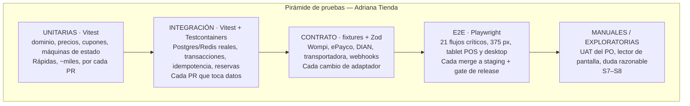

# Estrategia de pruebas — Adriana Tienda

| Campo | Valor |
|---|---|
| **Proyecto** | Adriana Tienda — e-commerce de belleza (Colombia, COP, dos sedes) |
| **Autor** | `forge-qualis` (Quality & Reliability / SRE) |
| **Versión** | 1.1 — 23 de noviembre de 2026 (enmienda C-01, C-02, C-03, C-05, C-11, C-12) |
| **Principio APEX FORGE** | **El que construye, prueba.** `forge-qualis` define la estrategia, valida la ejecución y firma el release |
| **Documentos relacionados** | [`definicion-terminado.md`](./definicion-terminado.md), [`matriz-riesgos.md`](./matriz-riesgos.md), [`plan-sprints.md`](./plan-sprints.md), [`metricas-exito.md`](./metricas-exito.md), [Design Doc canónico](../02-arquitectura/design-doc.md) §12, [decisiones-comandante.md](../02-arquitectura/decisiones-comandante.md) |

> **Fuentes canónicas (C-07/C-12):** [Design Doc](../02-arquitectura/design-doc.md) y tabla maestra
> de [decisiones del Comandante](../02-arquitectura/decisiones-comandante.md). Dinero en `BIGINT`
> centavos con IVA a 1900 basis points (C-02), lotes FEFO (C-01) y venta POS en el MVP (C-03).

> **Nota documental:** los fragmentos de YAML y comandos que aparecen aquí son **ejemplos de
> diseño**. No se crean archivos `.yml` ni scripts ejecutables como parte de esta entrega.

---

## 1. Objetivos de calidad medibles

| Objetivo | Umbral | Fuente | Gate |
|---|---|---|---|
| Cobertura global de líneas | ≥70% | Vitest coverage en CI | Bloquea merge si baja sin justificación |
| Cobertura en `packages/core` | ≥80% | Vitest coverage en CI | Bloquea merge |
| Flujos de pago | 100% de ramas críticas | Vitest + contratos + E2E | Bloquea release |
| E2E críticos | 21 escenarios en verde (móvil, tablet POS y desktop) | Playwright en staging | Bloquea release |
| Pedido POS (C-03) | E2E-21 en verde + 0 sobreventas web/POS | Playwright + integración FEFO | Bloquea release |
| Accesibilidad | 0 violaciones críticas/serias (axe 2.2 AA) | axe-core + manual | Bloquea release |
| LCP / INP / CLS (p75 móvil) | <2,5 s / <200 ms / <0,1 | Lighthouse CI + RUM | Sin regresión >10% |
| Lighthouse score | ≥90 en Home, PLP, PDP, Checkout | Lighthouse CI | Bloquea release |
| Carga | 200 rps sostenidos, p95 API <400 ms, errores <0,1% | k6 en staging | Bloquea release |
| Seguridad | 0 críticos (audit + ZAP + Semgrep) | CI + revisión Sentinel | Bloquea merge/release |
| Disponibilidad | 99,9% mensual (43 min 12 s de error budget) | Uptime/RUM | Pausa de features si se agota |

---

## 2. Pirámide de pruebas



**Regla de proporción:** muchas unitarias, menos de integración, pocas E2E pero representativas
del viaje de compra. Las E2E **no** se usan para probar cálculos unitarios (son lentas y frágiles).

### 2.1 Unitarias (Vitest)

| Qué se prueba | Ejemplos | Quién lo escribe | Gate |
|---|---|---|---|
| Cálculo de precios e impuestos | **`BIGINT` centavos (`*_cents`)**, IVA **1900 basis points**, fórmula canónica, descuento sobre snapshot, bordes 0 / 1 centavo / máximo | Backend / dominio | ≥80% en `packages/core` |
| Cupones y promociones | 1 cupón + promo no acumulable, expirado, usos agotados, mínimo no cumplido | Backend | Casos feliz y fallo |
| Máquina de estados de pago y pedido | `PAID` no retrocede, reintento crea nuevo Payment, reembolso ≤ monto pagado | Backend | 100% de transiciones |
| Reglas de stock, lotes y reserva | `reserved ≤ on_hand` sobre `inventory_lots`, FEFO por `expires_at`, aviso 90 / bloqueo 15 días, expiración 30 min, pago tardío → `PENDING_PAYMENT con reviewRequired=true` | Backend | Todas las ramas |
| Validaciones de dirección y formularios | Departamento→ciudad, teléfono CO, longitud de campos | Frontend | Componente + lógica |
| Selectores y helpers de UI | Formato de despliegue COP **desde centavos**, facetas activas, ETA por `site_id` | Frontend | Sin DOM real necesario |

#### 2.1.1 Casos límite monetarios (C-02 — fórmula canónica)

**Regla bajo prueba (única, prohibido «COP entero» y prohibido `1900` como tasa decimal):**

```text
iva_rate_bps     = 1900                                  // basis points, NO 1900 como decimal
base_cents       = round_half_up(total_line_cents / 1.19)
iva_cents        = total_line_cents - base_cents
suma(base_cents) + suma(iva_cents) = grand_total_cents   // la suma por línea cuadra con el total
```

| Caso | Entrada (`total_line_cents`) | Salida esperada | Aserción del test |
|---|---:|---|---|
| Cero | 0 | `base_cents = 0`, `iva_cents = 0` | Sin división por cero; total 0 |
| Mínimo no nulo | 1 | `base_cents = 1`, `iva_cents = 0` | `1 / 1.19 = 0,8403…` → `round_half_up` → 1; cuadra |
| IVA exacto | 119 | `base_cents = 100`, `iva_cents = 19` | `100 × 1,19 = 119` sin residuo |
| Redondeo hacia arriba | 118 | `base_cents = 99`, `iva_cents = 19` | `99,159…` → 99; `99 + 19 = 118` |
| Múltiplo exacto amplio | 238 | `base_cents = 200` (200×1,19 = 238), `iva_cents = 38` | `round_half_up` aplicado una sola vez, nunca dos; con denominador 1,19 no existe punto medio exacto en centavos enteros |
| Máximo `BIGINT` | 9.223.372.036.854.775.807 | Sin desbordamiento en la suma por línea | Usar `BigInt`; ningún `Number`/float en el cálculo |
| Líneas múltiples | 119 + 118 + 238 | `base = 100+99+200 = 399`, `iva = 19+19+38 = 76`, total 475 | Cuadre por línea y agregado (`grand_total_cents`) |
| Cupón sobre snapshot | Descuento aplicado al snapshot inmutable | Recalcular IVA sobre el valor descontado | El pedido ya pagado conserva el desglose original |
| POS (C-03) | Venta presencial con tarjeta/efectivo | Mismo desglose en centavos y 1900 bps que la web | E2E-21 + test unitario compartido `packages/core` |

> Estos casos son **unitarios** (rápidos) y se complementan con un test de integración que
> verifica el cuadre contra la BD; **nunca** se comprueban con E2E (§2, regla de proporción).

### 2.2 Integración (Vitest + Testcontainers)

| Qué se prueba | escenario | Gate |
|---|---|---|
| Repositorios y transacciones | Rollback al fallar, snapshot inmutable del pedido | Transacción real Postgres |
| Idempotencia | Misma `Idempotency-Key` con payload distinto → conflicto | Sin duplication |
| Concurrencia de inventario (web/web) | 2 compradores, 1 unidad → solo 1 reserva | 0 sobreventa, siempre |
| **Concurrencia POS/web (C-03, R5)** | Venta POS y checkout web simultáneos sobre la última unidad del mismo lote | 1 pedido, 1 movimiento FEFO, 0 sobreventa; **gate de release con E2E-21** |
| **Lotes y FEFO (C-01)** | Lote a 91 días → aviso sin bloqueo; a 15 días → bloqueo; dos lotes vigentes → se descuenta el de menor `expires_at`; proyección `inventory_by_site` coherente | 100% de selecciones FEFO; 0 lotes vencidos vendidos |
| Cuadre monetario (C-02) | Suma por línea de `base_cents + iva_cents` = `grand_total_cents` en `BIGINT` | 0 diferencias; sin float en la capa de dominio |
| Outbox y worker | Evento persistido en misma transacción; reintento con `jobId` no duplica | Cola real Redis |
| Contratos de API | Envelope `{error:{code,message},requestId}`, paginación por cursor | Todos los endpoints `/api/v1/*` |
| Autorización | Usuario A no ve pedido/dirección de B | Test de ID ajeno |
| **Rate limits (C-05)** | Login 5/15 min IP+cuenta; checkout 20/min sesión con `Idempotency-Key` | 429 con `Retry-After` sin efectos secundarios (§2.10) |

> **Datos reales de clientes jamás** en tests: se usan fixtures sintéticas (§4).

### 2.3 Contrato (fixtures + validación de esquema)

| Proveedor | Eventos de la fixture | Validación |
|---|---|---|
| **Wompi** | `APPROVED`, `DECLINED`, duplicado, fuera de orden, tardío tras expirar, monto distinto | Firma HMAC, ventana temporal, esquema Zod, unicidad `event_id` |
| **ePayco** (plan B) | `APPROVED`, `DECLINED` | Mismo puerto, sin cambios en dominio |
| **DIAN** (proveedor tecnológico) | Factura emitida, error temporal, nota crédito | CUFE, reintento, contingencia |
| **Transportadora / agregador** | Guía creada, recogida, entregada, novedad duplicada | Estado monotónico y no duplicar notificaciones |
| **GA4 / Consent Mode** | Eventos con y sin consentimiento | Ningún tag dispara antes del consentimiento |

### 2.4 E2E (Playwright) — 21 escenarios (POS incluido, gate de release)

| # | Escenario | Dispositivo | Notas |
|---:|---|---|---|
| 1 | Home → categoría → PLP → PDP → bolsa | 375 px | LCP/CLS medidos en el recorrido |
| 2 | Búsqueda con typo → resultado → PDP | 375 px | Sinónimo `shampoo → champú` |
| 3 | Filtro por necesidad ("caída") + faceta de marca | 375 px | URL compartible |
| 4 | Cambio de variante sin recarga (precio/imagen/stock/URL) | Desktop | Sin hidratación duplicada |
| 5 | Variante agotada bloquea CTA y ofrece "avísame" | 375 px | Sin agregar inválido |
| 6 | Quick-add desde PLP con selector de variante | 375 px | `aria-live` anunciado |
| 7 | Carrito invitado persiste tras cerrar navegador | 375 px | Cookie firmada |
| 8 | Merge de bolsa invitada al iniciar sesión | Desktop | Sin líneas duplicadas |
| 9 | Cupón válido aplica y se revierte al quitarlo | 375 px | Total con IVA |
| 10 | Cupón expirado se rechaza con mensaje claro | 375 px | Sin cambio de total |
| 11 | Checkout con envío a ciudad y ETA | 375 px | <90 s con datos guardados |
| 12 | Checkout con recogida en sede (Bogotá/Medellín) | 375 px | Sin costo de envío |
| 13 | Pago con tarjeta aprobada (fixture Wompi) | 375 px | Sin PAN en nuestro DOM |
| 14 | Pago rechazado + reintento con otro método | 375 px | Reserva sigue viva <30 min |
| 15 | PSE (mock) y Nequi (mock) | 375 px | Métodos visibles y cond claras |
| 16 | Webhook duplicado no duplica pedido ni email | API + UI | idempotencia de extremo a extremo |
| 17 | Contraentrega con límite y OTP | 375 px | Regla de riesgo aplicada |
| 18 | Confirmación: factura, ETA, evento GA4 `purchase` único | Desktop | Sin duplicado en refresh |
| 19 | Tracking público con número + email + rate limit | 375 px | Sin fuga entre pedidos |
| 20 | Retracto dentro de 5 días hábiles → nota crédito | Desktop | Ley 1480 |
| **21** | **Pedido POS: venta presencial descuenta lote FEFO, cuadra IVA en centavos y no sobrevende si coincide con checkout web** | **Tablet POS + API** | **C-03: gate de release. Misma regla atómica que la web; verifica aviso 90 / bloqueo 15 y 0 sobreventas (R5)** |

**Ejecución:** PR → smoke subset (escenarios 1, 7, 13, 18, **21**) en preview; merge a trunk → suite
completa en staging; release → suite completa + repetición 3 veces para detectar flakiness.
**El escenario 21 no se puede omitir ni marcar `skip`: es condición de Go/No-Go (C-03).**

### 2.5 Accesibilidad (axe + manual)

- **Automático:** `@axe-core/playwright` en Home, PLP, PDP, carrito, checkout, confirmación,
  cuenta y tracking. Gate: 0 críticas/serias.
- **Manual:**_tab order completo, `Esc` en drawers, focus trap en modales, zoom 200%, contraste,
  lector de pantalla (VoiceOver/NVDA) en checkout y confirmación, `prefers-reduced-motion`.
- **Responsable de validación:** `forge-frontend` ejecuta; `forge-qualis` verifica el reporte;
  el PO participa en UAT de accesibilidad en S7–S8.

### 2.6 Visual (regresión)

- Playwright screenshots de referencia para design system y plantillas clave en 375 px y 1440 px.
- Cambio visual → revisión y aprobación del diseñador; diferencias introducidas por contenido
  (fotos nuevas) se separan de diferencias de código mediante fixtures fijas.
- El quick-add y el CTA sticky en móvil son zonas de alta sensibilidad visual.

### 2.7 Rendimiento (Lighthouse CI + RUM)

| Métrica | Meta (p75 móvil) | Medición | Responsable |
|---|---|---|---|
| LCP | <2,5 s | Lighthouse CI + CrUX/Vercel Speed Insights | Frontend |
| INP | <200 ms | RUM | Frontend |
| CLS | <0,1 | RUM + Lighthouse | Frontend |
| TTFB HTML | <800 ms | RUM / CDN | Infra |
| JS gzip por plantilla | Home ≤150 KB · PLP ≤160 KB · PDP ≤170 KB · Checkout ≤190 KB | Bundle analyzer en CI | Frontend |
| HTML Home sin comprimir | <250 KB | CI budget | Frontend |

### 2.8 Seguridad (OWASP ZAP, dependencias, secretos)

- **En cada PR:** `npm audit` / equivalente, Semgrep, detección de secretos (gitleaks o equivalente).
- **En release:** ZAP baseline contra staging (spider + active scan limitado), revisión de CSP,
  HSTS, rate limiting, cabeceras y SAQ-A.
- **Revisión humana:** `forge-sentinel` aprueba todo cambio de pagos, PII, auth, roles o fiscal.
- **Gate:** 0 críticos; riesgos medios documentados con dueño y fecha en la matriz de riesgos.

### 2.9 Pruebas de carga y caos (k6)

| Prueba | Parámetros | Criterio de éxito |
|---|---|---|
| Carga sostenida | 200 rps, 15 min, mezcla Home 60% / PLP 25% / PDP 15% | p95 API <400 ms, error <0,1% |
| Pico de campaña | 400 rps, 5 min | Sin 5xx; cola de webhooks <100 |
| Checkout concurrente | 50 pagos/min con fixtures | 0 sobreventa; 0 pedidos duplicados |
| Caos: Wompi caído | Simular 500 en adaptador | Método alterno visible; incidente registrado |
| Caos: Meilisearch caído | Timeout >300 ms | Fallback a Postgres FTS; sin pantalla de error |
| Caos: Redis caído | Sin caché/colas | Storefront sirve contenido; pagos encolados con reintento |

### 2.10 Rate limits e idempotencia (C-05 — valores únicos)

Los únicos valores vigentes son **login 5 intentos / 15 min por IP + cuenta** (backoff exponencial
y CAPTCHA desde el quinto) y **checkout 20 peticiones / min por sesión** con `Idempotency-Key`
obligatoria. No coexisten otros umbrales en tests ni en documentación.

| # | Caso de prueba | Entrada | Resultado esperado | Capa / gate |
|---:|---|---|---|---|
| 1 | Login dentro del límite | 4 intentos fallidos en 15 min | 401 con mensaje genérico; sin revelar si el email existe | Integración / PR |
| 2 | Quinto intento y CAPTCHA | 5º intento fallido en 15 min para el par IP+cuenta | **429**, backoff exponencial y desafío CAPTCHA | Integración + API / PR |
| 3 | Dimensión del límite | Misma IP con otra cuenta y misma cuenta desde otra IP | El contador es por **IP + cuenta**; no se bloquea indebidamente al otro par | Integración / PR |
| 4 | Backoff y ventana | 6º intento a los 14 min y a los 16 min | Sigue bloqueado a los 14 min; se libera tras la ventana de 15 min | Integración / PR |
| 5 | Checkout dentro del límite | 20 peticiones/min con la misma `Idempotency-Key` y payload | Respuesta idéntica, **un solo pedido** y una sola reserva FEFO | Integración / PR |
| 6 | Checkout sobre el límite | Petición 21 en el mismo minuto de sesión | **429** con `Retry-After`; ningún pedido ni reserva creada | Integración / PR |
| 7 | Checkout sin cabecera | `POST /api/v1/checkout` sin `Idempotency-Key` | **400** con `requestId`; efectos cero | Contrato API / PR |
| 8 | Sesiones distintas | 20 peticiones/min en dos sesiones distintas | Cada sesión gestiona su propio contador; sin fuga entre sesiones | Integración / PR |

> Estos casos cubren RNF-016, ADR-005, el contrato API y SEC-011. `forge-sentinel` firma los
> casos 2, 6 y 7 por ser superficie de auth y pago.

---

## 3. Objetivos de cobertura por capa

| Capa | Cobertura objetivo | Qué cuenta | Qué NO cuenta |
|---|---:|---|---|
| Dominio (`packages/core`) | ≥80% líneas y ramas críticas | Precio, cupón, stock, estados, idempotencia | Getters triviales sin lógica |
| Aplicación / API | ≥70% líneas | Route handlers, validación, errores, autorización | Mocks que solo devuelven datos |
| UI (componentes) | ≥70% de componentes críticos con Testing Library | Interacción, estados, accesibilidad básica | Snapshots sin aserción de comportamiento |
| Integración BD/col | 100% de flujos críticos | Transacciones, reserva concurrente, outbox | Unitarios con BD simulada |
| Contratos externos | 100% de eventos mapeados | Todos los tipos de webhook y respuesta | Solo el caso exitoso |
| E2E | 21/21 escenarios (incluye pedido POS) | Flujo completo de negocio, web y presencial | Reintentos automáticos que ocultan fallos |

> La cobertura se mide **por capa** y se reporta en el CI. Un descenso >2 puntos respecto al
> sprint anterior requiere justificación escrita en el PR; si no, bloquea merge.

---

## 4. Datos de prueba (fixtures)

### 4.1 Catálogo y media

| Fixture | Contenido | Uso |
|---|---|---|
| `catalog-300.json` | 300 SKUs sintéticos, 8 marcas, 2 niveles de categoría, 3 variantes por producto | PLP, PDP, búsqueda, carga CSV |
| `catalog-stress.json` | 800 SKUs + 5.000 imágenes sintéticas (AVIF/WebP) | Carga y media pipeline |
| `brands-authorized.json` | Marcas con/sin autorización y MAP flag | Reglas de precio |
| `media-derivatives.json` | Original + derivados con `sizes`/`srcset` | CLS y CWV |

### 4.2 Usuarios y roles

| Fixture | Descripción | Uso |
|---|---|---|
| `user-guest` | Carrito por cookie firmada, sin cuenta | Escenarios 7, 8 |
| `user-buyer` | Comprador registrado con 2 direcciones y pedidos previos | Cuenta, purchase, reseñas |
| `user-support` | Rol soporte: ve pedidos, no edita precios | Autorización |
| `user-admin` | Rol administrador con auditoría | Admin, cupones, roles |

### 4.3 Sedes (`sites`), lotes e inventario

| Fixture | Descripción | Uso |
|---|---|---|
| `sites-2.json` | Bogotá y Medellín (*nombres a confirmar*), `site_id`, horarios, dirección, prioridad | Recogida, ETA, asignación |
| `inventory-low-stock.json` | 1 variante con 1 unidad compartida entre `sites` | Concurrencia web/web, web/POS y pago tardío |
| `inventory-movements.json` | Ajustes con motivo y actor | Conciliación de inventario |
| `inventory-lots-fefo.json` | 3 lotes por `site_id`: vigente lejano, vigente próximo (≈91 días) y bloqueado (≤15 días) | FEFO, aviso 90 / bloqueo 15, E2E-21 |
| `inventory-lots-expired.json` | Lote vencido y lote sin `expires_at` declarado | Exclusión de FEFO y regla de desempate |
| `money-cents-boundaries.json` | 0, 1 centavo, 119, 118, 238, máximo `BIGINT`, líneas múltiples | Casos límite C-02 (§2.1.1) |

### 4.4 Pagos, fiscal y logística

| Fixture | Descripción | Uso |
|---|---|---|
| `wompi-events/*` | APPROVED, DECLINED, DUPLICATE, OUT_OF_ORDER, LATE_APPROVED, AMOUNT_MISMATCH | Idempotencia y estados |
| `dian-responses/*` | Factura OK, error 500, nota crédito, contingencia | Facturación y reintentos |
| `shipping-events/*` | Guía, recogida, entregado, novedad duplicada | Tracking y notificaciones |
| `coupons.json` | Válido, expirado, usos agotados, mínimo, porcentaje/monto | Cupones y promociones |

### 4.5 Reglas de datos

1. **Cero PII real** en local/CI/staging: nombres, emails, teléfonos y documentos son falsos y
   claramente marcados (`test+...@example.com`, `+57000000000`).
2. Los eventos de GA4 en tests usan un property de sandbox y nunca se mezclan con producción.
3. Las fixtures se versionan con el código y se regeneran de forma determinista (mismo input,
   mismo output) para evitar flakiness.
4. Los pagos de prueba usan **sandbox**; en producción solo se hacen pagos reales de bajo monto
   con tarjeta autorizada por el negocio, documentados y conciliados.

---

## 5. Ambientes

| Ambiente | Datos | Despliegue | Quién puede ejecutar | Pruebas permitidas |
|---|---|---|---|---|
| **Local** | Fixtures sintéticas; Postgres/Redis/Meilisearch en contenedores | `pnpm dev` | Dev Team | Unitarias, integración, contrato con mocks, E2E contra localhost |
| **CI** | Igual que local, efímero por job; BD destruida al terminar | GitHub Actions por PR | Automático | Lint, typecheck, unit, integración, contrato, build, Lighthouse budget, audit, smoke E2E |
| **Staging (preview)** | Datos sintéticos + catálogo de muestra; **sin PII real** | Vercel preview + worker de staging | Dev Team, Qualis, PO | E2E completas, axe, Lighthouse, k6, ZAP, caos, UAT, canary interno |
| **Producción** | Datos reales | Canary 5% → 25% → 100% | Solo `forge-infra` + Qualis (Go/No-Go) | Smoke de post-deploy, RUM, synthetics, pagos reales de bajo monto autorizados. **Prohibido** cargar fixtures o ejecutar k6 destructivo |

**Regla de separación:** ninguna credencial de producción se usa en local, CI o staging; los
secretos se inyectan por entorno y se rotan sin redeploy. `forge-sentinel` revisa esta separación.

---

## 6. Quién valida cada tipo de prueba

| Tipo de prueba | Lo escribe / ejecuta | Lo valida (firma) | Momento |
|---|---|---|---|
| Unitarias | Ingeniero que construye | `forge-reviewer` en el PR | Cada PR |
| Integración | Ingeniero que construye | `forge-reviewer` + `forge-qualis` (cobertura) | Cada PR que toca datos |
| Contrato | Ingeniero del adaptador | `forge-qualis` + `forge-sentinel` (webhooks/pagos) | Cada cambio de integración |
| E2E | Ingeniero que construye el flujo (con apoyo de Qualis en el diseño) | `forge-qualis` | Cada merge + release |
| Accesibilidad | `forge-frontend` (axe + manual) | `forge-qualis` + PO en UAT | Cada PR + release |
| Visual | `forge-frontend` / diseñador | Diseñador UX/UI | Cambios de UI |
| Rendimiento | `forge-frontend` + `forge-infra` | `forge-qualis` | Cada PR (budget) + release (Lighthouse/k6) |
| Seguridad | `forge-infra` (escaneo) + todo el equipo (código seguro) | `forge-sentinel` | Cada PR + release |
| Carga / caos | `forge-infra` + `forge-qualis` | `forge-qualis` | S8 y antes de campañas |
| UAT / exploratoria | PO y operación del negocio | PO | S7–S8 |
| Release Go/No-Go | `forge-qualis` prepara | `forge-qualis` firma; Comandante arbitra | Día D |

> **Autoridad:** `forge-qualis` puede bloquear el release si falta evidencia de cualquiera de
> estas filas. El Comandante resuelve conflictos con el PO.

---

## 7. Matriz riesgo ↔ tipo de prueba

Los IDs corresponden a [`matriz-riesgos.md`](./matriz-riesgos.md).

| Riesgo | Unitaria | Integración | Contrato | E2E | A11y/Visual | Perf/Carga | Seguridad | Prueba clave / gate |
|---|---:|---:|---:|---:|---:|---:|---:|---|
| R1 DIAN no habilitado | · | ● | ● | ● | · | · | ● | Fixture de contingencia + factura real validada en staging |
| R2 Contenido/fotos incompletos | · | ● | · | ● | ● | ● | · | CSV con validación por fila + catálogo ≥95% en go-live |
| R3 Onboarding Wompi | · | · | ● | ● | · | · | ● | Sandbox en S0 + plan B en adaptador |
| R4 Webhooks duplicados/fuera de orden | ● | ● | ● | ● | · | ● | ● | `event_id` único + transiciones monotónicas + E2E 16 |
| R5 Sobreventa por concurrencia **web/web y web/POS (C-03)** | ● | ● | · | ● **21** | · | ● | · | 2 compradores / 1 unidad + venta POS simultánea en integración, k6 y **E2E-21 (gate de release)** |
| R6 Fraude contraentrega | ● | ● | · | ● | · | · | ● | Límites, OTP, blocklist, scoring |
| R7 CWV en rojo por imágenes | · | · | · | ● | ● | ● | · | Lighthouse budget + derivados AVIF/WebP + CLS 0 |
| R8 Dependencia de una pasarela | · | · | ● | ● | · | ● | ● | Cambio a ePayco por flag sin tocar dominio |
| R9 Ley 1581 / consentimiento | · | ● | · | ● | ● | · | ● | Consentimiento versionado + GTM no dispara sin consent |
| R10 Comisión erosiona margen | ● | ● | · | · | · | · | · | Tests de comisión, take rate y **cuadre de centavos/1900 bps (C-02, §2.1.1)** |
| R11 Rotación / conocimiento | · | · | · | · | · | · | · | ADRs, DoD, pair review, LGTM obligatorio |
| R12 Picos de tráfico | · | ● | · | ● | · | ● | · | k6 200 rps + pico 400 rps + colas |
| R13 Migración de planillas | · | ● | · | ● | · | · | · | Dry-run, conciliación SKUs/stock, rollback de import |
| R14 Retracto mal gestionado | ● | ● | · | ● | · | · | ● | Plazo 5 días hábiles + nota crédito (E2E 20) |
| R15 Caída en lanzamiento | · | ● | ● | ● | · | ● | ● | Canary + rollback <2 min + error budget |
| R16 Alcance crecido | · | · | · | · | · | · | · | DoR/DoD + congelación en S7 + change request |
| R17 Dependencia de sedes (`sites`) | ● | ● | · | ● | · | · | · | Fixture `sites-2` + `inventory-lots-fefo` + ETA y asignación con/sin stock |
| R18 Regresión por integración | ● | ● | · | ● | ● | ● | · | Suite completa en cada merge + rollback |
| R19 Fuga de PII | ● | ● | · | ● | · | · | ● | Cifrado, autorización, sin PII en logs, Sentinel |
| R20 Tests flaky / falsa seguridad | · | · | · | ● | · | · | · | 3 ejecuciones E2E + semilla fija + cuarentena con dueño |

● = cubierto · · = no aplica directamente

---

## 8. Gate de CI (diseño documental)

Ejemplo de **diseño** de las compuertas que `forge-infra` implementará (no se crea el archivo):

```yaml
# EJEMPLO DOCUMENTAL — no se crea este archivo en la entrega
name: quality-gate
on: [pull_request]
jobs:
  quality:
    runs-on: ubuntu-latest
    steps:
      - uses: actions/checkout@v4
      - run: pnpm install --frozen-lockfile
      - run: pnpm lint            # B2: sin excepciones
      - run: pnpm typecheck       # B1: TypeScript strict
      - run: pnpm test:unit --coverage   # C1 + C5: ≥70% global, ≥80% core
      - run: pnpm test:integration       # C2: Postgres/Redis reales
      - run: pnpm test:contract          # C3: fixtures de proveedores
      - run: pnpm audit --audit-level=high # 2.8: 0 críticos
      - run: pnpm gitleaks               # E2: sin secretos
      - run: pnpm build                  # build de web + worker
      - run: pnpm lighthouse:budget      # F1/F2: presupuestos por plantilla
      - run: pnpm playwright:smoke       # subset E2E en preview
  # El merge queda bloqueado hasta LGTM de forge-reviewer
  # y, si aplica, visto bueno de forge-sentinel.
```

**Compuertas por etapa:**

| Etapa | Compuerta | Bloquea |
|---|---|---|
| PR | lint + typecheck + unit + integración + contrato + audit + secretos + build + budget + smoke | Merge |
| Merge a trunk | Suite completa + E2E en staging + cobertura sin descenso | Release candidato |
| Release | **21 E2E (incluye E2E-21 POS)** + axe + Lighthouse + k6 + ZAP + UAT + rollback probado + error budget | Go/No-Go |

---

## 9. Cadencia de ejecución

| Momento | Pruebas | Responsable |
|---|---|---|
| Local, durante desarrollo | Unitarias + integración del cambio + contrato del adaptador | Autor |
| Cada PR | Gate completo de CI + smoke E2E + auditoría de secretos | CI / `forge-infra` |
| Cada merge a trunk | Suite completa en staging + E2E completas + axe | `forge-qualis` |
| Cada sprint | Cobertura, flakiness, escape defects y regresión visual | `forge-qualis` en Review |
| S7 (beta cerrada) | UAT, lector de pantalla, caos, carga ligera | PO + Qualis |
| S8 (release) | 21 E2E x3 (incluye pedido POS), k6, ZAP, Lighthouse, rollback simulacro, canary interno | Qualis + Sentinel + Infra |
| Post-lanzamiento 72 h | RUM, SLOs, error budget, synthetics, smoke tras cada deploy | Qualis + Infra |

---

## 10. Cierre: criterio de "estrategia suficiente"

`forge-qualis` solo firma el release si puede responder **sí** a estas ocho preguntas:

1. ¿Están todos los riesgos críticos de la matriz cubiertos por al menos una prueba automática?
2. ¿Hay evidencia de que un webhook duplicado y una carrera de stock no duplican/sobrevenden?
3. ¿Se verificó accesibilidad en móvil con teclado y lector de pantalla en checkout?
4. ¿LCP/INP/CLS y presupuestos de JS están en verde sin regresión >10%?
5. ¿Hay 0 críticos de seguridad y aprobación de Sentinel en pagos/PII?
6. ¿Se probó el rollback en <2 min y hay error budget para el canary?
7. ¿Pasa el **E2E-21 de pedido POS** y está demostrado que una venta presencial y una web
   simultáneas no sobrevenden (C-03)?
8. ¿Cuadran todos los importes en `BIGINT` centavos con IVA a 1900 bps y la fórmula canónica, y
   están aplicados los límites 5/15 min y 20 req/min (C-02, C-05)?

**Si alguna respuesta es "no", el release se detiene.** No se compensa con más reuniones ni con
optimismo: se corrige la evidencia o se recorta el alcance.
