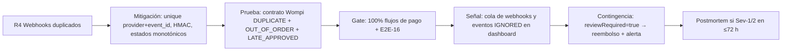

# Matriz de riesgos — Adriana Tienda

| Campo | Valor |
|---|---|
| **Proyecto** | Adriana Tienda — e-commerce de belleza (Colombia, COP, dos sedes físicas) |
| **Autor** | `forge-qualis` (Quality & Reliability / SRE) |
| **Versión** | 1.1 — 23 de noviembre de 2026 (enmienda C-01, C-02, C-03, C-05, C-11, C-12) |
| **Revisión** | Semanal en Refinement; obligatoria antes de cada Go/No-Go y tras cualquier incidente |
| **Documentos relacionados** | [`estrategia-pruebas.md`](./estrategia-pruebas.md), [`plan-sprints.md`](./plan-sprints.md), [`metricas-exito.md`](./metricas-exito.md), [Design Doc canónico](../02-arquitectura/design-doc.md) §12.1, [decisiones-comandante.md](../02-arquitectura/decisiones-comandante.md) |

> **Fuentes canónicas (C-07/C-12):** [Design Doc](../02-arquitectura/design-doc.md) y tabla maestra
> de [decisiones del Comandante](../02-arquitectura/decisiones-comandante.md). Vocabulario técnico
> `site_id`/`sites`; lotes FEFO con aviso 90 / bloqueo 15 (C-01); POS en el MVP (C-03).

> **Regla de fiabilidad:** un riesgo no se mitiga con optimismo. Todo riesgo **Alto o Crítico**
> necesita dueño, mitigación verificable, plan de contingencia y una prueba que lo cubra
> (ver matriz riesgo↔prueba en [`estrategia-pruebas.md`](./estrategia-pruebas.md) §7).

---

## 1. Escala y criterios

### 1.1 Probabilidad (P)

| Valor | Significado | Frecuencia orientativa |
|---:|---|---|
| 1 | Raro | <5% de probabilidad en el proyecto |
| 2 | Poco probable | 5–25% |
| 3 | Posible | 25–50% |
| 4 | Probable | 50–75% |
| 5 | Casi seguro | >75% o ya se está observando |

### 1.2 Impacto (I)

| Valor | Significado | Consecuencia típica |
|---:|---|---|
| 1 | Menor | Sin efecto en cliente ni en fecha |
| 2 | Bajo | Retraso <1 día o incidencia menor |
| 3 | Medio | Retraso 1–3 días, pedidos afectados o margen erosionado |
| 4 | Alto | Retraso >1 semana, pérdida de ingresos o incumplimiento legal |
| 5 | Crítico | Caída del lanzamiento, fuga de datos, fraude masivo o sanción |

### 1.3 Nivel de riesgo (P × I)

| Puntaje | Nivel | Política |
|---:|---|---|
| 1–4 | 🟢 Bajo | Monitoreo normal en el tablero |
| 5–9 | 🟡 Medio | Mitigación asignada; revisión quincenal |
| 10–14 | 🟠 Alto | Mitigación + contingencia escrita; revisión semanal; bloquea release si no hay evidencia |
| 15–25 | 🔴 Crítico | No se libera hasta reducirlo; decisión del Comandante con PO y Sentinel |

---

## 2. Registro de riesgos

| ID | Riesgo | P | I | P×I | Nivel | Mitigación | Dueño | Plan de contingencia |
|---|---|---:|---:|---:|---|---|---|---|
| **R1** | Proveedor de facturación DIAN no habilitado a tiempo (resolución, credenciales, certificación) | 3 | 4 | 12 | 🟠 Alto | Contratar en S0; credenciales de prueba en S2; integrar proveedor con adaptador y modo contingencia; monitor de facturas pendientes | Comandante + PO (cliente) | Facturación manual temporal con plantilla autorizada + reembolso/cupón si el cliente no recibe factura; reprogramar hito H4 sin mover el checkout |
| **R2** | Catálogo, fotos y fichas incompletos al lanzamiento (300–800 SKUs, 2 sedes) | 4 | 4 | 16 | 🔴 Crítico | CSV con validación por fila, placeholders válidos, congelación en S7, carga por tandas de marcas; cronograma de contenido desde S2 | PO (cliente) | Lanzar por tandas de marcas con catálogo ≥95% por tanda; ocultar SKUs incompletos y publicar aviso; **no bajar la DoD** |
| **R3** | Fricción en onboarding de Wompi (validación, documentos, tarifas) | 3 | 3 | 9 | 🟡 Medio | Sandbox en S0 (H3); acelerar puerto de pagos; contacto directo con proveedor desde S1 | Backend + Comandante | Activar plan B ePayco por flag (adaptador ya implementado en PAG-04); difundir métodos disponibles en checkout |
| **R4** | Webhooks duplicados, fuera de orden o tardíos tras la expiración | 3 | 4 | 12 | 🟠 Alto | `unique(provider,event_id)`, HMAC + ventana temporal, máquina de estados monotónica, reconciliación cada 10 min, fixtures de todos los eventos | Backend + `forge-sentinel` | `reviewRequired=true` + reintento de reserva; si no hay stock, reembolso automático, cupón de disculpa y alerta a operación. Nunca confirmar entrega sin stock |
| **R5** | Sobreventa por concurrencia **entre canales (web ↔ POS) y sedes**, agravada por lotes con vencimiento | 3 | 4 | 12 | 🟠 Alto | Reservas TTL 30 min, `UPDATE` atómico condicional sobre `inventory_lots` (`reserved ≤ on_hand`), selección FEFO, `CHECK` de BD, **prueba de concurrencia web/web y web/POS sobre 1 unidad**, integración + k6 + **escenario E2E-21 (pedido POS) como gate de release**, alerta de inventario negativo y de `inventory_projection_drift` | Backend + `forge-qualis` (gate E2E-21) | Reasignar desde otro `site_id` si hay lote vigente; si no, reembolso inmediato + cupón; pausar venta de la variante y del POS de esa sede hasta corregir; postmortem sin culpables si Sev-1/2 |
| **R6** | Fraude en contraentrega (COD) | 4 | 3 | 12 | 🟠 Alto | Límite de monto y zonas, OTP de teléfono en primer pedido, blocklist, scoring por antigüedad/historial, límite por cliente/mes | Negocio + Backend | Desactivar COD por flag; exigir prepago para zonas o montos sensibles; reporte de novedades a la transportadora |
| **R7** | Core Web Vitals en rojo por imágenes o JS en móvil (70% del tráfico) | 3 | 4 | 12 | 🟠 Alto | Pipeline AVIF/WebP, `sizes`/`srcset`, `priority` solo en hero, presupuestos por plantilla en CI, Lighthouse CI + RUM, sin librerías de animación | Frontend | Apagar bloques no críticos por feature flag, servir imágenes de menor resolución desde CDN, revertir el release que introdujo la regresión |
| **R8** | Dependencia de un único proveedor de pagos | 2 | 4 | 8 | 🟡 Medio | Capa de puertos/adaptadores, plan B ePayco implementado y probado en staging, métrica de error por proveedor | `forge-architect` | Activar ePayco por flag en <5 min; comunicar método alterno en checkout y soporte |
| **R9** | Incumplimiento de Ley 1581 / Decreto 1377 (consentimiento, RNBD) | 2 | 4 | 8 | 🟡 Medio | Banner granular y revocable, versión de consentimiento registrada, Consent Mode v2, políticas publicadas, revisión de Sentinel | `forge-sentinel` | Pausar tags y recolección por flag, publicar aviso correctivo, notificar al delegado de protección de datos del cliente |
| **R10** | Comisiones de pasarela erosionan margen **y errores de dinero/IVA rompen el cuadre** | 3 | 3 | 9 | 🟡 Medio | Negociar tarifa por volumen, incentivar PSE/Nequi, dashboard de take rate, tests de comisión y de centavos `BIGINT` con IVA a 1900 bps y fórmula canónica (C-02, §2.1.1) | Negocio + Backend | Ajustar umbral de envío gratis o promociones; migrar tráfico a método más barato; si el total no cuadra, bloquear el release y corregir la capa de dominio |
| **R11** | Rotación del equipo o conocimiento concentrado | 3 | 3 | 9 | 🟡 Medio | ADRs, README por módulo, pair programming, DoD escrita, LGTM obligatorio, tablero visible | `forge-architect` | Reasignar pair de apoyo por 1 sprint, congelar cambios no críticos mientras se transfiere contexto |
| **R12** | Picos de tráfico en campañas (hot sale, redes) | 3 | 3 | 9 | 🟡 Medio | ISR + CDN, caché de facetas, colas BullMQ, rate limiting, k6 200 rps + pico 400 rps, escalado de worker | `forge-infra` | Modo degradado: búsqueda FTS, desactivar recomendaciones, ampliar réplicas y colas; posponer campaña si el error budget está bajo |
| **R13** | Migración de datos desde planillas con errores de precio/stock | 4 | 3 | 12 | 🟠 Alto | Scripts con dry-run, validación por fila, conciliación de SKUs y stock por sede, checkpoint y revert de import | Backend | Restaurar snapshot previo a la importación, repetir carga corregida por tandas, bloquear SKUs dudosos hasta validación |
| **R14** | Retracto y devoluciones mal gestionados (Ley 1480, 5 días hábiles) | 3 | 3 | 9 | 🟡 Medio | Flujo de estados, plazos visibles, nota crédito automática, registro de casos y responsable operativo | Negocio + Backend | Atención manual prioritaria, extensión controlada del plazo con comunicación al cliente, revisión legal |
| **R15** | Caída en el lanzamiento o consumo acelerado del error budget | 3 | 4 | 12 | 🟠 Alto | Canary 5%→25%→100%, feature flags, smoke tests, rollback <2 min probado, SLOs y alertas, on-call 72 h | `forge-qualis` | Revert inmediato, apagar `checkout_enabled`, postmortem en ≤72 h y reintento en ventana posterior; la feature espera si el budget se agota |
| **R16** | Alcance crecido (scope creep) y presión para saltarse la DoD | 4 | 4 | 16 | 🔴 Crítico | DoR/DoD escritas, congelación en S7, change request con impacto en puntos/fecha, PO decide prioridad, Qualis bloquea sin tests | PO + Comandante | Recortar historias `Should`, moverlas a Fase 2 y documentarlo; **nunca** reducir tests ni revisión por presión de fecha |
| **R17** | Dependencia operativa de los dos `sites` (horarios, stock por lote y asignación inconsistentes) | 3 | 4 | 12 | 🟠 Alto | Entidad `site` (`site_id`) con horario y prioridad, conciliación de `inventory_lots` por sede, fixtures `sites-2` + `inventory-lots-fefo`, confirmación de datos reales con el cliente en S0/S2 (C-01) | Operación del cliente + Backend | Desactivar recogida en el `site` conflictivo y vender solo con envío; corregir inventario en admin con movimiento auditado |
| **R18** | Regresión funcional por integración frecuente a trunk | 3 | 4 | 12 | 🟠 Alto | CI obligatoria, suite completa en cada merge, E2E de flujos críticos, LGTM, rollback instantáneo | `forge-reviewer` + `forge-qualis` | Revert del commit problemático, ticket con test de regresión antes de reintroducir el cambio |
| **R19** | Fuga o exposición de datos personales (PII) en logs, errores o analytics | 2 | 5 | 10 | 🟠 Alto | Cifrado AES-256-GCM, índice ciego, sin PII en logs/trazas, autorización por usuario, revisión de Sentinel, gitleaks | `forge-sentinel` | Rotar credenciales, pausar superficie afectada, notificar al delegado del cliente, anonimizar y documentar el incidente con postmortem |
| **R20** | Tests flaky que dan falsa sensación de seguridad | 3 | 3 | 9 | 🟡 Medio | Semillas y fixtures deterministas, sin `sleep` arbitrarios, 3 ejecuciones E2E en release, cuarentena con dueño y fecha | `forge-qualis` | Marcar test en cuarentena visible, bloquear release hasta tener alternativa determinista; ningún test se desactiva silenciosamente |

**Distribución:** 2 críticos (R2, R16), 10 altos, 8 medios. No hay riesgos "bajos" sin dueño:
todos se revisan en el tablero semanal.

---

## 3. Dueños y responsables

| Dueño | Riesgos | Responsabilidad |
|---|---|---|
| **PO (cliente)** | R1, R2, R6, R14, R16, R17 | Aportar datos reales, decidir alcance, aprobar contingencias de negocio |
| **Comandante `apex-forge`** | R1, R3, R16 | Arbitrar prioridades, gestionar contratos e impedimentos I3 |
| **Backend** | R3, R4, R5, R6, R13, R14, R17 | Idempotencia, inventario, pagos, importación, trazas |
| **Frontend** | R7 | Rendimiento, accesibilidad, presupuestos de plantilla |
| **`forge-architect`** | R8, R11 | Adaptadores, ADRs, documentación técnica |
| **`forge-infra`** | R12 | Escalado, colas, entornos, alertas |
| **`forge-reviewer`** | R18 | LGTM obligatorio y regresión |
| **`forge-sentinel`** | R4, R9, R19 | Webhooks firmados, privacidad, seguridad |
| **`forge-qualis`** | **R5**, R15, R18, R20 | Gates, **E2E-21 POS como gate de concurrencia web/POS**, canary/rollback, pruebas deterministas, postmortems |
| **Negocio / operación** | R6, R10, R14, R17 | Reglas de COD, margen, retracto, operación de sedes |

---

## 4. Plan de contingencia general por fase

| Fase | Riesgo dominante | Acción preventiva | Acción si se materializa |
|---|---|---|---|
| **S0–S2** | Contratos y contenido (R1, R2, R3) | Iniciar gestiones en S0; catálogo sintético para desarrollo | Cambiar proveedor de facturación; cargar por tandas; activar ePayco |
| **S3–S5** | Stock/lotes FEFO, webhooks y pagos (R4, R5, R8) | Tests de concurrencia web/web, idempotencia y FEFO (INV-03 en S5); plan B | Pausar variante o lote, reembolsar, conmutar pasarela |
| **S6–S7** | DIAN, sedes, **POS** y legales (R1, R5, R9, R14, R17) | Adaptadores, consentimiento versionado, fixtures `sites-2`/`inventory-lots-fefo`, E2E-21 | Facturación manual, pausar POS de la sede conflictiva, desactivar recogida, pausar tags |
| **S8 / Día D** | Caída y error budget (R15, R18, R20) | Canary, rollback, E2E x3, on-call | Revert <2 min, apagar flags, postmortem ≤72 h |
| **Post-lanzamiento** | Picos y fraude (R6, R12) | Rate limit, k6, monitor de take rate | Modo degradado, desactivar COD, posponer campaña |

---

## 5. Monitorización de disparadores (triggers)

| Riesgo | Señal de disparo | Umbral | Acción inmediata |
|---|---|---|---|
| R1 | Facturas pendientes >15 min | 3 pedidos | Modo contingencia + alerta al dueño |
| R2 | SKUs sin imagen o stock | >5% del catálogo | Congelar publicación de esos SKUs |
| R4 | Webhooks en `IGNORED` o cola >100 | 10 eventos / 5 min | Reconciliación manual + revisión de Sentinel |
| R5 | Reservas fallidas por stock (web o POS) / desviación de proyección | >1% de intentos o cualquier `inventory_projection_drift` | Pausar variante y POS de la sede, revisar conciliación FEFO; si hay sobreventa → Sev-1 y postmortem |
| R6 | Pedidos COD cancelados en ruta | >5% semanal | Desactivar COD por flag |
| R7 | LCP p75 móvil | >2,5 s | Revertir release o apagar bloque pesado |
| R8 | Tasa de error de Wompi | >1% en 15 min | Activar ePayco |
| R9 | Tags GA4 antes de consentimiento | Cualquiera | Pausar GTM + revisión Sentinel |
| R12 | p95 API / error 5xx | >600 ms / >0,1% | Escalar y activar modo degradado |
| R15 | Error budget consumido | >50% en semana 1 → pausa features; 100% → bloqueo | Go/No-Go reevaluado por Qualis |
| R18 | Escape defects | >2 por sprint | Revertir o añadir test de regresión |
| R19 | PII detectada en logs | Cualquiera | Rotar secretos + incidente Sev-1 |
| R20 | Test flaky | >1 fallo intermitente en 3 ejecuciones | Cuarentena con dueño y fecha |

---

## 6. Política de riesgo aceptado

1. Un riesgo **Solo** puede aceptarse temporalmente si: tiene dueño, fecha de expiración,
   plan de contingencia y una prueba que detecte su materialización.
2. La aceptación la firman el **Comandante** y, si afecta datos/pagos, **`forge-sentinel`**.
3. Un riesgo aceptado **nunca** autoriza a saltarse la DoD: se mitiga con compensaciones
   (monitoreo reforzado, flag de apagado, contingencia manual).
4. Todo riesgo materializado se convierte en incidente; si es Sev-1/Sev-2, se hace postmortem
   sin culpables en ≤72 h y se actualiza esta matriz con las acciones correctivas.
5. La matriz se actualiza en la **Retrospectiva** y antes de cada **Release Readiness**.
   Si no hay actualización escrita, el release no se firma.

---

## 7. Trazabilidad de un riesgo (ejemplo R4)

> Este mismo patrón aplica a los 20 riesgos: **riesgo → mitigación → prueba → gate → señal →
> contingencia**. Si algún eslabón falta, el riesgo sigue abierto.
>
> **R5 (C-03), trazabilidad de la concurrencia POS/web:**
> `R5 sobreventa` → `UPDATE atómico sobre inventory_lots + FEFO` → `integración web/POS sobre 1 unidad
> + k6 + E2E-21` → `gate de release (21 E2E, POS no omisible)` → `alerta de stock negativo y
> inventory_projection_drift` → `pausar POS + reembolso + postmortem ≤72 h`. El escenario asignado
> es **E2E-21 del plan de pruebas**, ejecutado también en el canary (§5.2 de `plan-sprints.md`).
