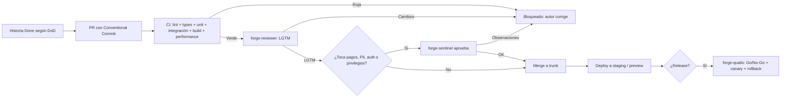

# Metodología Scrum — Adriana Tienda

| Campo | Valor |
|---|---|
| **Proyecto** | Adriana Tienda — e-commerce de belleza y cuidado capilar (Colombia, COP, español) |
| **Autor** | `forge-qualis` (Quality & Reliability / SRE) |
| **Estado** | Propuesta para adopción por el Comandante `apex-forge` y el Product Owner (cliente) |
| **Versión** | 1.1 — 23 de noviembre de 2026 (enmienda C-11, C-12) |
| **Marco de referencia** | *The Scrum Guide* (2020) + Constitución APEX FORGE (AGENTS.md) |
| **Documentos relacionados** | [`backlog-inicial.md`](./backlog-inicial.md), [`plan-sprints.md`](./plan-sprints.md), [`definicion-terminado.md`](./definicion-terminado.md), [`estrategia-pruebas.md`](./estrategia-pruebas.md), [`matriz-riesgos.md`](./matriz-riesgos.md), [`metricas-exito.md`](./metricas-exito.md), [Design Doc canónico](../02-arquitectura/design-doc.md) |

> **Fuentes canónicas y decisión maestra (C-07/C-12):** el **Design Doc canónico** es
> [`docs/02-arquitectura/design-doc.md`](../02-arquitectura/design-doc.md); absorbe al antiguo
> `DESIGN_DOC.md` de la raíz, que deja de ser fuente de verdad. Las **decisiones maestras** están en
> [`docs/02-arquitectura/decisiones-comandante.md`](../02-arquitectura/decisiones-comandante.md)
> (`C-01`…`C-12`) y tienen precedencia sobre cualquier otro documento: primero esa tabla, después
> el Design Doc y, en último lugar, los artefactos operativos de dominio. Los IDs de preguntas
> abiertas usan los prefijos `DD-Qn` (Design Doc) y `RM-Qn` (plan maestro); ya no existen IDs `Qn`
> sueltos. En estimación rige **Fibonacci estricta** (C-11): 1, 2, 3, 5, 8, 13 — nunca 6 ni 11.

> **Principio rector:** Scrum provee el *ritmo*; APEX FORGE provee el *estándar de calidad*.
> Un sprint no se completa porque "pasaron dos semanas": se completa cuando el Incremento
> cumple la [Definition of Done](./definicion-terminado.md). Si el incremento no es utilizable,
> no se presenta en Review como terminado.

---

## 1. Por qué Scrum (y por qué adaptado)

El cliente quiere trabajar en Scrum con una base sólida y profesional. Scrum encaja porque el
producto es nuevo (greenfield), el valor se descubre iterando (búsqueda por necesidad, checkout,
pagos locales) y el riesgo está en la integración (Wompi, DIAN, transportadora, dos sucursales).

Adaptaciones deliberadas para un equipo pequeño de APEX FORGE:

| Adaptación | Razón |
|---|---|
| **Sprints de 2 semanas**, con un **Sprint 0 de 1 semana** | Ciclo de feedback corto; el S0 existe para desbloquear contratos externos (lead time de 2–6 semanas) antes de escribir producto. |
| **Un solo equipo**, no varios "scrums" | El equipo pico es ~4,7 FTE; dividirlo crearía más coordinación que capacidad. |
| **El cliente es el Product Owner**, no un proxy | Evita perder decisiones de negocio (precios, marcas, retracto, operación de sedes) en traducciones. |
| **`forge-qualis` participa desde el Sprint 0** | En APEX FORGE el que construye prueba; la calidad se diseña antes del primer commit, no al final. |
| **DoD es la puerta, no la opinión** | Ninguna historia se marca "Done" sin CI verde, tests, accesibilidad, seguridad y LGTM. |
| **Design Doc aprobado antes del código** | Fase 1 del pipeline APEX FORGE; Scrum no sustituye el diseño, lo ordena. |

> **Nota de responsabilidad:** `forge-qualis` define y valida la estrategia de pruebas y firma el
> release, pero **no sustituye al ingeniero que escribe los tests**. El que construye, prueba.

---

## 2. Roles

### 2.1 Mapa de roles Scrum ↔ APEX FORGE

| Rol Scrum | Quién lo ejerce | Responsabilidad principal | Qué **no** hace |
|---|---|---|---|
| **Product Owner (PO)** | **El cliente** (Adriana / negocio), acompañado por `apex-forge` como facilitador | Maximizar valor: priorizar el Product Backlog, aceptar o rechazar historias en Review, decidir alcance de MVP vs Fase 2 | No escribe código, no dirige la implementación técnica, no cambia el Sprint Goal a mitad de sprint |
| **Scrum Master (SM)** | **Comandante `apex-forge`** | Hacer que Scrum funcione: facilitar eventos, eliminar impedimentos, proteger al equipo de interferencias, enseñar la metodología | No prioriza el backlog en lugar del PO, no "aprueba" su propio trabajo, no asigna tareas autoritariamente |
| **Development Team** | Subagentes APEX FORGE: `forge-architect`, `forge-frontend`, `forge-backend`, integraciones/fullstack, `forge-qualis` (calidad embebida), con soporte de `forge-infra`, `forge-reviewer` y `forge-sentinel` | Convertir historias en un Incremento utilizable; estimar; auto-organizarse; escribir tests de lo que construyen | No saltarse la DoD, no mergear sin LGTM, no declarar "Done" con CI roja |

### 2.2 Equipo y dedicación (coherente con el Design Doc §11.1)

| Rol APEX | FTE | Participación en el equipo Scrum |
|---|---:|---|
| Tech Lead / Arquitecto (`forge-architect`) | 0,4 | Development Team — decisiones técnicas y ADRs |
| Backend Engineer (`forge-backend`) | 1,0 | Development Team — dominio, API, pagos, DIAN |
| Frontend Engineer (`forge-frontend`) | 1,0 | Development Team — storefront, design system, a11y |
| Fullstack / Integraciones | 0,6 | Development Team — admin, workers, transportadora, webhooks |
| Diseñador UX/UI | 0,6 → 0,2 | Development Team (S0–S6), consultor después |
| QA / Reliability (`forge-qualis`) | 0,5 | Development Team + autoridad de gate de release |
| DevOps / SRE (`forge-infra`) | 0,3 | Supporting — CI/CD, entornos, observabilidad |
| Product Owner | 0,3 del Comandante + cliente | PO — priorización y aceptación |
| Contenido y catálogo | 0,5 (cliente) | Stakeholder clave: entregable en fecha es dependencia crítica |

**Tamaño del equipo de desarrollo:** 5–6 personas con dedicación parcial. Es el tamaño máximo
que permite mantener Daily de 15 minutos y Planning de 2 horas sin reuniones redundantes.

### 2.3 RACI simplificado

| Decisión | PO (cliente) | SM (Comandante) | Dev Team | Reviewer / Sentinel | Qualis |
|---|---|---|---|---|---|
| Prioridad del Product Backlog | **A/R** | C | C | I | C |
| Estimación en puntos | I | C | **A/R** | I | C |
| Diseño técnico (ADR) | I | A | **R** | C | C |
| Criterios de aceptación | **A/R** | C | C | I | C |
| Aceptar historia en Review | **A/R** | C | I | I | C |
| LGTM de código | I | I | R (autor no aprueba) | **A/R** | I |
| Seguridad de datos/pagos | C | I | R | **A** (sentinel) | C |
| Firma de release / rollback | C | A | R | I | **A/R** |

*A = Aprueba, R = Realiza, C = Consulta, I = Informa.*

---

## 3. Artefactos y sus compromisos

| Artefacto | Compromiso (commitment) | Dónde vive | Quién lo mantiene | Actualización |
|---|---|---|---|---|
| **Product Backlog** | **Product Goal**: "Lanzar un canal propio de belleza en Colombia que supere la experiencia de referencia en móvil, con pago y factura confiables para dos sedes" | [`backlog-inicial.md`](./backlog-inicial.md) | PO con apoyo del Comandante | Continua; refinamiento semanal |
| **Sprint Backlog** | **Sprint Goal**: una frase de valor, no una lista de tareas | [`plan-sprints.md`](./plan-sprints.md) + tablero del equipo | Development Team | Diaria (el equipo lo posee) |
| **Incremento** | **Definition of Done** | [`definicion-terminado.md`](./definicion-terminado.md) + deploy a staging/producción | Development Team | Cada merge; demostrable en Review |
| **Product Goal / Roadmap** | Hitos MVP, beta cerrada y lanzamiento | [`plan-sprints.md`](./plan-sprints.md) | PO + Comandante | Cada cambio de alcance, con change request |

### 3.1 Product Backlog

- Es **vivo, ordenado y estimado**; el orden refleja valor de negocio, no urgencia percibida.
- Las historias de nivel superior se dividen en historias verificables en refinement.
- Regla de oro: **sin criterios de aceptación Given/When/Then, la historia no entra a un sprint**.
- MoSCoW se usa para priorizar, pero el Sprint Backlog se compromete por valor y capacidad, no
  por etiqueta: una historia `Should` puede entrar antes que una `Must` si desbloquea el flujo.

### 3.2 Sprint Backlog

- Contiene: historias comprometidas, tareas de implementación, responsables auto-elegidos,
  dependencias y **la definición de "terminado" aplicable**.
- Límite de trabajo en progreso (WIP): **máximo 2 historias en curso por ingeniero**.
- El equipo puede renegociar *tareas* dentro del sprint; el **Sprint Goal solo lo cambia el PO**,
  y solo si el objetivo pierde sentido (regla Scrum).

### 3.3 Incremento

- Es la suma de historias Done desde el último incremento, **integradas y desplegables**.
- Un incremento se considera listo para Review cuando: CI verde, preview deploy accesible,
  criterios de aceptación verificados y demo preparada con datos reales de muestra.
- Los incrementos se acumulan: lo Done en S1 sigue funcionando en S8 (regresión continua).

---

## 4. Eventos (ceremonias)

Todos los eventos tienen **hora fija, duración máxima y salida written**. Si no hay salida, el
evento se cancela. Se usa la zona horaria del equipo (América/Bogota) y se respeta
`prefers-reduced-motion` también en las presentaciones (sin animaciones innecesarias).

| Evento | Duración | Cadencia | Participantes | Entrada | **Salida concreta** |
|---|---|---|---|---|---|
| **Sprint** | 1 semana (S0) / 2 semanas (S1–S8) | Continuo, sin pausas | Todo el equipo | Sprint Goal + Sprint Backlog | Incremento potencialmente liberable + decisión de aceptación |
| **Sprint Planning** | 2 h (1 h por semana de sprint); S0: 1 h | Día 1 de cada sprint | PO, SM, Dev Team | Backlog ordenado y refinado, velocity histórica, DoD/DoR | Sprint Goal, lista comprometida con puntos, plan de dependencias, definition de demo |
| **Daily Scrum** | 15 min (asincrónico 09:00 + sincronía 10 min mar/jue) | Cada día hábil | Dev Team (SM facilita si hay impedimento) | Sprint Backlog actualizado | 3 preguntas + impedimentos con dueño y fecha; tablero actualizado |
| **Backlog Refinement (Grooming)** | 45 min | 1 por semana (miércoles) | PO, SM, Dev Team, Qualis | Historias del próximo sprint | Historias con DoR completa: CA, puntos, dependencias, datos de prueba |
| **Sprint Review** | 60 min | Final de cada sprint | PO, SM, Dev Team, stakeholders (cliente, operación) | Incremento desplegado en staging | Demo en vivo, feedback del PO, historias **aceptadas / rechazadas / reprogramadas**, actualización del backlog |
| **Sprint Retrospectiva** | 45 min | Final de cada sprint, después del Review | SM, Dev Team (PO observa si quiere) | Datos de métricas + impedimentos del sprint | 1–2 experimentos concretos con dueño y fecha; próximos pasos del SM |
| **Release Readiness** | 60 min | S7 y S8 (y antes de cada canary) | Qualis, SM, PO, infra, reviewer, sentinel | Checklist de DoD, gate de CI, SLO/error budget | Go / No-Go firmado, plan de rollback, ventana de monitoreo |
| **Plan de lanzamiento (T-4 / T-2 / T-1 / Día D)** | 30–60 min por hito | Solo en S8 | Qualis + infra + PO + Comandante | Runbook y canary | Fecha y escalonamiento 5% → 25% → 100% |

### 4.1 Reglas de los eventos

1. **Puntualidad:** se empieza a la hora, con o sin todos; el que llega tarde se pone al día.
2. **Daily no es reporte al SM:** es del Development Team; se habla de progreso hacia el Sprint
   Goal, no de "qué hice ayer" como control jerárquico.
3. **Review demuestra software funcionando**, no slides. Si no se puede demo, no se reporta Done.
4. **Retrospectiva sin culpables:** se analiza el sistema (proceso, herramientas, supuestos),
   nunca a la persona. Aplica también a incidentes (postmortem en ≤72 h para Sev-1/Sev-2).
5. **Timebox estricto:** si una discusión se sale de tiempo, se anota como "parking lot" y se
   lleva a un hilo async con dueño.
6. **Fuera del sprint:** las decisiones se documentan en ADRs o en el backlog, nunca quedan solo
   en la reunión.

### 4.2 Formato sugerido del Daily (3 preguntas + impedimento)

```text
1. ¿Qué hice ayer que acerca el Sprint Goal?
2. ¿Qué haré hoy para acercarlo?
3. ¿Qué me bloquea o qué riesgo veo?
4. Impedimento: descripción, dueño (normalmente el SM), fecha límite (SLA 24 h).
```

---

## 5. Definition of Ready (DoR) y Definition of Done (DoD)

### 5.1 DoR — condición para entrar al Sprint Backlog

Una historia está *Ready* cuando cumple **todo**:

- [ ] Título claro con ID, épica y valor de negocio explícito.
- [ ] Formato **Como / Quiero / Para** completo.
- [ ] Criterios de aceptación en **Given / When / Then** (mínimo 2 escenarios: feliz y fallo).
- [ ] Estimación en puntos acordada por Planning Poker.
- [ ] Prioridad MoSCoW y dependencias identificadas (otras historias, contratos externos, datos).
- [ ] Datos de prueba y fixtures necesarios identificados.
- [ ] Implicaciones de accesibilidad, seguridad/privacidad y rendimiento marcadas como Sí/No.
- [ ] Cabe en la capacidad del sprint (no excede el límite por historia: 13 puntos; si es mayor, se divide).

### 5.2 DoD — condición para decir "Done"

Una historia está *Done* cuando cumple la [checklist completa](./definicion-terminado.md):

- [ ] Todos los criterios de aceptación pasan.
- [ ] Tests unitarios e integración escritos por quien construyó, en verde.
- [ ] E2E del flujo crítico implicado (si aplica) en verde.
- [ ] axe sin violaciones críticas/serias en lo tocado; teclado y `prefers-reduced-motion` verificados.
- [ ] Revisión de seguridad por `forge-sentinel` si toca pagos, PII, auth o privilegios.
- [ ] `forge-reviewer` dio **LGTM**; nadie aprobó su propio cambio.
- [ ] CI verde (lint + typecheck + unit + integración + build + presupuesto de performance).
- [ ] Documentación mínima actualizada (ADR, README, contratos/API, runbook si operacional).
- [ ] Métrica o señal de verificación definida (log, evento GA4, alerta o dashboard).

> **Política APEX FORGE:** todo cambio de producción trae o mantiene tests. Sin tests, no hay LGTM.

---

## 6. Estimación y velocity

### 6.1 Escala de puntos

Se usa **Fibonacci estricta: 1, 2, 3, 5, 8, 13** (C-11). Están prohibidos los valores 6 y 11:
un 6 se convierte en 5 u 8 y un 11 en 8 o 13, según la incertidumbre; la conversión se registra
en la historia y la suma se propaga a backlog, plan de sprints y métricas.

| Puntos | Significado (equipo APEX) |
|---:|---|
| 1 | Cambio trivial, validable en minutos; riesgo nulo |
| 2 | Ajuste pequeño con un test; sin dependencias externas |
| 3 | Tarea de medio día; 1–2 archivos; camino claro |
| 5 | Historia de 1–2 días; requiere tests unitarios y algo de integración |
| 8 | Historia de 3–4 días; múltiples capas, integración externa o incertidumbre moderada |
| 13 | Historia grande (casi un sprint para una persona); **se descompone en tareas verificables dentro del sprint y se divide historia si hay incertidumbre alta** |

**Convención interna:** 1 punto ≈ **0,7 persona-día efectivo** del equipo (ya descontadas
ceremonias, soporte y cambios de contexto). Una historia de 8 puntos ≈ 5,6 persona-días.

### 6.2 Planning Poker

1. El PO lee la historia y sus criterios; se hacen preguntas de clarificación (5 min máx.).
2. Cada ingeniero elige una carta en privado y la revela simultáneamente.
3. Si hay diferencia >1 nivel, se explican el mínimo y el máximo (2 min cada uno) y se revota.
4. Si persiste la diferencia, se decide por consenso con el arquitecto; **se documenta el supuesto**.
5. El PO no impone puntos; puede influir aportando contexto de negocio.
6. Las historias inciertas se marcan con **?**, se investigan en un *spike* y se reestiman en refinement.

### 6.3 Velocity

- **Capacity inicial:** 28–39 puntos por sprint de 2 semanas; S0 = 11 puntos (1 semana). El rango
  se amplió respecto a 28–32 porque C-01 (lotes FEFO, +8) y C-03 (POS, +8) son alcance mandatorio
  del MVP y C-11 corrigió la escala (+4 −1); la DoD no se relajó.
- **Compromisos planificados:** S1 31, S2 34, S3 34, S4 34, S5 39, S6 34, S7 34, S8 29
  (**total 280 puntos / 42 historias**; ver [`plan-sprints.md`](./plan-sprints.md)).
- **Velocity observada** se calcula al final de cada sprint: puntos **Done según DoD**, no
  "casi terminados".
- **Previsión:** media móvil de los últimos 3 sprints, con rango ±10%. Hasta tener 3 sprints,
  se usa la capacity inicial como referencia.
- Si la velocity real cae 2 sprints consecutivos por debajo del rango, el SM y el equipo analizan
  causas en la retro (¿DoR débil?, ¿dependencias externas?, ¿demasiado WIP?) y ajustan el plan,
  **no la DoD**.
- La velocity **nunca se usa para comparar personas** ni como KPI de rendimiento individual.

---

## 7. Manejo de impedimentos

| Nivel | Ejemplo | Dueño | SLA de resolución | Escalado |
|---|---|---|---|---|
| **I1 — Historia** | Falta una respuesta del PO sobre un criterio | Ingeniero → PO | 24 h | Daily del día siguiente |
| **I2 — Equipo** | Sandbox de Wompi sin credenciales, BD de test caída | Scrum Master (Comandante) | 24 h | Comandante + proveedor/forge-infra |
| **I3 — Proyecto** | Proveedor DIAN no habilitado, catálogo incompleto, contrato de transportadora | Comandante + PO (cliente) | 48 h para plan de contingencia | Roadmap y riesgo R1/R2/R5 en [`matriz-riesgos.md`](./matriz-riesgos.md) |

**Reglas:**

1. Todo impedimento se registra con: descripción, impacto en Sprint Goal, dueño, fecha límite.
2. El Daily no se convierte en lista de quejas: los impedimentos I2/I3 se gestionan **fuera** del
   Daily, con seguimiento asíncrono y reporte breve al día siguiente.
3. Si un impedimento I3 amenaza el Sprint Goal, el PO puede renegociar el alcance del sprint;
   se documenta como cambio y se refleja en velocity (no se cuenta como Done lo cancelado).
4. Los impedimentos recurrentes se convierten en acciones de la retrospectiva o en riesgos del registro.

---

## 8. Regla de oro: no merge sin LGTM



- **Nadie aprueba su propio cambio.** El autor del PR no puede dar el LGTM, aunque sea el Tech Lead.
- **CI en roja bloquea merge**, sin excepciones "rápidas" ni `--no-verify`.
- Los cambios sensibles (pagos, datos personales, auth, roles, webhooks) requieren además el
  visto bueno de `forge-sentinel`.
- Trunk siempre desplegable: si un merge rompe staging, se revierte primero y se investiga después.
- Los commits siguen **Conventional Commits** en inglés (`feat`, `fix`, `test`, `refactor`,
  `docs`, `chore`); los mensajes al cliente y la documentación son en español.

---

## 9. Cómo encaja Scrum con el pipeline APEX FORGE

| Fase APEX FORGE | Momento Scrum | Artefacto que lo materializa |
|---|---|---|
| 1. Diseño | Sprint 0 (y ADRs continuos) | Design Doc aprobado + [`backlog-inicial.md`](./backlog-inicial.md) |
| 2. Planificación | Sprint Planning / Refinement | Sprint Goal + Sprint Backlog |
| 3. Construcción | Diario del sprint | PRs incrementales sobre trunk |
| 4. Auto-testing | Diario del sprint; DoD | [`estrategia-pruebas.md`](./estrategia-pruebas.md) |
| 5. Code review | Antes de cada merge | LGTM de `forge-reviewer` |
| 6. Seguridad | Antes de merge en cambios sensibles | Aprobación de `forge-sentinel` |
| 7. Integración continua | Cada merge | CI verde (gate documentado) |
| 8. Liberación | Release Readiness / S8 | [`plan-sprints.md`](./plan-sprints.md) §Release + runbook |

> **Cambios triviales** (typo, color, texto): se omiten diseño y planificación, pero **no se omiten**
> review, tests que cubran el cambio y CI verde.

---

## 10. Reglas de cambio de alcance

1. El backlog se reordena libremente antes de cada Planning; **durante el sprint el Sprint Goal es sagrado**.
2. Una petición nueva del cliente entra al Product Backlog y se estima; el PO decide su prioridad
   para el **siguiente** sprint.
3. Solo una emergencia regulatoria, de seguridad o de pagos puede sustituir una historia del sprint;
   la decisión la toma el PO con el Comandante y se registra como cambio con impacto en velocity.
4. **Congelación de alcance:** desde el inicio del Sprint 7 (semana 14) solo entran correcciones
   de defectos y ajustes legales/fiscales. Las mejoras van a Fase 2.
5. Todo cambio de alcance se refleja en tres sitios: backlog, plan de sprints y matriz de riesgos.

---

## 11. Checklist rápido de adopción (para el primer día)

- [ ] PO (cliente) nombra un único interlocutor de priorización y otro de aceptación operativa.
- [ ] Comandante publica el calendario de ceremonias en zona América/Bogota.
- [ ] Equipo acuerda la Definition of Ready y la Definition of Done y las firma (este documento + [`definicion-terminado.md`](./definicion-terminado.md)).
- [ ] Tablero con columnas: Backlog → Ready → En curso → Review → Done (con DoD como puerta).
- [ ] Gate de CI documentado y implementado por `forge-infra` antes del primer merge de producto.
- [ ] Primer Planning Poker sobre las historias del Sprint 0 (11 puntos).
- [ ] Métricas base configuradas: velocity, cycle time, % Done con DoD, escape defects (ver [`metricas-exito.md`](./metricas-exito.md)).
