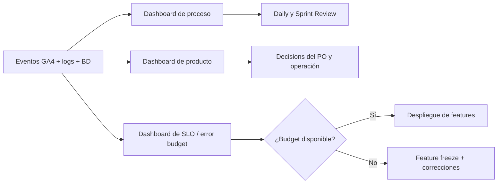

# Métricas de éxito — Adriana Tienda

| Campo | Valor |
|---|---|
| **Proyecto** | Adriana Tienda — e-commerce de belleza (Colombia, COP, dos sedes físicas) |
| **Autor** | `forge-qualis` (Quality & Reliability / SRE) |
| **Versión** | 1.1 — 23 de noviembre de 2026 (enmienda C-01, C-02, C-03, C-05, C-11, C-12) |
| **Principio** | **Nada se da por terminado sin métrica y fuente de datos.** Si no se puede medir, no se puede mejorar ni se puede aceptar |
| **Documentos relacionados** | [`plan-sprints.md`](./plan-sprints.md), [`definicion-terminado.md`](./definicion-terminado.md), [`estrategia-pruebas.md`](./estrategia-pruebas.md), [Design Doc canónico](../02-arquitectura/design-doc.md) §2, [decisiones-comandante.md](../02-arquitectura/decisiones-comandante.md) |

> **Fuentes canónicas (C-07/C-12):** [Design Doc](../02-arquitectura/design-doc.md) y tabla maestra
> de [decisiones del Comandante](../02-arquitectura/decisiones-comandante.md). El plan vigente es
> de **280 puntos / 42 historias**; la capacidad por sprint se amplió a 28–39 pts (C-01, C-03, C-11).

> Las metas de producto son **hipótesis** a validar con datos reales (benchmark beauty/e-commerce
> Colombia ~1–2% de conversión, *verificar*). Se reportan con rango y fecha de revisión, nunca como
> resultados garantizados.

---

## 1. Reglas de medición

1. **Toda métrica tiene:** definición, fórmula, fuente, frecuencia, responsable, meta y umbral de alerta.
2. **Toda historia Done deja una señal**: evento GA4, log estructurado, alerta o dashboard (DoD Bloque F).
3. **Consentimiento primero:** GA4/GTM opera con Consent Mode v2. Sin consentimiento no se recogen
   señales de analítica; las métricas de operación (pedidos, pagos, stock) vienen de la BD y no
   dependen de cookies.
4. **Datos de proceso vs. datos de producto** separados: el primero mide cómo trabaja el equipo;
   el segundo, cómo le va al negocio. Mezclarlos genera decisiones erróneas.
5. **Sin penalización individual:** velocity y cycle time se usan para mejorar el sistema, nunca
   para evaluar personas.
6. **Datos sintéticos en local/CI/staging**; producción solo datos reales con minimización y cifrado (Ley 1581).

---

## 2. Métricas de proceso (cómo trabajamos)

| Métrica | Definición y fórmula | Fuente | Frecuencia | Meta / umbral | Responsable |
|---|---|---|---|---|---|
| **Velocity** | Suma de puntos de historias **Done según DoD** por sprint | Tablero + checklist DoD | Por sprint (cierre) | **28–39 pts** (media 33,6; pico S5 = 39); alerta si <90% de capacidad 2 sprints seguidos | SM (`apex-forge`) |
| **Predicción de velocity** | Media móvil de los últimos 3 sprints, rango ±10% | Tablero | Semanal | Usada en Planning; no se usa para comparar personas | SM |
| **Say/Do ratio** | Puntos Done ÷ puntos comprometidos en Planning | Tablero + Sprint Backlog | Por sprint | ≥90%; <80% dispara retro | SM |
| **Cycle time** | Días hábiles desde que la historia pasa a **Ready** hasta **Done** | Tablero (timestamps) | Semanal + tendencia por sprint | p50 ≤5 días, p85 ≤12 días | Dev Team |
| **Lead time** | Días hábiles desde que se crea la historia hasta Done | Backlog + tablero | Por sprint | ≤20 días (tendencia decreciente) | PO + SM |
| **% historias que cumplen DoD** | Historias con checklist A–G completo y evidencia ÷ historias cerradas | Checklist DoD (enlaces a PR/CI) | Por sprint | **100%**; cualquier historia sin evidencia se devuelve a En curso | `forge-qualis` |
| **% historias Ready al Planning** | Historias con DoR completa ÷ historias planificadas | Backlog refinado | Semanal (Refinement) | ≥90% | PO |
| **Escape defects** | Defectos encontrados en staging/prod que corresponden a una historia marcada Done | Issue tracker + postmortems | Por sprint | ≤2 por sprint; >2 → retro obligatoria | `forge-qualis` |
| **Defectos por historia** | Número de bugs vinculados a cada historia Done | Issue tracker | Por sprint | ≤0,2 por historia | `forge-reviewer` |
| **Flakiness rate** | Tests con resultado inconsistente en 3 ejecuciones ÷ total de E2E | Playwright reports | Cada release | 0 tests flaky sin cuarentena; >1 → bloquea release | `forge-qualis` |
| **Cobertura por capa** | Líneas/ramas cubiertas según Vitest report | CI coverage | Cada PR | Global ≥70%, core ≥80%, pagos 100%; sin descenso >2 pts | `forge-reviewer` + Qualis |
| **Tiempo de review (PR → LGTM)** | Horas hábiles entre PR abierto y LGTM | GitHub PR metadata | Semanal | p50 <8 h; p90 <24 h | `forge-reviewer` |
| **Change failure rate** | Deploys que causaron incidente Sev-1/2 ÷ deploys totales | GitHub Actions + incident tracker | Mensual | <10% | `forge-infra` + Qualis |
| **Deployment frequency** | Deploys a producción por semana | GitHub Actions / Vercel | Semanal | ≥1/semana tras el lanzamiento; cualquier rollback cuenta como deploy | `forge-infra` |
| **MTTR** | Minutos desde detección hasta recuperación del servicio | Incident tracker + alertas | Por incidente | <30 min (objetivo SRE) | `forge-qualis` |
| **Impedimentos resueltos en SLA** | Impedimentos I1/I2 cerrados en 24 h ÷ total | Tablero de impedimentos | Semanal | ≥90% | SM |
| **Acciones de retro completadas** | Acciones con dueño y fecha cerradas ÷ acciones acordadas | Actas de retrospectiva | Por sprint | ≥80% en el sprint siguiente | SM |

### 2.1 Cómo se reporta el proceso

```text
Sprint Review (fin de sprint):
  Velocity: 34 pts / 34 comprometidos (Say/Do 100%)
  Cycle time p50: 4 d · p85: 10 d
  DoD: 5/5 historias con evidencia (100%)
  Escape defects: 1 (H-12, cupón expirado) → acción en retro
  Impedimentos: 2, ambos resueltos en <24 h
```

---

## 3. Métricas de producto (cómo le va al negocio)

### 3.1 Embudo y conversión

| Métrica | Definición y fórmula | Fuente | Frecuencia | Meta (hipótesis) | Responsable |
|---|---|---|---|---|---|
| **Sesiones** | Usuarios únicos con consentimiento analytics | GA4 (Consent Mode v2) | Diaria / semanal | 10–50 mil/mes (supuesto S5) | PO + marketing |
| **Tasa de add-to-cart** | `add_to_cart` ÷ sesiones con PLP/PDP | GA4 eventos | Semanal | ≥8% (baseline a calibrar) | PO + Frontend |
| **Tasa de conversión (CVR)** | Compras únicas ÷ sesiones | GA4 `purchase` + BD de pedidos | Diaria / semanal / mensual | ≥1,8% móvil a 12 meses | PO |
| **CVR móvil** | Compras ÷ sesiones móviles | GA4 + RUM (device) | Semanal | ≥1,8%; segmento prioritario (70% tráfico) | PO + Frontend |
| **Checkout completion** | Pedidos con pago aprobado ÷ checkouts iniciados | GA4 `begin_checkout` + BD | Diaria | ≥55% | PO + Backend |
| **Carrito abandonado** | 1 − (checkouts iniciados ÷ carritos con ítem) | GA4 + eventos de carrito en BD | Semanal | ≤65%; recuperación ≥8% (Fase 2) | PO |
| **AOV (ticket promedio)** | Suma de importes pagados (`*_cents`, `BIGINT`) ÷ pedidos pagados; presentado en COP solo en la capa de UI (C-02) | BD (`orders` / `payments`) | Semanal / mensual | ≥COP 190.000 (hipótesis) | PO |
| **Ventas por sede (`site_id`)** | Pedidos e ingresos por sede de despacho o recogida | BD (`orders.site_id`, `shipments`) | Semanal / mensual | Comparativa Bogotá vs. Medellín; sin sede dominada por error de asignación | Operación |
| **Ventas POS (C-03)** | Pedidos con origen POS ÷ pedidos totales, por `site_id` | BD (`orders.channel = 'POS'`) | Semanal / mensual | Trazable y conciliada con la web; **0 sobreventas web/POS** (R5) | Operación + Backend |

### 3.2 Pagos, pedidos y operación

| Métrica | Definición y fórmula | Fuente | Frecuencia | Meta / umbral | Responsable |
|---|---|---|---|---|---|
| **Pedidos exitosos** | Pedidos en `PAID` o posteriores ÷ pedidos creados | BD (`orders`) | Diaria | ≥97% excluyendo rechazos de banco | Backend + PO |
| **Tiempo de confirmación de pago** | `created_at` (Payment) → webhook `APPROVED` verificado, p95 | Logs + BD (`payment_transactions`) | Diaria | p95 <60 s; alerta si cola >100 o antigüedad >5 min | Backend + Qualis |
| **Tasa de rechazo de pago** | Webhooks `DECLINED` ÷ intenciones creadas | Wompi + BD | Diaria | Monitorear por método; alerta si >10% sobre baseline | Backend |
| **Webhooks duplicados detectados** | Eventos con `event_id` repetido ÷ eventos totales | BD (`webhook_events`) | Diaria | 0 efectos duplicados; duplicados esperados se responden 200 | Backend |
| **Factura DIAN emitida** | Pedidos pagados con CUFE ÷ pedidos pagados | BD + proveedor DIAN | Diaria / horaria en release | 100% en <15 min p95; 0 sin factura >24 h | Backend + PO |
| **Precisión de inventario** | 1 − (SKUs con diferencia entre BD y conteo físico ÷ SKUs auditados) | BD (`inventory_lots`) + conteo por `site_id` (CSV) | Semanal (auditoría), mensual (conteo) | ≥98%; 0 stock negativo; 0 desviación de `inventory_by_site` | Operación + Backend |
| **Lotes FEFO bajo control (C-01)** | Lotes con aviso (≤90 días) y bloqueados (≤15 días) ÷ lotes activos; ventas sobre lote vencido | BD (`inventory_lots.expires_at`) + alertas | Diaria | 100% de lotes warning etiquetados; **0 ventas de lotes a ≤15 días** | Operación + Backend |
| **Cuadre monetario (C-02)** | Pedidos donde `suma(base_cents) + suma(iva_cents) = grand_total_cents` ÷ pedidos pagados | BD (`*_cents`) + tests de dominio | Diaria / por release | **100%**; IVA 1900 bps y `round_half_up` por línea; cualquier diferencia bloquea el release | Backend + Qualis |
| **Sobreventas detectadas** | Pedidos pagados sin stock asignado ÷ pedidos pagados | BD (`reviewRequired=true`, incidencias) | Diaria | **0**; cualquier caso → incidente | Backend + Qualis |
| **Tiempo de entrega** | `DELIVERED` − `PAID`, p50/p90 | BD + webhook transportadora | Semanal | Publicar ETA realista por ciudad; desviación p90 <2 días sobre ETA | Operación |
| **Recogida en tienda** | Pedidos con `site_id` y recogida ÷ pedidos totales, por sede | BD | Semanal | ≥10% de pedidos (hipótesis a validar) | Operación |
| **Retractos y devoluciones** | Solicitudes `RETURN_REQUESTED` ÷ pedidos entregados | BD | Semanal | Dentro de 5 días hábiles; 0 reembolsos sin nota crédito | PO + Backend |
| **Take rate de pasarela** | Comisiones pagadas ÷ GMV pagado | Reporte de pasarela + BD | Mensual | Monitorear vs. 3,59% efectivo estimado | Negocio |

### 3.3 Calidad de experiencia y fiabilidad

| Métrica | Definición y fórmula | Fuente | Frecuencia | Meta / umbral | Responsable |
|---|---|---|---|---|---|
| **LCP p75 móvil** | Core Web Vitals LCP, percentil 75 | CrUX + Vercel Speed Insights + GA4 | Diaria | <2,5 s | Frontend |
| **INP p75** | Interaction to Next Paint, p75 | CrUX / RUM | Diaria | <200 ms | Frontend |
| **CLS p75** | Cumulative Layout Shift, p75 | CrUX / RUM | Diaria | <0,1 | Frontend |
| **TTFB p75** | Time to First Byte HTML | RUM + CDN | Diaria | <800 ms | Infra |
| **Disponibilidad storefront** | 1 − (minutos indisponibles ÷ minutos del mes) | Uptime checks + CDN | Mensual, alerta horaria | 99,9% (43 min 12 s de budget) | Infra + Qualis |
| **Tasa de error 5xx** | Respuestas 5xx ÷ requests totales | Logs + APM/CDN | Horaria / diaria | <0,1%; alerta si >0,1% en 15 min | Infra |
| **p95 API** | Latencia p95 de `/api/v1/*` | APM / logs estructurados | Diaria | <400 ms; alerta >600 ms en 15 min | Backend + Infra |
| **Job failures / DLQ** | Jobs fallidos ÷ jobs totales; ítems en DLQ | Worker + Redis/Sentry | Diaria / horaria | <1%; alerta >5% o 10 en DLQ | Infra |
| **Violaciones de accesibilidad** | Violaciones críticas/serias detectadas | axe en CI + auditoría manual | Por release | 0 en flujos críticos | Frontend + Qualis |
| **Consentimiento registrado** | % de sesiones con versión de política registrada | BD (`consents`) + GA4 | Diaria | 100% de los consentimientos de datos; 0 tags antes del consentimiento | Sentinel |
| **Rate limits vigentes (C-05)** | Respuestas 429 correctas ÷ intentos sobre umbral; peticiones sin `Idempotency-Key` rechazadas | Logs + APM | Diaria | Login 5/15 min por IP+cuenta; checkout 20 req/min por sesión; 0 pedidos duplicados | Backend + Sentinel |

---

## 4. SLOs y error budget (números que mandan)

| SLO | Objetivo | Ventana | Presupuesto de error | Alerta | Acción al agotarse |
|---|---|---|---|---|---|
| Disponibilidad storefront | 99,9% | 30 días | **43 min 12 s / mes** | <99,95% en 1 h | Pausa de features, solo fixes |
| Latencia p95 API | <400 ms | 7 días | >600 ms sostenido 15 min | Misma señal | Revertir cambio que introdujo latencia |
| Checkout success | >97% (excluye rechazos de banco) | 24 h | 3% de intentos | <95% en 1 h | Apagar flag de pago problemático, activar plan B |
| Webhook processing p95 | <60 s | 24 h | Cola >100 o eventos >5 min | Misma señal | Escalar worker, reconciliación manual |
| Factura DIAN p95 | <15 min | 24 h | 0 pedidos sin factura >24 h | >30 min o 3 reintentos | Modo contingencia documentado |
| Job failures | <1% | 24 h | 1% de jobs | >5% o 10 en DLQ | Drenar DLQ antes de seguir desplegando |

**Política de error budget (coherente con [`plan-sprints.md`](./plan-sprints.md) §5.4):**

- Consumo <50%: despliegue normal.
- Consumo 50–100%: revisión diaria; features no críticas en espera; enfoque en correcciones.
- Consumo 100%: **feature freeze** hasta recuperar el SLO o cambiar el objetivo formalmente con el PO.
- El error budget se reporta en el Daily y en la Review desde el primer día de producción.

---

## 5. Taxonomía de eventos (para que las métricas existan)

| Evento | Cuándo | Propiedades mínimas | Consentimiento |
|---|---|---|---|
| `view_item_list` | PLP vista | `category`, `filters`, `result_count` | Requiere analytics |
| `select_item` | PDP abierta | `product_id`, `variant_id`, `position` | Requiere analytics |
| `add_to_cart` | Producto agregado | `product_id`, `variant_id`, `quantity`, `source` (PDP/PLP) | Requiere analytics |
| `begin_checkout` | Checkout iniciado | `cart_id`, `item_count`, `value` | Requiere analytics |
| `add_payment_info` | Método elegido | `method` (sin PAN ni últimos 4 en GA4) | Requiere analytics |
| `purchase` | Pago confirmado por webhook | `transaction_id`, `value_cents`, `tax_cents`, `shipping_cents`, `site_id`, `channel` (WEB/POS) | Requiere analytics; **idempotente** en refresh; importes en centavos (C-02) |
| `pos_sale` | Venta presencial registrada (C-03) | `order_id`, `site_id`, `seller_id`, `lot_id`, `total_cents`, `iva_cents` | Log interno + BD; sin PAN ni datos del cliente en claro |
| `refund` | Reembolso aprobado | `transaction_id`, `value`, `reason` | Requiere analytics |
| `search` | Búsqueda enviada | `term` (sin PII), `result_count`, `latency_ms` | Requiere analytics |
| `order_status_changed` | Cambio de estado del pedido | `order_id`, `from`, `to`, `actor` | Log interno (sin PII) |
| `webhook_processed` | Webhook verificado | `provider`, `event_id`, `result` (APPLIED/IGNORED) | Log interno |
| `inventory_reservation_failed` | Fallo de reserva por stock o lote bloqueado | `variant_id`, `site_id`, `lot_id`, `channel` (WEB/POS), `requested`, `available` | Log interno + alerta (R5) |
| `invoice_pending` | Factura sin CUFE tras 15 min | `order_id`, `attempts` | Log interno + alerta |

**Reglas de eventos:** nunca PII, PAN, CVV, tokens ni documentos en propiedades. `purchase` se
dispara **una sola vez** por `transaction_id` (verificado en E2E-18).

---

## 6. Dashboard y cadencia de revisión

| Audiencia | Dashboard | Frecuencia | Pregunta que responde |
|---|---|---|---|
| Equipo (Daily) | Tablero Scrum + CI + SLO live | Diaria | ¿Vamos al Sprint Goal? ¿Hay impedimentos o alertas? |
| PO (Review) | Velocity, cycle time, DoD, embudo, AOV | Por sprint | ¿Qué valor se entregó y qué cambió en el negocio? |
| Comandante (Retro) | Proceso + impedimentos + acciones | Por sprint | ¿Qué ajustamos en el sistema? |
| Qualis (Release) | Gates, cobertura, axe, Lighthouse, k6, ZAP, error budget | Cada release | ¿Podemos decir sí al Go/No-Go? |
| Negocio / operación | Pedidos, pagos, facturas, stock, sedes | Diaria / semanal | ¿Se está operando bien y dónde hay incidencias? |



---

## 7. Checklist de cierre de historia (métrica obligatoria)

Antes de mover una historia a **Done**, el autor completa:

```markdown
- [ ] La historia produce (o consume) una señal medible.
- [ ] Señal: <nombre del evento / log / alerta / dashboard>.
- [ ] Fuente: <GA4 / BD / Sentry / logs / Uptime / k6 / Lighthouse>.
- [ ] Frecuencia: <diaria / semanal / por sprint / por release>.
- [ ] Responsable de la métrica: <rol>; umbral de alerta definido.
- [ ] Sin PII, PAN ni secretos en la señal.
- [ ] Verificado en staging con datos sintéticos.
```

> Si esta checklist está vacía, la historia **no está Done** según
> [`definicion-terminado.md`](./definicion-terminado.md) (Bloque F).

---

## 8. Revisión y calibración

| Métrica | Primera revisión | Acción |
|---|---|---|
| CVR y AOV | 30 días post-lanzamiento | Confirmar o ajustar hipótesis; no presentar como logro hasta tener volumen ≥500 pedidos |
| ETA y precisión de inventario | Semana 2 post-lanzamiento | Ajustar reglas por sede si hay desviación |
| Velocity y cycle time | Cierre de S3 y S8 | Calibrar capacity del siguiente plan |
| SLOs y error budget | Mensual | Ajustar umbrales con datos reales; cambio requiere aprobación del PO y Qualis |
| Matriz de riesgos | Semanal y post-incidente | Actualizar probabilidad/impacto y acciones |

**Honestidad:** los benchmarks citados (CVR 1–2%, abandono ~70%, AOV 180–250 mil COP) son
referencias de mercado a **verificar**, no promesas. Cada reporte al cliente incluye la fuente,
el periodo y el tamaño de muestra.
