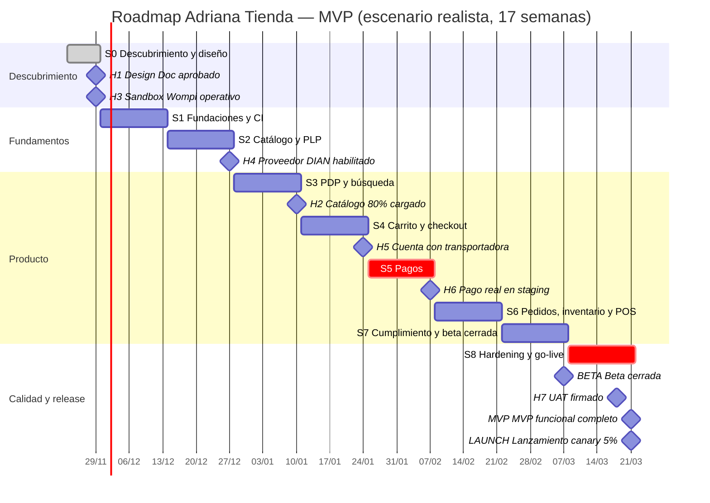
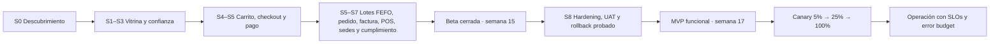
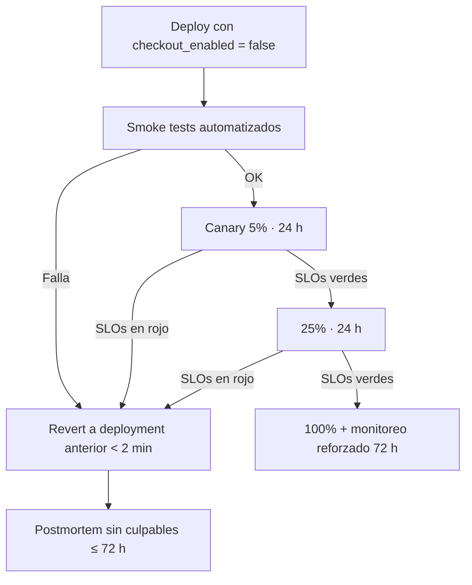

# Plan de Sprints y roadmap de lanzamiento — Adriana Tienda

| Campo | Valor |
|---|---|
| **Proyecto** | Adriana Tienda — e-commerce de belleza (Colombia, COP, dos sedes físicas) |
| **Autor** | `forge-qualis` (Quality & Reliability / SRE) |
| **Versión** | 1.1 — 23 de noviembre de 2026 (enmienda C-01, C-02, C-03, C-05, C-11, C-12) |
| **Horizonte** | Sprint 0 + Sprints 1–8 = **17 semanas** (escenario realista) |
| **Esfuerzo comprometido** | **280 puntos** en 42 historias (ver [`backlog-inicial.md`](./backlog-inicial.md)) |
| **Documentos relacionados** | [`metodologia-scrum.md`](./metodologia-scrum.md), [`definicion-terminado.md`](./definicion-terminado.md), [`estrategia-pruebas.md`](./estrategia-pruebas.md), [`matriz-riesgos.md`](./matriz-riesgos.md), [`metricas-exito.md`](./metricas-exito.md), [Design Doc canónico](../02-arquitectura/design-doc.md), [decisiones-comandante.md](../02-arquitectura/decisiones-comandante.md) |

> **Fuentes canónicas (C-07/C-12):** [Design Doc](../02-arquitectura/design-doc.md) y tabla maestra
> de [decisiones del Comandante](../02-arquitectura/decisiones-comandante.md). El cambio de 259 a
> 280 puntos viene de: +8 INV-03 (FEFO, C-01) +8 OPS-09 (POS, C-03) +4 (C-11: 11 → 13 en CAT-02,
> CAT-04 y CHE-01) −1 (C-11: QUA-04 6 → 5). No se bajó la DoD ni se movió historia alguna a Fase 2.

> **Fechas relativas:** "semana 1" es la semana del 23 de noviembre de 2026 (lunes). Las fechas
> concretas del Gantt son **ilustrativas** y se recalcularán cuando el PO confirme el calendario
> de festivos y la fecha objetivo de lanzamiento.

---

## 1. Supuestos de capacidad

| Concepto | Valor |
|---|---|
| Equipo de desarrollo | ~4,7 FTE APEX + 0,5 FTE de contenido del cliente (no computado en puntos) |
| Sprint estándar | 2 semanas (10 días hábiles) |
| Sprint 0 | 1 semana (5 días hábiles) — discovery y desbloqueo de contratos |
| 1 punto de historia | ≈ 0,7 persona-día efectivo (descontadas ceremonias, soporte y cambios de contexto) |
| Capacidad inicial por sprint | 28–39 puntos; S0 = 11 puntos. Rango ampliado de 28–32 a 28–39 para absorber el alcance mandatorio C-01 (FEFO) y C-03 (POS) más la corrección Fibonacci C-11, sin recortar la DoD |
| Compromisos planificados | S0 11 · S1 31 · S2 34 · S3 34 · S4 34 · S5 39 · S6 34 · S7 34 · S8 29 = **280 puntos** |
| Velocity de previsión | Media móvil de 3 sprints, rango ±10%; se calibra al cierre de S3 |
| Regla de capacidad | Si un sprint cierra <90% de lo comprometido, no se "recupera" aumentando el siguiente: se ajusta el backlog con el PO |

**Contenido del cliente como dependencia:** fichas, fotos, precios y stock inicial de las dos
sedes deben entregarse entre las semanas 4 y 7 (S2–S3). Un retraso de 2 semanas en contenido
traslada el lanzamiento 2 semanas (ruta crítica: catálogo → PLP/PDP → checkout → pagos → DIAN → UAT).

---

## 2. Tabla de sprints

| Sprint | Semana | Objetivo (Sprint Goal) | Historias comprometidas (ID · pts) | Capacidad | Dependencias críticas | Entregable demostrable |
|---|---|---|---|---:|---|---|
| **S0 — Discovery** | 1 | Despejar incertidumbre: diseño aprobado, prototipo y contratos iniciados | FUN-01 3 · DIS-01 5 · QUA-01 3 | **11 pts** | Acceso al cliente; sandbox Wompi; elección de proveedor DIAN | Design Doc aprobado + Figma navegable + estrategia de pruebas + cuentas sandbox creadas |
| **S1 — Fundaciones** | 2–3 | Tener un trunk desplegable, seguro y medible | FUN-02 5 · FUN-03 8 · FUN-04 8 · DIS-02 5 · CUE-01 5 | **31 pts** | Gate de CI (infra); decisiones de auth | Home con layout y login funcionando en staging; CI verde + Lighthouse >90 + Sentry capturando errores |
| **S2 — Catálogo y PLP** | 4–5 | Publicar el catálogo y permitir descubrir productos | CAT-01 13 · CAT-02 13 · CAT-03 5 · SUC-01 3 | **34 pts** | Contenido del cliente (≥50%); proveedor DIAN contratado | 300 SKUs navegables por categoría, marca y necesidad; URLs limpias y sitemap; dos `sites` modeladas |
| **S3 — PDP y búsqueda** | 6–7 | Convertir descubrimiento en decisión de compra | CAT-04 13 · CAT-05 8 · CAT-06 5 · INV-01 8 | **34 pts** | Catálogo ≥80% cargado; Meilisearch operativo | De búsqueda con typo a PDP con variante, stock y ETA; reserva concurrente atómica probada |
| **S4 — Carrito y checkout** | 8–9 | Llevar al usuario desde la bolsa hasta "pagar" sin fricción | CAR-01 8 · CHE-01 13 · PRO-01 5 · CUE-02 5 · QUA-02 3 | **34 pts** | Cuenta con transportadora para cotizar envío | Checkout completo en móvil con cupón, envío y recogida en sede (sin pasarela aún); cobertura core ≥80% |
| **S5 — Pagos e inventario FEFO** | 10–11 | Cobrar de forma segura sobre lotes correctos | PAG-01 8 · **INV-03 8** · PAG-02 13 · PAG-03 5 · PED-01 5 | **39 pts** | Sandbox Wompi; revisión `forge-sentinel` de HMAC; INV-01 cerrada en S3 | Pago aprobado/rechazado/pendiente end-to-end; webhook duplicado no duplica pedido; **descuento FEFO (aviso 90 / bloqueo 15) en el primer cobro**; email en <60 s |
| **S6 — Pedidos, inventario y POS** | 12–13 | Cerrar el ciclo operativo con factura, administración de stock y venta presencial | INV-02 8 · **OPS-09 8** · PAG-04 5 · PED-02 8 · PED-03 5 | **34 pts** | Proveedor DIAN habilitado; transportadora con cuenta real; INV-03 en S5 | Pedido pagado → factura DIAN → guía; stock descontado una sola vez; **venta POS registrada con la misma regla FEFO y 0 sobreventas web/POS (E2E-21)** |
| **S7 — Marketing y cumplimiento** | 14–15 | Completar confianza, consentimiento y operación (beta cerrada) | CUE-03 5 · LEG-01 8 · LEG-02 8 · ADM-01 5 · ADM-02 3 · PED-04 5 | **34 pts** | Políticas legales aprobadas por el cliente | Beta cerrada: reseñas verificadas, consentimiento granular, roles, auditoría y **tracking público** |
| **S8 — Hardening y lanzamiento** | 16–17 | Probar que el sistema aguanta y se puede revertir | QUA-03 8 · QUA-04 5 · SEG-01 5 · SEG-02 3 · OPS-01 8 | **29 pts** | UAT firmado; rollback probado en staging | **21 E2E en verde (incluye pedido POS)**; k6 a 200 rps; pentest sin críticos; runbook + canary 5% listo para go-live |

**Total: 280 puntos · 17 semanas.** El Sprint 0 no incluye código de producto: solo artefactos de
diseño y acuerdos (restricción de la misión: documentación antes que implementación). El pico de
S5 (39 pts) se compensa con S8 (29 pts); la media de S1–S8 es 33,6 pts.

> **Nota de rebalanceo (C-01/C-03):** INV-03 se adelanta a S5 (antes que PAG-01/PAG-02) para que
> la primera confirmación de pago descuente FEFO; OPS-09 entra en S6 tal como exige C-03. Para no
> superar la capacidad, PED-04 (tracking público, `Should`) se mueve de S6 a S7. Ninguna historia se
> elimina del MVP y la DoD permanece intacta.

### 2.1 Criterios de aceptación por sprint (resumen ejecutable)

| Sprint | Criterio de aceptación (debe pasar para cerrar) |
|---|---|
| S0 | Design Doc *Approved*; prototipo navegable; cuentas sandbox; backlog con 42 historias estimadas |
| S1 | CI verde en trunk; preview por PR; login funcional con límite 5/15 min IP+cuenta; Home con LCP <2,5 s en 4G; errores en Sentry |
| S2 | ≥300 SKUs; facetas <300 ms; URLs limpias; 0 errores de hidratación; dos `sites` visibles |
| S3 | Cambio de variante sin recarga; sugerencias <150 ms; typo tolerado; reserva atómica concurrente sin sobreventa |
| S4 | Bolsa persistente y merge sin duplicados; cupón aplica y revierte; checkout conserva estado y exige `Idempotency-Key` con límite 20 req/min; cobertura core ≥80% |
| S5 | Lotes FEFO operativos (aviso 90 / bloqueo 15); pago aprobado/rechazado/PSE mock; webhook duplicado idempotente; confirmación <60 s; revisión de seguridad firmada |
| S6 | Factura DIAN <15 min (p95); guía generada; **venta POS registrada con 0 sobreventas web/POS**; stock descontado una vez desde el lote FEFO |
| S7 | Reseña solo con compra; consentimiento registra versión; axe sin críticos; roles deniegan acciones no permitidas; tracking público con rate limit |
| S8 | **21 E2E verdes (incluye pedido POS, gate de release)**; sin regresión CWV >10%; ZAP sin críticos; rollback <2 min probado; Go/No-Go firmado |

---

## 3. Roadmap e hitos

### 3.1 Diagrama de Gantt

> Los hitos `H1`–`H7` y `BETA` se explican en la tabla siguiente. "MVP funcional completo" es el
> momento en que todo el alcance está Done; "Lanzamiento canary" es cuando entra tráfico real.

### 3.2 Hitos y dependencias

| Hito | Nombre | Depende de | Fecha objetivo | Criterio de salida |
|---|---|---|---|---|
| **H1** | Design Doc aprobado | Comandante + 4 revisores | Fin S0 (semana 1) | Estado *Approved* y ADRs registrados |
| **H2** | Catálogo ≥80% cargado | Cliente (contenido) + CAT-01 | Fin S3 (semana 7) | ≥640 SKUs con imagen, precio y stock |
| **H3** | Sandbox de pagos operativo | Onboarding Wompi | Fin S0 (semana 1) | Intención de pago y webhook de prueba recibidos |
| **H4** | Proveedor DIAN habilitado | Cliente + proveedor | Fin S2 (semana 5) | Resolución de numeración y credenciales de prueba |
| **H5** | Cuenta con transportadora | Cliente | Fin S4 (semana 9) | Cotización y guía de prueba posibles |
| **H6** | Checkout con pago real en staging | S5 | Fin S5 (semana 11) | Pago aprobado end-to-end sin PAN en nuestro DOM |
| **H7** | UAT firmado por negocio | S6–S8 + cliente | Semana 17 | Aceptación escrita de pedido web **y POS**, factura, guía y retracto |
| **H8** | Go-live canary | H1–H7 + rollback probado | Semana 17 | 5% de tráfico con SLOs en verde 24 h |

**Ruta crítica:** contenido → catálogo → PDP → checkout → pagos → DIAN → UAT → canary.
**Mitigación:** iniciar contratos en S0 (H3/H4/H5 tienen lead time de 2–6 semanas) y cargar
catálogo por CSV con placeholders válidos, congelando la versión definitiva en S7.

### 3.3 Escenarios de duración

| Escenario | MVP (semanas) | Condición | Acción del PO |
|---|---:|---|---|
| Optimista | 13 | Contenido a tiempo, contratos sin fricción, sin cambios de alcance | Paralelizar S6–S7 y mover "relacionados", blog y reseñas a Fase 2 |
| **Realista (plan oficial)** | **17** | 1–2 semanas de retraso en contenido o contratos | Plan de este documento |
| Pesimista | 23 | DIAN/transportadora con demoras, cambios de alcance o rotación | Replanificar con el Comandante; recortar `Should` y activar contingencias de la matriz de riesgos |

> El plan no se "acelera" bajando la DoD. Si se necesita el escenario optimista, se **reduce
> alcance**, no calidad.

---

## 4. Flujo de hitos de producto

- **MVP (semana 17):** alcance completo del backend funcional, storefront, admin y cumplimiento.
- **Beta cerrada (semana 15):** employees + ~10 clientes invitados con pagos reales de bajo monto;
  permite detectar fallos de integración antes del hardening.
- **Lanzamiento (semana 17):** canary gradual con feature flags y monitoreo reforzado 72 h.

---

## 5. Plan de lanzamiento (release graduado)

### 5.1 Pre-lanzamiento

| Momento | Acciones | Responsable | Salida |
|---|---|---|---|
| **T-4 semanas** (S7) | Congelar alcance; UAT; carga definitiva de catálogo; pruebas de caos (pasarela/Redis/Meilisearch caídos); revisión de código y seguridad | PO + Qualis + Reviewer + Sentinel | Alcance congelado y hallazgos mitigados |
| **T-2 semanas** (S8 inicio) | Runbook de operación; backup con **restore real**; dashboards y alertas; on-call definido | Qualis + Infra | Runbook firmado y restore verificado |
| **T-1 semana** (S8 cierre) | Canary interno con pagos reales de bajo monto; verificar correos, WhatsApp, facturas y guías | Qualis + PO | Go/No-Go firmado |

### 5.2 Día D y escalonamiento

| Paso | Tráfico | Duración | Métricas observadas | Condición para avanzar |
|---|---:|---|---|---|
| 1 | 0% (interno) | — | Smoke tests, health checks | 100% de smoke en verde |
| 2 | 5% | 24 h | Error 5xx, checkout success, LCP p75, webhook lag, tasa de conversión, **pedidos POS y sobreventas web/POS** | Error <0,1%; checkout >97%; LCP <2,5 s; **0 sobreventas**; sin incidente Sev-1 |
| 3 | 25% | 24 h | Igual + factura DIAN y guías | Sin desviación >10% vs. baseline de staging |
| 4 | 100% | 72 h reforzadas | Igual + error budget | Consumo de error budget dentro de lo previsto |

### 5.3 Rollback (sin plan de reversión no hay deploy)

| Capa | Mecanismo | Objetivo | Verificado en |
|---|---|---|---|
| Código (`web`) | Revert a deployment anterior en Vercel | <2 min | S8 (simulacro en staging) |
| Worker | Redeploy de imagen anterior (tag inmutable) | <5 min | S8 |
| Funcionalidad | Feature flags (`checkout_enabled`, `payments_enabled`, `search_v2`) | <1 min, sin redeploy | S7 |
| Base de datos | Migraciones **expand/contract**; nunca destructivas en el mismo release | Código anterior sigue funcionando | Revisión en cada PR |
| Datos | PITR de Neon (RPO ≤5 min, RTO ≤1 h) | Restauración real probada | T-2 semanas |
| Negocio | Facturación manual temporal y método de pago alterno | Continuar vendiendo | Runbook + plan B ePayco |

> **Autoridad:** `forge-qualis` puede declarar **No-Go** y detener el escalonamiento. El Comandante
> arbitra si hay conflicto con el PO.

### 5.4 SLOs y error budget (decisiones con números)

| SLO | Objetivo | Ventana | Alerta | Error budget |
|---|---|---|---|---|
| Disponibilidad storefront | 99,9% | 30 días | <99,95% en 1 h | 43 min 12 s / mes |
| Latencia p95 API | <400 ms | 7 días | >600 ms en 15 min | Presupuesto de latencia por ventana |
| Checkout success (excluye rechazos de banco) | >97% | 24 h | <95% en 1 h | 3% de intentos |
| Webhook p95 | <60 s | 24 h | Cola >100 o edad >5 min | 0,1% de eventos atrasados |
| Emisión de factura p95 | <15 min | 24 h | >30 min o 3 reintentos | 0 pedidos sin factura >24 h |
| Job failures | <1% | 24 h | >5% o 10 ítems en DLQ | 1% de jobs |

**Política de error budget:** si se consume >50% del presupuesto en la primera semana del mes,
se pausan despliegues de features y solo entran correcciones. Si se agota, la feature espera:
no se libera nada nuevo hasta recuperar el SLO o aceptar formalmente un cambio de objetivo con el PO.

### 5.5 Postmortem

Todo incidente Sev-1/Sev-2 se documenta en ≤72 h: qué pasó, impacto (pedidos, ingresos, usuarios),
detección, mitigación, causa raíz y acciones con dueño y fecha. **Sin buscar culpables**: se corrige
el sistema (tests que faltaron, alerta que no disparó, runbook incompleto).

---

## 6. Seguimiento del plan

| Métrica de seguimiento | Fuente | Frecuencia | Umbral de alerta |
|---|---|---|---|
| Velocity (puntos Done) | Tablero + DoD | Por sprint | <90% de capacidad 2 sprints seguidos |
| % historias Ready al Planning | Backlog refinado | Semanal | <80% |
| Cumplimiento de DoD | Checklist por historia | Por sprint | <95% |
| Escape defects (defectos en staging/prod por historia) | Issue tracker | Por sprint | >2 por sprint |
| Cycle time (Ready → Done) | Tablero | Semanal | >12 días |
| Hitades pendientes | Esta tabla §3.2 | Semanal | Cualquier hito con riesgo rojo en la matriz |

La definición y fuente de cada métrica están en [`metricas-exito.md`](./metricas-exito.md).
**Ningún sprint se da por terminado sin estas mediciones actualizadas.**
