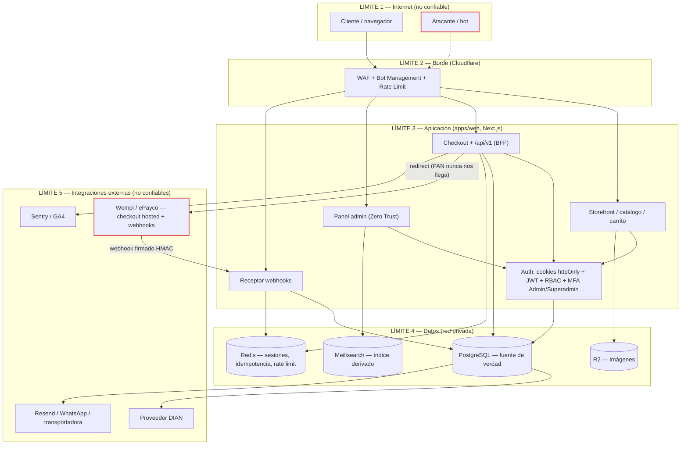

# Modelo de Amenazas — Adriana_tienda

| Campo | Valor |
|---|---|
| Propietario | `forge-sentinel` |
| Metodología | STRIDE (Spoofing, Tampering, Repudiation, Information disclosure, Denial of service, Elevation of privilege) |
| Alcance | Storefront, catálogo, carrito, checkout, pasarela/webhooks, cuenta de cliente, panel admin, inventario por lotes y `site_id` (dos sedes, FEFO), APIs y BD |
| Referencias | OWASP ASVS 4.0 L2, OWASP Top 10 2021, `requisitos-seguridad.md` |

> **BLOQUEANTE:** Todo componente marcado con riesgo **Crítico** debe tener mitigación implementada y probada antes del go-live.

---

## 1. Activos a proteger

| ID | Activo | Clasificación | Por qué es atractivo |
|---|---|---|---|
| A1 | Credenciales de clientes (password hash) | Confidencial / PII | Reutilización de contraseñas en otros sitios |
| A2 | Datos personales (nombre, email, teléfono, documento, dirección, cumpleaños) | Confidencial / PII (Ley 1581) | Venta en mercados clandestinos, suplantación |
| A3 | Sesiones y tokens (JWT, refresh, cookie de carrito) | Confidencial | Secuestro de cuenta y compras fraudulentas |
| A4 | Carrito y precios/cupones | Integridad | Manipulación de totales y descuentos |
| A5 | Catálogo, imágenes y contenido | Integridad / público | Defacement, SEO spam, daño de marca |
| A6 | Inventario por lote y sede (`inventory_lots(lot_id, site_id)`, FEFO; dos sedes físicas) | Integridad / Disponibilidad / Trazabilidad | Desabastecimiento, venta sin stock, fraude interno, pérdida de trazabilidad cosmética |
| A7 | Pedidos, pagos y facturas DIAN | Integridad / Confidencial | Fraude, evasión, reprocesos fiscales |
| A8 | Secretos (Wompi/ePayco, DIAN, Resend, WhatsApp, gestor) | Confidencial / crítico | Cobros falsos, reembolsos, envío de mensajes |
| A9 | Registros de auditoría (`audit_logs`, `webhook_events`) | Integridad | Borrar rastro de fraude o error |
| A10 | Disponibilidad del checkout y del admin | Disponibilidad | Pérdida de ventas y de operación |
| A11 | Reputación y cumplimiento legal | Intangible | Confianza del cliente, sanciones SIC/DIAN |

---

## 2. Flujo de confianza y límites

Los **límites de confianza** (trust boundaries) son los puntos donde cambia el nivel de confianza. Cada flecha que cruza un límite exige validación, autenticación y registro.

**Límites críticos:**
- **L1→L2:** tráfico público; se asume hostil. WAF y bot management no sustituyen la validación en aplicación.
- **L2→L3:** toda petición se valida; access y refresh viajan en cookies `HttpOnly/Secure/SameSite=Strict` (excepción: `Lax` solo en la cookie de sesión de checkout al retornar de Wompi, C-04). `Bearer` solo server-to-server.
- **L3→L4:** la app usa credenciales de BD con privilegios mínimos; Prisma parametriza; nunca SQL dinámico con entrada del usuario.
- **L3→L5:** salidas a proveedores con allowlist; entradas (webhooks) con firma HMAC + idempotencia. El redirect a la pasarela **no** nos devuelve datos de tarjeta.
- **Admin (L3):** se trata como una zona separada: **MFA en MVP para Admin y Superadmin**, sesión de 8 h (Vendedores: sesión de tablet de 8 h sin MFA, Fase 2 — C-04), reautenticación para acciones sensibles y auditoría inmutable.

---

## 3. Análisis STRIDE por componente

### 3.1 Navegación pública y catálogo

| STRIDE | Amenaza | Vulnerabilidad si falta control | Impacto | Prob. | Mitigación | Req. |
|---|---|---|---|---|---|---|
| **S** | Suplantación de la marca en enlaces/banners | Redirect abierto desde parámetro `?next=` | Phishing desde dominio propio | Media | Allowlist de rutas internas; no redirect a dominios arbitrarios | SEC-014 |
| **T** | Manipulación de filtros/orden para inyectar contenido | Parámetros sin validar (`sort`, `facets`, `q`) | SQLi / error 500 con stack trace | Media | Esquemas Zod + Prisma parametrizado; whitelist de campos ordenables | SEC-006 |
| **R** | — (bajo riesgo, contenido público) | — | — | — | Logs de request con `requestId` | SEC-017 |
| **I** | Exposición de SKUs internos, costos o márgenes | Serializar el modelo completo de Prisma | Fuga de información comercial | Media | DTO explícitos: nunca `SELECT *` al cliente | SEC-016 |
| **D** | Scraping masivo / flood de búsqueda | Sin rate limit en `/api/v1/search` | Caída de Meilisearch y BD | Alta | Rate limit por IP + WAF bot management + caché | SEC-011 |
| **E** | Inyección de HTML en reseñas o descripciones | `dangerouslySetInnerHTML` sin sanitizar | XSS almacenado | Media | React escapa por defecto; sanitizar HTML permitido; CSP | SEC-008 |

### 3.2 Carrito

| STRIDE | Amenaza | Vulnerabilidad | Impacto | Prob. | Mitigación | Req. |
|---|---|---|---|---|---|---|
| **S** | Robo/forge de cookie de carrito anónimo | Token de carrito predecible o sin firma | Secuestro de carrito ajeno | Media | Cookie firmada (HMAC), aleatoria de 256 bits, `HttpOnly/Secure/SameSite` | SEC-004, SEC-023 |
| **T** | Modificar precio, cantidad o cupón en el cliente | Confiar en montos enviados por el navegador | Pérdida económica | Alta | Recalcular precios/descuentos siempre en servidor desde BD | SEC-006 |
| **R** | Negar haber agregado un item | Sin registro de eventos de carrito | Disputa con cliente | Baja | Auditoría de mutaciones de carrito | SEC-017 |
| **I** | Leer carrito de otro usuario por ID incremental | IDs UUIDv4 sin verificación de propiedad | Fuga de PII/direcciones | Media | Chequeo de propiedad (`userId`/`cartToken`) en cada acceso | SEC-002 |
| **D** | Crear miles de carritos | Sin TTL ni límite | Saturación de Redis/BD | Media | `expiresAt` + rate limit + cupones de serie limitados | SEC-011 |
| **E** | Aplicar cupón de otro cliente / reutilizar | Cupón sin vincular a usuario ni límite de usos | Pérdida económica | Media | `couponRedemptions` único por cliente/orden, validación en servidor | SEC-002 |

### 3.3 Checkout

| STRIDE | Amenaza | Vulnerabilidad | Impacto | Prob. | Mitigación | Req. |
|---|---|---|---|---|---|---|
| **S** | Suplantación de cliente al pagar | Sesión robada / CSRF en `POST /api/v1/checkout` | Compra fraudulenta | Media | Cookies `httpOnly` + JWT/refresh rotado, CSRF, reautenticación para cambio de dirección | SEC-003, SEC-010 |
| **T** | Alterar monto, moneda, dirección o sede de recogida en tránsito | Body sin firmar / sin validar | Envío a otra dirección, pérdida | Alta | Validación estricta; monto recalculado; `Idempotency-Key`; comparación con el intent de pago | SEC-006, SEC-025 |
| **R** | Cliente niega el pedido | Sin evidencia de consentimiento de compra | Chargeback perdido | Media | Registro de consentimiento + snapshot de pedido + auditoría | SEC-017, SEC-027 |
| **I** | Fuga de dirección/documento en confirmación | Email con datos de otro cliente | Violación Ley 1581 | Media | Generar desde la orden autenticada; no aceptar `?email=` sin verificación | SEC-009, SEC-016 |
| **D** | Doble clic / reintento masivo | Sin idempotencia ni límite | Órdenes duplicadas, sobrecarga | Alta | `Idempotency-Key` + bloqueo de botón + `unique(order.idempotencyKey)` + **20 req/min por sesión (C-05)** | SEC-011, SEC-025 |
| **E** | Crear orden con lote ajeno a la sede | No validar `siteId` contra `inventory_lots` (FEFO) | Venta sin stock o de lote vencido | Media | `UPDATE` atómico condicional sobre `inventory_lots` en la misma transacción | SEC-002, SEC-020, SEC-031 |

### 3.4 Pasarela y webhooks

| STRIDE | Amenaza | Vulnerabilidad | Impacto | Prob. | Mitigación | Req. |
|---|---|---|---|---|---|---|
| **S** | Webhook falso de "APPROVED" | Firma no verificada | Producto gratis / pérdida económica | **Alta** | HMAC SHA-256 sobre body crudo, comparación `timingSafeEqual`, secreto por entorno, tolerancia temporal | SEC-025 |
| **T** | Replay de webhook antiguo | Sin `event_id` único ni marca de tiempo | Doble envío, doble reembolso | Alta | `unique(provider,event_id)` + ventana de 5 min + estado de máquina de pagos | SEC-025 |
| **R** | Proveedor afirma haber notificado y nosotros no | Sin registro de eventos recibidos | Disputa de conciliación | Media | `webhook_events` inmutable con headers y payload; job de reconciliación | SEC-017, SEC-026 |
| **I** | Fuga de secreto de webhook en logs | Loguear headers completos | Firma falseable | Media | Redactar `Authorization`/`x-webhook-signature`; secretos en gestor | SEC-015, SEC-018 |
| **D** | Flood de webhooks | Sin límite en endpoint público | Saturación del worker | Media | Rate limit por IP/proveedor, verificación antes de encolar, cola con backpressure | SEC-011 |
| **E** | Webhook manipula estado de reembolso | Aceptar eventos de reembolso sin validation de monto | Reembolso indebido | Alta | Comparar monto/moneda y estado permitido; reembolsos > umbral requieren aprobación humana | SEC-026 |

> **BLOQUEANTE:** Un endpoint de webhook sin verificación de firma se considera Critical. No se activa en producción.

### 3.5 Cuenta de cliente

| STRIDE | Amenaza | Vulnerabilidad | Impacto | Prob. | Mitigación | Req. |
|---|---|---|---|---|---|---|
| **S** | Credential stuffing / fuerza bruta | Sin rate limit ni detección de reutilización | Secuestro de cuentas | **Alta** | **5 intentos/15 min por IP+cuenta**, backoff exponencial y CAPTCHA tras el 5.º intento (C-05); verificación de email; MFA opcional para Cliente, obligatorio para Admin/Superadmin (Vendedor Fase 2) | SEC-003, SEC-011 |
| **T** | Cambio de email/contraseña sin verificar | Falta de token de confirmación | Takeover permanente | Media | Token de un solo uso + expiración + notificación al email anterior | SEC-003 |
| **R** | Usuario niega haber cambiado sus datos | Sin auditoría de cuenta | Disputa | Baja | `audit_logs` con actor, IP y before/after | SEC-017 |
| **I** | Enumeration de usuarios por login/register | Mensajes distintos ("email no existe") | Listado de clientes | Alta | Mensaje genérico + timing uniforme + verificación de email | SEC-003, SEC-007 |
| **D** | Bloqueo de cuenta por intentos fallidos | Sin política de desbloqueo | Negación de servicio al cliente | Media | Bloqueo temporal con recovery por email verificado | SEC-011 |
| **E** | Escalada vertical cambiando `role` en el perfil | Confiar en campos del cliente al actualizar usuario | Cliente se vuelve Admin | **Crítica** | Los roles solo se cambian desde el panel admin con permiso `users.role.write` + MFA | SEC-005 |

### 3.6 Panel administrativo (Zero Trust)

| STRIDE | Amenaza | Vulnerabilidad | Impacto | Prob. | Mitigación | Req. |
|---|---|---|---|---|---|---|
| **S** | Phishing a un administrador / robo de tablet de vendedor | Sin MFA en Admin/Superadmin o sesión larga | Acceso total al negocio | **Alta** | **MFA obligatorio para Admin y Superadmin en MVP**; Vendedor con sesión de tablet de 8 h y MFA diferida a Fase 2 (C-04); reautenticación para acciones sensibles | SEC-003, SEC-004 |
| **T** | Modificar precios/inventario/contenido sin rastro | Falta de auditoría o de validación de permisos | Fraude interno, pérdida | Media | Verificación de permiso por acción + `audit_logs` before/after inmutable | SEC-005, SEC-017 |
| **R** | Admin alega no haber ejecutado una acción | Logs mutables | Impunidad | Media | Append-only + hash encadenado + retención | SEC-017 |
| **I** | Vendedor ve pedidos de ambos `sites` o exporta toda la BD | RBAC por sede ausente; exportes sin control | Fuga de PII y de operación | **Alta** | Alcance por `siteId`; exportes solo Superadmin con auditoría y MFA | SEC-005, SEC-016 |
| **D** | Bloquear el admin con mass-request | Sin rate limit interno | Operación detenida | Media | Rate limit y WAF para `/admin/*` | SEC-011 |
| **E** | Usuario con rol bajo accede a endpoints admin por llamada directa | Autorización solo en el botón de la UI | Elevación de privilegio | **Crítica** | Middleware de autorización en servidor en **toda** ruta y Server Action; tests negativos por rol | SEC-005 |

> **BLOQUEANTE:** El panel admin sin MFA para **Admin/Superadmin** y sin autorización server-side bloquea el lanzamiento. La MFA del Vendedor no bloquea el MVP (diferida a Fase 2, C-04), pero su sesión de tablet de 8 h sí es obligatoria.

### 3.7 Inventario por lotes, FEFO y sedes (`site_id`)

| STRIDE | Amenaza | Vulnerabilidad | Impacto | Prob. | Mitigación | Req. |
|---|---|---|---|---|---|---|
| **S** | Vendedor de un `site` opera como otro | `siteId` tomado del cliente | Inventario falso | Media | `siteId` derivado de la sesión/permiso, nunca del body | SEC-005 |
| **T** | Ajustar stock para ocultar mermas o robo | Movimientos sin aprobación | Pérdida financiera y de confianza | Media | `inventory_movements` con `createdById`, motivo obligatorio y aprobación para ajustes grandes | SEC-017, SEC-020, SEC-031 |
| **R** | Repudiar la procedencia de un cosmético vendido | Movimientos de lote sin registro inmutable | Sin trazabilidad ante autoridad o reclamo | Media | `inventory_movements` append-only con `lotId`, `siteId`, `expirationDate`, actor y `orderId`; traza lote → pedido (C-01) | SEC-031 |
| **R** | Transferencia entre sedes sin responsable | Sin firma de quien autoriza | Disputa interno | Media | Doble confirmación (origen + destino) y auditoría | SEC-020 |
| **I** | Ver stock de otro `site` sin permiso | RBAC sin scope por sede | Fuga de información operativa | Media | Filtro por `siteId` en query, no solo en UI | SEC-005 |
| **D** | Reservas infinitas que agotan stock | Sin expiración de reservas | Ventas canceladas | Media | `reservations.expiresAt` + job de liberación (TTL 30 min) | SEC-020 |
| **E** | Conexión directa a BD para cambiar stock | Credenciales compartidas | Fraude no rastreable | Media | Credenciales por servicio, sin acceso directo a BD para usuarios, auditoría | SEC-002, SEC-015, SEC-031 |

### 3.8 APIs internas (`/api/v1`)

| STRIDE | Amenaza | Vulnerabilidad | Impacto | Prob. | Mitigación | Req. |
|---|---|---|---|---|---|---|
| **S** | Llamada a API con token de otro usuario | IDOR: `GET /orders/:number?email=` sin verificar | Fuga de pedidos | **Alta** | Verificar propiedad o token de acceso por orden; no confiar solo en `email` query | SEC-002 |
| **T** | Mass assignment en PATCH | Prisma `update` con todo el body | Cliente se asigna `status=PAID` o `role=ADMIN` | **Crítica** | Esquemas Zod con campos permitidos explícitos (allowlist) | SEC-006 |
| **R** | Negar una mutación | Sin `requestId` ni log | Disputa | Media | `requestId` en cada respuesta y log estructurado | SEC-018 |
| **I** | Fuga de stack traces en errores | `message: e.message` al cliente | Mapa del sistema | Media | Respuesta genérica + código + `requestId`; detalle solo en logs | SEC-007 |
| **D** | Abuso de endpoints costosos (search, export) | Sin cuotas | Caída | Alta | Rate limit por ruta + timeouts + límites de paginación | SEC-011 |
| **E** | Consumo de APIs admin con token de cliente | Middleware solo en rutas web, no en Route Handlers | Elevación | **Crítica** | Autorización centralizada en BFF + tests negativos por endpoint | SEC-005 |

### 3.9 Base de datos y secretos

| STRIDE | Amenaza | Vulnerabilidad | Impacto | Prob. | Mitigación | Req. |
|---|---|---|---|---|---|---|
| **S** | Acceso a BD con credenciales filtradas | Secretos en repo, `.env` o logs | Compromiso total | **Alta** | Gestor de secretos, rotación, `.gitignore`, escaneo de secretos en CI | SEC-015 |
| **T** | Modificación directa de filas sin auditoría | Acceso de escritura compartido | Fraude no detectable | Media | Usuarios de BD separados; migraciones revisadas; auditoría a nivel app | SEC-015, SEC-017 |
| **R** | Borrado de logs para ocultar fraude | Tablas auditables con DELETE | Pérdida de evidencia | Media | Permisos `INSERT/SELECT` solo en `audit_logs`; export a almacenamiento inmutable | SEC-017 |
| **I** | Volcado de PII | Sin cifrado en reposo ni control de export | Violación Ley 1581 | **Alta** | Cifrado AES-256-GCM de teléfono/documento, hashes ciegos, backups cifrados | SEC-012 |
| **D** | Borrado/criptominado por ransomware | Sin backups inmutables | Pérdida total | Media | Backups cifrados con retención y prueba de restore | SEC-019 |
| **E** | Escalada vía SQL injection | Consulta concatenada | Lectura/escritura total | Baja (Prisma) | Prisma parametrizado + revisión de `$queryRaw` + SAST | SEC-006 |

---

## 4. Matriz consolidada de riesgo

| # | Amenaza principal | Impacto | Probabilidad | Riesgo | Mitigación clave | Bloqueante |
|---|---|---|---|---|---|---|
| R1 | Webhook falso/replay de pasarela | Crítico | Alta | **Crítico** | HMAC + idempotencia + monto | Sí |
| R2 | Elevación de privilegio a Admin | Crítico | Media | **Crítico** | RBAC server-side + MFA + tests negativos | Sí |
| R3 | Fuga/robo de PII (BD o export) | Alto | Alta | **Crítico** | Cifrado, DTO, least privilege, consentimiento | Sí |
| R4 | Fraude en checkout (monto/doble orden) | Alto | Alta | **Alto** | Cálculo en servidor + Idempotency-Key | Sí |
| R5 | Fuerza bruta / credential stuffing | Alto | Alta | **Alto** | Rate limit + backoff + verificación | Sí |
| R6 | Secretos expuestos en repo/logs/frontend | Crítico | Media | **Alto** | Gestor + escaneo CI + rotación | Sí |
| R7 | XSS almacenado en reseñas/contenido | Medio | Media | **Medio** | Escape + CSP + sanitización | No |
| R8 | IDOR en pedidos/carritos por sede | Alto | Media | **Alto** | Chequeo de propiedad por recurso | Sí |
| R9 | DoS por scraping/search/webhooks | Medio | Alta | **Medio** | WAF + rate limit + colas | No |
| R10 | Ajuste de stock sin rastro en sucursal | Medio | Media | **Medio** | Auditoría + aprobación + scope por sede | No |
| R11 | Falta de evidencia ante chargeback/DIAN | Medio | Media | **Medio** | Auditoría inmutable + retención | No |
| R12 | Pérdida de trazabilidad de lote cosmético / FEFO incorrecto | Alto | Media | **Alto** | `inventory_lots(lot_id, site_id)` + FEFO + `inventory_movements` append-only (SEC-031) | Sí |

> **BLOQUEANTE:** R1–R6, R8 y R12 deben estar mitigados y verificados en staging antes de activar producción.

---

## 5. Supuestos y revisiones

- Se asume checkout-hosted (redirect) a Wompi; si se cambia a widget embebido, el alcance PCI puede pasar a SAQ-A-EP y este modelo debe revisarse.
- Se asume **`inventory_lots(lot_id, site_id)` como fuente de verdad** con FEFO y `sites` como vocabulario único; dos sedes físicas con scopes por `siteId` para el Vendedor (C-01).
- Se asume **MFA en MVP solo para Admin/Superadmin**; el Vendedor usa sesión de tablet de 8 h sin MFA y su MFA se difiere a Fase 2 (C-04).
- Revisar este documento cuando: cambie la pasarela, se añada un rol, se exponga una API pública, se integre un nuevo proveedor o se modifique la política de retención. Frecuencia mínima: semestral.
