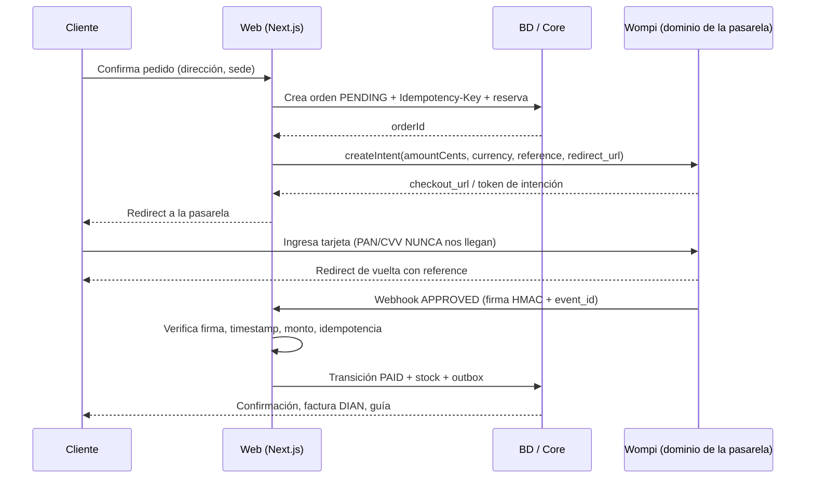

# Pagos y PCI DSS — Adriana_tienda

| Campo | Valor |
|---|---|
| Propietario | `forge-sentinel` |
| Pasarela primaria | Wompi (Bancolombia) — checkout-hosted / redirect |
| Plan B | ePayco (mismo patrón de integración) |
| Objetivo de alcance | **SAQ-A** (comercio sin contacto con datos de tarjeta) |
| Métodos | Tarjeta, PSE, Nequi, Daviplata, Botón Bancolombia, efectivo en corresponsales, contraentrega, BNPL nativo |
| Referencias | PCI DSS v4.0 SAQ-A, OWASP ASVS, `requisitos-seguridad.md` SEC-025/026/027 |
| Decisiones aplicadas | C-02 (BIGINT centavos, IVA 1900 bp) y C-05 (checkout 20 req/min) — `docs/02-arquitectura/decisiones-comandante.md` |

> **BLOQUEANTE:** Cualquier cambio que haga que PAN, CVV o datos de banda pasen por nuestro servidor, logs o base de datos cambia el alcance a SAQ-D y **detiene el lanzamiento** hasta nueva evaluación.

---

## 1. Estrategia de minimización del alcance

La regla de oro: **nuestro servidor nunca ve, procesa ni almacena datos sensibles de autenticación de tarjeta**. El cliente introduce los datos en el dominio de la pasarela (redirect completo o checkout-hosted). Nosotros solo recibimos un `payment_intent`/referencia y el resultado por webhook firmado.

### 1.1 Comparación de alcance

| Modalidad | Datos que toca nuestro servidor | Alcance | Decisión |
|---|---|---|---|
| **Redirect / checkout-hosted** | Solo referencia, `amountCents`, estado y últimos 4 | **SAQ-A** | ✅ Elegido para el MVP |
| Widget embebido en iframe de la pasarela | El iframe es de la pasarela; no tocamos PAN, pero hay scripts en nuestra página | SAQ-A-EP (según proveedor) | ⚠️ Solo si se decide y se documenta con la pasarela |
| Formulario propio / API directa con PAN | PAN y CVV pasan por nuestro código | SAQ-D | ❌ Prohibido |

> **BLOQUEANTE:** El equipo de pago no debe implementar nunca un campo de tarjeta en nuestro frontend ni un endpoint que reciba PAN/CVV. Revisar el bundle en CI buscando patrones de `cardNumber`, `cvv`, `pan`.

---

## 2. Qué datos NUNCA se guardan

| Dato | Guardarlo | Alternativa permitida |
|---|---|---|
| PAN / número de tarjeta completo | ❌ **Nunca** | Últimos 4 dígitos (`cardLast4`) |
| CVV / CVC | ❌ **Nunca**, ni cifrado, ni en logs | Ninguno; la pasarela lo valida |
| Datos de banda magnética / chip | ❌ **Nunca** | Ninguno |
| PIN de tarjeta | ❌ **Nunca** | Ninguno |
| Token de tarjeta reutilizable sin consentimiento | ⚠️ Solo si la pasarela lo emite y el cliente autoriza "guardar tarjeta" | Referencia opaca del proveedor, nunca el PAN |
| Contraseñas de la pasarela | ❌ **Nunca** en repo/logs/frontend | Gestor de secretos (SEC-015) |

**Sí se pueden almacenar:** `provider_payment_id`, `authorizationCode`, `cardLast4`, `cardBrand`, moneda, `amountCents` (BIGINT), estado, fecha, resultado de 3-D Secure y `provider` (enum `WOMPI`/`EPAYCO`).

> **BLOQUEANTE:** Un log con `authorization` completo, un body de webhook sin redactar o un `console.log(req.body)` en el checkout son findings Critical.

---

## 3. Tokenización

- Si se habilita "guardar.tarjeta" en el futuro, el token lo emite **la pasarela** y se guarda solo una **referencia opaca** (`providerTokenId`) asociada al cliente, con consentimiento explícito y revocable.
- El token nunca se usa fuera del adaptador `packages/core/payments/providers/*`; el dominio conoce la referencia, no el instrumento.
- La interfaz `payment-provider.port.ts` (`createIntent`, `getStatus`, `refund`, `verifyWebhook`) aísla al proveedor. Cambiar de Wompi a ePayco es cambiar de adaptador, sin tocar checkout ni pedidos.
- Al borrar/anonymizar un cliente (Ley 1581), se solicita también la eliminación de tokens en la pasarela.

---

## 4. Verificación de firmas de webhook

Controles obligatorios en `POST /api/v1/webhooks/:provider`:

| Control | Implementación |
|---|---|
| **Body crudo** | Verificar HMAC sobre el **raw body** exacto recibido (antes de parsear JSON). Next.js Route Handler con `req.text()`. |
| **Algoritmo** | HMAC-SHA256 con `WOMPI_EVENTS_SECRET=<VALUE>` (y secreto distinto para ePayco). |
| **Comparación** | `crypto.timingSafeEqual` sobre buffers de igual longitud; comparación de strings con `===` **prohibida**. |
| **Anti-replay** | Cabecera de timestamp con tolerancia de **5 min**; eventos fuera de ventana se rechazan y registran. |
| **Idempotencia** | `unique(provider, event_id)`; duplicado → responder `200` sin efectos. |
| **Integridad de negocio** | Comparar `amountCents`, `moneda`, `reference`/`orderId` contra la orden en BD antes de aceptar. |
| **Transiciones válidas** | Aplicar solo si la máquina de estados lo permite (un `PAID` no vuelve a `PENDING`). Eventos viejos → `IGNORED` y registrados. |
| **Redacción** | No loguear headers completos ni `x-event-signature`; `webhook_events.headers` guarda solo campos no sensibles. |
| **Respuesta** | `401` si firma inválida; `200` rápido tras persistir el evento y encolar el procesamiento (el trabajo pesado va al worker). |

> **BLOQUEANTE:** Endpoint de webhook sin verificación de firma = Critical (R1 en `modelo-amenazas.md`). No se activa en producción.

---

## 5. Idempotencia y consistencia

| Escenario | Manejo |
|---|---|
| Doble clic en "Pagar" | Botón bloqueado + `Idempotency-Key` + orden ya pagada → se devuelve la misma respuesta |
| Webhook duplicado | `unique(provider,event_id)`; 200 sin reprocesar |
| Webhooks fuera de orden | Solo transiciones válidas; si no, `IGNORED` con registro |
| Webhook perdido | Job cada 10 min consulta `PENDING` > 5 min contra la API del proveedor |
| Cliente cierra la página al pagar | Orden sigue `PENDING_PAYMENT`; el webhook manda; expira a los 30 min con liberación de stock |
| Pago aprobado tras expirar | Se acepta el dinero → pedido en `PENDING_PAYMENT` con `reviewRequired=true`, se intenta re-reservar; si no hay stock → reembolso automático + cupón + alerta |
| Timeout entre web y pasarela | Siempre se consulta el estado real al proveedor antes de marcar `FAILED` |

`Idempotency-Key` es obligatorio en `POST /api/v1/checkout` (único crear-pedidos, C-06), `POST /payments` y `POST /refunds` (ver api en el Design Doc, Anexo A).

---

## 6. Prevención de fraude

| Señal | Control | Responsable |
|---|---|---|
| **Velocity** | Múltiples intentos de pago desde misma IP/cuenta en ventana corta → **20 req/min por sesión en checkout** (C-05) + revisión | Backend (SEC-011) |
| **IP / reputación** | Cloudflare bot management; bloqueo de proxies/VPN conocidos para checkout de alto monto; coherencia IP↔dirección de envío | Infra + Cloudflare |
| **Órdenes duplicadas** | Misma dirección + productos + monto en `<VALUE>` min → marcar `NEEDS_REVIEW` antes de despachar | Worker / reglas de dominio |
| **Cambio de dirección tardío** | Reautenticación + notificación al email; retrasar despacho si difiere de la facturación | Backend |
| **Tarjetas internacionales / 3DS** | 3-D Secure delegado en la pasarela; registrar resultado; rechazar si `3DS_FAILED` | Pasarela |
| **Contraentrega (COD)** | Monto máximo `<VALUE>` centavos (`codMaxAmountCents`, BIGINT), zonas permitidas, OTP de confirmación, blocklist de teléfonos/direcciones, scoring simple, confirmación por WhatsApp, límite por cliente/mes | Negocio + Backend |
| **BNPL** | Límites del proveedor; no almacenar datos del crédito; validar aprobación por webhook firmado | Pasarela |
| **Cupones** | Un uso por cliente/orden; validar en servidor; alerta si redención anómala | Backend |
| **Reembolsos** | Solo al método original; umbrales con MFA; auditoría; nunca reembolsar dos veces (SEC-026) | Admin + Superadmin |

> **Nota de privacidad:** cualquier fingerprinting de dispositivo o scoring que trate datos personales debe informarse en la política de privacidad y, si es no esencial, contar con consentimiento (ver `cumplimiento-colombia.md`).

---

## 7. Conciliación y reembolsos seguros

### 7.1 Conciliación
- Job diario (y cada 10 min para `PENDING`) compara órdenes pagadas en BD vs. transacciones de la pasarela.
- Toda discrepancia genera alerta a operación y registro en `audit_logs` con `actorType=INTEGRATION`.
- No se emite factura DIAN ni guía de transporte sin pago confirmado por webhook verificado o conciliación.
- **Representación monetaria (C-02):** todos los importes son **BIGINT en centavos** (`*_cents`, p. ej. `grandTotalCents` / `grand_total_cents`, `amountCents`). El IVA del 19 % se expresa como **`1900` basis points** (`taxRateBps = 1900`); está prohibido usar `1900` como `rate` decimal. Fórmula canónica: `baseCents = round_half_up(totalLineCents / 1.19)`, `ivaCents = totalLineCents - baseCents`; la suma por línea debe cuadrar con el total de la orden.
- Ejemplo (un solo ítem, sin descuentos):

| Campo | Valor |
|---|---|
| `totalLineCents` | `11900` |
| `taxRateBps` | `1900` (= 19 %) |
| `baseCents` | `10000` |
| `ivaCents` | `1900` |

- Los importes publicados de comisión de pasarela son **sin IVA**; no aplicar `× 1,19` a esa tabla (C-09).

### 7.2 Reembolsos
1. Solicitud desde el panel admin con permiso `orders.refund`; si `refundAmountCents` supera `<VALUE>` centavos (BIGINT), requiere Superadmin + MFA.
2. Validar: orden `PAID`, monto ≤ total pagado, método original, motivo, y que no exista un reembolso previo (idempotencia).
3. Llamar al adaptador `refund()` con `Idempotency-Key`; registrar `PaymentTransaction` y nota crédito DIAN.
4. Notificar al cliente por email; actualizar estado a `REFUNDED` o `PARTIALLY_REFUNDED`.
5. Auditoría inmutable con `before/after`.

> **BLOQUEANTE:** Un reembolso sin verificación de permiso, sin idempotencia o sin auditoría se bloquea en review.

---

## 8. Chargebacks (contracargos)

| Paso | Acción |
|---|---|
| 1. Recepción | Webhook/aviso de la pasarela → orden a `CHARGEBACK`; **congelar liquidación** y suspender despacho si aún no se envió |
| 2. Preservación | Guardar evidencia: snapshot de orden, dirección IP, consentimiento, email de confirmación, guía de transporte, firma de entrega, logs de auditoría y resultado 3DS |
| 3. Notificación | Avisar a operación y al cliente por el canal autorizado; no revelar datos del titular de la tarjeta |
| 4. Representment | Responder dentro del plazo de la pasarela con la evidencia; responsable designado (`<VALUE>`) |
| 5. Resolución | Si se pierde: registrar pérdida, **no** reembolsar además (evitar doble devolución), ajustar contabilidad y revisar reglas de fraude |
| 6. Lección aprendida | Actualizar `{plan-respuesta-incidentes.md}` y reglas de screening si aplica |

> **BLOQUEANTE:** Nunca se confirma una entrega ni se libera mercancía mientras exista un chargeback abierto sobre esa orden.

---

## 9. Checklist PCI / pagos por PR

| # | Control | Bloqueante |
|---|---|---|
| 1 | No hay campos de tarjeta en el frontend ni endpoints que reciban PAN/CVV | Sí |
| 2 | `cardLast4`, `brand` y `providerPaymentId` son los únicos datos de instrumento guardados | Sí |
| 3 | Webhook verifica HMAC, timestamp, `event_id`, monto y moneda | Sí |
| 4 | `Idempotency-Key` presente en órdenes, pagos y reembolsos | Sí |
| 5 | Logs y payloads de webhook redactados (sin firma, sin PAN, sin token) | Sí |
| 6 | Reembolsos con permiso por umbral, MFA, idempotencia y auditoría | Sí |
| 7 | Estado `PAID` nunca retrocede a `PENDING`; eventos viejos `IGNORED` | Sí |
| 8 | Secreto de webhook por entorno, rotado, en gestor (`<VALUE>`) | Sí |
| 9 | Conciliación automática activa y documentada | No (exigido en 30 días) |
| 10 | Evidencia de chargeback reconstruible para una orden de prueba | No (exigido en 30 días) |

---

## 10. Referencias

- PCI DSS v4.0 — SAQ A (Redirect/Checkout Hosted).
- OWASP ASVS 4.0 L2 — 5.1, 10.3, 12.5.
- Documentación interna: `requisitos-seguridad.md` (SEC-015, SEC-025, SEC-026, SEC-027), `modelo-amenazas.md` (R1, R4), `plan-respuesta-incidentes.md`.
