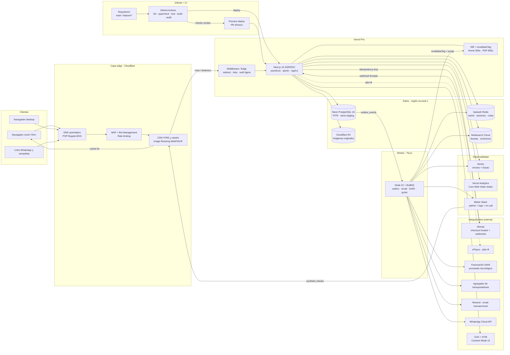
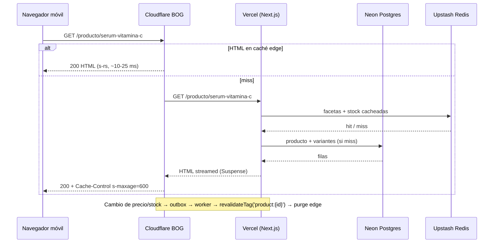

# Arquitectura de despliegue — Adriana Tienda

| Campo | Valor |
|---|---|
| **Autor** | `forge-infra` (Plataforma e Infraestructura, APEX FORGE) |
| **Estado** | Propuesta alineada al diseño canónico [design-doc.md §4.1](../02-arquitectura/design-doc.md#41-arquitectura-general) (absorbe el raíz `DESIGN_DOC.md` v1.0, C-12) y a [analisis-hosting.md](analisis-hosting.md) |
| **Fecha** | 23 de noviembre de 2026 |
| **Hosting elegido** | Vercel (web) + Neon `aws-sa-east-1` (DB) + Cloudflare (edge) |
| **Nota** | Documento de diseño. Los bloques de código son **ejemplos**, no archivos de configuración ejecutables. |

---

## 1. Principios de la topología

1. **Edge primero, origen protegido.** Cloudflare termina TLS en el POP más cercano al
   usuario (Bogotá, `BOG`), aplica WAF y sirve caché; Vercel solo recibe lo que no se puede
   cachear.
2. **Datos cerca del usuario.** PostgreSQL en `aws-sa-east-1` (São Paulo), la región
   administrada más cercana con PITR disponible (~40–90 ms estimados desde Colombia,
   validar con RUM).
3. **Dos procesos, un repositorio.** `apps/web` (Next.js 15) y `apps/worker` (BullMQ) con
   `packages/core` compartido; sin microservicios en MVP.
4. **Todo como código.** DNS, variables, pipelines, reglas de caché y runbooks viven en el
   repositorio. Cero cambios manuales irreproducibles en consola.
5. **Cada deploy es reversible.** Alias de Vercel + feature flags + migraciones
   expand/contract. Nunca un deploy sin rollback probado.

---

## 2. Diagrama de despliegue

### 2.1 Responsabilidades por componente

| Componente | Responsabilidad | Detalle operativo |
|---|---|---|
| Cloudflare DNS/WAF | Punto de entrada, TLS, WAF, bot management | DNS autoritativo; proxy activo ("nube naranja") en `www`, `api`, `admin` |
| Cloudflare CDN | Caché de HTML/estáticos e imágenes | Reglas §6; `Cache-Control` respetado en contenido dinámico |
| Vercel Edge/Middleware | Redirects, cabeceras de seguridad, detección de bots | Sin lógica de negocio transaccional |
| `apps/web` | RSC, ISR/PPR, Server Actions, webhooks, admin | Node runtime en rutas con Prisma; `/api/v1` versionado |
| Neon PostgreSQL | Fuente de verdad (pedidos, stock, pagos, clientes) | Rama `main` para producción, rama `staging` para pruebas, PITR |
| Upstash Redis | Caché de facetas, sesiones de carrito, idempotencia, colas | Claves versionadas `v:{n}:...` |
| Meilisearch | Búsqueda con tolerancia a errores y sinónimos en español | Reindexado desde outbox; fallback a Postgres FTS |
| Cloudflare R2 | Originales de imagen y derivados AVIF/WebP | Dominio público propio; sin egress medido |
| `apps/worker` | Consumo de outbox, reintentos, DLQ, integraciones | `jobId = outbox.id` para idempotencia; imagen etiquetada por versión |
| Wompi/ePayco | Checkout hospedado (SAQ-A) y webhooks firmados | Nunca tocamos PAN; verificación de firma en el webhook |
| Sentry / Analytics / Better Stack | Errores, CWV reales, uptime, logs y alertas | `requestId` correlaciona las tres señales |

### 2.2 Flujo de lectura con caché

---

## 3. Ambientes

| Entorno | Propósito | Origen / rama | URL | Datos | Quién despliega | Aprobación |
|---|---|---|---|---|---|---|
| **Local** | Desarrollo diario | `feature/*` en la máquina | `http://localhost:3000` | Postgres/Redis/Meili en Docker Compose; fixtures sintéticos | Ingeniero | Ninguna |
| **CI (efímero)** | Ejecutar gates sobre el cambio | Cada push/PR | N/A (Testcontainers) | BD desechable con schema migrado | GitHub Actions | Automática |
| **Preview** | Revisión visual y QA del PR | Cada PR abierto | `pr-<n>.vercel.app` | Copia anonimizada de staging (o semilla) | GitHub Actions | Protección: solo equipo |
| **Staging** | UAT, integraciones y prueba de carga | `main` (promoción automática) | `staging.<DOMINIO>` | Rama Neon `staging`, datos anonimizados; webhooks en sandbox | GitHub Actions | CI verde + LGTM |
| **Producción** | Clientes reales | Tag `v*` desde `main` | `www.<DOMINIO>` | Neon `main`, datos reales; Wompi/DIAN en modo producción | GitHub Actions | `forge-qualis` + `forge-infra` |

**Reglas de ambientes:**

- Un mismo commit se promociona de preview → staging → producción (sin recompilar).
- Los secretos de producción **nunca** están disponibles en preview ni en staging; se usan
  credenciales de sandbox y datos sintéticos/anonimizados.
- La base de staging se refresca desde producción con anonimización controlada, nunca con
  datos reales de clientes sin mask (Ley 1581).
- Los deployments de preview tienen protección de Vercel (SSO o contraseña) para evitar
  indexación y fuga de URLs.

---

## 4. Estrategia de ramas y promoción

Modelo **trunk-based**, coherente con la constitución APEX (cambios pequeños a trunk, CI
siempre en verde):

```mermaid
flowchart LR
  DEV["local<br/>feature/* &lt;= 2 días"] -->|"push + PR"| CI["CI efímero<br/>tests + build + audit"]
  CI -->|"PR abierto"| PREV["preview<br/>pr-N.vercel.app"]
  PREV -->|"LGTM forge-reviewer<br/>+ CI verde"| MAIN["main protegida<br/>squash merge"]
  MAIN -->|"auto"| STG["staging<br/>staging.&lt;DOMINIO&gt;"]
  STG -->|"gate forge-qualis"| CAN["canary 5% → 25%<br/>flag-driven"]
  CAN -->|"métricas OK"| PROD["producción<br/>www.&lt;DOMINIO&gt;"]
  PROD -.->|"rollback &lt; 2 min"| OLD["deployment anterior"]
```

| Elemento | Regla |
|---|---|
| `main` | Protegida: requiere 1 LGTM de `forge-reviewer`, checks verdes, y OWNERS cuando toca pagos/datos |
| `feature/*` | Vida máxima ~2 días; < 400 líneas por PR recomendado; Conventional Commits |
| `hotfix/*` | Desde `main`, con flags de mitigación primero y deploy prioritario |
| Tags | `vYYYY.MMDD.N` (p. ej. `v2026.1123.1`); el tag es la versión inmutable desplegada |
| Imágenes del worker | Etiquetadas con el SHA del commit y el tag de versión; **sin `latest` en producción** |
| Releases | Pequeños y frecuentes; se prohíbe el "release gigante" de fin de sprint |

> Los cambios triviales (typo, color) siguen la vía abreviada: PR + review; no requieren
> Design Doc nuevo, pero sí pasan por CI.

---

## 5. Dominios, DNS y TLS

> `<DOMINIO>` es el nombre definitivo pendiente de confirmación con el cliente. Todas las
> entradas siguientes se gestionan como código (p. ej. Terraform Cloudflare o archivo de
> reglas revisionado), nunca a mano en la consola.

| Nombre | Tipo | Destino | Proxy Cloudflare | Uso |
|---|---|---|---|---|
| `<DOMINIO>` (apex) | A / CNAME flatten | Vercel (`76.76.21.21` o CNAME canónico vigente) | Sí | Redirección 301 a `www` |
| `www.<DOMINIO>` | CNAME | `cname.vercel-dns.com` | Sí | Storefront (producción) |
| `admin.<DOMINIO>` | CNAME | Mismo proyecto Vercel → rewrite `/admin` | Sí | Panel administrativo (MFA obligatorio) |
| `api.<DOMINIO>` | CNAME | Mismo proyecto Vercel → rewrite `/api/v1` | Sí | API pública/versionada futura |
| `staging.<DOMINIO>` | CNAME | Alias del deployment de staging | Sí | UAT, no indexable (`X-Robots-Tag: noindex`) |
| `assets.<DOMINIO>` | CNAME | Dominio custom de R2 | Sí | Imágenes originales y derivados |
| `status.<DOMINIO>` | CNAME | Better Stack status page | No | Estado público del servicio |
| `_dmarc`, SPF, DKIM | TXT | Valores de Resend | No | Entregabilidad de emails transaccionales |

**TLS y seguridad de transporte:**

- Certificados gestionados por Vercel para `www`, `admin`, `api`, `staging` (wildcard
  `*. <DOMINIO>` si el proveedor lo permite); Cloudflare en modo **Full (strict)** con
  origin certificate.
- Redirección HTTP → HTTPS en Cloudflare; HSTS `max-age=31536000; includeSubDomains`
  (activar `preload` solo tras validar todos los subdominios).
- TLS 1.2+; desactivar TLS 1.0/1.1 y cifrados débiles; cabeceras CSP, `X-Content-Type-Options`,
  `Referrer-Policy` y `Permissions-Policy` en middleware.
- Registros CAA limitados a las CA autorizadas; renovación automática monitorizada por
  check sintético de expiración (alerta a 30 días).
- TTL de DNS: 300 s durante el lanzamiento (facilita cambios), 3600 s tras estabilizar.

**Consideración de rendimiento:** Cloudflare con proxy activo permite servir HTML cacheado
desde BOG; la conexión Cloudflare→Vercel se mantiene con keep-alive. Verificar en producción
que las reglas de caché no almacenen respuestas de `admin`, `checkout` ni webhooks.

---

## 6. Reglas de CDN y caché

| Ruta / patrón | Estrategia | TTL / cabecera orientativa | Invalidación |
|---|---|---|---|
| `/` (Home) | ISR + edge caché | `s-maxage=300, stale-while-revalidate=86400` | `revalidateTag('home')` por evento de outbox |
| `/c/*` (PLP) | ISR con filtros en segmentos de URL | `s-maxage=300` | `revalidateTag('plp:{categoryId}')` |
| `/p/*` (PDP) | ISR + stock próximo a tiempo real | `s-maxage=600` | `revalidateTag('product:{id}')` al cambiar precio/stock |
| `/blog/*`, legales | ISR | `s-maxage=3600` | Publicación en CMS |
| `/api/v1/search/suggest` | Caché de edge corta | `s-maxage=30` | Expiración natural |
| `/carrito`, `/checkout`, `/cuenta/*` | Dinámico, **sin caché** | `Cache-Control: private, no-store` | N/A |
| `/admin/*` | Dinámico + auth | `private, no-store` + `X-Robots-Tag: noindex` | N/A |
| `/api/v1/orders`, `/api/v1/webhooks/*` | Dinámico, **sin caché** | `no-store` | N/A |
| `/_next/static/*` | Inmutable | `public, max-age=31536000, immutable` | Cambia el hash del archivo |
| Imágenes `assets.<DOMINIO>/*` | Inmutable + transformación | `public, max-age=31536000, immutable` | Nueva versión con hash en la URL |
| `/robots.txt`, `/sitemap.xml` | Caché corta | `s-maxage=3600` | Regeneración en build |

**Pipeline de imágenes (CLS/LCP):**

1. Original en R2 (JPEG/PNG del cliente); derivados AVIF y WebP generados por Cloudflare
   Image Resizing o en el worker.
2. `next/image` con `sizes` correcto y anchos 320/640/960/1280; `quality≈75`.
3. `priority` **solo** en la imagen LCP de Home y PDP; el resto `loading="lazy"`.
4. `width`/`height` explícitos en todas las imágenes → CLS objetivo 0.
5. Presupuesto en CI: Lighthouse CI con LCP p75 < 2,5 s, INP < 200 ms, CLS < 0,1.
6. Sin librerías de animación; `prefers-reduced-motion` respetado (CSS-first).

**Invalidación distribuida:** evento de dominio → `outbox_events` → worker →
`revalidateTag(...)` en Vercel + purga selectiva en Cloudflare por tag/prefix. Nunca
invalidación manual desde el admin sin evento (regla del §6.3 del Design Doc).

---

## 7. Variables de entorno y secretos (sin valores reales)

| Variable | Ámbito | Descripción |
|---|---|---|
| `DATABASE_URL` / `DATABASE_URL_STAGING` | Servidor (Vercel + CI) | Cadena de Neon por ambiente; pooling habilitado |
| `REDIS_URL` | Servidor | Upstash REST/TCP según cliente |
| `MEILI_HOST` / `MEILI_ADMIN_KEY` | Servidor | Host y clave de administración del índice |
| `R2_ACCOUNT_ID` / `R2_BUCKET` / `R2_ACCESS_KEY` | Servidor + worker | Credenciales con permisos mínimos por bucket |
| `WOMPI_PUBLIC_KEY` / `WOMPI_SECRET_KEY` / `WOMPI_EVENTS_SECRET` | Servidor | Checkout y verificación de firma de webhooks |
| `EPAYCO_*` | Servidor | Plan B, activable por flag |
| `DIAN_PROVIDER_KEY` | Servidor + worker | Proveedor tecnológico de facturación |
| `RESEND_API_KEY` / `WA_TOKEN` | Worker | Email y WhatsApp |
| `SENTRY_DSN` / `BETTER_STACK_TOKEN` | Todos | Observabilidad (DSN no es secreto, token sí) |
| `NEXT_PUBLIC_SITE_URL` / `NEXT_PUBLIC_GA_ID` | Público | Solo valores no sensibles |

**Política:** secretos en GitHub Environments (`staging`, `production`) y en Vercel por
ambiente; rotación trimestral y tras cualquier incidente; `.env` en `.gitignore`;
auditoría `git ls-files | grep -E '\.env|pem|key$'` en el pipeline; los logs nunca imprimen
cabeceras de autorización, PAN ni tokens (ver `monitoreo-y-alertas.md`).

---

## 8. Protección perimetral

| Capa | Medida | Parámetro orientativo |
|---|---|---|
| WAF Cloudflare | Managed rules OWASP + reglas custom | Bloquear SQLi/XSS; bot fight mode en PLP/PDP |
| Rate limiting | `/api/v1/search/suggest` | 60 req/min/IP |
| Rate limiting | `/api/v1/checkout` (y alias POS) | **20 req/min por sesión** + `Idempotency-Key` (C-05, visto bueno de `forge-sentinel`) |
| Login/admin | MFA obligatorio + duración de sesión corta | Reautenticar para acciones sensibles |
| Origen | Solo aceptar tráfico desde Cloudflare + Vercel internal | Cabecera de verificación de origen |
| Preview | Protección de deployment | Acceso solo al equipo; `noindex` |
| Webhooks | Verificación de firma + `unique(provider,event_id)` | Rechazar eventos con firma inválida |

---

## 9. Puntos a confirmar antes de implementar

1. **Dominio definitivo** y titularidad de Cloudflare/Vercel/Neon (bloqueante para DNS y
   facturación).
2. **Canary:** ¿feature flags propios/servicio externo o weighted routing de Cloudflare
   entre alias `stable`/`canary`? Ver `plan-despliegue.md` §5.
3. ~~Región y retención de DB~~ **Resuelto (C-09):** Neon Launch (`sa-east-1`) con PITR 7 días
   + dump frío diario con retención 30 días; PITR 30 días es mejora opcional. Ver
   [backups-y-recuperacion.md](backups-y-recuperacion.md).
4. ~~TRM y moneda de facturación~~ **Resuelto (C-09):** TRM única de planeación COP 4.000/USD
   (estimación; se actualiza con la TRM vigente el día de firma); los proveedores facturan en
   USD. Ver [presupuesto.md §1](presupuesto.md#1-supuestos).
