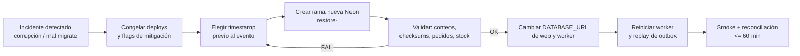

# Backups y recuperación ante desastres — Adriana Tienda

| Campo | Valor |
|---|---|
| **Autor** | `forge-infra` (Plataforma e Infraestructura, APEX FORGE) |
| **Estado** | Propuesta; complementa `plan-despliegue.md` §7 |
| **Fecha** | 23 de noviembre de 2026 |
| **Referencias** | Diseño canónico: [design-doc.md §8 Rollout y rollback](../02-arquitectura/design-doc.md#8-rollout-y-rollback) y [design-doc.md §4.4 Estrategia de datos](../02-arquitectura/design-doc.md) (absorbe al raíz `DESIGN_DOC.md` v1.0, C-12); [estrategia-datos.md §1 y §5](../04-datos/estrategia-datos.md#1-migraciones-versionadas); [decisión C-09](../02-arquitectura/decisiones-comandante.md#c-09--costes-trm-y-pitr-resuelve-q11q12-m2) |
| **Nota** | Documento de diseño; no contiene credenciales ni código de producción. |

---

## 1. Principios

1. **Un backup que no se ha restaurado no existe.** Toda política se valida con una
   restauración real en un entorno aislado.
2. **3-2-1 adaptado:** 3 copias de los datos críticos, en 2 tecnologías distintas (PITR de
   Neon + `pg_dump` en R2), con 1 copia inmutable/fuera de la cuenta principal.
3. **Restaurar nunca sobrescribe producción directamente:** primero a una rama/bucket nuevo,
   se valida y luego se conmuta el alias de conexión.
4. **La recuperación se mide:** RPO y RTO objetivos por escenario, con responsable y reloj.
5. **Privacidad también en backups:** si un cliente ejerce supresión (Ley 1581), se registra
   la solicitud y se reaplica tras cualquier restauración.

---

## 2. Inventario y política de backups

| Activo | Mecanismo | Frecuencia | Retención | RPO objetivo | RTO objetivo | Responsable |
|---|---|---|---|---:|---:|---|
| **PostgreSQL (Neon `main`)** | PITR continuo (WAL) en la región `aws-sa-east-1` | Continuo | **7 días (MVP, C-09)** | **≤ 5 min** | **≤ 60 min** | `forge-infra` |
| PostgreSQL — **dump frío diario** | `pg_dump` cifrado a R2 (`backups/db/`) | Diario 03:00 CO | **30 días (MVP, C-09)** | ≤ 24 h | ≤ 2 h | `forge-infra` |
| PostgreSQL — dump semanal | Copia a bucket secundario con Object Lock | Domingos 04:00 CO | 90 días | ≤ 7 días | ≤ 4 h | `forge-infra` |
| PostgreSQL — dump mensual | Copia fría inmutable | Día 1 de cada mes | 12 meses | ≤ 30 días | ≤ 8 h | `forge-infra` |
| Redis (Upstash) | **No se respalda:** caché, sesiones y colas son reconstruibles desde outbox y DB | N/A | N/A | N/A | ≤ 15 min (recrear) | Backend |
| Meilisearch | Reconstrucción desde Postgres + snapshot opcional del índice | Diario (opcional) | 7 días | ≤ 24 h | ≤ 30 min | Backend |
| Imágenes (R2) | Versionado de objetos + Object Lock + copia a segunda cuenta/bucket | Continuo / semanal | 30 días versiones; 90 días copia fría | ≈ 0 | ≤ 30 min | `forge-infra` |
| Código y migraciones | GitHub + tags `v*` inmutables + caché de artefactos | Cada merge | Permanente | 0 | ≤ 5 min | `forge-infra` |
| Configuración e IaC | Repositorio (`docs/07-infra`, reglas, workflows) + gestor de secretos | Cada cambio | Permanente | 0 | ≤ 15 min | `forge-infra` |
| Logs y métricas | Better Stack / Sentry / Vercel | Continuo | 30 días (auditoría 12 meses) | N/A | N/A | `forge-infra` |

> **Decisión C-09 (MVP): PITR de 7 días + dump frío diario con retención de 30 días.** Los
> dumps semanal (90 días) y mensual (12 meses) se mantienen como capas frías adicionales.
> La ampliación a **PITR de 30 días** (contratar Neon Scale u otra solución; USD 50–100/mes,
> COP 200.000–400.000) queda como **mejora aprobable por el cliente, NO como requisito
> bloqueante** para el go-live y **no está incluida** en el presupuesto base. Ver
> [presupuesto.md §4](presupuesto.md#4-coste-mensual-por-servicio--meses-412-crecimiento).

---

## 3. PITR: procedimiento de restauración

**Pasos detallados:**

1. **Identificar el punto de restauración.** Usar el timestamp del deploy o del job que
   introdujo el problema, con 2–3 minutos de margen anterior.
2. **Crear una rama nueva** en Neon desde ese punto (`restore-<ISO8601>`). **Nunca** restaurar
   sobre la rama `main`.
3. **Validar antes de conmutar:**
   - Conteo de filas de `orders`, `payments`, `inventory`, `webhook_events` frente al último
     reporte sano.
   - `CHECK` de integridad: `reserved <= on_hand`, sin pedidos pagados sin `payment_id`.
   - Muestra de 10 pedidos recientes con su factura DIAN y su guía.
   - Consultas críticas con `EXPLAIN` para descartar degradación.
4. **Conmutar** la variable `DATABASE_URL` de Vercel y del worker (GitHub Environment +
   Vercel por ambiente) y reiniciar el worker.
5. **Replay controlado** del outbox y de los webhooks posteriores al punto de restauración;
   la idempotencia (`unique(provider, event_id)`, `jobId = outbox.id`) evita duplicados.
6. **Reconciliar** con Wompi y el proveedor DIAN: pagos aprobados, reembolsos y facturas.
7. **Documentar** el incidente, el timestamp elegido y la evidencia de validación.

---

## 4. Pruebas de restauración

| Prueba | Frecuencia | Alcance | Criterio de aceptación | Evidencia |
|---|---|---|---|---|
| Restore PITR a rama aislada | Mensual | Punto arbitrario de los últimos 7 días (ventana MVP, C-09) | DB abre; conteos y checks correctos; ≤ 60 min | Captura de validación + ticket |
| Restore de dump diario a entorno efímero | Mensual | `pg_dump` de R2 | Schema + datos consistentes; migraciones aplicadas | Log con checksum |
| Restore de imágenes desde Object Lock | Trimestral | 10 objetos aleatorios | Hash idéntico al original; URLs sirven WebP/AVIF | Log de comparación |
| Rebuild de índice Meilisearch | Trimestral | Reindexado completo desde Postgres | 100% de SKUs; facetas y sinónimos correctos; ≤ 30 min | Reporte de conteo |
| Simulacro de DR completo (Teoría del caos) | Trimestral | Pasarela caída + sede caída + restore | RTO/RTO cumplidos; comunicación en 15 min | Act de simulacro firmado por `forge-qualis` |
| Auditoría de secretos y accesos | Trimestral | Quién puede restaurar/borrar backups | 0 accesos compartidos; MFA obligatorio | Reporte de `forge-sentinel` |

**Regla de go-live:** el simulacro de restauración debe haberse ejecutado **al menos una vez
antes del lanzamiento**; un PITR configurado pero nunca probado no cuenta como mitigación.

---

## 5. Objetivos RPO/RTO por escenario

| Escenario | RPO | RTO | Prioridad |
|---|---:|---:|---|
| Deploy defectuoso (código) | 0 | < 5 min | Crítica |
| Corrupción lógica de datos / mal migrate | ≤ 5 min | < 60 min | Crítica |
| Borrado accidental desde admin | ≤ 5 min | < 60 min | Alta |
| Caída de Neon o región `sa-east-1` | ≤ 5 min (último PITR) | 2–4 h (restore en otra región) | Alta |
| Caída de la pasarela de pagos | 0 | < 10 min (conmutación) | Crítica |
| Caída de R2/Cloudflare | 0 | < 30 min (fallback de imágenes) | Media |
| Caída de email/WhatsApp | 0 (outbox conserva eventos) | < 1 h (reintento o canal alterno) | Media |
| Pérdida operativa de una sede física | 0 (DB sigue en línea) | < 30 min (reconfiguración) | Alta |

---

## 6. Planes ante desastres

### 6.1 Corrupción de datos o migración destructiva

1. Kill flags y rollback de código (ver `plan-despliegue.md` §7).
2. PITR a rama nueva y validación (§3 de este documento).
3. Conmutación de `DATABASE_URL`, replay de outbox y reconciliación.
4. Postmortem en ≤72 h; prohibido reintentar la misma migración sin expand/contract.

### 6.2 Caída de Neon / región `sa-east-1`

**No asumir failover automático multi-región en el plan Launch.** Procedimiento:

1. Confirmar el alcance con el check sintético de DB y el estado del proveedor.
2. Poner el storefront en modo **catálogo de solo lectura** sirviendo HTML cacheado (Cloudflare)
   y desactivar checkout con `checkout_enabled=false`; comunicar en status page.
3. Restaurar el dump/PITR más reciente en una instancia de otra región (p. ej. `us-east-1`)
   con `DATABASE_URL` alternativa preparada como variable de entorno (sin valores en el repo).
4. Validar, conmutar, reanudar checkout de forma gradual y conciliar pagos ocurridos durante
   la ventana.
5. **Mejora Fase 2:** standby lógico/replica en segunda región para bajar el RTO a < 60 min;
   decisión de coste pendiente con el Comandante.

### 6.3 Caída de la pasarela de pagos (Wompi)

1. Alerta por tasa de aprobación anómala o fallo de webhooks; verificar estado del proveedor.
2. `wompi_enabled=false` → `epayco_enabled=true` (adaptador plan B ya integrado).
3. Si el plan B tampoco responde: desactivar pagos electrónicos y ofrecer **contraentrega**
   con reglas de riesgo vigentes; nunca pedir datos de tarjeta por otro canal.
4. Los pedidos PENDING_PAYMENT expiran por TTL de reserva (30 min) y se liberan automáticamente.
5. Al restablecer: conciliar transacciones, responder/reprocesar webhooks pendientes y
   notificar a los clientes afectados con plantilla aprobada.

### 6.4 Pérdida operativa de una sede física (2 tiendas)

1. Confirmar con operaciones cuál sucursal queda fuera (cierre, daño, fallo de inventario).
2. En admin: marcar la bodega/tienda como inactiva y **congelar su stock** para evitar
   sobreventa; no borrar filas (histórico de pedidos).
3. Desactivar `recogida en tienda` para esa sede en el checkout por flag/configuración;
   redirigir a la otra sede o a envío a domicilio con fecha estimada recalculada.
4. Reasignar pedidos pendientes de recogida: WhatsApp/email al cliente con nueva sede o envío;
   registrar la decisión en la auditoría del pedido.
5. Conciliar inventario físico al reapertura con conteo manual antes de reactivar la bodega.

### 6.5 Caída de R2 / transformación de imágenes

1. Cloudflare sirve la caché existente; si falla la transformación, usar derivados WebP
   pregenerados o la original con `sizes` reducido.
2. Si R2 está indisponible, `next/image` apunta al bucket secundario (misma ruta lógica).
3. No se detiene el checkout: las imágenes son degradación visual, no transaccional.

### 6.6 Caída de email o WhatsApp

1. El worker conserva eventos en outbox con reintentos y backoff; no se pierde la notificación.
2. Si el proveedor no recupera en 1 h, enviar por el canal alterno (email ↔ WhatsApp) y
   registrar el cambio de canal en el pedido.
3. Verificar plantillas y límites de Meta tras el incidente.

---

## 7. Gobierno y cumplimiento

| Tema | Regla |
|---|---|
| Acceso a backups | Solo `forge-infra` + Comandante; MFA; roles temporales; **sin credenciales compartidas** |
| Cifrado | En tránsito (TLS) y en reposo (AES-256 del proveedor); claves gestionadas, nunca en el repo |
| Inmutabilidad | Object Lock en copias semanales/mensuales; nadie puede borrarlas desde la consola sin aprobación |
| Monitorización de backups | Alerta si el job diario no reporta éxito antes de las 05:00 CO |
| Supresión de datos (Ley 1581) | Registro de solicitudes; al restaurar, se reaplica la supresión antes de reactivar el servicio |
| Facturación DIAN | Los XML/CUFE se conservan según requisito fiscal; se incluyen en el plan de backup lógico |
| Evidencia | Cada prueba deja timestamp, responsable, resultado y enlace al log; se revisa en el comité mensual |

---

## 8. Registro de pruebas (plantilla)

| Fecha | Tipo de prueba | Responsable | Resultado | Hallazgo | Acción correctiva |
|---|---|---|---|---|---|
| `<FECHA>` | Restore PITR a rama aislada | `<NOMBRE>` | OK / FAIL | `<HALLAZGO>` | `<ACCION>` |
| `<FECHA>` | Restore dump diario | `<NOMBRE>` | OK / FAIL | `<HALLAZGO>` | `<ACCION>` |
| `<FECHA>` | Simulacro de pasarela caída | `<NOMBRE>` | OK / FAIL | `<HALLAZGO>` | `<ACCION>` |
| `<FECHA>` | Simulacro de sede caída | `<NOMBRE>` | OK / FAIL | `<HALLAZGO>` | `<ACCION>` |

> **Entregable para el Go/No-Go:** al menos una fila real de restore PITR y una de
> simulacro de pasarela, con resultado OK, antes de abrir el checkout al público.
