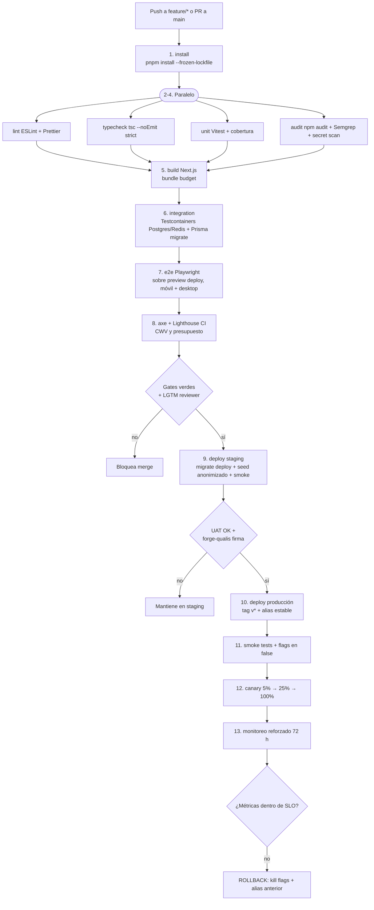

# Plan de despliegue (CI/CD) — Adriana Tienda

| Campo | Valor |
|---|---|
| **Autor** | `forge-infra` (Plataforma e Infraestructura, APEX FORGE) |
| **Estado** | Propuesta para aprobación del Comandante |
| **Fecha** | 23 de noviembre de 2026 |
| **Dependencias** | `forge-qualis` define compuertas de calidad; `forge-reviewer` da el LGTM; `forge-sentinel` aprueba cambios sensibles |
| **Nota** | Documento de diseño: los ejemplos YAML/comandos van en bloques de código con marcadores `<VALUE>`; **no son archivos reales del repositorio**. |

---

## 1. Objetivos y reglas del pipeline

1. **CI siempre en verde:** el build roto bloquea el merge. No existe "lo arreglo después".
2. **Un commit, un artefacto:** el mismo commit se promociona a staging y producción sin
   recompilar.
3. **Fail-fast y paralelo:** install → (lint, typecheck, unit, security) en paralelo → build →
   integration → e2e → deploy.
4. **Ningún deploy sin rollback:** cada release tiene un deployment anterior identifiable y
   un flag de mitigación.
5. **Secretos solo en variables de entorno/CI:** ningún valor real en el repo ni en logs.
6. **Migrations expand/contract:** el código anterior debe seguir funcionando tras una
   migración aditiva.

---

## 2. Vista general del pipeline



---

## 3. Etapas del pipeline

| # | Etapa | Acciones | Herramienta | Gate de salida | Tiempo objetivo |
|---:|---|---|---|---|---:|
| 1 | `install` | `pnpm install --frozen-lockfile`, caché de dependencias | GitHub Actions cache | Lockfile sin cambios | 1–2 min |
| 2 | `lint` | ESLint + Prettier en TODO el repo | ESLint 9 / Prettier 3 | 0 errores, 0 warnings nuevos | 1–2 min |
| 3 | `typecheck` | `tsc --noEmit` en todos los workspaces | TypeScript strict | 0 errores; sin `any` nuevo | 1–2 min |
| 4 | `unit` | Precio, IVA, cupones, máquina de estados, stock | Vitest | ≥70% global, ≥80% `packages/core`, 100% pagos | 2–3 min |
| 5 | `security` | `npm audit --audit-level=high`, Semgrep, detección de secretos, `git ls-files` audit, Trivy al image del worker | Semgrep / Trivy / audit | 0 críticos; 0 secretos | 2–3 min |
| 6 | `build` | Build de Next.js + análisis de bundle | Next.js 15 + bundle analyzer | PDP ≤170 KB gzip; sin regresión >10% | 2–4 min |
| 7 | `integration` | Repositorios, transacciones, idempotencia, reservas concurrentes | Vitest + Testcontainers | 100% flujos críticos | 3–5 min |
| 8 | `e2e` | 21 escenarios (compra, rechazo, PSE mock, contraentrega, cupón, refund, tracking y **E2E-21 pedido POS**) sobre preview | Playwright (móvil emulado + desktop) | **21/21 en verde**; E2E-21 es gate no omisible | 5–8 min |
| 9 | `a11y/perf` | axe-core en flujos críticos + Lighthouse CI | axe / Lighthouse | 0 violaciones críticas; LCP/INP/CLS dentro de presupuesto | 2–4 min |
| 10 | `deploy staging` | `prisma migrate deploy`, seed anonimizado, deploy, smoke | GitHub Actions + Vercel + Fly.io | Smoke 200 OK; webhook sandbox recibido | 3–5 min |
| 11 | `deploy producción` | Tag inmutable, migración aditiva, alias estable, flags en seguro | GitHub Environment `production` | Aprobación `forge-qualis`/`forge-infra` | 3–5 min |
| 12 | `canary` | 5% (24 h) → 25% (24 h) → 100% | Feature flags / edge routing | Error rate, LCP y checkout success dentro de SLO | 48 h |
| 13 | `post-deploy` | Monitoreo reforzado, reconciliación, cierre de release | Sentry / Better Stack / GA4 | Sin incidentes Sev-1/2 | 72 h |

> **Nota:** la etapa 5 (seguridad) se ejecuta en paralelo con lint/typecheck/unit para no
> alargar el critical path, pero **es bloqueante** antes de build/deploy.

### 3.1 Ejemplo de workflow (documentación, no archivo real)

```yaml
# Ejemplo ilustrativo — docs/07-infra/plan-despliegue.md
name: ci-cd
on:
  pull_request: { branches: [main] }
  push: { branches: [main], tags: ['v*'] }

concurrency:
  group: ${{ github.workflow }}-${{ github.ref }}
  cancel-in-progress: true

permissions:
  contents: read
  id-token: write   # OIDC hacia Vercel/Fly.io: sin tokens guardados en el repo

jobs:
  quality:
    runs-on: ubuntu-latest
    steps:
      - uses: actions/checkout@v4
      - uses: pnpm/action-setup@v4
      - run: pnpm install --frozen-lockfile
      - run: pnpm lint && pnpm typecheck
      - run: pnpm test:unit --coverage
      - run: pnpm audit --audit-level=high && pnpm semgrep
      - run: pnpm build
      - run: pnpm test:integration
      - run: pnpm test:e2e --project=chromium-mobile

  deploy_staging:
    needs: quality
    if: github.ref == 'refs/heads/main'
    environment: staging
    runs-on: ubuntu-latest
    steps:
      - run: echo "Desplegando <SHA> a staging con DATABASE_URL_STAGING"
      - run: echo "prisma migrate deploy (rama staging de Neon)"
      - run: echo "seed anonimizado + smoke tests"

  deploy_production:
    needs: deploy_staging
    if: startsWith(github.ref, 'refs/tags/v')
    environment: production   # aprobadores designados; exige checks verdes
    runs-on: ubuntu-latest
    steps:
      - run: echo "Tag <VERSION> inmutable -> Vercel + worker <SHA>"
      - run: echo "migración aditiva verificada en staging"
      - run: echo "flags checkout_enabled=false; canary 5%"
```

---

## 4. Compuertas de aprobación

| Compuerta | Responsable | Criterio | Cuándo |
|---|---|---|---|
| Checks automáticos | GitHub Actions | Todas las etapas 1–9 en verde | Cada PR |
| Code review | `forge-reviewer` | LGTM; nadie aprueba su propio cambio | Antes de merge a `main` |
| Revisión de seguridad | `forge-sentinel` | OK en pagos, auth, datos personales, DIAN | PRs sensibles (CODEOWNERS) |
| Calidad/release | `forge-qualis` | Estrategia de tests válida, SLOs y rollout aceptados | Antes de producción |
| Infra | `forge-infra` | CI verde, rollback probado, secretos y costes revisados | Antes de producción |
| Go/No-Go lanzamiento | `apex-forge` (Comandante) | Checklist de `checklist-lanzamiento.md` completo | Día D |

> La aprobación de GitHub Environment para producción es un **gate gobernado**, no un paso
> manual irreproducible: quién puede aprobar, qué checks exige y qué evidencia se adjunta
> están definidos en el repositorio. El objetivo es automatizarlo conforme madure el equipo.

---

## 5. Estrategia de release

### 5.1 Canary guiado por feature flags (mecanismo principal)

Independiente de las capacidades de Vercel en cada plan, permite apagar el cambio sin
redeploy y medir por cohorte.

| Paso | Cohorte | Duración | Métricas de salida | Acción si falla |
|---|---|---|---|---|
| 0 | Empleados / IP interna | 2–4 h | Flujo completo, factura DIAN, emails | Kill flag, fix |
| 1 | 5% de sesiones (hash de `userId`/cookie) | 24 h | 5xx < 0,1%, checkout success > 97%, LCP p75 < 2,5 s | Kill flag + rollback de alias |
| 2 | 25% de sesiones | 24 h | Iguales + latencia p95 API < 400 ms, webhook p95 < 60 s | Kill flag + rollback |
| 3 | 100% | — | Monitoreo reforzado 72 h | Rollback de alias |

**Regla de coherencia:** la cohorte se calcula una sola vez y se propaga a web, worker y
analytics para que las métricas sean comparables. Un mismo usuario no cambia de cohorte a
mitad del checkout.

### 5.2 Blue-green por alias (mecanismo de reversión)

Vercel mantiene cada deployment con URL inmutable. Producción apunta a un alias estable;
hacer rollback consiste en reasignar el alias al deployment anterior (`Instant Rollback`).
Es la vía para recuperarse en < 2 min cuando el problema es de código.

**Alternativa evaluada:** weighted routing en Cloudflare entre `stable.<DOMINIO>` y
`canary.<DOMINIO>` para canary por porcentaje de tráfico a nivel edge. Da más control, pero
añade dos targets que mantener y dos conjuntos de secretos. Se adopta sólo si el Comandante
decide que los flags no cubren el caso (ver decisión pendiente).

### 5.3 Feature flags

| Flag | Propósito | Default en producción |
|---|---|---|
| `checkout_enabled` | Matar el checkout sin redeploy | `true` tras canary; `false` en incidente |
| `wompi_enabled` / `epayco_enabled` | Conmutar pasarela primaria/plan B | `true` / `false` |
| `bnpl_direct_enabled` | BNPL Addi/Sistecrédito (Fase 2) | `false` |
| `new_search_enabled` | Índice nuevo de Meilisearch con rollback a FTS | `true` tras canary |
| `maintenance_mode` | Pantalla de mantenimiento controlada | `false` |

**Restricciones:** los flags no sustituyen a las migraciones expand/contract; un flag nunca
debe exponer un esquema de BD que el código anterior no entienda. Los flags se registran con
versión, dueño y fecha de caducidad; los permanentes se eliminan en el siguiente sprint.

---

## 6. Migraciones de base de datos y seeds

### 6.1 Política

- **Expand / contract:** (1) añadir columna/tabla nullable, (2) desplegar código que la usa,
  (3) backfill en lotes, (4) en un release posterior, eliminar lo obsoleto. Nunca renombrar
  o dropear en el mismo release.
- `prisma migrate deploy` **en CI/CD**, jamás `prisma db push` en producción.
- Migración revisionada por `forge-reviewer`; se ejecuta primero en staging con datos
  anonimizados y se mide duración y bloqueo de tablas.
- Snapshot lógico/PITR verificado antes de migraciones grandes (índices, backfills,
  cambios de tipo).
- Las migraciones son **idempotentes en la práctica**: se registran en `_prisma_migrations`
  y el job falla si hay divergencia de checksum.
- Bloqueo de deploy si la migración exige `ACCESS EXCLUSIVE` en tablas de pedidos/inventario
  durante más de 5 s en staging.

### 6.2 Secuencia por release

```text
1. PR con prisma/migrations/<timestamp>_<name>/migration.sql
2. CI: migrate deploy sobre BD efímera (Testcontainers) + tests de integración
3. Merge a main → migrate deploy en rama Neon staging + seed anonimizado
4. Validación: conteo de filas, constraints, consultas críticas con EXPLAIN
5. Tag de producción → migrate deploy en Neon main (ventana de bajo tráfico si es grande)
6. Deploy del código (nunca antes de que la migración aditiva esté aplicada)
7. Verificación: smoke + monitor de errores 5xx durante 15 min
```

### 6.3 Seeds

| Ambiente | Seed | Regla |
|---|---|---|
| Local / CI | Datos sintéticos deterministas | Reproducible; incluye casos borde de impuestos y stock |
| Preview | Copia anonimizada de staging o seed sintético | Sin datos reales de clientes |
| Staging | Refresco anonimizado desde producción | Mask de nombres, emails, direcciones y documentos; `upsert` por IDs estables |
| Producción | **Solo carga inicial de catálogo** validada por CSV/import | Sin seed de usuarios ni pedidos; dry-run + conciliación de SKUs y stock |

---

## 7. Plan de rollback

### 7.1 Objetivos

| Escenario | RTO objetivo | RPO objetivo |
|---|---:|---:|
| Código defectuoso (frontend/API) | **< 5 min** | 0 (no se pierden datos) |
| Feature defectuosa aislable | **< 2 min** | 0 |
| Worker/jobs defectuosos | **< 10 min** | 0 (colas se replayan desde outbox) |
| Migración destructiva/corrupción de datos | **< 60 min** | ≤ 5 min (PITR) |
| Pasarela caída | **< 10 min** (conmutación a plan B) | 0 |

### 7.2 Procedimiento paso a paso

| # | Acción | Responsable | Tiempo objetivo |
|---:|---|---|---:|
| 1 | Detectar anomalía (alerta Sentry/Better Stack o reporte) | On-call | ≤ 2 min |
| 2 | Declarar incidente Sev-1/Sev-2 y abrir canal de incidente | On-call + `forge-qualis` | ≤ 3 min |
| 3 | Congelar deploys (bloquear environment `production`, revertir PRs pendientes) | `forge-infra` | ≤ 2 min |
| 4 | Activar kill switches (`checkout_enabled=false`, flag de la feature) | On-call | ≤ 2 min |
| 5 | Rollback de código: alias de Vercel al deployment anterior (tag `v...` previo) | `forge-infra` | ≤ 2 min |
| 6 | Smoke tests automáticos en producción (Home, PLP, PDP, carrito, webhook) | CI / on-call | ≤ 5 min |
| 7 | Decisión de BD: si la migración fue aditiva → **forward-fix**; si hubo corrupción → PITR a rama nueva | `forge-infra` + Backend | ≤ 10 min decidir |
| 8 | Si aplica: PITR a nueva rama Neon, validar, cambiar `DATABASE_URL`, reiniciar web/worker | `forge-infra` | ≤ 60 min |
| 9 | Worker: redeploy de la imagen con tag anterior, drenar/replay de colas y webhooks | `forge-infra` | ≤ 10 min |
| 10 | Purga de caché y `revalidateTag` masivo controlado | `forge-infra` | ≤ 5 min |
| 11 | Reconciliación: pedidos pagados sin factura, stock, webhooks duplicados, carritos | Backend + Negocio | ≤ 30 min |
| 12 | Comunicación: status page + WhatsApp/email a clientes afectados | Comandante | ≤ 15 min |
| 13 | Cierre y postmortem sin culpables con acciones asignadas | `forge-qualis` | ≤ 72 h |

**Tiempo total esperado:** código ≤ 5 min (pasos 1–6); datos ≤ 60 min (pasos 1–8).

### 7.3 Matriz de rollback por tipo de fallo

| Fallo | Primera acción | Rollback | Precaución |
|---|---|---|---|
| UI rota / 5xx tras deploy | Kill flag + alias anterior | < 5 min | No tocar BD si la migración fue aditiva |
| Migración incompatible | Forward-fix aditivo | < 15 min | Si es destructiva, PITR; nunca `db push` |
| Worker envía emails duplicados | Pausar worker, `jobId` idempotente, reanudar | < 10 min | Verificar outbox antes de replay |
| Webhook de Wompi falla | Verificar firma y esquema; replay desde `webhook_event` | < 10 min | Responder 200 a duplicados sin reprocesar |
| Pasarela caída | `wompi_enabled=false`, `epayco_enabled=true`; si no, modo contraentrega | < 10 min | No almacenar PAN; comunicar en checkout |
| Import de catálogo erróneo | Detener import, restaurar tablas desde backup/PITR, reimport validado | < 60 min | Conciliar SKUs y stock antes de reabrir PDP |
| Coste desbocado | Apagar previews, scale-to-zero Neon, límites de tasa | < 15 min | No desactivar WAF ni backups |

### 7.4 Ejemplo de comandos (ilustrativos)

```bash
# Revertir alias de Vercel al deployment anterior (sin tocar la BD)
vercel rollback <DEPLOYMENT_URL> --yes

# Pausar/reanudar worker en Fly.io
fly scale count 0 --app <APP_NAME>     # pausa
fly scale count 1 --app <APP_NAME>     # reanuda

# Restauración PITR a una rama nueva de Neon (validar antes de cambiar DATABASE_URL)
# neon branches create --project-id <PROJECT_ID> --name restore-<TS> --restore-point <ISO8601>
```

---

## 8. Verificación post-deploy

- [ ] Tag desplegado coincide con el commit aprobado.
- [ ] `prisma migrate status` sin divergencias.
- [ ] Flags en estado esperado para la cohorte.
- [ ] Smoke tests: Home, PLP, PDP, añadir al carrito, checkout con tarjeta de prueba,
      webhook recibido, email y WhatsApp entregados.
- [ ] Factura DIAN de prueba emitida y validada.
- [ ] Error rate 5xx < 0,1% en los primeros 15 min.
- [ ] Latencia p95 API < 400 ms; LCP p75 < 2,5 s en RUM.
- [ ] Sin secretos en logs; `requestId` correlaciona Sentry ↔ Better Stack.
- [ ] Rollback ejecutado en simulacro en los últimos 30 días.

---

## 9. Runbook rápido

| Necesidad | Acción |
|---|---|
| Publicar fix urgente | PR pequeño → CI verde → LGTM → tag → deploy → smoke |
| Apagar una feature | Kill flag (no redeploy) → verificar métrica → comunicar |
| Volver atrás | `vercel rollback <DEPLOYMENT_URL>` → smoke → reconciliar |
| Recuperar datos | PITR a rama nueva → validar → cambiar `DATABASE_URL` → reiniciar |
| Pasarela caída | Conmutar a ePayco por flag → avisar al Comandante |
| Dudas sobre el deploy | Ver `monitoreo-y-alertas.md` y `checklist-lanzamiento.md` |
